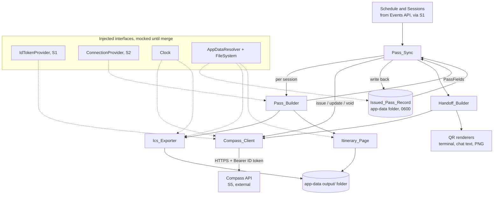

# Design Document

## Overview

This document designs stream S4, the local "pass side" of re:Invent Compass. S4 lives under `packages/core/src/passes/**` and turns a confirmed schedule into unofficial boarding passes, keeps those passes in sync as the schedule changes, hands them to a phone through a QR code, and produces a local calendar file and an offline itinerary page. Everything here runs on the attendee's own machine. The only data that leaves is the Builder ID ID token (as a bearer credential to the Compass API) and the printable pass fields.

S4 is a pure consumer of two things it does not own:

1. The shared types and schemas in `@compass/contracts` (S0): `PassFields` (through the `createPassFieldsSchema` factory and `normalisePassText` helper), `Problem`, `Commitment`, `ScheduleWire`, `SessionWire` and the generated `CompassApi` type namespace. S4 never redefines these shapes. Where a change is needed in a contract, it is raised as an S0 change request noted in `tasks.md`, not made here.
2. The Compass API, reached only through a typed client generated from `contracts/compass-api.openapi.yaml`, which validates every response with zod.

S4 receives two things from other streams only through injected interfaces, so it never depends on their unmerged code:

- The ID token, from the auth module (S1), through an `IdTokenProvider` interface.
- The walk and boarding data (walk minutes between venues), from the rules engine (S2), through a `ConnectionProvider` interface.

Both interfaces are mocked until S1 and S2 merge.

All names and attendee-facing copy follow the airline metaphor (`BoardingPass`, `Connection`, `Layover`, `Standby`, `rebook`, `voidPass`). No copy, comment, document, test name or commit message uses an em dash or an en dash.

### Scope boundaries

- Apple pass signing (`passkit-generator`) lives in the Compass API Lambdas (S5), not here. S4 only calls the Compass API; it never signs a pass.
- The local calendar file is built with `ical-generator`.
- The itinerary page is a self-contained offline HTML file: no script, no network, WCAG 2.2 AA.
- Token acquisition, keychain storage and refresh belong to S1. S4 holds the ID token only transiently in memory, received through the injected provider on each call, and never writes it anywhere.

### Requirements coverage map

| Requirement                    | Component that satisfies it                           |
| ------------------------------ | ----------------------------------------------------- |
| 1 Build PassFields             | Pass_Builder                                          |
| 2 Call the Compass API         | Compass_Client                                        |
| 3 Store the issued-pass record | Pass_Store                                            |
| 4 Sync passes                  | Pass_Sync                                             |
| 5 Hand off with a QR code      | Handoff_Builder                                       |
| 6 Export the .ics calendar     | Ics_Exporter                                          |
| 7 Offline itinerary page       | Itinerary_Page                                        |
| 8 Protect credentials and data | All components, through a shared redaction discipline |
| 9 Testing and coverage         | Testing Strategy                                      |

## Architecture

S4 is a set of small, mostly pure modules under `packages/core/src/passes/`, exported through the `@compass/core/passes` subpath. Side effects (network, filesystem, clock, environment) enter only through injected interfaces, which keeps the core logic pure and lets tests reach 100% coverage without touching a real disk, network or wallet.



### Layering

- **Pure core**: `Pass_Builder` (which no longer needs a clock, since Boarding_Closes is derived downstream in the Ics_Exporter and the itinerary page), the sync diff logic inside `Pass_Sync`, the field-hash function, the QR encoding, the `.ics` document build and the itinerary HTML build. These are functions of their inputs with no ambient side effects.
- **Edge adapters**: `Compass_Client` (HTTP), `Pass_Store` (filesystem), and the writers that persist `.ics` and HTML to the `output/` folder. Each depends on an injected interface so it is testable without real I/O.

### Dependency injection seams

| Interface            | Owner / source           | Why injected                                                                                                                                   |
| -------------------- | ------------------------ | ---------------------------------------------------------------------------------------------------------------------------------------------- |
| `IdTokenProvider`    | S1 (auth)                | S4 must not depend on unmerged S1 code; the token is fetched fresh per request and never stored by S4                                          |
| `ConnectionProvider` | S2 (rules)               | Walk minutes between venues come from S2; mocked until merge                                                                                   |
| `HttpTransport`      | injected (fetch wrapper) | Lets the client run against a contract mock server in tests                                                                                    |
| `Clock`              | injected                 | Deterministic time and sleep for the Compass_Client Retry-After wait, the Ics_Exporter alarms and snapshot tests. Not used by the Pass_Builder |
| `AppDataResolver`    | S4, OS-aware             | Resolves the per-OS app-data folder; injected so tests control the path                                                                        |
| `FileSystem`         | injected                 | Lets Pass_Store and the writers run in memory in tests, and sets mode 0600                                                                     |

### Trust and redaction boundary

A single rule crosses every component (Requirement 8): the ID token, the attendee email, the Board_URL and the hand-off id are secrets that must never appear in a log line or an error message. The design centralises this in one place: a `redact` helper plus a rule that error values carry only a stable code and a non-sensitive summary, never the offending input or any credential. The Compass_Client additionally parses every error body as `Problem`, which by construction carries no request input.

## Components and Interfaces

All interfaces below are TypeScript 6 strict. Shared types are imported from `@compass/contracts`; none are redefined. File names are kebab-case; functions are camelCase verbs; types are PascalCase.

### Injected interface contracts

```ts
// Supplies the Builder ID ID token as a bearer credential. Owned by S1; mocked
// until S1 merges. The token is returned fresh per call and never stored by S4.
export interface IdTokenProvider {
  getIdToken(): Promise<string>;
}

// Supplies the walk (Connection) between two venues in whole minutes. Owned by
// S2; mocked until S2 merges. Returns undefined when no walk data is known, so
// the builder can omit the walk fields rather than invent a number.
export interface ConnectionProvider {
  walkMinutes(fromVenue: string, toVenue: string): number | undefined;
}

// A clock seam so time-derived fields are deterministic in tests. sleep waits the
// given number of milliseconds and is the seam the Compass_Client uses for its
// single Retry-After wait, so tests drive the delay without real time passing.
export interface Clock {
  now(): Date;
  sleep(ms: number): Promise<void>;
}

// Resolves the per-OS app-data folder. Pure given the environment it reads.
export interface AppDataResolver {
  resolve(): string; // absolute path to the reinvent-compass app-data folder
}

// A minimal filesystem seam. create modes are explicit so Pass_Store can set 0600.
export interface FileSystem {
  readFile(path: string): Promise<string | undefined>; // undefined when absent
  writeFile(path: string, data: string, mode: number): Promise<void>;
  remove(path: string): Promise<void>;
  ensureDir(path: string): Promise<void>;
}

// The HTTP seam the Compass_Client calls. Lets tests use a contract mock server.
export interface HttpTransport {
  request(req: HttpRequest): Promise<HttpResponse>;
}
```

### Component 1: Pass_Builder (Requirement 1)

Pure. Builds a validated `PassFields` from one confirmed session and its surrounding itinerary context.

```ts
import type { PassFields } from '@compass/contracts';

export interface BuildPassInput {
  // The session being turned into a pass, already normalised by S1.
  session: BuildSession; // defined in Data Models
  previous?: AdjacentCommitment; // the commitment immediately before, if any; defined in Data Models
  next?: AdjacentSession; // the following reserved session, if any; defined in Data Models
  attendeeName?: string; // present only when a local opt-in is recorded
  eventWindow: EventWindow; // start, end, timezone from GetEvent
}

export interface BuildPassResult {
  fields: PassFields; // validated against the current window schema
}

// No clock is injected: the Pass_Builder derives nothing time-relative. The
// ConnectionProvider is the only injected dependency, supplying walk minutes.
export function buildPass(
  input: BuildPassInput,
  deps: { connections: ConnectionProvider },
): BuildPassResult;
```

Behaviour:

- Derives nothing the server owns. It never sets `boardingClosesAt`, `disclaimer`, `expirationDate`, `relevantDates`, `transitType`, `sharingProhibited`, and sends no barcode field (Requirement 1.10). Boarding_Closes (session start minus ten minutes) is not placed in PassFields and is not derived here at all: the builder takes no clock. It is computed downstream from the server-supplied session start by the Ics_Exporter for the `.ics` alarms and by the itinerary page for display (Requirement 1.2 informs those local artifacts; the server owns the pass field).
- Runs `normalisePassText` from `@compass/contracts` on title, venue, room and the from-venue value before validation (Requirement 1.8).
- Title length rule (Requirement 1.5): after normalisation, if the title exceeds eighty characters it is truncated to seventy-seven characters followed by `"..."` (three ASCII full stops), because the single Unicode horizontal ellipsis is not in the PassFields allowlist.
- Fallbacks (Requirement 1.8): if the title still fails the text rules after normalisation, use `"Title not shown"` and keep the session code; if venue or room still fails, send an empty string. The rejected text is never echoed (checked by validating the candidate against `createPassFieldsSchema` and, on failure, substituting without logging the input).
- Empty venue or room is sent as an empty string; `"Venue not published"` is a render-time string produced from an empty value by the itinerary page, not sent as field content (Requirement 1.9).
- Walk-from-previous is populated from the `ConnectionProvider` and the previous commitment's venue when a previous commitment exists and the walk minutes are known (Requirement 1.3). Next-connection is populated with the following session code, start, venue and walk minutes when a following reserved session exists and its walk minutes are known (Requirement 1.4). When the `ConnectionProvider` returns no walk minutes (undefined) for either side, the builder omits `walkFromPrevious` or `nextConnection` respectively rather than inventing a number. Any walk minutes that are known are clamped to the range 0 to 90 before use, matching the PassFields schema bounds, so an out-of-range value from the provider cannot fail validation.
- Attendee name is included (one to forty characters) only when `attendeeName` is present, and omitted otherwise (Requirements 1.6, 1.7).
- The returned `fields` are always validated against `createPassFieldsSchema(eventWindow)` before return, so the result is a valid `PassFields` for the current Event_Window (Requirement 1.1).

### Component 2: Compass_Client (Requirement 2)

The only component that performs network I/O. It calls the Compass API through contract-generated request and response types and validates every response body with zod. It attaches the ID token as a bearer credential on every attendee route.

```ts
import type { CompassApi, PassFields, Problem } from '@compass/contracts';

export interface CompassClientOptions {
  baseUrl: string; // https://<distribution>.cloudfront.net
  transport: HttpTransport;
  idToken: IdTokenProvider;
  clock: Clock; // used for the single Retry-After wait
}

export interface CompassClient {
  issuePasses(req: IssuePassesRequest): Promise<IssuePassesResponse>;
  getApplePass(serialNumber: string): Promise<Uint8Array>;
  updatePass(serialNumber: string, fields: PassFields): Promise<UpdatePassResponse>;
  voidPass(serialNumber: string): Promise<VoidPassResponse>;
  createHandoff(req: CreateHandoffRequest): Promise<CreateHandoffResponse>;
  forgetMe(): Promise<ForgetMeResponse>;
}
```

Behaviour per acceptance criterion:

- `issuePasses`: POST `/api/v1/passes` with platforms and the PassFields array; validate against the issue-response schema (2.1).
- `getApplePass`: GET `/api/v1/passes/{serialNumber}/apple`; return the Apple pass body as bytes (2.2).
- `updatePass`: PUT `/api/v1/passes/{serialNumber}` with PassFields; validate update-response (2.3).
- `voidPass`: POST `/api/v1/passes/{serialNumber}/void`; validate void-response (2.4). Idempotent: a success response on a repeat void is treated as the completed state, not an error (2.5). A 404 on a void is treated as the record entry no longer existing on the server: the client reports the serial as already gone so the caller (Pass_Sync) drops that entry from the record, rather than surfacing an error.
- `createHandoff`: POST `/api/v1/handoffs` with serial numbers and include flags; validate hand-off-response (2.6).
- `forgetMe`: DELETE `/api/v1/me`; validate forget-me-response. The Compass_Client itself performs no local deletion: it only calls the API and returns the parsed response with its status. The local deletion is driven by a separate `forgetMe` orchestrator (see below), so the client stays a pure API boundary (2.7).
- Every attendee route request carries `Authorization: Bearer <idToken>` fetched from the `IdTokenProvider` (2.8).
- An `application/problem+json` body is parsed against `ProblemSchema` and surfaced as a typed error that carries no request input (2.9, 2.3 of Req 8).
- A 429 with a `Retry-After` header triggers exactly one retry after waiting the Retry-After duration (2.10). The `Retry-After` value is accepted either as delta-seconds (a non-negative integer) or as an HTTP-date, whichever the header carries; a wait of at most 60 seconds is honoured and retried once, while a longer wait is never clamped: the 429 is surfaced as `compass.rate_limited` carrying the full wait. If the header is absent, or its value is neither a valid delta-seconds nor a valid HTTP-date, no retry is performed and the 429 is surfaced. No other automatic retry of a write request is performed (2.11), so a human still approves every meaningful write.
- A response body that fails its contract schema raises a validation failure and no unvalidated data is returned (2.12).
- An `updatePass` (PUT) that answers 404 is treated the same way as a 404 on void: the client reports the serial as already gone so the caller drops that entry from the record, rather than surfacing an error, because the pass no longer exists on the server.

#### forgetMe orchestrator

Local deletion is not done inside the Compass_Client. A small orchestrator function composes the client, the Pass_Store and the filesystem:

```ts
export interface ForgetMeDeps {
  client: CompassClient;
  store: PassStore;
  fs: FileSystem;
  appData: AppDataResolver;
}

// Calls client.forgetMe(); only on a 202 response does it delete the local
// Issued_Pass_Record and remove output/reinvent.ics and output/itinerary.html.
export function forgetMe(deps: ForgetMeDeps): Promise<ForgetMeOutcome>;
```

Behaviour (Requirement 2.7):

- Calls `client.forgetMe()`.
- On a 202 response only, it calls `store.deleteRecord()` and removes `output/reinvent.ics` and `output/itinerary.html` from the app-data `output/` folder. On any other status it leaves local files untouched.
- Its surfaced copy states that passes are voided and will expire, and never claims passes are deleted from the attendee's phone, because no wallet permits remote deletion (product principle 6).

### Component 3: Pass_Store (Requirement 3)

Reads and writes the local Issued_Pass_Record inside the OS app-data folder. Pure given the injected `AppDataResolver` and `FileSystem`.

```ts
export interface IssuedPass {
  serialNumber: string; // UUID v4
  sessionCode: string;
  fieldsHash: string; // hash of the pass fields, see Data Models
  platforms: ('apple' | 'google')[];
}

export interface IssuedPassRecord {
  passes: IssuedPass[];
}

export interface PassStore {
  read(): Promise<IssuedPassRecord>; // empty record when absent
  write(record: IssuedPassRecord): Promise<void>; // file mode 0600
  deleteRecord(): Promise<void>;
}
```

Behaviour:

- Resolves the folder per OS: `%APPDATA%` on Windows, `~/Library/Application Support` on macOS, `$XDG_DATA_HOME` with suffix `/reinvent-compass` on Linux (3.1, 3.2).
- The record holds, per issued pass, the serial number, session code, a hash of the pass fields and the platforms the pass was issued for (3.3).
- Creates the record file with mode 0600 (3.4). The mode is always passed to the `FileSystem.writeFile` seam. On Windows, Node ignores the POSIX mode bits, so the on-disk protection there relies on the per-user `%APPDATA%` ACL rather than the mode; the design does not run `icacls` or otherwise alter the ACL. On macOS and Linux the 0600 mode is honoured by the filesystem. Tests assert the mode value passed to the seam (0600) regardless of platform, since the seam is where the design's contract lives.
- Reading an absent record returns an empty record (`{ passes: [] }`) (3.5).
- The record never contains the ID token or the attendee email (3.6); the stored shape has no field for either.

### Component 4: Pass_Sync (Requirement 4)

Pure diff over the resolved sessions (a `SyncInput` that also carries `scheduleConfirmed`, see Review round 1, where S1 has already resolved the schedule's reserved ids to `NormalisedSession` values) and the Issued_Pass_Record, driving issue, update and void through the Compass_Client, then writing the resulting state back to the Pass_Store.

```ts
export type DiffCase = 'added' | 'changed' | 'cancelled' | 'unchanged';

export interface SyncPlanEntry {
  sessionCode: string;
  serialNumber?: string; // present for changed, cancelled, unchanged
  diffCase: DiffCase;
}

export interface SyncResult {
  plan: SyncPlanEntry[];
  calls: number; // number of Compass API calls made
  record: IssuedPassRecord;
}

export function diffSchedule(
  input: SyncInput, // resolved sessions, defined in Data Models
  record: IssuedPassRecord,
  rebuild: (sessionCode: string) => PassFields,
): SyncPlanEntry[];

export function syncPasses(
  input: SyncInput, // resolved sessions, defined in Data Models
  deps: {
    store: PassStore;
    client: CompassClient;
    builder: BuildPassFn; // defined in Data Models
    platforms: ('apple' | 'google')[]; // the platforms to issue added passes for
  },
): Promise<SyncResult>;
```

Behaviour:

- Diffs the resolved sessions in the `SyncInput` against the Issued_Pass_Record into exactly four cases: added, changed, cancelled, unchanged (4.1). The diff keys each entry on the session code (`NormalisedSession.code`), which is the stable identity shared by the session side and the record side.
- Added: issue passes through the client (4.2). Added sessions are issued in chunks of at most 25 (the contract's per-request limit for `issuePasses`), using the `platforms` from the deps. The issue response is matched back to the added sessions by `sessionCode` so each returned serial number is attached to the right record entry, and each entry carries the platforms it was issued for. Changed: PUT update through the client (4.3). Cancelled: void through the client (4.4).
- Classification (4.5): a session is changed when the hash of the rebuilt PassFields differs from the hash stored in the record; a session is cancelled when it is in the record but absent from the current Schedule. A session is added when present in the schedule but absent from the record. Otherwise unchanged.
- When the Schedule matches the record (all unchanged), make no Compass API calls and leave the record unchanged (4.6). This is the idempotent re-run.
- After each completed issue, update or void, write the resulting state to the record (4.7). A 404 reported by the client on an update or a void (see Compass_Client) means the pass no longer exists on the server, so Pass_Sync drops that entry from the record rather than treating it as an error.

### Component 5: Handoff_Builder (Requirement 5)

Creates a hand-off through the Compass_Client and renders the returned Board_URL as a QR code for three targets.

```ts
export interface HandoffRenders {
  terminalQr: string; // ASCII or Unicode block characters
  chatText: string; // text QR for chat
  chatPng: Uint8Array; // PNG QR for chat
}

export interface HandoffBuilder {
  handoff(serialNumbers: string[], include: IncludeFlags): Promise<HandoffRenders>;
}
```

Behaviour:

- Creates the hand-off through the client and obtains the Board_URL (5.1).
- Renders the Board_URL as a terminal QR using ASCII or Unicode block characters (5.2), and as a chat QR both as text and as a PNG image (5.3).
- The hand-off id is carried in the URL fragment of the Board_URL encoded into every QR code (5.4). The renders encode the Board_URL exactly as returned, fragment intact. The Board_URL and hand-off id are secrets for logging purposes (Requirement 8): they are encoded into the QR but never written to a log line or error message.

### Component 6: Ics_Exporter (Requirement 6)

Pure build of an RFC 5545 calendar using `ical-generator`, then a write to the app-data `output/` folder.

```ts
export interface IcsExporter {
  buildCalendar(itinerary: Itinerary, window: EventWindow): string; // RFC 5545 text
  writeCalendar(itinerary: Itinerary, window: EventWindow): Promise<string>; // output path
}
```

Behaviour:

- Produces a calendar that validates as RFC 5545 (6.1), one VEVENT per Commitment (6.2).
- Writes all event times in UTC, using the `Z` designator, with no `TZID` and no `VTIMEZONE` component. Each local instant (ISO 8601 with offset) is converted to its UTC instant before being written. This keeps the `.ics` unambiguous across devices. The itinerary page still shows event times in the event local time (Requirement 7.4); only the `.ics` uses UTC.
- For a reserved session with an earlier commitment, adds a "leave now" alarm triggered at Boarding_Closes minus the Connection walk minutes; with no earlier commitment, adds only the "boarding closes" alarm (6.3). The walk minutes come from the `walkMinutes` already carried on the reserved commitment in the Itinerary (see Data Models), so the Ics_Exporter needs no `ConnectionProvider`: the walk data is resolved upstream by the Pass_Builder and travels with the itinerary.
- For any reserved session, adds a "boarding closes" alarm set to session start minus ten minutes (6.4). Boarding_Closes is derived here from the server-supplied session start (the Pass_Builder no longer carries a clock).
- Writes the calendar as a local file only, into the app-data `output/` folder, with a stable UID per session (6.5). A reserved-session UID is derived deterministically from the session code (`NormalisedSession.code`); a layover (personal time) UID is its `personalTimeId` when present, otherwise a hash of its title and start. Re-exports keep the same UID.

### Component 7: Itinerary_Page (Requirement 7)

Pure build of a single self-contained offline HTML string, then a write to `output/`. Built last (cut-list item 1).

```ts
export interface ItineraryPage {
  render(itinerary: Itinerary, window: EventWindow): string; // one HTML document
  write(itinerary: Itinerary, window: EventWindow): Promise<string>;
}
```

Behaviour:

- One self-contained HTML file with all CSS inlined (7.1), no script content (7.2), no network requests and no external resource references (7.3).
- States the event timezone once for the view and shows all times in event local time (7.4).
- An empty venue renders the gate as `"Venue not published"` (7.5).
- Accessibility (WCAG 2.2 AA): a document language, a page title, a single top-level heading and a heading outline in document order (7.6); table or list markup whose structure is programmatically determinable (7.7); a viewport meta tag (7.8); reflow with no information loss and no horizontal scrolling at 320 CSS pixels (7.9); body text contrast of at least 4.5 to 1 against its background (7.10). The 320 pixel reflow and 4.5:1 contrast are enforced by construction (fixed, device-width CSS and a checked palette) and verified structurally in tests; full WCAG validation still needs manual assistive-technology testing and expert review.

### Cross-cutting: redaction (Requirement 8)

```ts
// Returns a string safe to log: no ID token, email, Board_URL or hand-off id.
export function redact(value: string): string;

// The error type every component raises. It carries a stable code and a safe
// summary only. It never carries request input, a credential or a Board_URL.
export interface PassError {
  code: string; // stable, machine-readable
  summary: string; // human-readable, already redacted
}
```

Every component surfaces failures as a `PassError` whose `summary` has passed through `redact`, and no component passes the ID token, email, Board_URL or hand-off id to any logger or into any thrown error (8.1, 8.2). The Compass_Client additionally excludes request input from any surfaced error (8.3), which the `Problem` shape guarantees by having no input-bearing field.

## Data Models

S4 defines only the small local shapes it owns. Every wire and pass shape is imported from `@compass/contracts`.

### Imported from `@compass/contracts` (not redefined)

| Type                                                        | Source file                                               | Use in S4                                                                                                         |
| ----------------------------------------------------------- | --------------------------------------------------------- | ----------------------------------------------------------------------------------------------------------------- |
| `PassFields`, `createPassFieldsSchema`, `normalisePassText` | `src/pass-fields.ts`                                      | The Pass_Builder output shape, its schema factory, and the normalisation pre-pass                                 |
| `Problem`, `ProblemSchema`                                  | `src/problem.ts`                                          | Parsing `application/problem+json` error bodies in Compass_Client                                                 |
| `Commitment`                                                | `src/domain/commitment.ts`                                | Itinerary entries for the Ics_Exporter and Itinerary_Page                                                         |
| `ScheduleWire`                                              | `src/wire/schedule.ts`                                    | The raw schedule from GetSchedule; S1 resolves its reserved ids to sessions before S4 diffs them                  |
| `SessionWire`, `NormalisedSession`                          | `src/wire/session.ts`, `src/domain/normalised-session.ts` | Session timing and venue for the Pass_Builder, and the resolved sessions Pass_Sync diffs (carried in `SyncInput`) |
| `CompassApi` (generated namespace)                          | `src/generated/compass-api.ts`                            | Request and response types for every Compass_Client call                                                          |

The Compass API response zod schemas (IssuePassesResponse, UpdatePassResponse, VoidPassResponse, CreateHandoffResponse, ForgetMeResponse) are owned by S4 and live in `packages/core/src/passes/compass-api-schemas.ts`. `zod` is now declared in `packages/core` (integrator commit b5c22cd), so S4 can define these schemas in its own package. Each schema is declared as a `z.ZodType<...>` of the matching response type from the generated `packages/contracts/src/generated/compass-api.ts` (the `CompassApi` namespace), for example `z.ZodType<CompassApi['components']['schemas']['IssuePassesResponse']>`. Declaring the schema's output type as the generated contract type makes the TypeScript compiler reject any schema that drifts from the contract, so the validation schemas stay identical to the contract by construction. `packages/contracts` is never edited from here: the generated types are the single source, and these schemas are typed against them. `Problem` and `ProblemSchema` continue to come from `@compass/contracts` (`src/problem.ts`) and are not redefined. If a shape genuinely needs to change in the contract, that remains an S0 change request noted in `tasks.md`.

### Owned by S4

```ts
// The event window from GetEvent, passed to createPassFieldsSchema.
export interface EventWindow {
  start: string; // ISO 8601 with offset
  end: string; // ISO 8601 with offset
  timezone: string; // IANA zone id
}

// The Issued_Pass_Record (personal data record P5). No token, no email.
export interface IssuedPass {
  serialNumber: string; // UUID v4
  sessionCode: string;
  fieldsHash: string; // see "Field hash" below
  platforms: ('apple' | 'google')[];
}
export interface IssuedPassRecord {
  passes: IssuedPass[];
}

// One itinerary used by the Ics_Exporter and Itinerary_Page. Commitments come
// straight from @compass/contracts. Each reserved commitment carries the walk
// minutes resolved upstream by the Pass_Builder, so the Ics_Exporter can compute
// the leave-now alarm without a ConnectionProvider. walkMinutes is absent when no
// earlier commitment exists or the walk is unknown.
export interface ItineraryCommitment {
  commitment: Commitment; // reserved session or layover, from @compass/contracts
  walkMinutes?: number; // present only for a reserved commitment with a known earlier-commitment walk
}
export interface Itinerary {
  commitments: ItineraryCommitment[];
}

// Request bodies S4 constructs for the client.
export interface IncludeFlags {
  apple: boolean;
  google: boolean;
  calendar: boolean;
}

// The input to a sync run. S1 resolves schedule.reserved ids to the normalised
// sessions before S4 diffs them, so Pass_Sync works over NormalisedSession values
// keyed by their code.
export interface SyncInput {
  sessions: NormalisedSession[];
}

// The session the Pass_Builder turns into a pass. It is a NormalisedSession from
// @compass/contracts (sessionId, code, title, venue, room, startsAt, endsAt and
// the rest), already normalised by S1.
export type BuildSession = NormalisedSession;

// The commitment immediately before a session, used to populate walkFromPrevious.
// It is any Commitment from @compass/contracts; the builder reads its venue and
// pairs it with the ConnectionProvider walk minutes.
export interface AdjacentCommitment {
  commitment: Commitment; // from @compass/contracts
}

// The reserved session that follows, used to populate nextConnection. It carries
// the following session code, start and venue; the builder adds the walk minutes.
export interface AdjacentSession {
  sessionCode: string;
  startsAt: string; // ISO 8601 with offset
  venue: string;
}

// The pass-building function Pass_Sync injects. Given a session code it returns the
// rebuilt, validated PassFields used for the "changed" hash comparison and for the
// PUT update body.
export type BuildPassFn = (sessionCode: string) => PassFields;

// The HTTP request and response shapes the HttpTransport seam carries. Kept minimal
// and free of any credential-bearing convenience field; the Authorization header is
// set explicitly by the Compass_Client per call.
export interface HttpRequest {
  method: 'GET' | 'PUT' | 'POST' | 'DELETE';
  url: string; // absolute URL built from baseUrl and the route
  headers: Record<string, string>;
  body?: string; // JSON string when present
}
export interface HttpResponse {
  status: number;
  headers: Record<string, string>; // lower-cased header names, including retry-after when present
  body: string; // raw response body, parsed and validated by the client
}
```

### Field hash

The `fieldsHash` is a deterministic hash of the canonical JSON of a validated `PassFields` value (keys sorted, no whitespace). It is the single source of truth for the "changed" diff case: two PassFields hash equal exactly when their canonical serialisations are equal. The hash input is pass content only (never the ID token or email), so the record stays free of credentials. The hash is a SHA-256 digest computed with `node:crypto` over the canonical JSON, rendered as a hex string. Its contract is determinism and collision-resistance adequate for change detection; SHA-256 gives that with a standard library primitive and no extra dependency.

### App-data layout

```
<app-data>/reinvent-compass/
  issued-pass-record.json   (mode 0600)
  output/
    reinvent.ics
    itinerary.html
```

`<app-data>` resolves per OS as in Requirement 3.2.

## Correctness Properties

_A property is a characteristic or behavior that should hold true across all valid executions of a system, essentially a formal statement about what the system should do. Properties serve as the bridge between human-readable specifications and machine-verifiable correctness guarantees._

PBT applies to the pure and logic-bearing parts of S4 whose behaviour varies meaningfully across a large input space: the Pass_Builder adjacency and title transforms, the Compass_Client logic over an injected transport, the Pass_Sync diff, the field hash, the QR encoding and the `.ics` alarm and validity rules. The Itinerary_Page layout concerns (reflow at 320 pixels, text contrast) and the per-OS folder resolution are covered by example, snapshot and integration tests instead, and are called out in the Testing Strategy.

Several criteria that were previously listed as properties are fixed, low-variation behaviours better proven by example or snapshot tests: the Boarding_Closes arithmetic (former Property 2), void idempotence (former Property 9), the record write path and mode and the record round trip (former Properties 13 and 14), the stable UID and output path (former Property 21), and the itinerary page structural checks (former Properties 22, 23, 24 and 25). These are now specified in the Testing Strategy under Unit and example tests. The property numbers below are kept stable for the criteria that remain property-based, so the gaps at 2, 9, 13, 14 and 21 through 25 are intentional and point to those moved tests.

Each remaining property below is implemented by a single property-based test running a minimum of 100 iterations.

### Property 1: Built fields always validate for the current window

_For any_ confirmed session and schedule context and _for any_ Event_Window, the PassFields produced by the Pass_Builder validate against `createPassFieldsSchema(window)`.

**Validates: Requirements 1.1, 1.8**

### Property 2: Boarding_Closes is start minus ten minutes (moved to an example test)

Moved out of the property-based set. Boarding_Closes being the session start minus ten minutes (Requirement 1.2) is a fixed arithmetic rule proven by example tests. See the Testing Strategy, Unit and example tests.

**Validates: Requirements 1.2**

### Property 3: Adjacency fields present exactly when the adjacent commitment exists

_For any_ build input, the walk-from-previous field is present with the previous venue and the clamped walk minutes exactly when a previous commitment with known walk minutes exists, and the next-connection field is present with the following session code, start, venue and clamped walk minutes exactly when a following reserved session exists. When the walk minutes are unknown for a side, that field is omitted, and any known walk minutes are clamped to the range 0 to 90.

**Validates: Requirements 1.3, 1.4**

### Property 4: Title length and ASCII ellipsis truncation

_For any_ raw title whose normalised form passes the PassFields text rules, the produced title is at most eighty characters, and whenever that normalised title exceeds eighty characters the produced title has length eighty and ends with the three ASCII full stops "...", the single Unicode horizontal ellipsis never appears in the produced title, and the truncation never splits a Unicode surrogate pair (a code point is never cut in half). Raw titles whose normalised form fails the text rules fall to the "Title not shown" fallback, which is covered by the builder fallback example tests rather than this property.

**Validates: Requirements 1.5**

### Property 5: Attendee name present exactly when opt-in is recorded

_For any_ build input, the attendee name field is present and between one and forty characters exactly when a local displayed-name opt-in is recorded, and absent otherwise.

**Validates: Requirements 1.6, 1.7**

### Property 6: Empty venue and room are sent as empty strings

_For any_ build input whose venue or room is empty, the produced fields carry an empty string for that value and never carry the literal text "Venue not published".

**Validates: Requirements 1.9**

### Property 7: No server-derived or barcode fields in builder output

_For any_ built fields, none of the keys boardingClosesAt, disclaimer, expirationDate, relevantDates, transitType, sharingProhibited or barcodes are present.

**Validates: Requirements 1.10**

### Property 8: ID token attached as Bearer on every attendee route

_For any_ attendee-route call, the outgoing request carries an Authorization header equal to "Bearer " followed by the ID token returned by the provider.

**Validates: Requirements 2.8**

### Property 9: Void is idempotent (moved to an example test)

Moved out of the property-based set. Void idempotence (Requirement 2.5): voiding a serial and then voiding it again against a success response yields the completed state both times and reports no error. This is a single concrete behaviour proven by an example test. See the Testing Strategy, Unit and example tests.

**Validates: Requirements 2.5**

### Property 10: Problem bodies parse and surface without request input

_For any_ `application/problem+json` body, the Compass_Client surfaces an error whose fields match the parsed Problem and which contains none of the request input.

**Validates: Requirements 2.9**

### Property 11: Single retry only on 429 with a usable Retry-After

_For any_ `Retry-After` value expressed as delta-seconds or an HTTP-date, a 429 response with that header causes exactly one retry after a wait equal to that duration when it is at most 60 seconds, and a longer wait causes no retry and a `compass.rate_limited` error carrying the full wait; _for any_ 429 whose `Retry-After` is absent or neither valid delta-seconds nor a valid HTTP-date, no retry is made and the 429 is surfaced; and _for any_ write that fails with a non-retryable status exactly one attempt is made.

**Validates: Requirements 2.10, 2.11**

### Property 12: Response validation gate

_For any_ validated endpoint and _for any_ response body, the Compass_Client returns the parsed value when the body satisfies its contract schema and raises a validation failure returning no value when the body does not.

**Validates: Requirements 2.1, 2.3, 2.4, 2.6, 2.12**

### Property 13: Record write path and mode (moved to an example test)

Moved out of the property-based set. Writing the record to a path inside the resolved App_Data_Folder and passing mode 0600 to the filesystem seam (Requirements 3.1, 3.4) is a fixed path-and-constant check proven by example tests. On Windows the mode is ignored by Node and the protection is the `%APPDATA%` ACL; the tests assert the mode value passed to the seam. See the Testing Strategy, Unit and example tests.

**Validates: Requirements 3.1, 3.4**

### Property 14: Issued-pass record round trip (moved to an example test)

Moved out of the property-based set. The issued-pass record round trip (Requirements 3.3, 3.6): writing a record and reading it back yields an equal record holding, per pass, the serial number, session code, fields hash and platforms, with neither the ID token nor the attendee email in the serialised form. This is a simple serialise/deserialise with no transformation logic, proven by an example test; the no-secret guarantee is additionally covered by the sentinel-secret harness (Property 26). See the Testing Strategy, Unit and example tests.

**Validates: Requirements 3.3, 3.6**

### Property 15: Diff partitions sessions into exactly one case

_For any_ set of resolved sessions and issued-pass record, the diff assigns every session in the union of the sessions and the record to exactly one of added, changed, cancelled or unchanged, where added is in the sessions but not the record, cancelled is in the record but not the sessions, changed is in both with a differing rebuilt-fields hash, and unchanged is in both with an equal hash.

**Validates: Requirements 4.1, 4.5**

### Property 16: Sync drives the correct call per case and persists the post-state

_For any_ set of resolved sessions and record, Pass_Sync issues each added session (in chunks of at most twenty-five, matching the issue response back by session code), updates (PUT) each changed session, voids each cancelled session, makes no call for unchanged sessions, and writes a record that reflects the resulting state.

**Validates: Requirements 4.2, 4.3, 4.4, 4.7**

### Property 17: Idempotent re-run makes no calls and leaves the record unchanged

_For any_ issued-pass record, running Pass_Sync against resolved sessions that match the record makes zero Compass API calls and leaves the record unchanged.

**Validates: Requirements 4.6**

### Property 18: The three QR renders encode the same Board_URL data

_For any_ Board_URL (including the hand-off id carried in its URL fragment), the terminal, chat-text and chat-PNG renders all encode the same data: the `QRCode.create(url)` segment data and the resulting module matrix are identical across the three renders. No QR decoder is used; the three renders are compared against one `QRCode.create(url)` of the same Board_URL, so each render is shown to carry the exact Board_URL and fragment.

**Validates: Requirements 5.2, 5.3, 5.4**

### Property 19: Calendar is valid RFC 5545 with one event per commitment

_For any_ itinerary, the produced calendar validates as RFC 5545 and contains exactly one event per Commitment.

**Validates: Requirements 6.1, 6.2**

### Property 20: Alarm rules

_For any_ reserved-session commitment, the calendar event carries a boarding-closes alarm set to the session start minus ten minutes, and it carries a leave-now alarm triggered at Boarding_Closes minus the Connection walk minutes exactly when an earlier commitment exists.

**Validates: Requirements 6.3, 6.4**

### Property 21: Stable UID and local output path (moved to example tests)

Moved out of the property-based set. Stable UID and local output path (Requirement 6.5): building the calendar twice yields an identical UID per commitment (a reserved session keys on its session code; a layover keys on its personalTimeId or a hash of its title and start), and the calendar is written only inside the app-data `output/` folder. This is a determinism and fixed-path check proven by example tests. See the Testing Strategy, Unit and example tests.

**Validates: Requirements 6.5**

### Property 22: Itinerary page contains no script (moved to a snapshot and example test)

Moved out of the property-based set. The itinerary page containing no script element and no inline event-handler attribute (Requirement 7.2) is a structural check over a fixed template, proven by a snapshot plus a targeted assertion. See the Testing Strategy, Unit and example tests.

**Validates: Requirements 7.2**

### Property 23: Itinerary page references no external resource (moved to a snapshot and example test)

Moved out of the property-based set. The itinerary page referencing no external resource (Requirement 7.3) is a structural check over a fixed template, proven by a snapshot plus a targeted assertion. See the Testing Strategy, Unit and example tests.

**Validates: Requirements 7.3**

### Property 24: Empty venue renders the published fallback (moved to an example test)

Moved out of the property-based set. An empty venue rendering the gate as exactly "Venue not published" (Requirement 7.5) is a single concrete render rule proven by an example test. See the Testing Strategy, Unit and example tests.

**Validates: Requirements 7.5**

### Property 25: Structural accessibility invariants (moved to a snapshot and example test)

Moved out of the property-based set. The structural accessibility invariants (Requirements 7.6, 7.7, 7.8): a document language, a non-empty page title, exactly one top-level heading, a heading outline that skips no level, a viewport meta tag, and table or list markup. These are structural checks over a fixed template, proven by a snapshot plus targeted assertions. See the Testing Strategy, Unit and example tests.

**Validates: Requirements 7.6, 7.7, 7.8**

### Property 26: No secret reaches logs or errors on the named failure paths

Over the sentinel-secret harness, which injects a known ID token, attendee email, Board_URL and hand-off id and drives each component's named failure paths (problem bodies, response validation failures, transport failures, store write failures and builder text fallbacks), no captured log output and no thrown error contains any injected sentinel value, and no surfaced Compass_Client error contains the request input.

**Validates: Requirements 8.1, 8.2, 8.3**

## Error Handling

S4 follows one error discipline so that failures are safe to show and safe to log.

### Error shape

Every component raises a `PassError { code, summary }`. `code` is stable and machine-readable (for example `compass.validation_failed`, `compass.problem`, `store.write_failed`, `builder.title_unrenderable`). `summary` is human-readable and has already passed through `redact`, so it carries no ID token, email, Board_URL, hand-off id or request input.

### Compass_Client errors

- A response body of `application/problem+json` is parsed with `ProblemSchema`. The resulting `PassError` surfaces the Problem `type`, `title`, `status` and `code`. Because the Problem shape has no input-bearing field, no request input can be reflected back (Requirements 2.9, 8.3).
- A response body that fails its contract schema raises `compass.validation_failed` and returns no value. Unvalidated data never leaves the client (Requirement 2.12).
- A 429 with a usable `Retry-After` is retried once after the stated wait; if it fails again, or fails with any other status, the error is surfaced with no further automatic retry, preserving human approval of writes (Requirements 2.10, 2.11). `Retry-After` is read as delta-seconds or an HTTP-date, and a wait over 60 seconds is surfaced in full rather than retried early. If the header is absent or its value is neither valid delta-seconds nor a valid HTTP-date, no retry is attempted and the 429 is surfaced as `compass.rate_limited` with a redacted summary.
- A 404 on an update (PUT) or a void is not surfaced as an error: the client signals that the serial is already gone, and Pass_Sync drops that entry from the record. This keeps a stale record self-healing without a human-facing failure.
- Network transport failures surface as `compass.transport_failed` with a redacted summary that names the route template only, never a URL with identifiers.

### Pass_Builder fallbacks

Text that still fails the PassFields rules after `normalisePassText` is handled by substitution, not by error: the title becomes "Title not shown" (session code kept), and a venue or room becomes an empty string. The rejected text is never placed in the error path or a log (Requirements 1.8, 8.1). A genuinely impossible build (for example a window that cannot contain the session) raises `builder.invalid_input` with a redacted summary.

### Pass_Store errors

A missing record is not an error; it reads as an empty record (Requirement 3.5). A write or permission failure surfaces as `store.write_failed` with a summary that names the operation, never the folder path if that path could contain a user name that counts as personal data; the path is redacted to the app-data root.

### forget_me copy

The `forgetMe` orchestrator's success copy states that passes are voided and will expire, and never claims that passes are deleted from the attendee's phone, because no wallet permits remote deletion (Requirement 2.7, product principle 6). The orchestrator deletes the local record and the `output/reinvent.ics` and `output/itinerary.html` files only on a 202 response; the Compass_Client performs no local deletion.

## Testing Strategy

The suite uses vitest 4 with v8 coverage and must reach 100% lines, branches, functions and statements for the owned code, with named exclusions only. Tests live in the package `test/` folder mirroring `src/`, named `<module>.test.ts`. No test calls the live Events API or the live Compass API; the Compass_Client runs against a mock server built from `contracts/compass-api.openapi.yaml`.

### Property-based tests

A property-based testing library for TypeScript (fast-check) is used; property tests are never implemented from scratch. The remaining property-based set is Properties 1, 3, 4, 5, 6, 7, 8, 10, 11, 12, 15, 16, 17, 18, 19, 20 and 26. Each is implemented by exactly one property-based test configured for a minimum of 100 iterations. The gaps (2, 9, 13, 14, 21, 22, 23, 24, 25) are the criteria moved to example and snapshot tests below. Each property test is tagged with a comment in the form:

```
// Feature: boarding-passes, Property 4: Title length and ASCII ellipsis truncation
```

Generators of note:

- A PassFields-context generator producing valid sessions, windows, adjacency (present/absent previous and next, known, unknown and out-of-range walk minutes) and opt-in states, plus a hostile-text generator (zero-width characters, controls, URLs, bare domains, over-long titles, astral and surrogate-pair characters, typographic punctuation) to drive Properties 1, 3, 4 and 6.
- A (schedule, record) generator that shares session codes so the diff exercises all four cases (Properties 15, 16, 17), including a "matching" mode that builds a schedule to match a record for the idempotence property, and a 404-on-write mode so the drop-from-record path is exercised.
- A Board_URL generator with a 128-bit capability fragment for the QR comparison (Property 18). The three renders are compared against one `QRCode.create(url)`: the segment data and the module matrix must be identical across the terminal, chat-text and chat-PNG renders. No QR decoder is used.
- An itinerary generator with empty venues, adjacent and non-adjacent commitments, per-commitment walk minutes, and reserved sessions plus layovers (with and without a personalTimeId) for the calendar properties (Properties 19 and 20).
- A sentinel-secret harness that injects a known token, email, Board_URL and hand-off id and drives each component's named failure paths (problem bodies, response validation failures, transport failures, store write failures and builder text fallbacks), captures all log output and thrown errors, and asserts no sentinel value and no request input appears (Property 26).

### Unit and example tests

- Pass_Builder, Ics_Exporter and Itinerary_Page each have snapshot tests over representative itineraries (Requirement 9.1).
- Boarding_Closes equals session start minus ten minutes, shown over a couple of representative starts (Requirement 1.2, former Property 2).
- `getApplePass` byte pass-through (2.2) is an example test.
- Void idempotence: void once, then void again against a success response, asserting the completed state and no error both times (2.5, former Property 9).
- The `forgetMe` orchestrator: on a 202 it deletes the local record and removes `output/reinvent.ics` and `output/itinerary.html`, on any other status it leaves local files untouched, and its copy states passes are voided and expire without claiming phone deletion (2.7).
- Per-OS App_Data_Folder resolution across platform and environment combinations, including the Linux `/reinvent-compass` suffix (3.2), are example tests.
- The record is written to a path inside the resolved App_Data_Folder and the mode passed to the filesystem seam is 0600; on Windows the mode is ignored by Node and the test asserts the mode value passed to the seam rather than an on-disk ACL (3.1, 3.4, former Property 13).
- Issued-pass record round trip: write a representative record (including multi-platform passes), read it back, assert equality and that the serialised text holds neither the ID token nor the attendee email (3.3, 3.6, former Property 14).
- An absent-record read returning an empty record (3.5) is an edge-case test.
- Stable UID and output path: building the calendar twice yields identical UIDs for a reserved session and for a layover (with and without a personalTimeId), and the file is written inside `output/` (6.5, former Property 21).
- Itinerary page structural and content checks over the rendered HTML and its snapshot: no script element and no inline event-handler attribute (7.2, former Property 22); no external resource reference (7.3, former Property 23); an empty venue renders the gate as exactly "Venue not published" (7.5, former Property 24); a document language, a non-empty page title, exactly one top-level heading, a heading outline that skips no level, a viewport meta tag, and table or list markup (7.6, 7.7, 7.8, former Property 25).
- Body text contrast of the chosen palette is computed once and asserted at or above 4.5 to 1 (7.10).
- The sentinel-secret harness (Property 26) covers the no-secret and no-input guarantees across the named failure paths (8.1, 8.2, 8.3).

### Integration and manual checks

- The Compass_Client property and example tests run against a mock server built from `contracts/compass-api.openapi.yaml` (Requirement 9.4). The mock server is either a local `node:http` server bound to a loopback port, or an in-memory `HttpTransport` that answers from the same OpenAPI-derived fixtures without opening a socket; both keep the suite free of any live call.
- The RFC 5545 calendar validity is checked with an RFC 5545 validator wired into Property 19 (Requirement 9.3).
- Reflow at 320 CSS pixels (7.9) needs a real layout engine. The page is built device-width with no fixed widths above 320 pixels and this is asserted structurally; a Playwright check at 320 pixels runs in the site stream (S7), and full WCAG 2.2 AA conformance still requires manual assistive-technology testing and expert review.

### Mocks and injected seams

All network, filesystem, clock, environment, ID-token and connection access goes through injected interfaces, so every property and unit test runs in memory with deterministic time and no real I/O. The S1 `IdTokenProvider` and S2 `ConnectionProvider` are mocked until those streams merge; this spec never imports their unmerged code.

## Implementation deviations (recorded while building)

Each entry names the task that introduced it. Where this section and the text above disagree, this section is the as-built record.

- **Task 1, PassError is a class.** The design shows `PassError` as a plain `{ code, summary }` interface. As built it is `class PassError extends Error` with readonly `code` and `summary`, and `message` equals the redacted `summary`. A thrown plain object is rejected by the `only-throw-error` lint rule, and a class lets callers use `instanceof`. The `{ code, summary }` shape is unchanged, no cause or other field is recorded, and `passError(code, summary)` is a factory returning an instance.
- **Task 1, redact covers more secret kinds.** Beyond URLs, JWT shaped tokens and emails, `redact` also removes `Bearer <token>` credentials and any bare run of 22 or more base64url characters (22 is the shortest base64url form of 128 bits), so a hand-off id or refresh token outside a URL is removed too.
- **Task 1, canonical serialiser shapes.** `fieldsHash` canonicalises strings, numbers and nested objects only. `PassFields` has no arrays, booleans or null, so no unreachable branches exist for them. If PassFields ever gains one, the serialiser and its tests must grow with it.
- **Task 1, Node types.** TypeScript 6 does not load `@types/node` by default and `packages/core/tsconfig.json` is outside the S4 ownership fence, so `src/passes/node-types.d.ts` pulls the Node types into the program with a triple-slash reference.
- **Task 1, test imports.** Tests import the S4 source through relative `../../src/passes/<module>.js` paths. The `@compass/core/passes` specifier resolves to `dist` under vitest (the package is externalised), which would leave the source uncovered. The lint rule allows same-package relative imports.
- **Task 2, text refusal is judged by the contract schema.** The builder does not keep its own copy of the text allowlist. It parses the candidate with `createPassFieldsSchema(window)` and reads the failing field from each issue path (never its message), so the contract stays the single judge. A too-long title is the one failure that is not a text failure: it is truncated. A title that fails the text rules on its full normalised text falls back even when the cut would have been safe. A second judging pass runs after truncation, because a cut can form a refused token (for example `ab.company` cut to `ab.com`); that title also falls back to `Title not shown`.
- **Task 2, length handling.** Title length is counted in UTF-16 code units, as the schema counts it. When an astral character straddles the cut at 77 units the cut backs off one unit, so that title is 79 units rather than 80. Property 4 states 79 or 80 for a truncated title. A venue, room, from-venue or next venue that is too long counts as refused and becomes an empty string (as written in 1.8), it is not truncated. An attendee name longer than 40 units is cut to 40. A name the contract refuses, or that normalises to nothing, is omitted and never echoed.
- **Task 2, walk lookups and clamping.** The `ConnectionProvider` is asked with the raw venue strings (an empty string stands in for an absent venue), not the normalised ones. A known walk is rounded to whole minutes and clamped to 0 to 90; a non-finite value counts as unknown and omits the field.
- **Task 2, invalid input.** `buildPass` throws `PassError` with code `builder.invalid_input` (and a fixed summary that carries no input) for a malformed event window, a session with no start or end time, and any session the final schema parse refuses (a session code outside the pattern, times outside the window or longer than ten hours).
- **Task 3, binary Apple pass bodies.** The HTTP seam carries text bodies, which would corrupt a signed pass (a zip archive). `HttpRequest` gains an optional `binary` flag and `HttpResponse` an optional `bytes` field. The client sets `binary` on the Apple pass download only, and the transport answers with the raw bytes in `bytes` (and an empty `body`). A success with no bytes is a validation failure.
- **Task 3, result types.** `updatePass` returns `{ outcome: 'updated', response } | { outcome: 'gone' }` and `voidPass` returns `{ outcome: 'voided', response } | { outcome: 'gone' }`, so the 404 already-gone signal is explicit rather than an exception. `forgetMe` returns `{ status, response }` so the orchestrator can check for 202. A void that succeeds again is the same `voided` outcome.
- **Task 3, CompassError.** Client failures are `CompassError extends PassError` with optional `status` and the parsed `problem`. Codes: `compass.problem` (a parsed Problem), `compass.rate_limited` (any 429), `compass.http_error` (an error status with no Problem body), `compass.validation_failed`, `compass.transport_failed`, `compass.no_id_token`, `compass.invalid_input`, `compass.invalid_config`. Every message is a fixed sentence that names at most the method and route template. Only a Problem's `title` and `code` enter the message, and they pass through `redact`.
- **Task 3, extra client-side safety checks.** The client refuses before sending: a serial number that is not a UUID (so nothing else can reach a URL path), a platform list, pass list, serial list or include flags outside the contract limits, an ID token that is empty, longer than 8192 characters or not made of JWT characters (so it cannot inject a header), and a base URL that is not https or carries credentials. A 429 is retried once whatever the method, because a 429 means nothing was processed.
- **Task 3, strict response schemas.** The response schemas are strict objects, because the contract sets `additionalProperties: false`. `boardUrl` stays a plain string in the schema, as in the contract; the https and fragment checks belong to the Handoff_Builder (task 7).
- **Task 3, the mock server.** The repository declares no YAML parser, so `test/passes/openapi-mock.ts` carries a small parser for the subset of YAML that `contracts/compass-api.openapi.yaml` uses. The in-memory mock loads routes, security, request schemas and response shapes from that file (read-only), records any request that violates the contract, answers a valid request with an example generated from the declared success schema, and lets a test queue scripted responses. No production fetch transport is part of S4; the integrator wires one behind `HttpTransport`.
- **Task 4, app-data resolver and path helpers.** `createAppDataResolver({ platform, env, homeDir })` is pure and returns the `reinvent-compass` folder: `%APPDATA%` (falling back to `<home>\AppData\Roaming`) on Windows, `<home>/Library/Application Support` on macOS, and `$XDG_DATA_HOME` on Linux and every other platform, falling back to `<home>/.local/share` when the variable is unset, empty or not absolute (the XDG rule). `createNodeAppDataResolver()` reads this process. `joinInFolder` joins onto a resolved root using that root's separator style, so a Windows root stays a Windows path on any host. The file and folder names (`issued-pass-record.json`, `output/`, `reinvent.ics`, `itinerary.html`) are exported constants for later tasks.
- **Task 4, strict record in both directions.** The record schema is strict on write and on read. A record carrying any field beyond the four (an ID token or an email, for example) is refused on write (`store.invalid_record`) and a stored file that carries one, or is not valid JSON, is refused on read (`store.corrupt_record`) rather than treated as empty, so a damaged record can never make sync re-issue every pass. Other codes: `store.read_failed`, `store.write_failed`, `store.delete_failed`. Each message is a fixed sentence that names no path.
- **Task 4, no production filesystem adapter.** S4 defines the `FileSystem` seam and tests it with an in-memory implementation; a `node:fs` adapter that honours mode 0600 is wiring for the integrator, as is the transport. On Windows Node ignores POSIX mode bits, so protection there is the per-user `%APPDATA%` ACL, as already stated for Component 3.
- **Task 5, plan order and duplicates.** `diffSchedule` lists the sessions first, in input order (added, changed or unchanged), then the record entries whose code is off the schedule (cancelled), in record order. A code that appears twice in the sessions or in the record counts once, at its first occurrence; the sync itself keeps the record to one entry per session code.
- **Task 5, fail closed on an unbuildable session.** Each pass is rebuilt once per run and shared by the diff, the issue bodies and the PUT bodies. If the builder throws for any scheduled session, the `PassError` propagates before any API call, so a session that is still on the schedule can never be voided by mistake.
- **Task 5, persistence points.** The record is written after every issue chunk, every update and every void, so a failure part-way keeps the progress already made. A run whose plan is entirely unchanged returns the record it read, makes no call and does not write. A session the issue response did not answer for is not recorded and is simply `added` again on the next run.
- **Task 6, forgetMe outcome and failures.** `ForgetMeOutcome` is `{ status, localDataRemoved, copy }`. The orchestrator removes the record through the store and the two output files through the filesystem seam, attempts all three even if one fails, and then raises `PassError` with code `forget.local_removal_failed` (a fixed sentence, no path) so the attendee knows the server accepted the deletion but a local copy remains. A client error propagates untouched. The confirmation copy reports the voided and removed counts, says passes are voided and will expire, and says passes already in a wallet stay on the phone until the attendee removes them.
- **Task 7, how the three renders are made.** One `QRCode.create(boardUrl, { errorCorrectionLevel: 'M' })` symbol feeds both text renders; the PNG comes from `QRCode.toBuffer` with the same string, level and a 4-module quiet zone at 6 pixels per module. The terminal render is Unicode half blocks (two module rows per line) wrapped per line in ANSI black-on-white so it scans on any terminal theme; the chat text is Unicode full blocks, two columns per module, with no escape codes. Property 18 reads each render back into a module matrix (the PNG by decoding its pixels with `node:zlib`) and compares it with one `QRCode.create` of the same URL; no QR decoder is used, as designed.
- **Task 7, Board_URL checks before encoding.** The builder refuses (`handoff.invalid_board_url`, a fixed sentence) a board URL that is not https, carries credentials, or does not hold the hand-off id in its fragment, so a broken or downgraded link is never turned into a QR code. A URL too long for any QR symbol raises `handoff.qr_failed`. Neither message names the URL or the id. The URL is encoded exactly as returned.
- **Task 8, the exporter has a clock and a filesystem.** `createIcsExporter({ fs, appData, clock })` returns `buildCalendar` and `writeCalendar`. The clock supplies DTSTAMP so a build is deterministic under a fixed clock. The `window` argument supplies the event timezone for the calendar description (the file itself stays UTC). The file is written with mode 0600 into `output/reinvent.ics`, because the itinerary is personal data.
- **Task 8, UID source.** A `Commitment` carries a `sessionId`, not a session code, so a reserved session's UID is `session-<sessionId>@reinvent-compass` (the session id is as stable as the code). A layover keys on its `personalTimeId` or, when it has none, a 24-character SHA-256 prefix over its title and start. Two commitments that would share a UID get a numeric suffix, so every UID in a file is unique and a rebuild gives the same UIDs.
- **Task 8, alarms and walks.** Alarm triggers are relative to the event start (`-PT10M` for boarding closes, `-PT(10+walk)M` for leave now), because calendar clients handle relative triggers more reliably than absolute ones. The leave-now alarm is added when the itinerary entry carries `walkMinutes`, which the model only sets when an earlier commitment exists and its walk is known. A carried walk outside 0 to 90 or not finite is refused; a fractional one is rounded.
- **Task 8, text safety and shape.** Control characters in a title, venue or location become spaces, and a title that is empty after that falls back to `Reserved session` or `Layover`. An end that is not after the start, or a time that is not an ISO instant with an offset, raises a fixed `PassError` that echoes nothing. The text ends with a final CRLF, as RFC 5545 requires. `boarding.ts` holds `BOARDING_CLOSES_MINUTES`, `parseInstant` and `boardingClosesAt` for the calendar and the itinerary page.
- **Task 8, the validator.** The RFC 5545 check in the tests is `ical.js` (a declared root dev dependency) parsing the text, plus assertions for CRLF endings, 75-octet lines, VERSION 2.0, PRODID, unique UIDs, UTC DTSTAMP, DTSTART and DTEND, no VTIMEZONE or TZID, and well-formed display alarms. The validator has its own negative tests.
- **Task 9, page structure.** The page is a list, not a table, so it reflows at 320 pixels without a stacked-table trick: one `h1`, an `h2` per local day, an `ol` of `li` items, an `h3` per item and a `dl` of details (Gate, Boarding closes, Connection, or Location for a layover). The event timezone appears once, in a sentence under the `h1`. Items are sorted by start and grouped by the event-local day, formatted with `Intl.DateTimeFormat` from the window timezone; a timezone Intl rejects is `itinerary.invalid_window` and never echoed. Boarding closes is shown from `boardingClosesAt`. A layover has no gate row (it has no venue); it shows a Location row only when it has a location. An invalid carried walk is left out of the page (the calendar refuses it instead).
- **Task 9, offline by construction.** Besides having no script, handler attribute or external reference, the page carries a `Content-Security-Policy` meta tag with `default-src 'none'; style-src 'unsafe-inline'`, so a browser would block any network request even if one slipped in. Escaping covers every piece of schedule text. The file is written to `output/itinerary.html` with mode 0600.
- **Task 9, palette and reflow checks.** The colours live in an exported `PALETTE`; the tests compute WCAG contrast (text 17.4 to 1, muted text 8.9 to 1, border 4.5 to 1). The reflow check is structural: no `width` or `min-width` above 320 pixels, no horizontal-scroll or no-wrap rule, wrapping enabled, and only a rem `max-width` cap. A real 320 pixel layout check belongs to the site stream, and full WCAG 2.2 AA conformance still needs manual assistive-technology testing and expert review.
- **Task 9, the sentinel harness.** Property 26 injects a generated ID token, email, hand-off id and Board_URL, plus a request-input marker, and drives 22 named failure paths across the client (problem body, invalid problem body, HTTP error, 429, validation failure, transport failure, token provider failure), the store (write failure, corrupt record, tainted record), the builder (text fallbacks and an impossible build), the hand-off builder (insecure URL, link too long for a QR code), sync, forgetMe, the calendar and the page. It asserts that no error message, summary, stack or serialised error, and no builder output, contains any of them, that every path really failed, and that no `console` method was called. Walk-length and fallback behaviour are covered by the earlier tasks' tests.

### Review round 1: client and forgetMe (security and QA findings)

- **Host pinning (security M2).** `createCompassClient` accepts `allowedHosts` and `simulated`. The base URL host must match `^[a-z0-9]{8,20}\.cloudfront\.net$`, be an exact allowed host, or be `localhost`, `127.0.0.1` or `[::1]` with `simulated: true` (the only case that permits plain http or a port). Credentials, a query and a fragment are always refused. The client never sends `x-api-key`; CloudFront adds it. The `HttpTransport` the integrator builds (S3) must refuse redirects (fetch with `redirect: 'error'`) so the bearer token cannot follow one.
- **Token check (security M2).** Before a token goes in a header the client decodes its payload without trusting it and refuses a token whose `token_use` is not `id`, as well as one that is not three JWT segments. This is defence in depth; the Compass API still verifies the signature.
- **404 means gone only for a Problem (QA H2).** A 404 on update or void is `gone` only when the content type is `application/problem+json` and the body parses as the contract Problem. Anything else (an error page, a proxy, an empty body) is `compass.http_error`; a problem content type with an invalid body is `compass.validation_failed`.
- **Retry-After is never clamped (QA L1).** The client retries once only when the wait is 60 seconds or less. A longer wait is surfaced as `compass.rate_limited` with `retryAfterSeconds` (and the figure in the message) instead of retrying early.
- **Problem text is sanitised (security L3).** The surfaced `problem` keeps its status but its title is reduced to letters, digits and basic punctuation and cut to 80 characters, its code to `[A-Za-z0-9_.-]` and 64 characters, and its type to URI characters and 200 characters.
- **redact (security L3).** It also removes standard base64 runs (`+`, `/` and `=` padding) of 22 or more characters and `key=value` or `key: value` pairs for credential-like key names.
- **forgetMe (security L2).** `client.forgetMe()` returns `{ status }` without a body for a 404 or 410, and for a 202 whose body does not match the contract. The orchestrator cleans up locally on 202, 404 and 410, removes the whole `output/` folder (the `FileSystem.remove` seam deletes a file, or a folder with everything in it, and treats an absent path as success), and copes with a missing body. Any other status leaves local files untouched.

### Review round 1: store and filesystem seam (QA M3, M4, M5; security L1)

- **The FileSystem seam grew.** It is now `readFile`, `writeFile(path, data, mode)`, `rename(from, to)` (atomic replace in one folder), `remove(path)` (a file, or a folder with everything under it; absent is fine), `ensureDir(path, mode)` and `createExclusive(path, data, mode)` (the `wx` flag: true when this call created the file, false when it already existed). The integrator's `node:fs` adapter must implement `rename` with `fs.rename`, `createExclusive` with `open(path, 'wx', mode)`, and create folders with mode 0700.
- **Atomic write with one backup (M3).** `write` validates the record, writes `issued-pass-record.json.tmp` (0600), copies the existing record to `issued-pass-record.json.bak` (0600, replacing any older `.bak`), then renames the temporary file over the record. On any failure the temporary file is removed and the previous record is untouched. `deleteRecord` removes the record, the `.bak` and the temporary file. The corrupt-record error (`store.corrupt_record`) now says to run the forget_me tool, or delete `issued-pass-record.json` in the reinvent-compass app-data folder, and mentions the `.bak`; it names no path and echoes no content.
- **Locking (M4).** `PassStoreDeps` gains a `clock`. `withLock(fn)` takes an in-process mutex keyed on the record path (shared by every store instance) and then creates `issued-pass-record.json.lock` with `createExclusive`, holding the time in it. If the lock exists, the store reads it: a lock older than two minutes (or with unreadable content) is removed and the attempt repeats; a fresh lock is waited for with 100 ms sleeps, up to 100 attempts, after which the error is `store.locked`. Other failures are `store.lock_failed`. The lock is released in a `finally`; a failed release is swallowed and the stale rule heals it. `write` and `deleteRecord` take the lock themselves unless the caller already holds it (tracked with `AsyncLocalStorage`, so a nested call does not deadlock). `read` takes no lock, because a rename is atomic. A stale-lock takeover is not itself atomic against a third process; the window is documented, not closed.
- **One entry per session code (M5).** `read` keeps the newest entry per code (the last in file order) in the position of the first. `readWithSuperseded` also returns the older duplicates, so Pass_Sync can void their passes rather than orphan them.
- **Windows folder and permissions (security L1).** On Windows the folder is `%LOCALAPPDATA%\reinvent-compass`, then an absolute `%APPDATA%`, then `<home>\AppData\Local` (personal data should not roam); a value that is not an absolute path is ignored. The folder is created with mode 0700 everywhere it is created (record store, calendar and itinerary writers). Windows ignores POSIX modes, so protection there is the per-user folder ACL.

### Review round 1: Pass_Sync and the schedule helpers (QA H1, H3, M1, M2, M5; security M4)

- **Header and prebuild (QA M2).** Every scheduled session's pass (added, changed or unchanged; neighbours are resolved by the injected builder) is built before the first API call, so a builder error makes zero calls. The earlier text that said each pass was built "once per sync, lazily" is replaced by this.
- **SyncInput carries the caller's assertions (QA H3).** `scheduleConfirmed: true` is required (a literal type, and checked at runtime: otherwise `sync.schedule_unconfirmed`): the caller asserts the session list came from a successful, complete GetSchedule. Voiding every recorded pass against an empty list also needs `confirmEmpty: true` (else `sync.empty_schedule_refused`), and voiding more than `MAX_UNCONFIRMED_VOIDS` (5) passes in one run needs `allowBulkVoid: true` (else `sync.bulk_void_refused`). Both refusals come before any call and name only counts. Older duplicates count toward the limit. S3 surfaces these to the human.
- **No orphan after a failed save (QA H1).** `syncPasses` runs under `store.withLock`. If saving the record fails after an issue, the just-issued serials are voided again at once and the error `sync.store_failed` states how many were voided and how many could not be (counts only). A save failure after an update or a void is `sync.store_failed` with no compensation, because the next sync repeats those idempotent steps. If an issue response lacks a requested code, what came back is recorded and then `sync.partial_issue` names only the counts.
- **Identity checks (security M4).** An update or void answering for a different serial is `sync.identity_mismatch`, as is an issue answer for a code that was not requested, a repeated code, or a serial that is already recorded or repeated; nothing is recorded for that chunk, and no compensating void is sent (the serial is not trusted). Record entries are matched on both code and serial.
- **Duplicates (QA M5).** Older duplicates reported by `store.readWithSuperseded` are voided first (before any write drops them from the record), then the deduplicated record is written. Cancelled codes void their newest serial in the cancelled step, so every serial for the code is voided.
- **Helpers (QA M1).** `buildPassFor(schedule, { connections, eventWindow, attendeeName? })` returns the `BuildPassFn` and `buildItinerary(schedule, connections)` returns the `Itinerary`, over a `ScheduleView` of `{ sessions: NormalisedSession[], personalTime: PersonalTime[] }`. Commitments are ordered by start, then end, then input order; a reserved session with no start or end cannot be placed, is left out of the itinerary and fails in `buildPassFor` with `builder.invalid_input`. For a session, the previous neighbour is the commitment immediately before it (a session or a layover) and the next neighbour is the next reserved session after it; walks come from the injected lookup, clamped to 0 to 90, and unknown walks are left out. An unknown code is `builder.unknown_session`. Example: `syncPasses({ sessions, scheduleConfirmed: true }, { store, client, platforms, builder: buildPassFor(schedule, { connections, eventWindow }) })`, and `createIcsExporter(...).writeCalendar(buildItinerary(schedule, connections), window)`.

### Review round 1: Board_URL (QA M6, security M3)

- **Exact shape.** `createHandoffBuilder({ client, baseUrl, clock })` takes the same base URL the client was built with and the clock. The Board_URL is accepted only when its origin equals that base URL's origin, its path is exactly `/board` (`BOARD_PATH`), its query is empty, it has no credentials, `handoffId` matches `^[A-Za-z0-9_-]{22}$` (128 bits in base64url) and the fragment is exactly `#h=<handoffId>`, matching S5 and S7. Because the path is fixed and the query empty, the id cannot appear in either. Any other shape is `handoff.invalid_board_url` (a fixed sentence naming neither the URL nor the id). An `expiresAt` more than 24 hours ahead is `handoff.invalid_expiry`; a base URL that does not parse is `handoff.invalid_config`.
- **The QR encodes the parsed href.** All three renders encode `new URL(boardUrl).href` (lower-cased host and so on), never the server's raw string. A QR library failure stays `handoff.qr_failed`; with the shape fixed it can only come from a library fault, so the test forces it by spying on `QRCode.create`.
- **Replaces the earlier rule** that only required https, no credentials and the id somewhere in the fragment (Task 7 text above).

### Review round 1: calendar and page (security M1, L4; QA L2, L3, L6)

- **Shared text cleaning (`text-safety.ts`).** `cleanDisplayText` turns control characters (C0, DEL, C1) and the line and paragraph separators into spaces, removes format characters (zero-width characters, the bidirectional marks, overrides and isolates, the byte order mark) and trims. The calendar uses it for every summary, location and alarm text, and the page for every title, venue and location, each with a fallback (`Reserved session`, `Layover`, `Venue not published`) when nothing is left.
- **Calendar identifiers and timezone (security M1).** A `sessionId` or `personalTimeId` is used in a UID only when it matches `^[A-Za-z0-9_-]{1,64}$`; otherwise the UID carries the 24-character SHA-256 prefix of the value. `window.timezone` is checked with `Intl.DateTimeFormat` and a zone it rejects is `ics.invalid_window` before anything is written. A property test over hostile identifiers and text (line breaks, separators, bidi, controls, injected property names) asserts that every emitted line starts with a known property name or is a fold continuation, that the event count matches, that UIDs are unique and match the safe shape, and that the RFC 5545 validator passes.
- **UID includes the start (QA L2).** A UID is `session-<id>-<UTC start as 20261201T183000Z>@reinvent-compass` (and `layover-...`), so a session that moves gets a new event instead of silently rewriting an old one. A repeated key still gets a numeric suffix. This replaces the Task 8 UID text.
- **Page (QA L3, L6; security L4).** When boarding closes ten minutes before the start on the previous local day, the Boarding closes row shows the date and the time (for example `Monday 30 November 2026, 23:55`). The content security policy is now `default-src 'none'; style-src 'unsafe-inline'; base-uri 'none'; form-action 'none'`.

### Review round 2: lock ownership (QA N1, security N4)

- **Owner token and compare-and-remove.** The lock file now holds `<random token> <ms timestamp>`. The token is a random UUID (injectable through `newToken` for tests). Release reads the file and removes it only while it still starts with our token, so a run that stalled past the stale limit and lost its lock to another process can never remove that process's lock.
- **Heartbeat.** `store.heartbeat()` rewrites the lock with a fresh timestamp, and Pass_Sync calls it before every API call (issue, update, void, a compensating void, and the retries of pending voids). If the lock no longer holds our token the call throws `store.lock_lost` and the run stops before the next call. Outside `withLock` it does nothing.
- **Stale rule.** `STALE_LOCK_MS` is now ten minutes (it was two). A lock with a readable timestamp is stale when that timestamp is older than the limit. A lock with empty or garbage content is stale only when the file's own modification time is older than the limit, which needs a new seam method `FileSystem.mtimeMs(path)` (undefined when absent). A fresh garbage lock is waited for.
- **Takeover race.** Before removing a stale lock the store reads it again and compares with what it judged stale; if the content changed (the owner refreshed, or another process took over) it removes nothing and tries again. A takeover is still not atomic against a third process arriving at the same instant; the compare shrinks the window to the gap between the compare and the remove.
