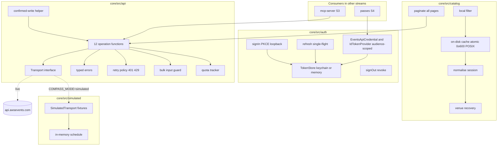
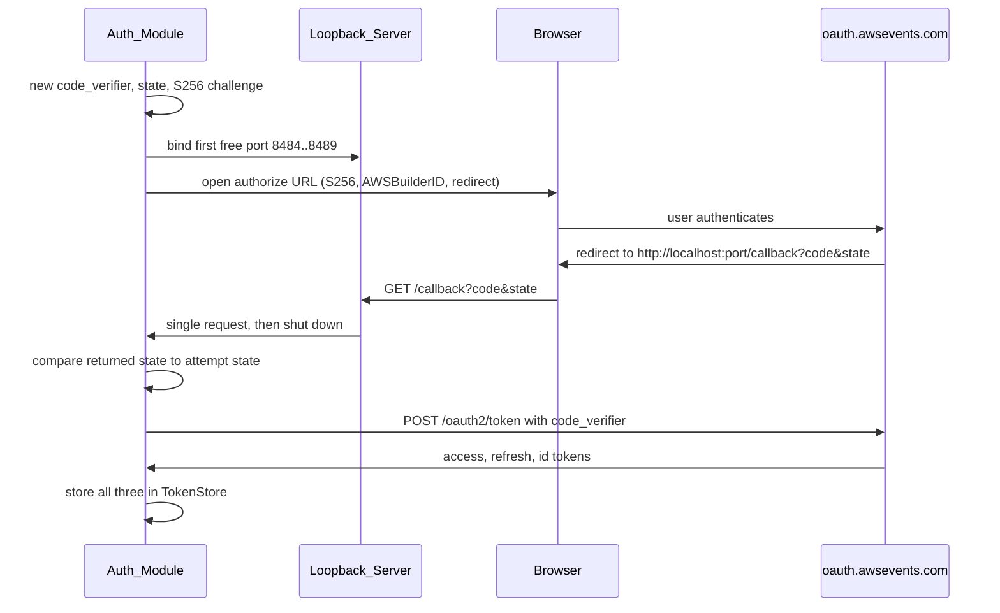

# Design Document

## Overview

This design covers S1, the `events-client` stream: the local-first Events API layer of re:Invent Compass. It owns four folders under `@compass/core`:

- `src/auth`: PKCE sign-in through a loopback redirect, token storage (OS keychain with memory fallback), refresh, revoke and strict token-audience separation.
- `src/api`: one typed function per Events API operation (all twelve), response validation against `@compass/contracts` zod schemas, typed errors, 401 and 429 retry policy, the bulk-write helper, the confirmed-write helper and the client-side quota tracker.
- `src/catalog`: full pagination, on-disk cache, session normalisation, venue recovery and local filtering.
- `src/simulated`: a fixture-backed transport that stands in for the live Events API when `COMPASS_MODE=simulated`.

The stream also owns `fixtures/api/**`.

In the airline metaphor this stream is the check-in desk and the departures board: it proves who the attendee is (sign-in), reads the live schedule (catalog and itinerary), books and cancels seats under strict rules (typed client and confirmed writes), and can run the whole desk against a made-up timetable with nothing live attached (simulated mode).

Everything here runs on the attendee's own computer. The access and refresh tokens, the catalog cache and the schedule snapshot never leave the machine. The ID token leaves only to prove sign-in to the Compass API (owned by S4), never to the Events API. All shared types and zod schemas come from `@compass/contracts`; this stream never edits `packages/contracts`.

### Design principles

1. **Local first.** Tokens, cache and schedule stay on the machine. No token reaches any file; no token reaches any log or error.
2. **Audience separation is enforced in one place.** A credential is never handed to code that is not entitled to it. The access token goes only to `api.awsevents.com`; the refresh token goes only to `oauth.awsevents.com`; the ID token is exposed only to the passes module.
3. **A human approves every write.** Reservations are never re-sent automatically. ReserveSessions is the one operation excluded from the automatic 401 retry.
4. **Trust `GetSchedule`.** A 200 does not mean success. Bulk writes report per session, and every write is confirmed by reading the schedule back.
5. **Honest about uncertainty.** Missing wire fields are recorded in `missingFields`, never invented.
6. **Contract-owned types.** Every wire shape, domain shape and the error shape come from `@compass/contracts`. The client builds only response wrappers from those schemas.
7. **Simulated mode is first class.** Tests and the public demo never touch the live API; the simulated transport is a drop-in replacement for the live HTTP transport.

### Research notes informing the design

- **PKCE (RFC 7636).** The S256 challenge is `base64url(SHA-256(code_verifier))` with padding removed. The client sends `code_challenge_method=S256` explicitly. Source: [RFC 7636 section 4](https://datatracker.ietf.org/doc/html/rfc7636#section-4).
- **OAuth 2.0 token revocation (RFC 7009).** Revocation is best-effort; a revoke failure must not block local sign-out. We bound the revoke with a 10-second timeout and clear tokens regardless. Source: [RFC 7009](https://datatracker.ietf.org/doc/html/rfc7009).
- **`Retry-After` header (RFC 9110 section 10.2.3).** May be an integer number of seconds or an HTTP date. The Events API uses whole seconds; the requirements bound the accepted range to 0 to 120 seconds inclusive for the client and 1 to 60 for simulated throttle fixtures. Source: [RFC 9110](https://www.rfc-editor.org/rfc/rfc9110#field.retry-after).
- **`@napi-rs/keyring`.** Every `Entry` is constructed with an explicit Linux target of `{ linux: { store: 'secret-service' } }` so keyutils is never used. On Linux without a Secret Service the constructor throws, which we catch and fall back to a memory store. Secrets are written with `setSecret` (UTF-8 bytes) and read with `getSecret`. Source: [`@napi-rs/keyring` README](https://github.com/napi-rs/node-rs/tree/main/packages/keyring).
- **OS app-data directories.** Windows `%APPDATA%`, macOS `~/Library/Application Support`, Linux `$XDG_DATA_HOME` or `~/.local/share`, each joined with `reinvent-compass`. These are resolved by this stream rather than pulled from a dependency, so the behaviour is testable with injected environment and home values.
- **Contracts surface.** `@compass/contracts` already exports every wire schema (`ListSessionsSchema`, `GetSessionSchema`, `GetScheduleSchema`, `EventSchema`, `BulkResultSchema`, `PersonalTimeSchema`, `PersonalTimeInputSchema`, `SessionWireSchema`), the domain schemas (`NormalisedSessionSchema`, `VenueSchema`) and the generated `EventsApi` type namespace used for the compile-time `BulkFailureCode` check.
- **zod placement.** `zod` is declared in `packages/core` (integrator commit b5c22cd). This stream builds its response wrappers in `core/src/api` with `z.object` composed from the exported contract schemas (`EventSchema`, `BulkResultSchema`, `SessionWireSchema`); it never edits `packages/contracts`.
- **Expiry source.** The access-token lifetime comes from the token response `expires_in`, converted to an absolute `accessTokenExpiresAt`. No JWT is decoded anywhere in this stream.

## Architecture

### Layered view



### Transport seam

The single most important architectural decision is a `Transport` seam between the operation functions and the network. Every operation function calls `transport.send(request)` and receives a raw `{ status, headers, body }` result. Two implementations exist:

- `HttpTransport`: uses the global `fetch`, targets `https://api.awsevents.com/v1`, attaches the bearer access token through the `EventsApiCredential` provider on the `ClientContext`.
- `SimulatedTransport`: selected when `COMPASS_MODE=simulated`, serves fixtures from `fixtures/api/**` and maintains an in-memory schedule.

The retry policy, quota tracker, validation and error mapping all sit **above** the transport, so they behave identically in live and simulated mode. The simulated transport only decides status, headers and body; it never decides retries or validation. This keeps simulated mode honest: the same client code path is exercised in tests and in the demo.

Selection is done once by a small factory `selectTransport(env)` that reads `COMPASS_MODE`. The live path is never taken under `COMPASS_MODE=simulated`, satisfying the "no live request" rules for simulated mode and gated tests.

### Credential provider and audience separation

The `api` layer obtains its credential through the `ClientContext`, which carries an `accessToken: EventsApiCredential` provider. That provider exposes only the Events API access token; it does **not** expose the refresh or ID token to the api layer. The refresh token is used only inside `auth` (refresh and revoke). The ID token is reached through a separate, asynchronous `IdTokenProvider` that refreshes within 300 seconds of expiry and is used by the passes module only; it is never part of the `ClientContext`. A guard function `assertAudience(credentialKind, targetHost)` refuses to return a credential whose kind does not match the destination host, which is the single enforcement point for Requirement 4.

In simulated mode the `ClientContext` is given a `SimulatedCredentialProvider` whose refresh is local and makes no OAuth call, so the `api` layer runs unchanged while nothing live is contacted.

### Sign-in flow



A port counts as free only when `127.0.0.1:P` binds and `[::1]:P` either binds too or is unsupported (the bind fails with `EADDRNOTAVAIL` or `EAFNOSUPPORT`); any other IPv6 failure disqualifies the port. If no port binds, sign-in returns a "no loopback port available" error. The browser is opened through an injected opener: `rundll32 url.dll,FileProtocolHandler <url>` on Windows, `open <url>` on macOS and `xdg-open <url>` on Linux; the built authorize URL is also returned to the caller so a headless or test run can drive it directly. A request to any path other than `/callback` gets a 404 and the server stays up. A `/callback?error=` request rejects the attempt at once. If no `/callback` request arrives within the sign-in timeout, the server is shut down and a timeout error is returned. A `state` mismatch rejects the attempt. A failed token exchange returns a sign-in-failed error and stores no partial token.

### Refresh single-flight

Refresh is guarded by a single in-flight promise keyed on the current refresh token. A second refresh request while one is in progress awaits the same promise rather than starting a second exchange (Requirement 3.5). A refresh is triggered proactively when the access token is within 300 seconds of expiry, and reactively by a 401 (except ReserveSessions).

The new access-token expiry is derived from the token response `expires_in` value; no JWT is decoded to learn the expiry. A refresh keeps the existing refresh token unless the token response returns a new one, in which case the stored refresh token is replaced. Only an `invalid_grant` error from the token endpoint clears the stored tokens and returns a sign-in-required error; any other refresh failure leaves the stored tokens in place.

### Module boundaries and ownership

- `auth`, `api`, `catalog`, `simulated` are the only folders this stream writes.
- `data/venues.json` (owned by S2) is read only, parsed through `VenueSchema`, and injected into the normaliser; tests supply their own venue fixture.
- `packages/contracts` is never edited; the known `BulkFailureCode` list lives in `core/src/api` and is checked against the generated `EventsApi` type at compile time.

## Components and Interfaces

All identifiers are illustrative TypeScript signatures. Shared types come from `@compass/contracts`. Files are kebab-case, one Events API operation per file.

### Component 1: Auth_Module (`core/src/auth`)

Files: `sign-in.ts`, `token-store.ts`, `credential-provider.ts`, `refresh.ts`, `sign-out.ts`, `pkce.ts`, `loopback-server.ts`, `index.ts`.

```ts
// pkce.ts
interface PkcePair {
  verifier: string;
  challenge: string;
} // challenge = base64url(sha256(verifier)), no padding
function createPkcePair(): PkcePair;
function createState(): string;

// loopback-server.ts
interface LoopbackResult {
  code: string;
  state: string;
  port: number;
}
interface LoopbackServer {
  port: number;
  awaitCallback(timeoutMs: number): Promise<LoopbackResult>; // one /callback request; 404 on other paths; /callback?error= rejects at once; shuts down
  close(): void;
}
// a port is free only if 127.0.0.1:P binds AND [::1]:P binds or is unsupported (EADDRNOTAVAIL or EAFNOSUPPORT)
function bindLoopback(ports: readonly number[]): Promise<LoopbackServer>; // tries 8484..8489; errors if none bind

// browser opener injected so the flow is testable; the authorize URL is also returned to the caller
type BrowserOpener = (url: string) => void; // rundll32 url.dll,FileProtocolHandler on Windows, open on macOS, xdg-open on Linux

// token-store.ts
interface TokenSet {
  accessToken: string;
  refreshToken: string;
  idToken: string;
  accessTokenExpiresAt: number;
}
type StorageKind = 'keychain' | 'memory';
interface TokenStore {
  kind: StorageKind;
  load(): TokenSet | undefined;
  save(tokens: TokenSet): StorageKind; // returns 'memory' if any keychain write threw and it fell back
  clear(): void; // empties memory even if deleteCredential throws
}
// one Entry per token, service "reinvent-compass", accounts "access", "refresh", "id",
// each built with { linux: { store: 'secret-service' } }; keyutils is never used.
// setSecret writes UTF-8 bytes, getSecret reads them. Any throw (including TooLong) means
// memory fallback plus a best-effort delete of all three entries.
function createTokenStore(keyring?: KeyringLike): TokenStore; // keyring injected for tests

// sign-in.ts
interface SignInResult {
  storage: StorageKind;
  memoryOnlyNotice?: string;
}
function signIn(deps: SignInDeps): Promise<SignInResult>;

// refresh.ts
function refreshIfNeeded(store: TokenStore, now: number, deps: RefreshDeps): Promise<void>; // single-flight
function refreshNow(store: TokenStore, deps: RefreshDeps): Promise<void>;

// credential-provider.ts
// EventsApiCredential supplies the access token to the api layer only (carried on ClientContext).
interface EventsApiCredential {
  getAccessTokenForEventsApi(): Promise<string>; // refreshes if within 300s of expiry; refresh keeps the existing
  // refresh token unless the response returns a new one
  forceRefresh(): Promise<void>; // refresh now regardless of the expiry window; called by the operation path on a
  // 401 before its single retry (Requirement 8.1) and once by ReserveSessions on a 401 before it fails without
  // re-sending (Requirement 9.1). Rejects on refresh failure, which the operation path maps to UnauthorizedError.
}
// IdTokenProvider is a separate async provider for the passes module only; never on ClientContext.
interface IdTokenProvider {
  getIdTokenForCompassApi(): Promise<string>; // refreshes within 300s of expiry; passes module only
}

// sign-out.ts
interface SignOutResult {
  signOutUrl: string;
} // https://idp.awsevents.com/oidc/logout
function signOut(store: TokenStore, deps: SignOutDeps): Promise<SignOutResult>; // revoke then clear; clear even on revoke failure or 10s timeout
```

**Deviations recorded with task 9.** (1) `bindLoopback(ports = [8484..8489], deps)` takes injectable `LoopbackDeps { createServer, createProbeServer }` instead of a bare port list, so port selection is testable without real sockets. The real server binds `127.0.0.1:P`, then a throwaway probe socket checks `[::1]:P` (usable if it binds, or fails with `EADDRNOTAVAIL` or `EAFNOSUPPORT`); any other `::1` failure marks the port taken. A callback server answers non-GET and non-`/callback` requests with 404, handles one valid `/callback` request, and rejects a missing or oversized `code` or `state` as `CallbackError('invalid_callback')`. (2) `createPkcePair` and `createState` accept an injectable random-bytes function; `computeChallenge(verifier)` is exported. (3) `assertAudience` uses the fixed label `compass-api` as the ID token's audience because the Compass API host belongs to another stream; the access token's audience is `api.awsevents.com` and the refresh token's is `oauth.awsevents.com`, matched exactly and case-insensitively. (4) The providers sit over a `CredentialSources` seam (`refreshIfNeeded`, `refreshNow`, `accessToken`, `idToken`) that task 11 wires to the token store and refresh. (5) `src/auth/errors.ts` holds `AuthError` and its subclasses with fixed messages. (6) `src/auth/node-types.d.ts` pulls in the Node type definitions, because `packages/core/tsconfig.json` declares no `types` and is outside this stream.

**Deviations recorded with task 10.** The access token expiry (from `expires_in`) is not a secret and the spec fixes exactly three keychain accounts, so it is kept in process memory only; `load()` returns `accessTokenExpiresAt: 0` after a restart, which makes the first use refresh with the stored refresh token. A keychain read that throws is treated like a failed write: fall back to memory and best-effort delete all three entries. `createTokenStore(keyring = realKeyring)` builds the three entries eagerly, and a throwing constructor means memory-only from the start. `KeyringLike` is `{ Entry }`, the shape of the `@napi-rs/keyring` module.

**Deviations recorded with task 11.** (1) New shared file `src/auth/oauth.ts` holds the endpoints, client id, scope, identity provider, the 300 second refresh window, the injectable `OAuthFetch` seam, the form POST helper and the token response parser (zod, `expires_in` required and positive). It sends `application/x-www-form-urlencoded` bodies: `grant_type=authorization_code` with `client_id`, `code`, `redirect_uri` and `code_verifier` for the exchange, `grant_type=refresh_token` with `client_id` and `refresh_token` for refresh, and `token` with `client_id` for revoke. (2) `signIn(deps)` is built on `startSignIn(deps)`, which returns `{ authorizeUrl, port, complete() }` straight after the browser is opened, so a headless run can drive the URL; `SignInResult` also carries `authorizeUrl`. `SignInDeps` is `{ store, logger, fetch, openBrowser, now, timeoutMs?, bind?, random? }`; the default timeout is five minutes and the default binder is `bindLoopback` over 8484 to 8489. A browser opener that throws does not stop sign-in (the URL is still returned). A token response without a refresh token is a sign-in failure. (3) `RefreshDeps` is `{ fetch, logger, now }`; `refreshIfNeeded(store, now, deps)` refreshes when `accessTokenExpiresAt - now <= 300000` (inclusive), single-flight is a module-level map keyed on the refresh token, `refreshNow` with nothing stored rejects with `NotSignedInError`, and `createCredentialSources(store, deps)` wires the store and refresh into the `CredentialSources` the providers read. A refresh answer that is a non-invalid_grant error, a network error or an unusable body is `RefreshFailedError` and leaves the stored tokens untouched. (4) `SignOutDeps` is `{ fetch, logger, timeoutMs? }`; the revoke is aborted through an `AbortController` at the 10 second timeout. (5) New typed errors: `StateMismatchError`, `SignInFailedError`, `SignInRequiredError`, `RefreshFailedError`, all with fixed messages.

**Deviations recorded with task 13.** (1) `filterCatalog(entries, filter)` takes and returns `CacheEntry[]` (normalised session plus wire), not `NormalisedSession[]`, because `text`, `topic` and `service` need the wire abstract, topics and services, which the normalised session does not carry. Criteria are empty-or-unset means not applied; `type`, `level`, `venue`, `topic` and `service` match case-insensitively by equality, `text` by substring of the title or abstract, and `day` is the first ten characters of `startsAt`. (2) `readCatalog(deps)` and `refreshCatalog(deps)` take one `CatalogDeps` object (`ctx`, `dir`, `fs`, `eventTimezone`, `venues?`, `maxAgeSeconds?`, `includeAbstracts?`, `now`) and return `CacheEntry[]`. A `maxAgeSeconds` that is not a positive number means a cache never goes stale. `venues` is the raw list and is parsed through `VenueSchema` by `parseVenues` (a bad list means no list). (3) `resolveAppDataDir` takes the platform as a plain string; on Windows with `%APPDATA%` unset it uses `<home>\AppData\Roaming`, and on Linux a relative `XDG_DATA_HOME` is ignored. (4) `fetchAllSessions` treats an empty `nextToken` as absent, and a repeated `nextToken` as an incomplete fetch (so it can never loop forever). Failures surface as `CatalogIncompleteError` carrying `pagesFetched` and the cause status. (5) `writeCache` uses a unique temp name in the same directory and throws `CacheWriteError` (fixed message, no path) on any failure. `fetchedAt` is written with an explicit `+00:00` offset. (6) `normaliseSession` tracks `code`, `type`, `level`, `venue`, `room`, `startsAt`, `endsAt`, `isAllDay`, `isReservable` and `seatAvailability` in `missingFields`; a base code of empty after removing `-R` leaves `repeatOf` absent; venue recovery picks the longest whole-phrase match. (7) `resolveEventWindow` reads start, end and timezone from `GetEvent`, taking the timezone from the matching `ListEvents` entry if `GetEvent` omits it, and rejects unparseable dates. (8) Time zone arithmetic lives in `src/catalog/session-time.ts` (`computeSessionInterval`, `isValidTimeZone`), reused by the simulated transport for overlap checks.

**Security fix H1 (path safety).** `segment(operation, value)` and `eventPath(ctx, operation, suffix)` in `src/api/event-path.ts` now take the operation name and reject, with `ValidationError`, an empty value, `.`, `..`, any value containing `/` or a backslash, any ASCII control character (including DEL) and anything longer than 256 characters. This is a deny-list of exactly those hazards, not an allow-list, so no real id format is refused; the error never echoes the value. `assertBulkInput` applies the same id check to every id, and `getEvent` encodes its id through `segment`. In `http-transport`, `buildUrl` refuses to send unless the request path is `/events` or inside `/events/`, has no empty segment, and the parsed URL pathname equals the base path plus the request path exactly (so a collapsed dot segment, a `?` or `#`, or a changed segment count is caught before the send). Ids containing a slash are therefore no longer accepted (they used to be encoded as `%2F`).

**Security fixes M1 and L2 (loopback server).** `bindLoopback(ports, deps, { expectedState, timeoutMs })` replaces the old signature, and `awaitCallback()` takes no argument. The callback slot is consumed only by a GET to `/callback` whose `state` equals the expected state (compared with `crypto.timingSafeEqual` over equal-length buffers) and whose Host header is `localhost:<port>` or `127.0.0.1:<port>` (case-insensitive; anything else is a 404, which also defeats DNS rebinding). A request with a missing, empty, oversized or wrong state, including one carrying `error=`, gets a 400 page and the server keeps listening within the same timeout. A matching state with `error=` rejects at once with a safe code; a matching state with a missing or oversized `code` is `CallbackError('invalid_callback')`. The sign-in timeout starts when the port is bound, so an uncompleted `startSignIn` cannot hold the port forever (the server shuts down and `awaitCallback()` then rejects with `SignInTimeoutError`). The default HTTP server is created with `maxHeaderSize` 8192, `headersTimeout` 10 s and `requestTimeout` 10 s, and shutdown calls `close()` and `closeAllConnections()` on every listener; the final response is flushed before shutdown. For L2, when IPv6 loopback is supported a second listener is kept open on `[::1]:<port>` with the same handler (replacing the old throwaway probe, and `LoopbackDeps.createProbeServer` is removed); a `::1` failure other than `EADDRNOTAVAIL` or `EAFNOSUPPORT` still disqualifies the port. `SignInDeps.bind` is now `(expectedState, timeoutMs) => Promise<LoopbackServer>`. The state comparison in `signIn` stays as defence in depth.

**Security fix M2 (refresh versus sign-out and sign-in).** `TokenStore` gains `generation` (a number that changes on every sign-in `save`, every `clear` and every `invalidate`), `invalidate()`, `replaceIfCurrent(generation, tokens)` and `clearIfCurrent(generation)`. `save` is the sign-in write; refresh no longer uses it. `refreshNow` records `store.generation` when it starts and writes its result with `replaceIfCurrent`, and clears on `invalid_grant` with `clearIfCurrent`; if the generation has moved on, the result is dropped (a warning without any token is logged) and the refresh resolves without writing, so a late refresh cannot bring tokens back after sign-out and a stale `invalid_grant` cannot wipe a newer sign-in. `signOut` calls `store.invalidate()` before it revokes, so a refresh already in flight cannot store a new refresh token that sign-out would neither revoke nor keep.

**Security fix M3 (egress binding and time limits).** `HttpTransportDeps` no longer has `baseUrl`: the transport always uses the fixed `EVENTS_API_BASE_URL`, so the bearer token cannot be pointed at another host from code, config or environment (tests inject only `fetch`; the simulated transport never goes through this path). The URL checks live in the exported `buildRequestUrl(baseUrl, req)`, which runs before the access token is even requested: it keeps the H1 path rules, requires `https:` with no port and no credentials in the URL (`ValidationError` otherwise), and calls `assertAudience('access-token', url.hostname)` on the hostname of the URL as finally parsed (`AudienceError` otherwise). Every API request is sent with `redirect: 'error'` and `signal: AbortSignal.timeout(30000)` (`API_REQUEST_TIMEOUT_MS`), and so is every OAuth form POST (`OAUTH_REQUEST_TIMEOUT_MS`, 30 s) for the token exchange and refresh; the revoke keeps its own 10 second signal and also refuses redirects. `FetchInit` and `OAuthFetchInit` gained required `redirect` and `signal` fields.

**Security fix L3 (response size caps).** New `src/api/capped-body.ts` provides `readBodyCapped(res, maxBytes)`, with limits `MAX_API_BODY_BYTES` (5 MB) and `MAX_OAUTH_BODY_BYTES` (64 KB). A declared `Content-Length` over the limit is refused without reading; a streamed body (`res.body.getReader()`) is read chunk by chunk and cancelled when it passes the limit; a response with only `text()` is checked in bytes after the read. `FetchResponseLike` and `OAuthResponseLike` gained an optional `body` and optional `headers` access for this. The Events API transport maps an oversize body to the new typed `ResponseTooLargeError` (operation and status, never the body); the OAuth calls let `BodyTooLargeError` reach their callers, which map it to `SignInFailedError`, `RefreshFailedError` (tokens untouched) or a logged revoke failure (tokens still cleared).

**Security fixes M4 and L5 (logger needles, token type).** `RedactingLogger.addSecret` and `removeSecret` now cover three forms of each secret: as given, percent-encoded (`encodeURIComponent`) and form-encoded. New `registerStoreSecrets(store, logger)` in `src/auth/secret-registering-store.ts` wraps a `TokenStore` so the access, refresh and ID tokens are registered whenever the store loads, saves or replaces them (including tokens loaded from the keychain that no sign-in or refresh in this process ever saw) and removed on `clear` and a successful `clearIfCurrent`; the application wraps its store once at composition. Sign-in registers the authorization code and the PKCE verifier for the duration of the exchange and removes them afterwards. New structural patterns redact the `Basic` scheme (in an `Authorization` or `Proxy-Authorization` header, and a bare `Basic <base64>` value that contains a digit or one of `+/=` so ordinary words after "basic" are not touched), the form and query keys `refresh_token=`, `code_verifier=`, `code=`, `access_token=` and `id_token=`, and the same keys in a JSON body. For L5, the token response parser now requires `token_type` to be `Bearer` (case-insensitive); anything else is a sign-in or refresh failure.

**Task 14 (simulated transport) and the S3 change request.** Files: `src/simulated/fixtures.ts`, `in-memory-schedule.ts`, `simulated-transport.ts`. `createSimulatedTransport(cfg, fixtures)` routes on method plus the official event-scoped paths (and the event id, which must equal the id in the `GetEvent/success` fixture, else 404; unknown routes are 404 `Unknown route`), derives everything from an in-memory schedule, and never builds a URL or uses a fetch. `FixtureLoader` is `{ catalog(), fixture(operation, scenario) }`; the default `createFsFixtureLoader(root)` reads `fixtures/synthetic/catalog.json` (read-only, the full 120-session catalog, served by `ListSessions` and `GetSession`) and `fixtures/api/<kebab-operation>/<scenario>.json` (`{ status, headers?, body? }`). `ListEvents` and `GetEvent` serve the `success` fixtures, whose event runs 30 Nov to 4 Dec 2026 with timezone `America/Los_Angeles`, so `resolveEventWindow` works in simulated mode and both the base ANT163 (`syn-096`) and its repeat ANT163-R (`syn-009`) are reachable (a test asserts both are served by list and get). `SimulatedConfig` is `{ fullSessionIds?, throttleOps?, expiredTokenOps?, scenarioRepeats?, pageSize?, now? }`. A configured operation answers its `error-429` or `error-401-expired-token` fixture for its first `scenarioRepeats` calls (default 1, so the client's single refresh or wait and retry can succeed); a throttle fixture whose `Retry-After` is not a whole number from 1 to 60 is refused with an error. `now` is the injected clock (change request): with it, reserving a session whose start is at or before that instant answers `timePassed` (a fixed demo instant such as 2026-11-29T18:00:00-08:00 makes every catalog session reservable); without it no session is ever past. Bulk results follow in-memory state: not reservable or unknown gives `sessionNotReservable`, already reserved `alreadyScheduled`, started gives `timePassed`, configured full `sessionFull`, a time overlap `scheduleConflict` with `conflictsWith`; favorites give `other` for an unknown session and `alreadyFavorited` for a repeat. Times for overlap checks use `computeSessionInterval` (the session timezone, else the event timezone). `ListSessions` uses numeric offset tokens as `nextToken`, a bad token is 400, and `includeAbstracts=false` strips abstracts. The OpenAPI conformance test also checks that every documented method and path template is a route the simulated transport knows.

**Task 15 (fixtures).** `fixtures/api/<kebab-operation>/<scenario>.json` holds `{ status, headers?, body? }`. Every operation has `success`, `error-429` (with a whole-second `Retry-After`; 30 for reserve-sessions, 2 elsewhere) and `error-401-expired-token`, because the simulated transport serves those by name for any configured operation. Extra scenarios: `get-schedule/error-401` and `error-500`, `reserve-sessions/error-400`, `error-403`, `error-503`, `get-session/error-404`, `cancel-reservation/error-409`, the catalog pages `list-sessions/page-1` to `page-3` (50 sessions per page, `nextToken` `50` and `100`, the last page omits it, together the full 120-session catalog), and `partial-failure-unknown-code` for reserve-sessions and associate-favorites (with `brandNewRefusalCode` and `anotherUnknownRefusal`). All session data is copied verbatim from `fixtures/synthetic/catalog.json`; a test asserts each session in any fixture equals its catalog entry. The event fixture (`reinvent2026`, 30 Nov to 4 Dec 2026, `America/Los_Angeles`) is the one canned value that is not from the catalog.

**Task 16 (subpath entry points).** `src/api/index.ts`, `src/auth/index.ts`, `src/catalog/index.ts` and `src/simulated/index.ts` are the four entry points; there is no shared barrel across streams. The api index exposes exactly the twelve operation functions (one file each), `confirmedWrite` and `selectTransport`, plus the listed support exports (typed errors, quota tracker, retry policy, validation, response wrappers, the HTTP transport factory and the new `ListEventsParams`, `GetSessionParams`, `ResponseTooLargeError` and body-limit constants). `eventPath` and `segment` stay internal on purpose: they are an implementation detail of building the official paths. Four structural tests (`index-exports.test.ts` in each test folder) pin the exact runtime export names of every entry point, so adding or removing an export is a deliberate change.

**Task 17 (required security test).** `test/auth/no-secret.test.ts` is the full named run of Property 7. For 100 random needle sets (access token, refresh token, a JWT-shaped ID token whose payload holds an email, the email, the authorization code and the `Bearer` Authorization value) it drives sign-in (four failing answers and a success), refresh (success, 500, network error, unusable body, `invalid_grant`), seven failing Events API statuses plus a repeated 401, a 401 on ReserveSessions, a 429, an invalid 200 body through the real HTTP transport (the fake server echoes the Authorization header, the email and the ID token into its error bodies), and a sign-out with a failing revoke. It asserts that no needle appears in any captured log line or in any thrown error (name, message, stack and every own field), that every `Authorization` or `Bearer` value is redacted, that every error is a typed `AuthError` or `EventsApiError`, and that the needles are live. A token needle is unregistered from the logger by design once the store is cleared (it has been revoked), so the positive control line is written while the session is live.

**Task 18 (owner-gated live smoke tests).** `test/api/live-smoke.test.ts` holds six live tests (sign-in through a real browser, catalog with the event window and the whole session list, schedule read, a favorite round trip, a personal-time round trip inside the event window, and exactly one reservation) behind `describe.skipIf(!isLiveEnabled(process.env))`, where the gate is exactly `COMPASS_LIVE_TESTS=1`. The owner also sets `COMPASS_LIVE_SESSION_ID` (the only session ever favorited or reserved; the live tests fail with a clear message if it is missing) and may set `COMPASS_LIVE_EVENT_ID` (default `reinvent2026`). Because vitest still collects a skipped suite, nothing is constructed in the suite body: the real keychain store, logger and transport are built in `beforeAll`, which never runs while the gate is closed. Everything the tests create is removed again (a favorite that already existed is left alone; a successful reservation is cancelled; the session is signed out in `afterAll`). Without the flag a normal run reports these six as skipped, never passed, and one always-run test checks the gate itself. These tests are never run by the build, CI or an assistant.

The access token is attached to Events API requests only. The ID token is never attached to Events API requests. No token value is included in any thrown error or logged line; all logging goes through a redacting logger (Component 7).

### Component 2: Events_Client operations (`core/src/api`)

One file per operation, each exporting one function. Files: `list-events.ts`, `get-event.ts`, `list-sessions.ts`, `get-session.ts`, `get-schedule.ts`, `reserve-sessions.ts`, `cancel-reservation.ts`, `associate-favorites.ts`, `disassociate-favorite.ts`, `create-personal-time.ts`, `update-personal-time.ts`, `delete-personal-time.ts`. Shared machinery: `transport.ts`, `errors.ts`, `retry.ts`, `validate.ts`, `bulk-input.ts`, `bulk-failure-codes.ts`, `confirmed-write.ts`, `quota-tracker.ts`, `response-wrappers.ts`, `execute-operation.ts`, `index.ts`.

The twelve operation functions do not each re-implement the layering. They delegate to a single shared executor `executeOperation(ctx, request, quota, handle)` in `execute-operation.ts`, which is the one place the design's above-the-transport layering is applied: quota gate (raising `QuotaExceededError` before any send), send, the 401 and 429 retry policy, status-to-error mapping, and finally the operation's `handle` (schema validation or the no-body assertion) on a 2xx. `quota` is `{ units }`: session-count for the two bulk operations, 1 for the other metered operations, and 0 for the unmetered ListEvents and GetEvent.

```ts
// transport.ts
interface ClientRequest {
  operation: OperationName;
  method: 'GET' | 'POST' | 'DELETE' | 'PATCH' | 'PUT';
  path: string;
  query?: Record<string, string>;
  body?: unknown;
}
interface RawResponse {
  status: number;
  headers: Headers;
  body: unknown;
}
interface Transport {
  send(req: ClientRequest): Promise<RawResponse>;
}
function selectTransport(env: NodeJS.ProcessEnv, deps: TransportDeps): Transport; // simulated when COMPASS_MODE=simulated

// ClientContext carries everything an operation needs.
interface ClientContext {
  eventId: string; // fills {eventId} in every event-scoped path, URL-encoded
  transport: Transport;
  accessToken: EventsApiCredential; // access token provider; the ID token is never here
  quota: QuotaTracker;
  logger: RedactingLogger;
  now: () => number;
  sleep: (ms: number) => Promise<void>;
}

// response wrappers built in core/src/api with z.object composed from the exported contract
// schemas (EventSchema, BulkResultSchema, SessionWireSchema); packages/contracts is never edited
interface ListEventsResult {
  items: Event[];
}
interface GetEventResult {
  event: Event;
}
interface ReserveResult {
  result: BulkResult;
}
interface AssociateResult {
  result: BulkResult;
}

// operation signatures (illustrative)
function listEvents(
  ctx: ClientContext,
  params?: { includePast?: boolean },
): Promise<ListEventsResult>;
function getEvent(ctx: ClientContext, eventId: string): Promise<GetEventResult>;
function listSessions(ctx: ClientContext, params: ListSessionsParams): Promise<ListSessions>;
function getSession(
  ctx: ClientContext,
  sessionId: string,
  params?: { locale?: string },
): Promise<GetSession>;
function getSchedule(ctx: ClientContext): Promise<GetSchedule>;
function reserveSessions(ctx: ClientContext, sessionIds: string[]): Promise<ReserveResult>; // no auto retry
function cancelReservation(ctx: ClientContext, sessionId: string): Promise<void>; // 204 success, no body validation
function associateFavorites(ctx: ClientContext, sessionIds: string[]): Promise<AssociateResult>;
function disassociateFavorite(ctx: ClientContext, sessionId: string): Promise<void>;
function createPersonalTime(ctx: ClientContext, input: PersonalTimeInput): Promise<void>;
function updatePersonalTime(
  ctx: ClientContext,
  id: string,
  input: PersonalTimeInput,
): Promise<void>;
function deletePersonalTime(ctx: ClientContext, id: string): Promise<void>;
```

**Official paths (change after the task 8 review).** Every path is built from the official OpenAPI document `packages/contracts/events-api.openapi.json`, relative to the base URL `https://api.awsevents.com/v1` that the transport prefixes: `GET /events` (query `includePast`), `GET /events/{eventId}`, `POST /events/{eventId}/favorites`, `DELETE /events/{eventId}/favorites/{sessionId}`, `POST /events/{eventId}/personal-time`, `PUT` and `DELETE /events/{eventId}/personal-time/{personalTimeId}`, `POST /events/{eventId}/reservations`, `DELETE /events/{eventId}/reservations/{sessionId}`, `GET /events/{eventId}/schedule`, `GET /events/{eventId}/sessions` (query `locale`, `includeAbstracts`, `nextToken`) and `GET /events/{eventId}/sessions/{sessionId}` (query `locale`). `ClientContext` gained `eventId: string` for the `{eventId}` segment (`GetEvent` still takes its id as an argument), and a shared helper `src/api/event-path.ts` (`eventPath`, `segment`) URL-encodes every dynamic segment. `listEvents` takes optional `includePast`, `listSessions` optional `locale`, and `getSession` an optional `params.locale`. A structural test (`test/api/openapi-conformance.test.ts`) reads the document at test time and asserts method, path template and query names for all twelve operations.

**Quota on the retry.** The single retry after a 401 or 429 is a second send, so `executeOperation` checks and records the units again before it (a shared `reserveQuota`), throwing `QuotaExceededError` if blocked. After a 429 the tracker is blocked until `Retry-After` elapses, so the retry proceeds only once the wait has really elapsed.

`ClientContext` is `{ eventId, transport, accessToken, quota, logger, now, sleep }`: the event id, the `Transport`, the `EventsApiCredential` access-token provider, the `QuotaTracker`, the redacting logger and injected `now`/`sleep` clocks. The ID token is never carried here; it is reached only through the separate `IdTokenProvider` used by the passes module. The 2xx path validates the body against the matching contract schema and returns the parsed value; a 204 for the five no-body operations returns success without validation; a validation failure returns a typed validation error and never returns the raw body (Requirement 6).

The response wrappers are built in `core/src/api` with `z.object` composed from the exported contract schemas (`EventSchema`, `BulkResultSchema`, `SessionWireSchema`) now that `zod` is declared in `packages/core`; this stream never edits `packages/contracts`.

### Component 3: Retry policy (`core/src/api/retry.ts`)

```ts
interface RetryPolicy {
  onUnauthorized(req: ClientRequest): 'refresh-and-retry-once' | 'refresh-then-fail' | 'fail';
  onRateLimited(req: ClientRequest, retryAfter?: number): 'wait-and-retry-once' | 'fail';
}
function parseRetryAfter(headers: Headers): number | undefined; // whole seconds in [0,120], else undefined
```

Non-ReserveSessions 401: exactly one refresh then exactly one retry; a second 401 or a failed refresh returns a typed unauthorized error with no further retry. Non-ReserveSessions 429 with a parseable `Retry-After` in `[0,120]`: wait once then retry once; a second 429 returns a typed rate-limited error. ReserveSessions is the exception: on 401 it refreshes once then returns unauthorized and never re-sends; on 429 or 5xx it returns the matching error and never re-sends; it is never automatically re-sent for any status (Requirements 8, 9).

This single 429 retry lives in the operation path. `paginate` does no retry of its own: it relies on the operation's one 429 retry, and if a page still fails it surfaces the did-not-complete error after that single wait.

### Component 4: Typed errors (`core/src/api/errors.ts`)

```ts
abstract class EventsApiError extends Error {
  readonly status?: number;
}
class ValidationError extends EventsApiError {} // schema failure, no raw body
class BadRequestError extends EventsApiError {} // 400
class UnauthorizedError extends EventsApiError {} // 401 after policy
class ForbiddenError extends EventsApiError {} // 403
class NotFoundError extends EventsApiError {} // 404
class ConflictError extends EventsApiError {} // 409
class RateLimitedError extends EventsApiError {} // 429 after policy
class ServerError extends EventsApiError {} // 500..599
class UnexpectedResponseError extends EventsApiError {} // any other failure status
class EventWindowError extends EventsApiError {} // event window/timezone missing or invalid
class QuotaExceededError extends EventsApiError {} // client-side quota would be exceeded; raised before send
```

`QuotaExceededError` is raised by the operation path before any request is sent when the quota tracker reports the call would exceed a per-operation limit. ListEvents and GetEvent are unmetered: they carry no quota and never raise `QuotaExceededError`.

Every error carries the response status where applicable and excludes every access token, refresh token, ID token, email and `Authorization` header value from its message and all fields (Requirements 7, 20).

### Component 5: Bulk input guard and failure codes (`core/src/api/bulk-input.ts`, `bulk-failure-codes.ts`)

```ts
function assertBulkInput(sessionIds: string[]): void;   // 1..10 inclusive, all distinct, else ValidationError before send
const KNOWN_BULK_FAILURE_CODES = [ ... ] as const;      // maintained here
// bidirectional compile-time check: the known list is assignable to the generated type AND vice versa
type GeneratedBulkFailureCode = EventsApi.components['schemas']['BulkFailureCode'];
type _KnownToGenerated = AssertAssignable<typeof KNOWN_BULK_FAILURE_CODES[number], GeneratedBulkFailureCode>;
type _GeneratedToKnown = AssertAssignable<GeneratedBulkFailureCode, typeof KNOWN_BULK_FAILURE_CODES[number]>;
function classifyFailure(f: BulkFailure): 'known' | 'unrecognised-refusal';
```

The bulk input guard rejects out-of-range or duplicate id lists before sending. The known-code list is checked against the generated `EventsApi` `BulkFailureCode` type at compile time in both directions: the known list must be assignable to the generated type, and the generated type must be assignable to the known list, so either side drifting fails the build. An unrecognised failure code at runtime is classified as an Unrecognised_Refusal, reported as a refusal, never as a success or safe retry (Requirement 10).

### Component 6: Confirmed-write helper (`core/src/api/confirmed-write.ts`)

```ts
interface Confirmed<W> {
  write: W;
  confirmed: true;
  schedule: GetSchedule;
}
interface Unconfirmed<W> {
  write: W;
  confirmed: false;
}
type ConfirmedWriteResult<W> = Confirmed<W> | Unconfirmed<W>;
function confirmedWrite<W>(
  write: () => Promise<W>,
  getSchedule: () => Promise<GetSchedule>,
): Promise<ConfirmedWriteResult<W>>;
```

The write and the `GetSchedule` reader are both injected as thunks, so this helper stays independent of the operation functions (wired in task 8) and is unit-testable on its own. On a successful write it calls the injected `getSchedule` exactly once and returns both results. If the write errors, that error propagates and `getSchedule` is never called. If the write succeeds but `getSchedule` errors, it returns `confirmed: false` and never re-sends the write (Requirement 11).

### Component 7: Quota tracker (`core/src/api/quota-tracker.ts`)

```ts
interface QuotaTracker {
  check(op: OperationName, units: number, now: number): 'allow' | 'blocked-until-reset';
  record(op: OperationName, units: number, now: number): void;
  note429(op: OperationName, retryAfterSeconds: number, now: number): void;
}
function createQuotaTracker(): QuotaTracker;
```

Per-operation rolling one-minute windows measured in seconds from the first counted call. Limits: GetSession 120, ListSessions 120, GetSchedule 60, ReserveSessions 30 counted sessions, AssociateFavorites 30 counted sessions, other writes 30. ListEvents and GetEvent are unmetered: they are never counted and never blocked. When a counted call would exceed its limit the operation raises `QuotaExceededError` before any request is sent. When the window elapses the count resets to zero. A 429 blocks the next call of that operation until the `Retry-After` duration has elapsed (Requirement 12).

### Component 8: Redacting logger (`core/src/api` shared)

A thin logger wrapper that scrubs any access token, refresh token, ID token, email and `Authorization` header value from every line. All components log only through it. This is the mechanism behind Requirements 2.5, 7.7 and 20.

### Component 9: Catalog_Module (`core/src/catalog`)

Files: `paginate.ts`, `cache.ts`, `app-data-dir.ts`, `normalise.ts`, `venue-recovery.ts`, `filter.ts`, `event-window.ts`, `index.ts`.

```ts
// paginate.ts
function fetchAllSessions(
  ctx: ClientContext,
  opts: { includeAbstracts: boolean },
): Promise<SessionWire[]>;
// requests pages until a response has no nextToken; follows nextToken even on a short page;
// does no retry of its own and relies on the operation's single 429 retry

// app-data-dir.ts
function resolveAppDataDir(
  env: NodeJS.ProcessEnv,
  homeDir: string,
  platform: NodeJS.Platform,
): string;

// cache.ts
interface CacheEntry {
  session: NormalisedSession;
  wire: SessionWire;
}
interface CatalogCache {
  fetchedAt: string;
  entries: CacheEntry[];
} // fetchedAt ISO 8601 with offset
function writeCache(dir: string, cache: CatalogCache, fs: FsLike): void; // mode 0o600, atomic temp-then-rename, dir created 0o700, leaves old file on failure
function readCache(dir: string, fs: FsLike): CatalogCache | undefined;
function readCatalog(
  ctx,
  cfg: { maxAgeSeconds?: number },
  now: number,
): Promise<NormalisedSession[]>; // refetch if stale
function refreshCatalog(ctx, dir, now): Promise<void>; // refetch and overwrite in place

// normalise.ts
function normaliseSession(
  wire: SessionWire,
  venues: Venue[] | undefined,
  eventTimezone: string,
): NormalisedSession;

// venue-recovery.ts
function recoverVenue(roomText: string | undefined, venues: Venue[]): string | undefined;

// event-window.ts
interface EventWindow {
  start: string;
  end: string;
  timezone: string;
} // timezone a valid IANA id
function resolveEventWindow(listEvents: ListEventsResult, getEvent: GetEventResult): EventWindow; // else EventWindowError

// filter.ts
interface CatalogFilter {
  text?: string;
  type?: string;
  level?: string;
  day?: string;
  venue?: string;
  service?: string;
  topic?: string;
}
function filterCatalog(sessions: NormalisedSession[], filter: CatalogFilter): NormalisedSession[]; // local only, no API
```

The cache is `{ fetchedAt, entries }`, where each entry pairs the normalised session with the `wire` session it came from, so a re-normalisation (for example after a venue-list change) needs no refetch. Writing is atomic: the cache directory is created with mode `0o700`, a temp file is written then renamed over the target, and a failed write leaves any existing file unchanged. On Windows the `0o600` mode passed to the write only toggles the read-only bit; privacy there relies on the per-user ACL of `%APPDATA%` rather than on the mode. Mode assertion tests therefore run on POSIX only.

`normaliseSession(wire, venues, eventTimezone)` takes the event timezone resolved from the API. A usable wire time needs a date, a time and a numeric length in minutes; the session zone is `sessionTime.timezone` when present, otherwise the supplied `eventTimezone`, and the UTC offset is computed through `Intl`. Normalisation produces a value that validates against `NormalisedSessionSchema`, sets `startsAt`/`endsAt` to offset-aware ISO 8601 when a usable wire time exists (otherwise records them in `missingFields`), derives `repeatOf` from a `-R[0-9]?$` code suffix, recovers venue from room text through the injected venue list when the wire venue is absent, applies the documented defaults for omitted `isAllDay`, `isReservable`, `seatAvailability` and `code` while recording each omitted name in `missingFields`, and never invents values (Requirement 15).

Local filter semantics: `text` matches the title and the abstract; `topic` matches the session topics; `service` matches the session services; `day` is the local date of `startsAt`. `type`, `level` and `venue` match their respective fields. All criteria combine conjunctively.

### Component 10: Simulated_Transport (`core/src/simulated`)

Files: `simulated-transport.ts`, `in-memory-schedule.ts`, `fixtures.ts`, `index.ts`.

```ts
interface SimulatedConfig {
  fullSessionIds?: string[];
  throttleOps?: OperationName[];
  expiredTokenOps?: OperationName[];
}
function createSimulatedTransport(cfg: SimulatedConfig, fixtures: FixtureLoader): Transport;
```

Serves fixtures from `fixtures/api/**` built to validate against `SessionWireSchema`, presents a signed-in attendee without any OAuth call, and maintains an in-memory schedule so a write followed by `GetSchedule` in the same process reflects the write. It derives bulk results from in-memory state (`sessionFull`, `scheduleConflict` with `conflictsWith`, `alreadyScheduled`), can return a configured 429 with `Retry-After` of 1 to 60 seconds, and a configured 401 expired-token response. It never calls the live API (Requirement 18).

## Data Models

All wire and domain models are owned by `@compass/contracts` and imported, not redefined. This stream adds only internal models that wrap or configure them.

### Imported from `@compass/contracts` (not redefined here)

| Schema                                                           | Used by                                             |
| ---------------------------------------------------------------- | --------------------------------------------------- |
| `SessionWireSchema` / `SessionWire`                              | pagination, normalisation input, simulated fixtures |
| `ListSessionsSchema`, `GetSessionSchema`, `GetScheduleSchema`    | list/get validation, pagination, confirmed write    |
| `ScheduleWireSchema`                                             | schedule confirmation, in-memory simulated schedule |
| `EventSchema` / `Event`                                          | ListEvents/GetEvent validation, event window        |
| `BulkResultSchema`, `BulkFailureSchema`, `BulkFailureCodeSchema` | reserve/favorite results, failure classification    |
| `PersonalTimeSchema`, `PersonalTimeInputSchema`                  | personal-time operations                            |
| `NormalisedSessionSchema` / `NormalisedSession`                  | normalisation output, cache contents                |
| `VenueSchema` / `Venue`                                          | injected venue list, venue recovery                 |

### Internal models owned by this stream

```ts
// auth
interface TokenSet {
  accessToken: string;
  refreshToken: string;
  idToken: string;
  accessTokenExpiresAt: number;
}
type StorageKind = 'keychain' | 'memory';

// api
type OperationName =
  | 'ListEvents'
  | 'GetEvent'
  | 'ListSessions'
  | 'GetSession'
  | 'GetSchedule'
  | 'ReserveSessions'
  | 'CancelReservation'
  | 'AssociateFavorites'
  | 'DisassociateFavorite'
  | 'CreatePersonalTime'
  | 'UpdatePersonalTime'
  | 'DeletePersonalTime';
interface RawResponse {
  status: number;
  headers: Headers;
  body: unknown;
}
type ConfirmedWriteResult<W> =
  { write: W; confirmed: true; schedule: GetSchedule } | { write: W; confirmed: false };

// catalog
interface CacheEntry {
  session: NormalisedSession;
  wire: SessionWire;
}
interface CatalogCache {
  fetchedAt: string;
  entries: CacheEntry[];
} // fetchedAt ISO 8601 with offset
interface EventWindow {
  start: string;
  end: string;
  timezone: string;
}

// simulated
interface SimulatedConfig {
  fullSessionIds?: string[];
  throttleOps?: OperationName[];
  expiredTokenOps?: OperationName[];
}
```

### Cross-cutting data rules

- **Defensive parsing by stripping.** All validation uses the contract schemas as given (plain `z.object` strips unknown fields). The client never adds `passthrough`, so fields the Events API adds later are ignored and never carried into logs.
- **No coercion.** A present field with the wrong type is rejected by the contract schema, surfaced as a `ValidationError`.
- **Quota units.** For ReserveSessions and AssociateFavorites the quota unit is the number of session ids in the request; for every other metered operation the unit is one call. ListEvents and GetEvent are unmetered and are never counted.
- **Cache file shape.** The cache stores `{ fetchedAt, entries }` where each entry is `{ session, wire }`: the normalised session plus the wire it came from, so a read is cheap and offline-friendly and a re-normalisation needs no refetch.

## Correctness Properties

_A property is a characteristic or behavior that should hold true across all valid executions of a system, essentially a formal statement about what the system should do. Properties serve as the bridge between human-readable specifications and machine-verifiable correctness guarantees._

This stream is a strong fit for property-based testing: the PKCE encoder, `Retry-After` parser, bulk input guard, failure classifier, quota tracker, pagination, normalisation, venue recovery, local filter and the redacting logger are all pure or clearly input-driven functions with universal properties (round-trips, invariants, idempotence, metamorphic relations and error conditions). Loopback binding, keychain I/O and live HTTP are integration or example concerns and are covered by the Testing Strategy rather than by properties.

The following properties were derived from the prework analysis of the acceptance criteria.

### Property 1: PKCE S256 challenge is correct base64url without padding

_For any_ code verifier string, the computed PKCE challenge equals the base64url encoding of the SHA-256 of that verifier with no padding, and contains only base64url characters (no `+`, `/` or `=`).

**Validates: Requirements 1.8**

### Property 2: Loopback binds the lowest free port in range

_For any_ subset of the ports 8484 to 8489 that are bindable, `bindLoopback` selects the smallest bindable port in that range; _for any_ case where none are bindable, it returns a no-loopback-port-available error.

**Validates: Requirements 1.2, 1.3**

### Property 3: Authorize request is built correctly for any bound port

_For any_ bound loopback port and sign-in attempt, the built authorize request uses the authorize endpoint, the client id `7vmom55m1qstvq8i71ph127bfq`, the scope `openid email events/access`, `code_challenge_method=S256`, `identity_provider=AWSBuilderID`, and a redirect URI exactly equal to `http://localhost:<bound port>/callback`.

**Validates: Requirements 1.9, 1.10, 1.11**

### Property 4: State mismatch is rejected

_For any_ pair of unequal `state` values, comparing the returned `state` against the attempt `state` rejects the sign-in attempt with a state-mismatch error.

**Validates: Requirements 1.12, 1.13**

### Property 5: Token storage round-trips through the keychain

_For any_ token set, saving it through an available keychain and then loading it returns an equal token set.

**Validates: Requirements 2.1, 3.3**

### Property 6: Keychain absence or failure falls back to memory and never writes a file

_For any_ token set, when no keychain is available or a keychain write fails, `save` returns the `memory` storage kind, the tokens are held in memory only, and no token is ever written to a file.

**Validates: Requirements 2.2, 2.4, 2.6**

### Property 7: No secret ever appears in logs or errors

_For any_ access token, refresh token, ID token, email value and `Authorization` header value flowing through sign-in, token refresh and a failing Events API operation, none of those secret values appears in captured log output or in any field or message of any returned or thrown error.

**Validates: Requirements 2.5, 7.7, 20.1, 20.2, 20.3**

### Property 8: Access token is refreshed exactly within 300 seconds of expiry

_For any_ current time and access-token expiry, the credential provider refreshes the access token before use if and only if the expiry is within 300 seconds of the current time, and otherwise reuses the stored access token.

**Validates: Requirements 3.1**

### Property 9: Only an invalid_grant refresh clears all tokens

_For any_ stored token set, a refresh that fails with an `invalid_grant` error leaves the token store empty and returns a sign-in-required error, and a refresh that fails with any other error leaves the stored tokens in place.

**Validates: Requirements 3.4**

### Property 10: Concurrent refreshes are single-flight

_For any_ number of concurrent refresh requests (two or more) against the same refresh token, exactly one token exchange is performed and every caller observes the same result.

**Validates: Requirements 3.5**

### Property 11: Credentials are released only to their own audience

_For any_ credential kind and target host, the credential is released if and only if the kind matches the audience defined for that host (access token only to `api.awsevents.com`, refresh token only to `oauth.awsevents.com`, ID token only to the passes caller), and any mismatch is refused. _For any_ Events API operation and input, the outgoing request carries the access token and never the ID token.

**Validates: Requirements 4.1, 4.2, 4.3, 4.4, 4.5, 6.2**

### Property 12: Sign-out always clears tokens and returns the logout URL

_For any_ outcome of the revoke call (success, failure, or exceeding the 10-second bound), sign-out clears the access, refresh and ID tokens from the store and returns the Builder ID sign-out URL `https://idp.awsevents.com/oidc/logout`.

**Validates: Requirements 5.1, 5.2, 5.3**

### Property 13: Valid 2xx bodies are returned parsed; invalid bodies yield a validation error

_For any_ operation and any response body, if the body satisfies the matching `@compass/contracts` schema the client returns the schema-parsed value in the specified wrapper shape (`{items}` for ListEvents, `{event}` for GetEvent, `{result}` for ReserveSessions and AssociateFavorites); if the body fails validation the client returns a typed validation error and never surfaces the unvalidated body.

**Validates: Requirements 6.3, 6.4, 6.5, 6.6**

### Property 14: A 204 for no-body operations is success without validation

_For any_ of CancelReservation, DisassociateFavorite, CreatePersonalTime, UpdatePersonalTime and DeletePersonalTime, a 204 response with an empty body is treated as success with no body and no schema validation is performed.

**Validates: Requirements 6.7**

### Property 15: Every failure status maps to its typed error carrying the status

_For any_ HTTP failure status, the error mapper returns the specified typed error (400 bad request, 403 forbidden, 404 not found, 409 conflict, 500 to 599 server error, and any status outside 400, 401, 403, 404, 409, 429 and 500 to 599 an unexpected-response error) and the returned error carries the response status.

**Validates: Requirements 7.1, 7.2, 7.3, 7.4, 7.5, 7.6**

### Property 16: Non-reserve 401 and 429 retry at most once

_For any_ operation that is not ReserveSessions: a 401 triggers exactly one refresh and exactly one retry, and a repeat 401 or a failed refresh returns a typed unauthorized error with no further retry; a 429 whose `Retry-After` parses to a whole number of seconds in the inclusive range 0 to 120 triggers exactly one wait and one retry, and an absent, unparseable or out-of-range `Retry-After` or a repeat 429 returns a typed rate-limited error with no further retry.

**Validates: Requirements 8.1, 8.2, 8.3, 8.4, 8.5, 8.6**

### Property 17: ReserveSessions is sent exactly once for any status

_For any_ status returned to a ReserveSessions request, the client sends the ReserveSessions request exactly once and never re-sends it; a 401 triggers exactly one refresh and then returns a typed unauthorized error without re-sending, and a 429 or a 500 to 599 returns the matching typed error without re-sending.

**Validates: Requirements 9.1, 9.2, 9.3, 9.4**

### Property 18: Bulk input is accepted only when 1 to 10 distinct ids, else rejected before send

_For any_ list of session ids, a bulk request (ReserveSessions or AssociateFavorites) is accepted if and only if the count is from 1 to 10 inclusive and all values are distinct; otherwise the client returns a typed validation error before sending and sends no request.

**Validates: Requirements 10.1, 10.2, 10.3**

### Property 19: Bulk results pass through successful and failed faithfully

_For any_ validated `BulkResult`, the client returns exactly `result.successful` and `result.failed`, including the cases where either is empty.

**Validates: Requirements 10.4**

### Property 20: Unrecognised failure codes are refusals, never successes

_For any_ per-session failure whose code is not one of the known `BulkFailureCode` values, the client classifies it as an Unrecognised_Refusal, reports it among the failures, and never reports it as a success or as a safe retry.

**Validates: Requirements 10.6**

### Property 21: Confirmed-write helper confirms, reports, and never re-sends

_For any_ write outcome and subsequent `GetSchedule` outcome, the confirmed-write helper invokes the write exactly once and: returns the write error without calling `GetSchedule` when the write fails; returns the write result and the confirmed schedule when both succeed; and returns the write result with an unconfirmed indication, without re-sending the write, when the write succeeds but `GetSchedule` fails.

**Validates: Requirements 11.1, 11.2, 11.3, 11.4**

### Property 22: Quota tracker blocks exactly the call that would exceed a per-operation limit

_For any_ sequence of timestamped calls within a rolling one-minute window, the quota tracker allows a call if and only if the resulting count within the current window would not exceed the operation's limit (GetSession 120, ListSessions 120, GetSchedule 60, ReserveSessions 30 counted sessions, AssociateFavorites 30 counted sessions, other writes 30), while ListEvents and GetEvent are unmetered and always allowed; a blocked call raises `QuotaExceededError` before any request is sent; when the window elapses the count resets to zero; and after a 429 for an operation the next call of that operation is blocked until the `Retry-After` duration has elapsed.

**Validates: Requirements 12.1, 12.2, 12.3, 12.4, 12.5, 12.6, 12.7, 12.8, 12.9**

### Property 23: Pagination returns every page in order and stops only when nextToken is absent

_For any_ sequence of pages that ends with a page carrying no `nextToken`, the catalog fetch requests exactly those pages in order (following a non-empty `nextToken` even when the current page is short), returns the in-order concatenation of all page items, and on a fast pass sends `includeAbstracts=false` on every page request.

**Validates: Requirements 13.1, 13.2, 13.3, 13.4**

### Property 24: Page 429 waits once then fails; non-retryable stops without completing

_For any_ page request that returns 429, the catalog fetch waits once for the `Retry-After` duration and retries that same page, and if the retry still fails it surfaces a did-not-complete error having performed only one wait; _for any_ non-retryable page error the fetch stops, does not treat the catalog as fully fetched, and surfaces a did-not-complete error.

**Validates: Requirements 13.5, 13.6**

### Property 25: App-data directory resolves per platform

_For any_ platform, environment and home directory, the resolved cache directory is the documented base joined with `reinvent-compass` (`%APPDATA%` on Windows, `~/Library/Application Support` on macOS, `$XDG_DATA_HOME` or `~/.local/share` on Linux).

**Validates: Requirements 14.1, 14.2, 14.3**

### Property 26: Cache write and read round-trip atomically with an ISO-8601 timestamp

_For any_ catalog and fetch time, writing the cache then reading it returns the same entries (each `{ session, wire }`) and a `fetchedAt` that parses as an ISO 8601 value with offset, the write is atomic (a temp file renamed into place) into a directory created with mode `0o700`, and a refresh overwrites the same file in place with the new data and a new timestamp. On POSIX the file is written with octal mode `0o600`; the mode assertion is checked on POSIX only, because on Windows `0o600` only toggles the read-only bit and privacy relies on the per-user ACL of `%APPDATA%`.

**Validates: Requirements 14.4, 14.5, 14.6**

### Property 27: Stale cache is refetched

_For any_ positive maximum cache age in seconds, current time and cached fetch timestamp, reading the catalog refetches before returning sessions if and only if the age exceeds the configured maximum.

**Validates: Requirements 14.7**

### Property 28: A failed cache write leaves the existing file unchanged

_For any_ existing cache file, a cache write that fails leaves the existing file unchanged and surfaces a cache-write error.

**Validates: Requirements 14.8**

### Property 29: Normalisation always produces a valid normalised session

_For any_ wire session, the normaliser produces a value that validates against `NormalisedSessionSchema`.

**Validates: Requirements 15.1**

### Property 30: Session times are offset-aware when usable, absent and recorded otherwise

_For any_ wire session and event timezone, if the wire session time is usable (it has a date, a time and a numeric length in minutes) the normaliser sets `startsAt` and `endsAt` to timezone-aware ISO 8601 values whose UTC offset is computed through `Intl` for the zone `sessionTime.timezone` when present else the supplied `eventTimezone`, and if it is not usable it leaves both absent and records both names in `missingFields`.

**Validates: Requirements 15.2, 15.3**

### Property 31: repeatOf is derived from the -R suffix

_For any_ session whose abbreviation or code matches the pattern `-R[0-9]?$`, the normaliser sets `repeatOf` to the base code without the `-R` suffix, and otherwise leaves `repeatOf` absent.

**Validates: Requirements 15.4**

### Property 32: Venue is taken from the wire, else recovered, else absent and recorded

_For any_ wire session and injected venue list, the normaliser sets `venue` from the wire venue when present, otherwise recovers `venue` from the room text using the venue list parsed through `VenueSchema`, and when no venue can be determined leaves `venue` absent and records `venue` in `missingFields`.

**Validates: Requirements 15.5, 15.6, 15.7**

### Property 33: missingFields records exactly the absent tracked fields with documented defaults applied

_For any_ wire session, the normaliser records in `missingFields` the name of every absent tracked optional field, applies the documented defaults for omitted `isAllDay` (`false`), `isReservable` (`false`), `seatAvailability` (`"unknown"`) and `code` (`""`), and never substitutes an invented value for any other field.

**Validates: Requirements 15.8, 15.10**

### Property 34: Local filtering is a conjunctive subset with no API call

_For any_ cached catalog and filter, the filter returns only the sessions that match every applied criterion (text against title and abstract, topic against topics, service against services, day against the local date of `startsAt`, and type, level and venue against their fields), returns every session when no criteria are applied, sends no request to the Events API, and never grows the result set when a further criterion is added.

**Validates: Requirements 16.1, 16.2, 16.3, 16.4**

### Property 35: Event window comes from the API or errors, never a default

_For any_ ListEvents and GetEvent responses, the event window is returned only when the event start, event end and a valid IANA timezone are all present in those responses, and otherwise an Event_Window error is returned with no substituted default.

**Validates: Requirements 17.1, 17.2, 17.3, 17.4**

### Property 36: Simulated responses conform to configuration and never reach the live API

_For any_ simulated operation, the served session fixtures validate against `SessionWireSchema`, a configured throttle scenario returns a 429 with a whole-second `Retry-After` in the inclusive range 1 to 60, and no request reaches the live Events API.

**Validates: Requirements 18.1, 18.5, 18.7**

### Property 37: Simulated writes are reflected by a later GetSchedule

_For any_ sequence of simulated writes (reserve, cancel, favorite, disassociate, personal-time) within one process session, a later `GetSchedule` in the same process returns a schedule equal to a reference model that applies the same sequence.

**Validates: Requirements 18.3**

### Property 38: Simulated bulk results are derived from in-memory state

_For any_ ReserveSessions or AssociateFavorites request served in simulated mode, the per-session bulk result is derived from the in-memory schedule, returning `sessionFull` for a configured full session, `scheduleConflict` carrying `conflictsWith` for a time clash, and `alreadyScheduled` for a session already reserved.

**Validates: Requirements 18.4**

## Error Handling

### Error taxonomy

All errors extend a single `EventsApiError` base. Each carries the response `status` where one applies and, critically, carries no secret value in any field or message.

| Error                     | Cause                                                                                            | Carries                                   | Retry behaviour              |
| ------------------------- | ------------------------------------------------------------------------------------------------ | ----------------------------------------- | ---------------------------- |
| `ValidationError`         | 2xx body fails the matching contract schema, or bulk input is invalid                            | operation name, no raw body               | none                         |
| `BadRequestError`         | 400                                                                                              | status                                    | none                         |
| `UnauthorizedError`       | 401 after policy (one refresh plus one retry for non-reserve; one refresh then fail for reserve) | status                                    | none after policy            |
| `ForbiddenError`          | 403                                                                                              | status                                    | none                         |
| `NotFoundError`           | 404                                                                                              | status                                    | none                         |
| `ConflictError`           | 409                                                                                              | status                                    | none                         |
| `RateLimitedError`        | 429 after policy (one wait plus one retry for non-reserve)                                       | status, parsed Retry-After when available | none after policy            |
| `ServerError`             | 500 to 599                                                                                       | status                                    | none (reserve never re-sent) |
| `UnexpectedResponseError` | any other failure status                                                                         | status                                    | none                         |
| `EventWindowError`        | event window or timezone missing or not a valid IANA id                                          | none                                      | none                         |
| `QuotaExceededError`      | client-side quota would be exceeded (metered operations only)                                    | operation name, no status                 | none, raised before send     |

### Handling rules

- **Secret redaction is centralised.** Errors are built through a factory that only accepts an operation name and status; it has no parameter that could carry a token, email or header. The redacting logger scrubs the same values from every log line. This makes Requirements 7.7 and 20 structural rather than relying on each call site.
- **No partial state on failure.** A failed token exchange stores no partial token (1.15). A failed cache write leaves the previous cache intact (14.8). A refusal in a bulk result never counts as a success (10.6).
- **ReserveSessions is never auto re-sent.** The retry policy special-cases ReserveSessions so that no status can cause a second send (9.4). This is the single most important safety rule in the stream.
- **Confirmation failure is distinct from write failure.** When a write succeeds but confirmation fails, the caller gets an explicit `confirmed: false` result rather than an error, and the write is not retried (11.4).
- **Simulated errors flow through the same policy.** The simulated transport returns real status codes and headers (401 expired, 429 with `Retry-After`); the client applies exactly the same retry and error mapping as in live mode.
- **Catalog fetch is fail-closed.** On a non-retryable page error or a persistent 429 the catalog is not marked fully fetched and a did-not-complete error is surfaced, so stale or partial data is never silently treated as complete (13.5, 13.6). `paginate` adds no retry of its own; the single 429 wait-and-retry lives in the operation path, so after that one wait a still-failing page surfaces the did-not-complete error.
- **Quota is enforced before send.** A metered operation whose call would exceed its window limit raises `QuotaExceededError` before any request leaves the client. ListEvents and GetEvent are unmetered and never raise it.

## Testing Strategy

### Tooling

- **vitest 4** with v8 coverage, 100% lines, branches, functions and statements for S1-owned code, zero named exclusions (Requirement 21.1, tech.md).
- **Property-based tests** use `fast-check` (the standard PBT library for TypeScript). Properties are not implemented from scratch. Each property test runs a minimum of 100 iterations.
- Tests live under `packages/core/test/{auth,api,catalog,simulated}/`, mirroring `src/` (Requirement 19.8).
- No test touches the live Events API; the simulated transport and fixtures stand in (workflow.md, Requirements 18.7, 21.2).

### Property test mapping and tagging

Each correctness property is implemented by a single property-based test, tagged in a comment:

`// Feature: events-client, Property {number}: {property text}`

| Property              | Generators (illustrative)                                                                                              |
| --------------------- | ---------------------------------------------------------------------------------------------------------------------- |
| 1 PKCE challenge      | arbitrary verifier strings including empty and unicode                                                                 |
| 2 port selection      | random subsets of 8484..8489 with an injected binder                                                                   |
| 3 authorize URL       | arbitrary bound port and attempt values                                                                                |
| 4 state mismatch      | pairs of unequal strings                                                                                               |
| 5,6 token store       | arbitrary `TokenSet`, injected keyring that can be absent or throw, recording fs                                       |
| 7 no-secret           | token/email/header needles embedded in inputs and server bodies                                                        |
| 8 refresh window      | arbitrary `now` and `expiresAt` around the 300s boundary                                                               |
| 9 rejected refresh    | arbitrary starting `TokenSet`                                                                                          |
| 10 single-flight      | arbitrary concurrency count N >= 2                                                                                     |
| 11 audience           | arbitrary (credential kind, target host) pairs                                                                         |
| 12 sign-out           | injected revoke outcomes (ok, error, slow past 10s)                                                                    |
| 13 2xx validation     | valid and invalid bodies per operation                                                                                 |
| 14 204                | the five no-body operations                                                                                            |
| 15 error mapping      | the full HTTP status space                                                                                             |
| 16 non-reserve retry  | response sequences and Retry-After values incl. 0 and 120                                                              |
| 17 reserve once       | arbitrary statuses for ReserveSessions                                                                                 |
| 18 bulk input         | id lists of varying length and duplication                                                                             |
| 19 bulk pass-through  | arbitrary `BulkResult` incl. empty arrays                                                                              |
| 20 unrecognised code  | failures with codes outside the known set                                                                              |
| 21 confirmed write    | injected write and schedule outcomes                                                                                   |
| 22 quota              | timestamped call sequences per operation with unit counts                                                              |
| 23 pagination         | page sequences with varying item counts ending without nextToken                                                       |
| 24 page failure       | injected 429 and non-retryable page outcomes                                                                           |
| 25 app-data dir       | platform, env and home combinations incl. XDG unset                                                                    |
| 26 cache round-trip   | arbitrary catalogs (entries of session plus wire) and fetch times, recording fs; mode asserted on POSIX only           |
| 27 staleness          | fetchedAt, now and positive maxAge around the boundary                                                                 |
| 28 write failure      | existing cache bytes with a failing fs                                                                                 |
| 29 normalise valid    | arbitrary `SessionWire` with random present/absent fields                                                              |
| 30 times              | wire session times (usable and not) with an event timezone and optional per-session zone                               |
| 31 repeatOf           | codes with and without `-R[0-9]?$`                                                                                     |
| 32 venue              | wire venue present/absent with an injected venue list                                                                  |
| 33 missingFields      | `SessionWire` with random omissions                                                                                    |
| 34 filter             | arbitrary catalogs and filter combinations (text over title/abstract, topic, service, day over local date of startsAt) |
| 35 event window       | event responses with present/absent/invalid timezones                                                                  |
| 36 simulated conform  | arbitrary simulated operations and throttle configs                                                                    |
| 37 simulated schedule | arbitrary write sequences vs a reference model                                                                         |
| 38 simulated bulk     | requests against configured full/clash/reserved state                                                                  |

### Unit and example tests (not properties)

- **Sign-in flow events:** single `/callback` request then shutdown; 404 on any other path with the server still up; sign-in timeout; token-exchange failure storing no partial token (Requirement 1 events, 1.1, 1.4, 1.5, 1.6, 1.14, 1.15, 1.16).
- **Memory-only notice** text is returned when no keychain is available (2.3).
- **Simulated signed-in presentation** with zero OAuth calls (18.2) and the expired-token 401 scenario (18.6).
- **Normaliser never writes `data/venues.json`** (15.9), asserted through a recording fs.
- **Required security scenario (20.3):** a concrete run through sign-in, refresh and a failing operation asserting no secret in captured logs or errors. This instantiates Property 7 as a named, required test.

### Structural and smoke checks (not properties)

- The `api` index exposes exactly the twelve operation functions, one file each (6.1). This structural export test lives in `packages/core/test/api/`, not in `exports-and-import-ban.test.ts`.
- A compile-time type assertion fails the build if the known `BulkFailureCode` list and the generated `EventsApi` type diverge in either direction (the known list must be assignable to the generated type and the generated type must be assignable to the known list) (10.5).
- Fixtures exist at `fixtures/api/<operation>/<scenario>.json` with kebab-case folders, at least one success fixture per operation, at least one error fixture per status condition (400, 401, 403, 404, 409, 429, 500 to 599), a multi-page catalog set, an unknown-bulk-code fixture and an expired-token fixture (Requirement 19).
- `packages/contracts` is not edited by this stream (6.8), covered by ownership and the existing import-ban test.

### Live smoke tests (owner-gated)

- Guarded by `COMPASS_LIVE_TESTS=1`. When unset, every live smoke test is reported as skipped, never passed, and sends no live request (21.2, 21.5).
- When set, the live smoke suite covers sign-in, catalog, schedule, a favorite round trip, a personal-time round trip and exactly one reservation using only a session id the owner supplies (21.3, 21.4). These run only locally, never in CI.

### Fixture coverage targets

Fixtures drive both the property tests (as seed inputs) and the example tests, and include: all twelve operations' success shapes, every error status, a two-or-more-page catalog where a non-final page carries `nextToken` and the final page omits it, a bulk result with at least one unknown failure code, and a 401 expired-token response (Requirement 19).
