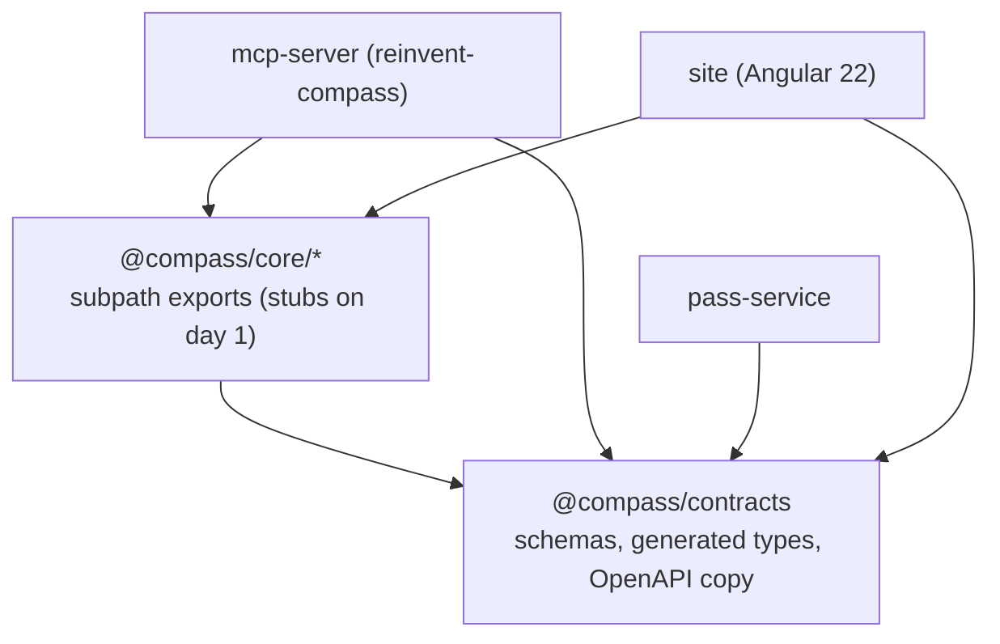
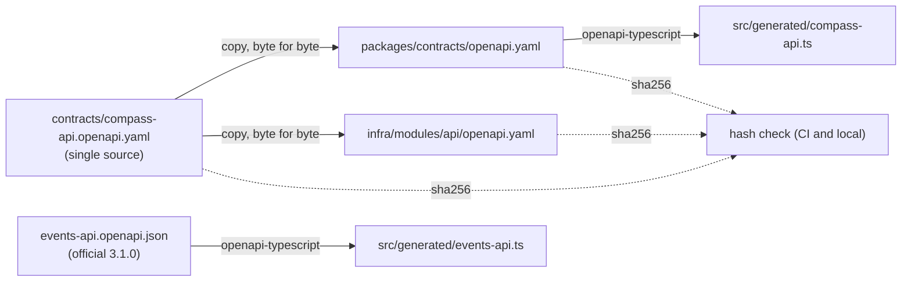

# Design Document: foundation-contracts (S0)

## Overview

S0 is the one-day foundation stream for re:Invent Compass. Its single job is to lock the shared contracts and scaffolding so that streams S1 to S7 can build in parallel the next day without ever editing the same file. Nothing here is feature logic: every package ships an index that compiles and a placeholder test, and every shared shape (zod schema, OpenAPI contract, generated types, synthetic catalog) is frozen at the end of day 1 (build plan section 9.2, ADR-008).

This design is grounded in the approved build plan (sections 3, 4.1, 5, 8, 8.1, 9.1, 9.2, 11.1, 11.2) and ADR-006 (toolchain), ADR-007 (monorepo layout and ownership), ADR-008 (contract first OpenAPI), ADR-016 (synthetic catalog), ADR-018 (CI pipeline). Where this design and the plan disagree, the plan wins and S0 fixes the steering file in the same change.

The deliverables, mapped to the twelve requirements:

| Area                                    | Requirement | What S0 produces                                                                                                                                                                                                                                                   |
| --------------------------------------- | ----------- | ------------------------------------------------------------------------------------------------------------------------------------------------------------------------------------------------------------------------------------------------------------------ |
| Workspace scaffold and toolchain        | 1           | npm workspaces root, TS 6 strict, ESLint flat config, Prettier, vitest 4 at 100 percent coverage, pinned dependencies, `.nvmrc`, lockfile                                                                                                                          |
| @compass/core subpath exports           | 2           | Empty compiling entry points for eight subpaths, no shared barrel, browser-safe `rules`                                                                                                                                                                            |
| Events API OpenAPI and types            | 3           | Committed official OpenAPI 3.1.0, ADR-023 provenance, generated TypeScript types                                                                                                                                                                                   |
| Shared zod schemas and MCP tool schemas | 4           | Wire schemas (Session, SessionTime, Schedule, PersonalTime, Event, BulkResult, response wrappers) mirroring the Events API OpenAPI, domain types (NormalisedSession, Commitment, Venue, Verdict, PassFields), Problem, seventeen MCP tool input and output schemas |
| Compass API OpenAPI, copies, types      | 5           | Single source contract, two byte-identical copies, hash check, placeholder safety check, generated types                                                                                                                                                           |
| Synthetic catalog                       | 6           | Deterministic generator plus about 120 committed sessions in the real shape                                                                                                                                                                                        |
| CI workflows and Dependabot             | 7           | check.yml, e2e.yml, publish.yml, dependabot.yml, scripts under `.github/scripts`                                                                                                                                                                                   |
| Repo build hooks                        | 8           | `.kiro/hooks` save hook running lint, owning-package tests and the dash check                                                                                                                                                                                      |
| SP2 ID token spike                      | 9           | `spikes/sp2-id-token.ts` with tested redaction modules under `spikes/src`, tests under `spikes/test`                                                                                                                                                               |
| SP5 shape-diff spike                    | 10          | `spikes/sp5-shape-diff.ts` with tested diff modules under `spikes/src`, tests under `spikes/test`                                                                                                                                                                  |
| Doc and example updates                 | 11          | `.env.example`, terraform tfvars and backend examples, CONCEPT dates                                                                                                                                                                                               |
| Foundation acceptance gate              | 12          | A green run of compile, test, hash, placeholder, dash, actionlint and catalog validation                                                                                                                                                                           |

### Non-negotiable constraints baked into every component

- No em dash or en dash anywhere in copy, comments, test names or commit messages. Use commas, colons, parentheses or new sentences. The Dash_Check_Script enforces this in CI and on save.
- Every dependency is pinned to an exact version. No ranges, no caret, no tilde. The full pinned table is in this design (requirements deferred version numbers to here).
- No secret, token, certificate, key or account identifier value is ever printed or committed. Only `.example` files hold secret-bearing config, with placeholder values.
- Tests run with `COMPASS_MODE=simulated` against committed fixtures only. No test calls the live Events API.
- S0 edits only its owned paths (listed in Architecture below).

## Architecture

### Monorepo layout and ownership

The repository is a single npm workspaces monorepo. The folders S0 owns, and only these, are editable by this stream (build plan section 9.1, ADR-007):

```
aws-re_invent-compass/
  package.json               # S0: workspaces, engines, scripts, devDependencies (lockfile integrator-owned after day 1)
  package-lock.json          # S0 on day 1
  .nvmrc                      # S0: contents "24"
  tsconfig.base.json         # S0: shared strict compiler options
  tsconfig.json              # S0: solution file referencing every workspace
  eslint.config.js           # S0: flat config, typescript-eslint plus angular-eslint for site
  .prettierrc.json           # S0: Prettier options
  vitest.config.ts           # S0: v8 coverage at 100 percent, named exclusions
  .env.example               # S0: placeholder env values
  contracts/
    compass-api.openapi.yaml # S0: single source Compass API contract (OpenAPI 3.0.1)
  packages/
    contracts/               # S0: @compass/contracts
      package.json
      openapi.yaml           #   byte-identical copy of the Compass API contract
      events-api.openapi.json#   official Events API document (OpenAPI 3.1.0)
      src/
        wire/                #   wire schemas, mirroring the Events API OpenAPI exactly
          session.ts         #     Session (wire) and SessionTime, SeatAvailability
          schedule.ts        #     Schedule (wire) and response wrappers
          personal-time.ts   #     PersonalTime and PersonalTimeInput
          event.ts           #     Event
          bulk-result.ts     #     BulkResult, BulkFailure, BulkFailureCode
        domain/              #   domain types, produced by S1's normaliser, shared by every stream
          normalised-session.ts #  NormalisedSession (startsAt and endsAt computed from sessionTime)
          commitment.ts      #     Commitment discriminated union
          venue.ts           #     Venue
          verdict.ts         #     Verdict
        pass-fields.ts       #   createPassFieldsSchema factory (single source, plan 5.3)
        problem.ts           #   Problem error schema
        mcp-tools.ts         #   MCP tool input and output schemas
        generated/
          events-api.ts      #   generated from events-api.openapi.json
          compass-api.ts     #   generated from openapi.yaml
        index.ts             #   explicit re-exports (not a core barrel; this is the contracts public surface)
      test/
    core/                    # @compass/core, subpath exports, src folders owned by S1 to S4
      package.json           # S0 writes the manifest and the empty entry points only
      src/
        auth/index.ts        #   S1 owns content; S0 ships an empty compiling stub
        api/index.ts         #   S1
        catalog/index.ts     #   S1
        simulated/index.ts   #   S1
        rules/index.ts       #   S2, browser-safe
        scanner/index.ts     #   S3
        spec/index.ts        #   S3
        passes/index.ts      #   S4
    mcp-server/              # S3 owns content; S0 ships manifest, stub index and placeholder test
    pass-service/            # S5 owns content; S0 ships manifest, stub index and placeholder test
  site/                      # S7 owns content; S0 ships the workspace manifest only
  infra/
    modules/api/openapi.yaml # S0 copy (the only infra path S0 owns)
    envs/dev/terraform.tfvars.example       # S0
    envs/dev/cloud.auto.tfbackend.example   # S0
    envs/prod/terraform.tfvars.example      # S0
    envs/prod/cloud.auto.tfbackend.example  # S0
  fixtures/
    synthetic/               # S0: generated catalog and the generator
  spikes/
    sp2-id-token.ts          # S0: thin .ts wrapper, run under Node 24 type stripping (no build)
    sp5-shape-diff.ts        # S0: thin .ts wrapper, run under Node 24 type stripping (no build)
    src/                     #   tested redaction and diff modules behind the thin wrappers (id-token-redact.ts, shape-diff.ts)
    test/                    #   spike tests (Requirements 9.7 and 10.6), in the root vitest run
  .github/
    workflows/check.yml      # S0
    workflows/e2e.yml        # S0
    workflows/publish.yml    # S0
    dependabot.yml           # S0
    scripts/                 # S0: hash-check, placeholder-safety, dash-check, catalog-check
  .kiro/
    hooks/                   # S0: save hook (lint, owning-package tests, dash check)
    steering/                # S0: product, tech, structure, workflow
  docs/
    decisions/ADR-023-events-api-openapi-source.md  # S0
  CONCEPT.md                 # S0: dates only
```

`core/src/{auth,api,catalog,simulated,rules,scanner,spec,passes}` folders are owned day-to-day by S1 to S4, but on day 1 S0 creates each folder with an empty compiling `index.ts` so the solution builds. After the day-1 lock, each stream fills its own folder.

### Workspace graph



`@compass/contracts` has no workspace dependency: it is the root of the graph. Every other workspace depends on it. `@compass/core/rules` must stay browser-safe so the site can import it without a Node polyfill.

### Build and type-generation pipeline

Type generation is a build-time step that produces committed, compiled TypeScript from two OpenAPI documents. The pipeline runs in this order:



Steps and their npm scripts:

1. `gen:copy` copies `contracts/compass-api.openapi.yaml` byte for byte to `packages/contracts/openapi.yaml` and `infra/modules/api/openapi.yaml`. The copy is a raw byte copy, not a parse and re-serialize, so the three files stay hash-identical.
2. `gen:types` runs `openapi-typescript` twice: once on `packages/contracts/openapi.yaml` to `src/generated/compass-api.ts`, once on `events-api.openapi.json` to `src/generated/events-api.ts`.
3. `tsc -b` compiles the solution, including the generated files.
4. `check:hash` recomputes SHA-256 of the three Compass API copies and fails if any differs.
5. `check:placeholders` scans the three committed Compass API copies and fails on a 12-digit number or an `arn:aws` literal.
6. `check:dash` fails if an em dash or en dash appears in any tracked text file except `LICENSE`.
7. `check:catalog` regenerates the synthetic catalog and compares it to the committed catalog, and validates every committed session against the live `SessionWireSchema`.

Generated files (`src/generated/**`) are excluded from coverage (named exclusion, build plan 11.2) but are compiled and committed so no stream needs network access to build.

### Trust and safety posture for the foundation

- Secret-bearing config exists only as `.example` files with placeholder values. The real files are git-ignored (`.env`, `terraform.tfvars`, `cloud.auto.tfbackend`).
- The Compass API contract uses `${...}` placeholders for integration URIs that Terraform fills with `templatefile()`, so no account identifier or ARN is committed. The placeholder safety check guards this.
- The spike wrappers print only metadata and field or claim names, never values. The wrappers are `.ts` files run directly under Node 24 using type stripping, so there is no build step for spikes. Their redaction and diff logic lives in tested modules under `spikes/src`, with tests under `spikes/test`, and `spikes/src` is in the root vitest coverage run so coverage stays at 100 percent with no new exclusions.

## Components and Interfaces

### 1. Workspace scaffold and toolchain (Requirement 1)

Root `package.json` declares:

- `"private": true` and `"workspaces": ["packages/contracts", "packages/core", "packages/mcp-server", "packages/pass-service", "site"]`.
- `"engines": {"node": ">=24"}`.
- Scripts: `build` (`tsc -b`), `test` (`vitest run --coverage`), `lint` (`eslint .`), `format:check` (`prettier --check .`), plus the `gen:*` and `check:*` scripts above.
- `devDependencies` with every tool pinned exactly (see the pinned dependency table).

`.nvmrc` contains exactly `24`.

`tsconfig.base.json` sets `strict`, `target` and `lib` for ES2024, `module` and `moduleResolution` for Node, `composite` true (for project references), `declaration` true, `noEmit` false, and `verbatimModuleSyntax`. It also sets `customConditions: ["@compass/source"]` so that `tsc` and editors resolve `@compass/core` subpaths to their TypeScript source (see Component 2), which means a fresh clone typechecks with no build step. The root `tsconfig.json` is a solution file with `references` to each workspace tsconfig. Each workspace extends the base and sets its own `rootDir`, `outDir` and `references`.

`eslint.config.js` is a flat config: the typescript-eslint recommended-type-checked rules for all TypeScript, the built-in `no-restricted-imports` rule that forbids deep relative imports across packages (so a `@compass/core` subpath is always imported through its declared subpath export, never through a deep relative path), and an angular-eslint block scoped to `site/**` (Requirement 2.6). There is no `eslint-plugin-import` dependency; the cross-package deep-relative-import ban is enforced by `no-restricted-imports` alone.

`.prettierrc.json` sets a single house style applied across the monorepo.

`vitest.config.ts` sets the v8 coverage provider, thresholds of 100 for lines, branches, functions and statements, and `coverage.exclude` listing only `packages/mcp-server/src/bin.ts`, `packages/pass-service/src/lambda-entry/*.ts` and `**/generated/**` (build plan 11.2). The root config also includes `spikes/src` in the run and coverage, with no new named exclusions. It sets `resolve.conditions` to include `@compass/source` so `npm test` resolves `@compass/core` subpaths to source and runs on a fresh clone with no build step. It sets `env: {COMPASS_MODE: "simulated"}` so no test can reach a live transport.

Each workspace gets a `package.json`, a tsconfig, a compiling placeholder `index.ts` and a placeholder test under `test/`.

### 2. @compass/core subpath exports (Requirement 2)

`packages/core/package.json` declares the eight subpath exports through the `exports` map:

```jsonc
{
  "name": "@compass/core",
  "exports": {
    "./auth": {
      "@compass/source": "./src/auth/index.ts",
      "types": "./dist/auth/index.d.ts",
      "default": "./dist/auth/index.js",
    },
    "./api": {
      "@compass/source": "./src/api/index.ts",
      "types": "./dist/api/index.d.ts",
      "default": "./dist/api/index.js",
    },
    "./catalog": {
      "@compass/source": "./src/catalog/index.ts",
      "types": "./dist/catalog/index.d.ts",
      "default": "./dist/catalog/index.js",
    },
    "./simulated": {
      "@compass/source": "./src/simulated/index.ts",
      "types": "./dist/simulated/index.d.ts",
      "default": "./dist/simulated/index.js",
    },
    "./rules": {
      "@compass/source": "./src/rules/index.ts",
      "types": "./dist/rules/index.d.ts",
      "default": "./dist/rules/index.js",
    },
    "./scanner": {
      "@compass/source": "./src/scanner/index.ts",
      "types": "./dist/scanner/index.d.ts",
      "default": "./dist/scanner/index.js",
    },
    "./spec": {
      "@compass/source": "./src/spec/index.ts",
      "types": "./dist/spec/index.d.ts",
      "default": "./dist/spec/index.js",
    },
    "./passes": {
      "@compass/source": "./src/passes/index.ts",
      "types": "./dist/passes/index.d.ts",
      "default": "./dist/passes/index.js",
    },
  },
}
```

Each subpath lists a custom `@compass/source` condition first, pointing at `./src/<subpath>/index.ts`, before the `types` and `default` dist entries. The custom condition is set in `tsconfig.base.json` (`customConditions: ["@compass/source"]`) and in `vitest.config.ts` (`resolve.conditions` includes `@compass/source`), so `tsc`, editors and `npm test` all resolve `@compass/core` subpaths to TypeScript source. The result is that a fresh clone typechecks and runs `npm test` with no build step, while the `types` and `default` dist entries remain for the published and built consumption path.

There is deliberately no `"."` root export and no `src/index.ts` barrel: streams must import a specific subpath, which keeps ownership clean and lets the site tree-shake `rules` alone. Each `src/<subpath>/index.ts` is an empty compiling stub on day 1 (for example `export {};`). The `rules` stub imports no Node runtime module (no `node:*`, no `fs`, no `path`), so it is importable in a browser; a lint rule and a type-level import test in `contracts` guard this.

### 3. @compass/contracts schemas and generated types (Requirement 4)

The package exports named schemas and their inferred types from `src/index.ts` (this is the contracts public surface, not a core-style barrel). Every schema is zod. The schemas fall into two groups: wire schemas that mirror the Events API OpenAPI exactly, and domain types that S1's normaliser produces and every stream shares. Each schema is defensive: it uses zod's default object behaviour, which strips unknown fields, so fields the Events API adds over time never break parsing and never flow into logs; it rejects wrong types rather than coercing. See Data Models for the field detail.

Public surface, wire schemas (from `src/wire/`):

- `SessionWireSchema`, `SessionWire`
- `SessionTimeSchema`, `SessionTime`
- `SeatAvailabilitySchema`, `SeatAvailability`
- `ScheduleWireSchema`, `ScheduleWire`
- `PersonalTimeSchema`, `PersonalTime`; `PersonalTimeInputSchema`, `PersonalTimeInput`
- `EventSchema`, `Event`
- `BulkResultSchema`, `BulkResult`; `BulkFailureSchema`, `BulkFailure`; `BulkFailureCodeSchema`, `BulkFailureCode`
- `ListSessionsSchema`, `GetSessionSchema`, `GetScheduleSchema` response wrappers and their inferred types

Public surface, domain types (from `src/domain/`):

- `NormalisedSessionSchema`, `NormalisedSession`
- `CommitmentSchema`, `Commitment`
- `VenueSchema`, `Venue`
- `VerdictSchema`, `Verdict`
- `createPassFieldsSchema` factory and the `PassFields` inferred type (from `src/pass-fields.ts`)

Public surface, shared:

- `ProblemSchema`, `Problem`
- `mcpTools`, a record of `{input, output}` zod schemas keyed by tool name, plus inferred input and output types per tool (from `mcp-tools.ts`)
- `components` and `paths` types re-exported from `src/generated/compass-api.ts`
- `EventsApi` namespace types re-exported from `src/generated/events-api.ts`

### 4. Compass API OpenAPI contract and three-way copy (Requirement 5)

`contracts/compass-api.openapi.yaml` is the single source, written as OpenAPI 3.0.1. It defines every route in build plan section 5.2 with request and response schemas, the `application/problem+json` error component, the two auth schemes (Bearer ID token, Apple `ApplePass` token) plus the capability routes, and the `x-amazon-apigateway-*` extensions needed for API Gateway REST import and request validation.

- Integration URIs use `${...}` placeholders (for example `${api_lambda_invoke_arn}`) that Terraform fills with `templatefile()`. No literal ARN, no 12-digit account number, no account-specific value is committed.
- The copy step is a byte copy to `packages/contracts/openapi.yaml` and `infra/modules/api/openapi.yaml`. The three files are hash-identical by construction, and the hash check proves it in CI.
- `openapi-typescript` generates `src/generated/compass-api.ts` from the contracts copy.

The error shape is the `application/problem+json` object `{type, title, status, code}`, defined once in the contract and mirrored by `ProblemSchema`. Input is never echoed back in an error.

### 5. Synthetic catalog generator (Requirement 6)

`fixtures/synthetic/generate.ts` is a deterministic generator. Determinism comes from a seeded pseudo-random generator (a small seeded PRNG such as a mulberry32 implemented in-repo, so there is no dependency and the seed is explicit), a fixed seed constant, and sorted iteration so output ordering never depends on map iteration order. It emits about 120 sessions as JSON under `fixtures/synthetic/` (one catalog file plus a committed index), using:

- made-up session titles, speakers and session codes (`abbreviation`),
- real venue names (so walking-time data is realistic for S2),
- repeats carrying the `-R` suffix, all-day items, sessions with missing venues and sessions with missing end times (so every optional-field path is exercised),
- the real data shape, so every generated session parses against `SessionWireSchema`.

`check:catalog` regenerates and compares against the committed files (byte-stable serialization: sorted keys, trailing newline), and validates every committed session against `SessionWireSchema`. A mismatch fails CI.

### 6. CI workflows and scripts (Requirement 7)

Four files under `.github/`, every action pinned by commit SHA, no `push` and no `schedule` trigger anywhere.

- `check.yml`: one job on `pull_request` into `main` only. Steps in build plan 11.1 order: `npm ci`, contract hash check, placeholder safety check, dash check, `prettier --check`, `eslint`, `tsc -b`, `vitest --coverage` at 100 percent, build, gitleaks, `npm audit --omit=dev --audit-level=high`, `terraform fmt -check`, `terraform validate`, `tflint`, `terraform test`, Trivy filesystem scan, Trivy config scan, shellcheck. Target run time under 8 minutes. The Terraform and shellcheck steps are written to pass as no-ops while there are no Terraform or shell files yet (guarded by a presence check so an empty match does not fail).
- `e2e.yml`: `workflow_dispatch` only. Playwright plus axe plus Lighthouse.
- `publish.yml`: tag `v*` only. Build and `npm publish` through npm trusted publishing with provenance.
- `dependabot.yml`: monthly schedule, `open-pull-requests-limit: 0`.

Scripts under `.github/scripts/` (Node ESM so they run under Node 24 with no extra dependency):

- `hash-check.mjs`: computes SHA-256 of the three Compass API copies and compares them; reports which copy differs.
- `placeholder-safety.mjs`: scans the three committed copies for a 12-digit number (`\b\d{12}\b`) or an `arn:aws` literal; reports which copy matched.
- `dash-check.mjs`: scans all tracked text files except `LICENSE` for an em dash or en dash; reports each offending file and line. Uses `git ls-files` to enumerate tracked files.
- `catalog-check.mjs`: wraps the generator comparison and schema validation.

`actionlint` lints the three workflow files clean (Requirement 7.11).

### 7. Repository build hooks (Requirement 8)

`.kiro/hooks/` holds a save hook that triggers on save of TypeScript files. On save it runs lint on the saved file, runs the tests of the package that owns the saved file (resolved by matching the file path to a workspace folder), and runs `dash-check.mjs`. The hook is a convenience for engineers; the CI check is the real gate.

### 8. Spike scripts (Requirements 9, 10)

Both spikes are thin `.ts` wrappers in `spikes/`, run directly under Node 24 using type stripping, so there is no build step for spikes. Their logic lives in tested modules under `spikes/src/`, and their tests live in `spikes/test/` (not in `packages/contracts/test`, which would cross ownership). The root vitest run includes `spikes/src` in its coverage, so `spikes/src` is covered at 100 percent with no new named exclusions.

- `sp2-id-token.ts`: after a local sign-in, decodes the ID token header and payload, prints only `alg`, `kid`, `iss`, `aud`, `token_use`, `exp` and the claim names (never values), fetches `<iss>/.well-known/openid-configuration` and the JWKS referenced from it, and verifies with `aws-jwt-verify`. On verification failure it reports the failure with no claim value. The claim-name extraction and the redaction function live in `spikes/src/id-token-redact.ts`, covered by a test in `spikes/test` (Requirement 9.7).
- `sp5-shape-diff.ts`: compares recordings in the git-ignored `fixtures/.raw/` against the synthetic catalog and the Events API OpenAPI, printing field-level differences only (field names and presence or type differences, never recorded values). If `fixtures/.raw/` is absent or empty it reports that no recordings are present, with no error. The field-diff logic lives in `spikes/src/shape-diff.ts`, covered by a test in `spikes/test` proving no recorded value is printed (Requirement 10.6).

### 9. Events API OpenAPI retrieval and ADR-023 (Requirement 3)

The official document is fetched once from `https://api.awsevents.com/v1/openapi.json` (OpenAPI 3.1.0) and committed as `packages/contracts/events-api.openapi.json`. `docs/decisions/ADR-023-events-api-openapi-source.md` records the source URL, the retrieval date and the SHA-256 of the committed document. A small fetch helper surfaces a descriptive error to the operator and leaves any previously committed document unchanged if the fetch fails (Requirement 3.5). The fetch is an operator action, not a CI or test action, so no test calls the live endpoint.

### 10. Doc and example updates (Requirement 11)

- `.env.example`, `infra/envs/dev/terraform.tfvars.example`, `infra/envs/prod/terraform.tfvars.example`, `infra/envs/dev/cloud.auto.tfbackend.example`, `infra/envs/prod/cloud.auto.tfbackend.example`, each with placeholder values only.
- `CONCEPT.md` dates are reconciled with the build plan in the same change if any differ. (On review the current CONCEPT dates already match the plan, so no date change is forced; this component stays as a guard.)

### Pinned dependency table

Every dependency is pinned to an exact version. The versions below are the exact verified pins. No range, caret or tilde appears in any manifest. At install time the integrator runs `npm view <pkg> version` and `npm view <pkg> peerDependencies` for every package and records the result in `package-lock.json` and in the install notes. TypeScript stays on the 6.0.x line because Angular 22.2 and typescript-eslint both require typescript `>=6.0 <6.1`.

| Package                         | Exact pin | Scope                                     | Purpose                                                                                                              | Source                   |
| ------------------------------- | --------- | ----------------------------------------- | -------------------------------------------------------------------------------------------------------------------- | ------------------------ |
| typescript                      | 6.0.3     | dev, root                                 | TS 6 strict compiler across every workspace, kept on the 6.0.x line for Angular 22.2 and typescript-eslint           | ADR-006                  |
| @types/node                     | 24.19.2   | dev, root                                 | Node 24 runtime type definitions                                                                                     | ADR-006, tech.md         |
| vitest                          | 4.1.12    | dev, root                                 | Unit test runner, v8 coverage at 100 percent                                                                         | ADR-006                  |
| @vitest/coverage-v8             | 4.1.12    | dev, root                                 | v8 coverage provider, kept in lockstep with vitest (ADR-006; Angular 22 supports vitest 4 and 5)                     | ADR-006                  |
| eslint                          | 10.12.0   | dev, root                                 | Linting with flat config                                                                                             | ADR-006                  |
| typescript-eslint               | 8.71.2    | dev, root                                 | TypeScript ESLint rules and parser                                                                                   | ADR-006                  |
| @angular-eslint/eslint-plugin   | 22.6.0    | dev, root                                 | Angular lint rules scoped to site                                                                                    | ADR-006                  |
| @angular-eslint/template-parser | 22.6.0    | dev, root                                 | Angular template parsing for lint                                                                                    | ADR-006                  |
| prettier                        | 3.9.10    | dev, root                                 | Code formatting across the monorepo                                                                                  | ADR-006                  |
| zod                             | 4.6.7     | prod, contracts                           | Every schema, tool input and API request parsed                                                                      | ADR-006                  |
| openapi-typescript              | 7.13.0    | dev, contracts                            | Generate TS types from both OpenAPI documents                                                                        | ADR-008                  |
| aws-jwt-verify                  | 5.2.1     | dev, root (SP2 spike); prod, pass-service | ID token verification, used by the SP2 spike at the root and by pass-service at runtime (not a contracts dependency) | ADR-006                  |
| passkit-generator               | 3.7.0     | prod, pass-service                        | Apple Wallet pass building                                                                                           | ADR-006                  |
| ical-generator                  | 11.1.2    | prod, core                                | Local .ics generation                                                                                                | ADR-006, tech.md         |
| @napi-rs/keyring                | 2.1.1     | prod, core                                | OS keychain token storage with memory fallback                                                                       | tech.md                  |
| @modelcontextprotocol/sdk       | 1.32.2    | prod, mcp-server                          | Local stdio MCP server and CLI                                                                                       | ADR-006                  |
| fast-check                      | 4.10.2    | dev, root                                 | Property-based testing                                                                                               | Requirements 4.12, 6.1   |
| esbuild                         | 0.28.2    | dev, root                                 | Lambda and MCP bundle step in CI build                                                                               | build plan 11.1          |
| @aws-sdk/client-dynamodb        | 3.1152.0  | prod, pass-service                        | DynamoDB client                                                                                                      | build plan 3, 7.2        |
| @aws-sdk/lib-dynamodb           | 3.1152.0  | prod, pass-service                        | DynamoDB document client                                                                                             | build plan 3, 7.2        |
| @aws-sdk/client-secrets-manager | 3.1152.0  | prod, pass-service                        | Secrets Manager client (pepper, origin verify)                                                                       | build plan 7.2           |
| google-auth-library             | 11.3.0    | prod, pass-service                        | Google Wallet JWT and API auth                                                                                       | build plan 3             |
| qrcode                          | 1.5.4     | prod, core                                | QR rendering for the hand-off                                                                                        | build plan 8.1           |
| ical.js                         | 2.2.1     | dev, core                                 | iCalendar parsing in tests only                                                                                      | Requirement 1.8          |
| @playwright/test                | 1.64.1    | dev, root                                 | Browser tests, site only, on demand                                                                                  | tech.md, build plan 11.2 |
| @axe-core/playwright            | 4.14.0    | dev, root                                 | Accessibility checks in e2e                                                                                          | build plan 8 (S7), 11.2  |

The cross-package deep-relative-import ban is enforced by the built-in `no-restricted-imports` rule only. There is no `eslint-plugin-import` dependency: it does not support ESLint 10, so it is dropped entirely.

The Angular 22 workspace pulls the `@angular/*` packages (`@angular/core`, `@angular/common`, `@angular/compiler`, `@angular/platform-browser`, `@angular/router`, `@angular/build`, `@angular/ssr`, `@angular/cli`, and the matching `@angular/compiler-cli`), each pinned to the latest 22.2.x patch, all on the same patch where they release together, and recorded in `site/package.json` by S0. They are listed as a group here to keep the table readable; every one is an exact pin in the manifest and the lockfile.

## Data Models

All schemas are zod and live in `packages/contracts/src`. They fall into two clearly separated groups: wire schemas under `src/wire/` that mirror the official Events API OpenAPI (`packages/contracts/events-api.openapi.json`) exactly, and domain types under `src/domain/` that S1's normaliser produces and every stream shares. Three cross-cutting rules apply to every schema:

- Defensive parsing by stripping: schemas use zod's default object behaviour, which strips unknown fields. Unknown data is ignored and never carried into logs, and fields the Events API adds over time never break parsing. The schemas never use `passthrough` or `looseObject`: only the known fields are preserved. The defensive intent (unknown fields do not break parsing) is kept, but the mechanism is strip, not passthrough.
- No coercion: a present field with the wrong type is rejected, not coerced. Schemas never fill a default to hide a type error.
- Enum forward-compatibility: for every wire enum (`seatAvailability`, `BulkFailureCode` and any other), a known value parses to its literal, and an unknown string is kept rather than failing the whole response. A wrong type (a number where a string belongs) is still rejected. In zod this is expressed as a union of the known string literals with a catch-all that preserves an unknown string (for example `z.union([<literals>, z.string().transform(...)])` or an equivalent `.catch` on a string, never `z.enum` alone, which would throw on an unknown value). For `seatAvailability` an unknown value becomes `"unknown"`; an unrecognised `BulkFailureCode` is kept as an unrecognised refusal.

## Wire schemas (`src/wire/`)

These mirror the official Events API OpenAPI exactly. Because they mirror the wire, there is no `startsAt` or `endsAt` on the wire: those are computed later by the normaliser.

### Session (wire) and SessionTime (`wire/session.ts`)

`SessionWireSchema` models one catalog session exactly as the Events API returns it (tech.md, Requirement 4.1 to 4.4).

- `sessionId`: string, required.
- `title`: string, required.
- `abbreviation`: string, optional. This is the session code field; it carries the `-R` repeat suffix when present.
- `abstract`: string, optional.
- `type`, `level`: string, optional.
- `venue`, `room`: string, optional.
- `isAllDaySession`: boolean, optional.
- `isReservable`: boolean, optional.
- `seatAvailability`: `SeatAvailability` enum, optional (see the enum below, with forward-compatibility).
- `sessionTime`: `SessionTime`, optional.
- `speakers`: array of `{name: string}`, optional.
- `tracks`, `topics`, `industries`, `areasOfInterest`, `roles`, `services`, `segments`, `features`, `customerPersonas`, `experiences`, `additionalActivities`, `focusAreas`: arrays of strings, each optional.
- Unknown fields: stripped (not kept).

`SessionTimeSchema` is `{date, time, length, timezone}`, all strings.

`SeatAvailabilitySchema` is the enum `available | limited | veryLimited | unavailable | walkUp`, applying the enum forward-compatibility rule: a known value parses to its literal; an unknown string becomes `"unknown"`; a wrong type is rejected.

A type-level test asserts the WIRE `SessionWire` type (not a conflated Session) matches the generated `Session` type from the Events API OpenAPI by comparing the set of `SessionWire` field names with the set of properties on the generated `Session` type, and checking that every non-enum field type is assignable. It does not assert full assignability, because the forward-compatible enums (which keep an unknown string) are intentionally wider than the generated enum unions and would make a full assignability check fail (Requirement 4.4).

### Schedule (wire) and response wrappers (`wire/schedule.ts`)

`ScheduleWireSchema` is `{reserved: string[], favorites: string[], personalTime: PersonalTime[]}`, with all three fields required. `reserved` and `favorites` are session id arrays; `personalTime` is an array of `PersonalTime`.

Response wrappers mirror the wire envelopes:

- `ListSessionsSchema`: `{items: SessionWire[], totalCount: number, nextToken?: string}`.
- `GetSessionSchema`: `{session: SessionWire}`.
- `GetScheduleSchema`: `{schedule: ScheduleWire}`.

### PersonalTime (`wire/personal-time.ts`)

`PersonalTimeSchema`: `personalTimeId`, `startDateTime`, `endDateTime`, `title`, `description` (all required), `location` (optional). `PersonalTimeInputSchema` is identical but without `personalTimeId` (used on create).

### Event (`wire/event.ts`)

`EventSchema` models the `GetEvent` response that supplies the event window and timezone used elsewhere (never hard-coded):

- Required: `eventId`, `name`, `eventType`, `startDate`, `endDate`, `isOnline`, `authenticationRequired`.
- Optional: `timezone`, `timezoneAbbreviation`, `timeFormat`, `address`, `supportedLanguageCodes`.

### BulkResult (`wire/bulk-result.ts`)

`BulkResultSchema` is `{successful: string[], failed: BulkFailure[]}`. `BulkFailureSchema` is `{sessionId: string, code: BulkFailureCode, conflictsWith?: string[]}`, where `conflictsWith` is an optional array of session ids.

`BulkFailureCodeSchema` is the enum `sessionNotReservable | scheduleConflict | alreadyScheduled | sessionFull | insufficientAccess | timePassed | alreadyFavorited | notFavorited | other`, applying the enum forward-compatibility rule: a known value parses to its literal; an unrecognised code string is kept as an unrecognised refusal; a wrong type is rejected.

## Domain types (`src/domain/`)

These are internal types produced by S1's normaliser. They are defined here in contracts so every stream shares them.

### NormalisedSession (`domain/normalised-session.ts`)

The normalised, internal view of a session. The normaliser computes `startsAt` and `endsAt` from the wire `sessionTime`.

- `sessionId`: string.
- `code`: string, from the wire `abbreviation`.
- `title`: string.
- `type`, `level`: string, optional. When the wire omits a value the normaliser leaves the field absent and lists its name in `missingFields`; it never substitutes a default.
- `venue`, `room`: string, optional.
- `startsAt`, `endsAt`: ISO 8601 with offset, optional, computed from `sessionTime` by the normaliser (absent when the wire has no usable time).
- `isAllDay`: boolean.
- `isReservable`: boolean.
- `seatAvailability`: `SeatAvailability` (same forward-compatible enum as the wire).
- `repeatOf`: string, optional (the base session a `-R` repeat points at).
- `missingFields`: array of strings, listing wire fields that were absent so downstream code can be honest about uncertainty.

### Commitment (`domain/commitment.ts`)

A discriminated union over a `kind` field covering a reserved session and personal time (a layover). The reserved variant carries a session reference and timing; the personal-time variant carries a free-text title and timing. The discriminant makes exhaustive handling checkable by the rules engine later.

### Venue (`domain/venue.ts`)

A venue with its name and optional coordinates and metadata, used by S2's walking-time data. Name required, coordinates optional.

### Verdict (`domain/verdict.ts`)

The guardrail outcome. A discriminated union over `allow`, `warn` and `block`, each carrying a `reasons` array of human-readable strings. `warn` and `block` always carry at least one reason.

### PassFields (`src/pass-fields.ts`)

The single source for pass content, applying build plan section 5.3. It lives directly under `src/`, not under `src/domain/` (build plan 5.3). It is a factory, not a fixed schema: `createPassFieldsSchema({ start, end, timezone })` returns the zod schema, where the event window (`start`, `end`, `timezone`) comes from `GetEvent` at runtime. No dates are hard-coded in the contract or the schema; the `startsAt` and `endsAt` "inside the event window" rule is enforced against the window passed into the factory.

- `sessionCode`: matches `^[A-Z0-9]{2,12}(-R[0-9]?)?$`.
- `title`: 1 to 80 characters.
- `venue`, `room`: 0 to 40 characters each (empty means "Venue not published").
- `startsAt`, `endsAt`: ISO 8601 with offset; `endsAt` after `startsAt`; inside the event window passed to the factory; at most 10 hours apart.
- `walkFromPrevious`: optional `{minutes: 0 to 90, fromVenue: 0 to 40 chars}`.
- `nextConnection`: optional `{sessionCode, startsAt, venue, walkMinutes}`.
- `attendeeName`: optional, 1 to 40 characters, only when opted in.
- Server-derived fields (`boardingClosesAt`, disclaimer, `expirationDate`, `relevantDates`, `transitType`, `sharingProhibited`, no barcodes) are not accepted from the client; they are documented here as derived and are set server-side by S5.
- All text: letters, digits, spaces and basic punctuation only. Any value that looks like a URL or domain, any control character and any bidirectional override character is rejected.

## Shared schemas

### Problem error (`problem.ts`)

The `application/problem+json` body `{type, title, status, code}`: `type` a string (URI reference), `title` a string, `status` an integer, `code` a string. No field echoes request input.

### MCP tool schemas (`mcp-tools.ts`)

An input schema and an output schema for every tool in build plan section 8.1: `sign_in`, `sign_out`, `refresh_catalog`, `find_sessions`, `scan_repo`, `plan_week`, `check_itinerary`, `reserve_with_guardrails`, `cancel_reservation`, `add_standby`, `remove_standby`, `add_layover`, `issue_boarding_passes`, `send_to_phone`, `sync_passes`, `export_calendar`, `forget_me`. Each is a zod object parsed defensively (unknown fields stripped). Write-tool inputs (reserve, cancel, standby, layover, issue, send, sync, forget) reference the domain types above; read-tool outputs reference `NormalisedSession`, `ScheduleWire` and `Verdict`. The schemas are exported as a `mcpTools` record keyed by tool name so S3 can iterate them.

## Correctness Properties

A property is a characteristic or behavior that should hold true across all valid executions of a system, essentially a formal statement about what the system should do. Properties serve as the bridge between human-readable specifications and machine-verifiable correctness guarantees.

Much of S0 is configuration (workspace manifests, CI YAML, hooks, documentation), which is not suitable for property-based testing and is covered by example, smoke and integration tests in the Testing Strategy. The parts that are pure logic with a large input space (zod schemas, the deterministic catalog generator, the hash and placeholder and dash scanners, the redaction functions) are strong candidates for property-based testing. The properties below were derived from the prework analysis and reduced to remove redundancy: the many per-schema acceptance criteria collapse into universal schema properties, and the four dash-related criteria, the four scan-related criteria and the three hash-related criteria each collapse into a single detector property.

### Property 1: Every declared dependency is an exact pin

For all dependency entries across every workspace manifest (root and each package), the declared version is an exact version with no range, caret, tilde, star or other range operator.

**Validates: Requirements 1.7, 1.8, 1.16**

### Property 2: Schemas accept valid inputs and strip unknown fields

For all shared schemas (the wire schemas, the domain types, Problem and every MCP tool input and output) and for all valid generated inputs, parsing succeeds; and when arbitrary unknown extra fields are added to an otherwise valid value, parsing still succeeds, the unknown fields are stripped (not carried through), and only the known fields are preserved.

**Validates: Requirements 4.1, 4.2, 4.5, 4.6, 4.7, 4.8, 4.9, 4.10, 4.11**

### Property 3: Schemas reject malformed inputs without coercion

For all shared schemas and for any valid value in which one field is replaced by a value of the wrong type or a value outside the field rules, parsing fails rather than coercing the value or substituting a default. In particular, a wire Session missing `sessionId` or `title` is rejected, and a PassFields value whose text looks like a URL or domain, or contains a control character or a bidirectional override, is rejected. Wire enums reject a wrong type (for example a number where a string belongs) but keep an unknown string (see Property 4).

**Validates: Requirements 4.3, 4.13**

### Property 4: Wire enums are forward-compatible

For all wire enum fields (`seatAvailability`, `BulkFailureCode` and any other), parsing maps a known string to its literal value and preserves an unknown string rather than failing the whole response (an unknown `seatAvailability` becomes `"unknown"`; an unrecognised `BulkFailureCode` is kept as an unrecognised refusal), while a value of the wrong type is still rejected.

**Validates: Requirements 4.3**

### Property 5: Schema parsing is idempotent

For all shared schemas and for all valid generated inputs, parsing a value and then parsing the result again produces an equivalent value: `parse(parse(x))` equals `parse(x)`.

**Validates: Requirements 4.12**

### Property 6: The synthetic catalog validates against the live schemas

For every session produced by the generator and for every session in the committed synthetic catalog, `SessionWireSchema.parse` succeeds, confirming the catalog uses the same shape and the same zod schemas as live data.

**Validates: Requirements 6.5, 12.6**

### Property 7: Catalog generation is deterministic

For all seeds, running the synthetic catalog generator twice with the same seed produces byte-identical output, and running it with the committed seed reproduces the committed catalog exactly.

**Validates: Requirements 6.1, 6.6**

### Property 8: The three Compass API OpenAPI copies are hash-equal

For all triples of byte strings standing in for the single source and its two copies, the hash check succeeds if and only if all three are byte-identical, and when exactly one differs the check reports which copy differs.

**Validates: Requirements 5.4, 5.5, 5.6, 12.3**

### Property 9: The safety scanner flags forbidden tokens and only those

For all texts, the placeholder and secret safety scanner reports a failure if and only if the text contains a forbidden token (a 12-digit number standing for an account identifier, an `arn:aws` literal, or a committed secret or key pattern), and it names the file in which the match occurred. Texts with no forbidden token pass, including boundary cases such as 11-digit and 13-digit runs that must not match the 12-digit rule.

**Validates: Requirements 5.7, 5.8, 11.5, 12.10**

### Property 10: The dash scanner flags em and en dashes and only those

For all texts, the dash check reports a failure if and only if the text contains an em dash or an en dash, and it names the offending file and line. Text using only commas, colons, parentheses, hyphen-minus or new sentences passes.

**Validates: Requirements 7.3, 8.4, 12.8, 12.9**

### Property 11: ID token redaction never leaks a claim value

For all generated ID token payloads, the output of the SP2 redaction logic contains only the allowed metadata (`alg`, `kid`, `iss`, `aud`, `token_use`, `exp`) and the names of the claims, and contains none of the claim values, on both the success path and the verification-failure path.

**Validates: Requirements 9.1, 9.2, 9.5, 9.7**

### Property 12: Shape-diff redaction never leaks a recorded value

For all generated pairs of a recording and a reference (the synthetic catalog or the Events API OpenAPI), the output of the SP5 field-diff logic contains only field names and presence or type difference descriptors, and contains none of the recorded values.

**Validates: Requirements 10.1, 10.2, 10.3, 10.6**

### Property 13: The rules subpath is browser-safe

For every source file under `packages/core/src/rules`, the file imports no Node builtin module (no `node:` specifier and no Node-only core module), so the subpath is importable in a browser.

**Validates: Requirements 2.4**

## Error Handling

S0 code is scaffolding, scanners and spike wrappers, so error handling is about failing loudly and safely, never about recovering a running service.

- Schema parse failures: schemas use zod's safe parsing at call sites that need a result, and throwing `parse` where a failure is a programming error. A failure returns the zod issue list; callers never see a coerced or defaulted value (Property 3). Error messages reference the failing field path, never the full input value, so no personal data or secret is echoed.
- Compass API error contract: all API errors are `application/problem+json` with `{type, title, status, code}` and never echo request input (build plan 5.1). `ProblemSchema` is the single definition.
- Events API document fetch (Requirement 3.5): the fetch helper is operator-run, not part of CI or tests. On any network or non-200 result it throws a descriptive error naming the URL and status, and it writes nothing, so any previously committed `events-api.openapi.json` is left unchanged. The write is atomic (write to a temporary file, then rename) so a partial document is never committed.
- Hash check failure (Requirement 5.6): exits non-zero and names which of the three copies differs, with the two differing SHA-256 prefixes, never the file contents.
- Placeholder and secret safety failure (Requirements 5.8, 12.10): exits non-zero and names the file and a redacted match location (the token kind and position), never the matched value.
- Dash check failure (Requirements 7.3, 12.8): exits non-zero and lists each offending file and line number, with the dash kind named, not a wide excerpt.
- Catalog check failure (Requirement 6.6): exits non-zero and reports either the first session index that fails `SessionWireSchema` (with the field path, not the value) or that the regenerated catalog differs from the committed catalog.
- Spike failures (Requirements 9.5, 10.4): SP2 reports a verification failure with no claim value. SP5 reports "no recordings present" when `fixtures/.raw/` is absent or empty, with a zero exit, since an empty private directory is a normal state.
- CI no-op steps (Requirements 7.4, 7.5): the Terraform and shellcheck steps guard on the presence of matching files and pass cleanly as no-ops when there are none, rather than failing on an empty match.

## Testing Strategy

The test runner is vitest 4 with the v8 coverage provider. Coverage thresholds are 100 percent for lines, branches, functions and statements, with named exclusions only: `packages/mcp-server/src/bin.ts`, `packages/pass-service/src/lambda-entry/*.ts` and generated types under `**/generated/**` (build plan 11.2, Requirement 1.6). The root vitest run also covers `spikes/src`, which is not excluded and must reach 100 percent. Every test runs with `COMPASS_MODE=simulated`; no test calls the live Events API.

### Property-based tests

Property-based tests use fast-check. Each property above is implemented by a single property-based test configured to run a minimum of 100 iterations. Each test is tagged with a comment referencing its design property in this exact format:

`Feature: foundation-contracts, Property {number}: {property_text}`

The thirteen properties map one to one to thirteen property-based tests. Generators needed:

- A valid-wire-Session generator and a valid-value generator per schema (drives Properties 2, 3, 5), including an extra-keys combinator for Property 2 (asserting the unknown keys are stripped) and a wrong-type mutator for Property 3.
- An unknown-enum-string generator that produces known literals, arbitrary unknown strings and wrong-type values for `seatAvailability` and `BulkFailureCode` (Property 4).
- The synthetic catalog generator itself, run under random seeds (Properties 6, 7).
- A byte-string triple generator with an identical mode and a one-differs mode (Property 8).
- A text generator that can embed or omit a 12-digit run, an `arn:aws` literal, a secret-like pattern, and 11-digit and 13-digit boundary runs (Property 9).
- A text generator that can embed or omit an em dash or en dash among safe punctuation (Property 10).
- An ID token payload generator with arbitrary claim names and values (Property 11).
- A recording and reference pair generator (Property 12).
- Property 13 scans the actual `rules` source tree rather than generated input, asserting the no-Node-import invariant over every file.

### Example and edge-case unit tests

- WIRE Session type-level compatibility with the generated Events API type (Requirement 4.4): a type-level test that compares the set of `SessionWire` field names with the set of properties on the generated `Session` type, and checks that every non-enum field type is assignable. It does not assert full assignability, because the forward-compatible enums are intentionally wider than the generated enum unions. The assertion must compile.
- Coverage exclusion list equals the three named entries, and `spikes/src` is included in the root run (Requirement 1.6).
- Core exports map has the eight subpath keys, each with a `@compass/source` source condition, no `.` root export, and no `src/index.ts` barrel (Requirements 2.1, 2.2, 2.3).
- The built-in `no-restricted-imports` lint rule rejects a deep relative cross-package import on a fixture; there is no `eslint-plugin-import` dependency (Requirement 2.6).
- Events API fetch helper on a mocked failing fetch surfaces a descriptive error and leaves the committed document unchanged (Requirement 3.5).
- ADR-023 contains the source URL and a SHA-256 equal to the hash of the committed Events API document (Requirement 3.2).
- Catalog contains at least one repeat (`-R`), one all-day item, one missing-venue session and one missing-end-time session (Requirement 6.4).
- SP5 on an absent and on an empty `fixtures/.raw/` reports no recordings with a zero exit (Requirement 10.4). Spike tests live in `spikes/test`, not in `packages/contracts/test`, so they never cross ownership; `spikes/src` is in the root coverage run.

### Configuration and smoke tests

- Workspaces array equals the five expected entries; root `engines.node` is `>=24`; `.nvmrc` is `24` (Requirements 1.1, 1.11, 1.12).
- tsconfig strict is true in the base and each workspace (Requirement 1.2).
- vitest coverage thresholds are 100 for the four metrics (Requirement 1.5).
- Save hook triggers on TypeScript save and runs lint, the owning-package tests and the dash check (Requirements 8.1, 8.2, 8.3).

### Workflow tests

- actionlint lints `check.yml`, `e2e.yml` and `publish.yml` clean (Requirements 7.11, 12.7).
- Parsed-YAML assertions: `check.yml` triggers only on `pull_request` into `main` and runs the steps in build plan 11.1 order; `e2e.yml` triggers only on `workflow_dispatch`; `publish.yml` triggers only on tag `v*` with trusted publishing and provenance; `dependabot.yml` is monthly with `open-pull-requests-limit: 0`; no workflow has a `push` or `schedule` trigger; every action is pinned by commit SHA (Requirements 7.1, 7.2, 7.6, 7.7, 7.8, 7.9, 7.10).

### Build and acceptance gate (Requirement 12)

The acceptance gate is the full CI job: `tsc -b` compiles every package; `vitest --coverage` passes at 100 percent; the hash check, placeholder safety check and dash check pass over the real committed files; actionlint is clean; the synthetic catalog validates against the live schemas; and a consumer fixture that imports a shared type from `@compass/contracts` resolves and compiles. gitleaks and `npm audit --omit=dev --audit-level=high` run as the security backstop for Requirement 12.10. These gate checks run the same scanners the property-based tests exercise, so the universal properties and the concrete repository state are both verified.

## Post-SP3 change: binary media types (19 October 2026, task 16)

The contract first listed only `application/vnd.apple.pkpass`, `application/vnd.apple.pkpasses` and `text/calendar` as binary media types. API Gateway decides whether to turn a base64 Lambda body back into bytes from the first media type of the request `Accept` header only ([Content type conversions](https://docs.aws.amazon.com/apigateway/latest/developerguide/api-gateway-payload-encodings-workflow.html)). The site's Add to Apple Wallet button is a plain link, so Safari asks with `Accept: text/html,...` first; on dev the bundle came back as base64 text and Wallet refused it, while the same URL with `Accept: application/vnd.apple.pkpasses` returned a zip.

Deviation: the list now also holds `'*/*'`, as AWS documents for clients whose Accept order cannot be controlled ([Lambda proxy binary media](https://docs.aws.amazon.com/apigateway/latest/developerguide/lambda-proxy-binary-media.html)). This was pass-service design Open Question 6's planned follow-up. Effects: every request body now reaches the Lambdas base64-encoded with `isBase64Encoded: true`, which the pass service's body reader already decodes; JSON responses are returned with `isBase64Encoded: false` and pass through as text. The three named types stay in the list, so the infra test that looks for them still holds. The JSON routes are rechecked on dev in the same SP3 run.

## Post-SP3 change: vertical bar in pass text (19 October 2026, task 18)

On a real iPhone every live pass lacked its ROOM line. Real catalog rooms are written like "Level 1 | Academy 409", and `|` is not in the PassFields character allowlist, so the S4 Pass_Builder's fallback sent an empty room and the Apple template left the ROOM field out.

Deviation: `normalisePassText` now also turns a vertical bar into a comma. After the whitespace collapse it splits the text on `|`, trims each part, drops empty parts and joins the rest with `, `, so "Level 1 | Academy 409" becomes "Level 1, Academy 409", repeated bars count as one and bars at either end disappear. The allowlist and the PassFields schema are unchanged, so the pass service, which validates with the same schema, needs no change, and raw text with a bar is still refused. The showcase copy of the helper (`site/src/lib/demo/pass-text.ts`) gets the same step, and its equality property test now includes `|`. The pass service builds its calendar LOCATION from the same validated room, so that gains the room too; the Google object shows only the venue. The local calendar and itinerary page clean their text with `cleanDisplayText`, which never refused `|`, so this change does not touch them.

## Post-SP3 change: the show_schedule tool contract (19 October 2026, task 17)

SP3 in Kiro showed that no MCP tool lists the attendee's current schedule with its ids (compass-power design "Post-SP3 change: show_schedule", task 33). `mcpTools` gains an eighteenth entry beyond build plan section 8.1, `show_schedule`: input `z.object({})`, output `z.object({ schedule: ScheduleWireSchema, notInCatalog: z.array(z.string()) })`. It reuses the shared wire schedule shape rather than declaring a new one (rule 4 of `mcp-tools.ts`), carries no secret, and strips unknown fields like every other tool schema.

## Post-merge change: CI on develop pushes (20 October 2026, task 19)

Deviation from "no push trigger" (ADR-018, build plan 11.1): `check.yml` now also runs on pushes to `develop`. With PR #1 merged there was no open pull request into `main`, so develop had no CI. The trigger is limited to the one integration branch; there is still no schedule and no deploy workflow. When a pull request from develop into main is open, a push runs the check twice (once per trigger); that is accepted, since a run takes about six minutes and the repository is public.

## Owner change: tech and GitHub tool contracts (20 October 2026, task 20)

`mcpTools` grows from eighteen to twenty-three entries for compass-power tasks 41 to 45 (design "Owner change: your tech and your GitHub"). Every schema strips unknown fields and carries no secret, no path and no repository name.

- `show_my_tech`: input `{ top?: number }`; output `{ services: { service, depth, projects }[], technologies: { technology, group, projects, score }[], sources: { folders, githubRepositories } }`.
- `find_sessions_by_tech`: input `{ tech?: string, limit?: number }`; output `{ groups: { tech, sessions: NormalisedSession[], totalMatched }[] }`.
- `connect_github`: input `{}`; output `{ state: 'notConfigured' | 'waiting' | 'connected' | 'failed', userCode?, verificationUri? }`.
- `scan_github`: input `{ owners?: string[], includeForks?: boolean, maxRepositories?: number }`; output `{ scanned: number, skipped: number, technologies: string[], services: string[] }`.
- `disconnect_github`: input `{}`; output `{ disconnected: boolean }`.
- `ScanRepoOutput` gains an optional `technologies: { technology, score }[]`, so older outputs still parse.

## Owner change: send_to_phone show (21 October 2026, task 21)

`send_to_phone` input: `{ sessionIds?: string[], show?: 'link' | 'qr' | 'both' }`. Output: `{ handoffUrl, expiresAt, shownAs?: 'link' | 'qr' | 'both', qrShownIn?: 'browser' | 'chat' }`. The new output fields are optional so older outputs still parse. compass-power task 48 implements it.

## Owner change: issue all passes or one (21 October 2026, task 22)

`issue_boarding_passes` (1 to 10 `sessionIds`) is replaced by `issue_all_boarding_passes` (input `{}`) and `issue_boarding_pass` (input `{ sessionId?: string }`), both with the output `{ issued: string[], serials?: string[] }`. `mcpTools` has twenty-four entries. compass-power task 51 implements them.
