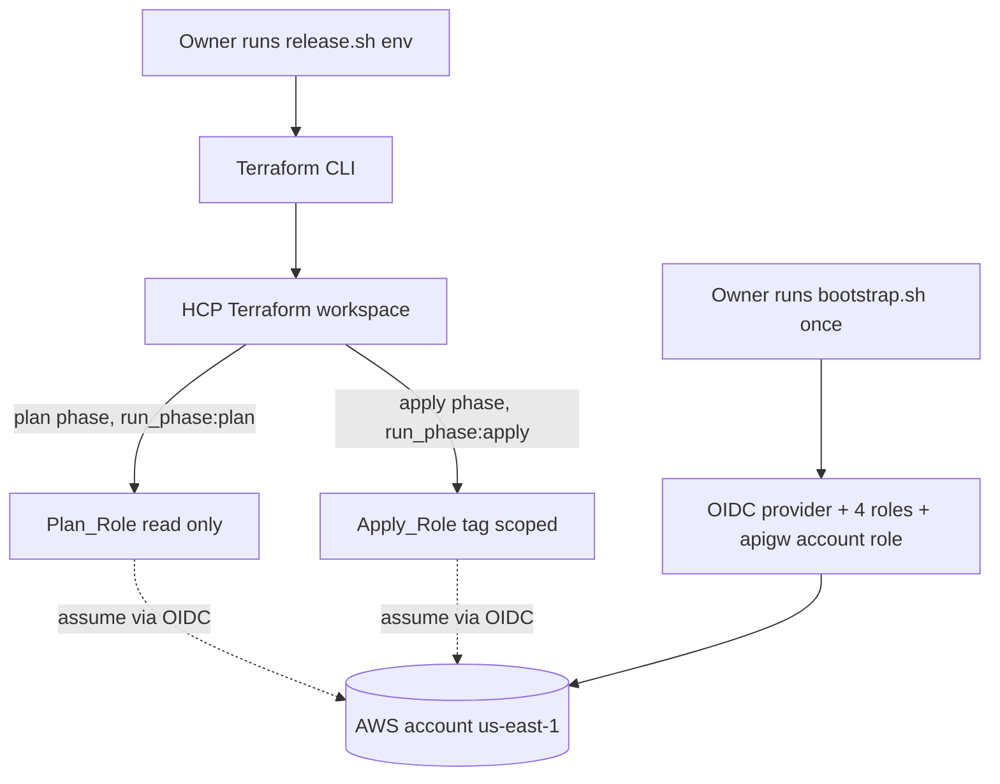
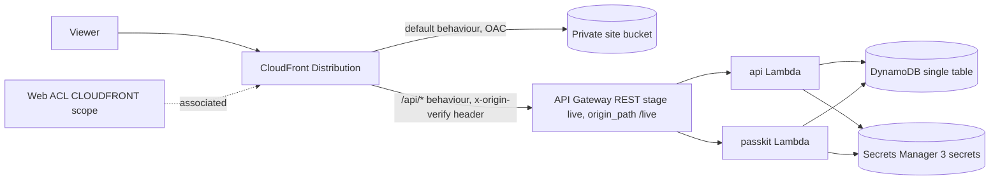

# Design Document

## Overview

This design covers stream S6 (`infra`): all Terraform for re:Invent Compass, the owner-run deploy and set-up scripts, and the operations runbooks. The infrastructure provisions the serverless Compass API in the owner's personal AWS account, region us-east-1, through HCP Terraform with dynamic provider credentials. There are no AWS access keys anywhere.

The design is grounded in the approved build plan (sections 6, 7, 8 S6 row, 11.3, 13) and the decisions in `docs/decisions/`: ADR-001 (state in HCP Terraform), ADR-013 (edge: CloudFront, WAF, API Gateway REST), ADR-014 (Terraform in HCP with dynamic credentials), ADR-015 (retained resources), ADR-019 (Google Wallet key in Secrets Manager), ADR-020 (dev before prod) and ADR-021 (CloudFront flat-rate Free plan, proposed). Where this document and the build plan disagree, the plan wins.

Three constraints shape every decision below:

1. **Owner-only deploys.** The Agent never runs `terraform apply` or any deploy script, and tests never create real AWS resources. Every verification is a plan-only Terraform native test against `mock_provider` blocks, plus static checks (`fmt`, `validate`, `tflint`, Trivy).
2. **No leakage.** No secret, token, email address, account identifier or other identifier may be output by Terraform or echoed by a script. Access logs and WAF never capture IP addresses or identifiers. Private values live in git-ignored files with committed `.example` files.
3. **Strict ownership.** This spec owns `infra/**`, `scripts/**` and `docs/runbooks/**`. The single exception inside `infra/**` is `infra/modules/api/openapi.yaml`, an S0-owned byte-identical copy that the Api_Module consumes through `templatefile()` but never edits.

### Research and grounding notes

- The OpenAPI copy at `infra/modules/api/openapi.yaml` was read to confirm the two Terraform template placeholders (`api_lambda_invoke_arn`, `passkit_lambda_invoke_arn`), the `x-amazon-apigateway-binary-media-types` extension (`application/vnd.apple.pkpass`, `application/vnd.apple.pkpasses`, `text/calendar`), and the public health route `GET /api/v1/health`. The file's own header warns that `templatefile()` evaluates dollar-brace and percent-brace markers anywhere in the file, so the Api_Module passes exactly the two documented variables and no others.
- HCP dynamic provider credentials: the plan and apply phases assume separate roles whose trust is scoped by `run_phase` (ADR-014; [HCP AWS dynamic credentials](https://developer.hashicorp.com/terraform/cloud-docs/workspaces/dynamic-provider-credentials/aws-configuration)).
- CloudFront with WAF at `CLOUDFRONT` scope must be created in us-east-1 ([WAF resources](https://docs.aws.amazon.com/waf/latest/developerguide/how-aws-waf-works-resources.html)); API Gateway REST is used for request validation and binary media support, which HTTP API lacks ([REST vs HTTP](https://docs.aws.amazon.com/apigateway/latest/developerguide/http-api-vs-rest.html)).

## Architecture

### HCP Terraform topology (ADR-014)

One personal HCP Terraform organisation, project `reinvent-compass`, three workspaces:

| Workspace                    | Execution          | Who runs it                 | Purpose                                                              |
| ---------------------------- | ------------------ | --------------------------- | -------------------------------------------------------------------- |
| `reinvent-compass-bootstrap` | local (in HCP)     | Owner, once, in CloudShell  | OIDC provider, four roles, account-level API Gateway CloudWatch role |
| `reinvent-compass-dev`       | remote, CLI-driven | Owner via `release.sh dev`  | Dev environment, all six modules                                     |
| `reinvent-compass-prod`      | remote, CLI-driven | Owner via `release.sh prod` | Prod environment, all six modules                                    |

The dev and prod workspaces authenticate with `TFC_AWS_PROVIDER_AUTH=true`, `TFC_AWS_PLAN_ROLE_ARN` and `TFC_AWS_APPLY_ROLE_ARN`. The plan phase assumes the read-only Plan_Role; the apply phase assumes the tag-scoped Apply_Role.

Each workspace sets its working directory so the whole `infra/` tree (modules included) is uploaded to HCP Terraform on each run: `reinvent-compass-dev` uses working directory `envs/dev` and `reinvent-compass-prod` uses working directory `envs/prod`. Because HCP uploads the configuration directory and its parents' module references, the environment roots reach the sibling `modules/` tree through relative `../../modules/...` source paths. To keep the upload lean and free of private or generated material, an `infra/.terraformignore` file at the repo's `infra/` root excludes the real `cloud.auto.tfbackend` and `terraform.tfvars` files and local state and plan artefacts, so they are never sent to HCP. It does **not** exclude `build/`: the remote plan and apply read the two Lambda zips from the uploaded configuration, so the git-ignored `infra/build/` folder must travel with the upload (see Implementation deviations).



### Request path at runtime (ADR-013)



### Repository layout (owned folders only)

```
infra/
  .terraformignore                # excludes real tfbackend/tfvars, local state and plan files from HCP uploads (build/ is uploaded)
  build/                          # git-ignored: Lambda zips produced by release.sh (never committed)
  bootstrap/                      # OIDC provider, 4 roles, apigw account role (local exec in HCP)
    versions.tf provider.tf variables.tf locals.tf oidc.tf roles-plan.tf
    roles-apply.tf apigw-account.tf outputs.tf terraform.tfvars.example
  modules/
    site/                         # S3 bucket, OAC, bucket policy
    edge/                         # CloudFront, response headers policy, WAF web ACL
    api/                          # REST API from openapi.yaml (S0 copy), 2 Lambdas, stage live
      openapi.yaml                # S0-owned, consumed via templatefile(), never edited here
    data/                         # DynamoDB single table, GSI2
    secrets/                      # 3 secret containers, random_password pepper + origin-verify
    observability/                # SNS topic, 4 alarms, monthly budget
  envs/
    dev/   versions.tf provider.tf variables.tf locals.tf main.tf outputs.tf
           cloud.auto.tfbackend.example terraform.tfvars.example
    prod/  (same shape as dev)
  tests/                          # *.tftest.hcl, mock_provider, command = plan
scripts/
  bootstrap.sh release.sh load-secrets.sh google-wallet-class.mjs
docs/runbooks/
  release.md rollback.md secrets.md google-class.md kill-switch.md
```

### File conventions (Requirement 1.8)

Each environment root and the bootstrap config split concerns into separate files: `versions.tf` (the `terraform` block with `required_version`, `required_providers` and, for the environment roots, the `cloud` block), `provider.tf` (the AWS provider with `default_tags`), `variables.tf` (inputs with `validation` blocks), `locals.tf` (computed values), `main.tf` (module composition in the environment roots), and `outputs.tf` (non-sensitive outputs only). Modules follow the same split, one file per concern.

## Components and Interfaces

### Bootstrap_Config (`infra/bootstrap`, Requirement 2)

The Owner applies it once in CloudShell with their own credentials. State is stored in HCP Terraform through a `cloud` block pointing at the `reinvent-compass-bootstrap` workspace, which is set to **Local execution mode** in HCP (per build plan 7.1 and ADR-001). Local execution means Terraform runs on the Owner's machine using the Owner's own credentials, while HCP only holds the state file: the bootstrap run therefore does not assume and does not depend on the project Plan_Role or Apply_Role (those roles do not exist yet when the bootstrap first runs).

> **Design decision reconciling Requirement 2.1.** Requirement 2.1 says the Bootstrap_Config uses "no `cloud` block and no remote backend requiring the project roles". The design keeps state in HCP via a `cloud` block (ADR-001, build plan 7.1) but runs in Local execution mode with the Owner's credentials, so it satisfies the _intent_ of 2.1: the bootstrap needs no project plan or apply role, no remote backend assuming those roles, and no dependency on anything the bootstrap itself creates. The literal "no `cloud` block" wording is in tension with ADR-001's "state in HCP for every workspace, including bootstrap". This design follows ADR-001 (the plan and ADRs win over the requirement wording per the steering rule) and records the tension here. **Integrator note:** if the requirement wording must be honoured literally (a purely local backend for bootstrap), raise it as an S6 change request before the owner runs the bootstrap; otherwise Requirement 2.1 should be reworded to "a configuration suited to local execution (local execution mode, owner credentials, no dependency on the project plan or apply roles), with state in HCP per ADR-001".

It creates:

- **OIDC_Provider** (`aws_iam_openid_connect_provider`): exactly one, URL `https://app.terraform.io`, client ID list `["aws.workload.identity"]`.
- **Four roles**: `Plan_Role` and `Apply_Role` for each of dev and prod. Each trust policy conditions on two claims with `StringEquals`: `app.terraform.io:aud` equals `aws.workload.identity` (the audience the OIDC provider is registered for), and `app.terraform.io:sub` matches `organization:<org>:project:reinvent-compass:workspace:<workspace>:run_phase:<plan|apply>`, so a plan-phase token can assume only the matching Plan_Role and an apply-phase token only the matching Apply_Role. The organisation name is a variable, never committed literally.
- **Plan_Role policy**: read-only actions only (`Describe*`, `Get*`, `List*`). No state permissions (HCP holds state). It adds an explicit `Deny` on `secretsmanager:GetSecretValue` for every resource except `compass/<env>/app*`, so the read-only plan role can never read the Apple or Google secret material (the `apple-pass` and `google-wallet` containers) while still allowing the pepper and origin-verify values in the `app` secret to be referenced in-graph.
- **Apply_Role policy**: scoped to project resources by requiring the project tag through `aws:RequestTag/project` on create actions and `aws:ResourceTag/project` on later actions; name-prefix ARNs for resource types that do not support tag conditions; `iam:PassRole` only for the two Lambda execution role ARNs. It also grants the read actions the apply phase needs (for example `Describe*`, `Get*`, `List*` on the managed services) and constrains `iam:CreateRole` with a condition requiring `iam:PermissionsBoundary` to equal the project permissions-boundary policy ARN, so any role the apply phase creates is bounded.
- **Account-level API Gateway CloudWatch role** and `aws_api_gateway_account`: created once here, so no environment root creates it (Requirement 2.7, 5.14).

No long-lived access key or secret key is created (Requirement 2.8). Re-applying with no change produces no diff (Requirement 2.9), which holds because every resource is declarative and uses stable names.

A committed `bootstrap/terraform.tfvars.example` documents the inputs (organisation name, account-scoped values); the real `terraform.tfvars` stays git-ignored (Requirement 17.5).

### Site_Module (`infra/modules/site`, Requirement 3)

- One `aws_s3_bucket`.
- `aws_s3_bucket_public_access_block` with all four settings true.
- `aws_s3_bucket_server_side_encryption_configuration` using `AES256` (SSE-S3).
- `aws_s3_bucket_versioning` set to `Enabled`.
- One `aws_cloudfront_origin_access_control` (signing `sigv4`, always).
- `aws_s3_bucket_policy` allowing `s3:GetObject` only when `AWS:SourceArn` equals the Distribution ARN, denying all other principals.

The site bucket carries `prevent_destroy = true` (Requirement 9.4). The OAC and distribution ARN are passed between Site_Module and Edge_Module through module variables and outputs; neither exposes a secret.

**Interface (inputs):** `bucket_name_prefix`, `distribution_arn` (from Edge_Module). **Outputs:** `bucket_regional_domain_name`, `bucket_arn`, `oac_id`.

### Edge_Module (`infra/modules/edge`, Requirement 4)

- One `aws_cloudfront_distribution`:
  - `default_root_object = "index.html"`, so a request to the distribution root serves the site's entry document.
  - **Default cache behaviour** (not an ordered behaviour with pattern `/`) targets the site bucket origin through the OAC, attaches the response headers policy, and attaches a viewer-request `aws_cloudfront_function` (see below) that rewrites directory-style paths to their `index.html`. This function is attached to the default (site) behaviour **only**, never to the `/api/*` behaviour.
  - **Ordered cache behaviour** with path pattern `/api/*` targets the API stage `live` as a custom origin with `origin_path = "/live"`, adds the `x-origin-verify` custom origin header sourced from the origin-verify secret value (never a committed literal), and attaches the managed `CachingDisabled` cache policy and the managed `AllViewerExceptHostHeader` origin request policy. No CloudFront function is attached here, so API request URIs reach the origin untouched.
  - **No `custom_error_response` block** is configured on the distribution. A distribution-level error-response rewrite (for example mapping 403 or 404 to `/index.html`) would also rewrite the API's own error responses (the `application/problem+json` 4xx and 5xx bodies from the `/api/*` behaviour), which must pass through unchanged. Directory routing for the static site is handled by the viewer-request function instead, so no custom error response is needed. This is stated explicitly to prevent a later addition from masking API errors.
  - CloudFront standard (access) logging is **not** enabled (Requirement 4.7, 17.4).
  - `prevent_destroy = true` on the distribution (Requirement 9.1).
- One `aws_cloudfront_function` (`viewer-request`): a short function that, for the site behaviour, rewrites a directory-style path such as `/board` to `/board/index.html` (and leaves requests that already target a file unchanged) so that clean URLs resolve against the private S3 origin. Attached only to the default cache behaviour as described above.
- One `aws_cloudfront_response_headers_policy` setting `Content-Security-Policy`, `Strict-Transport-Security`, `X-Content-Type-Options: nosniff`, `Referrer-Policy: no-referrer`, and `Permissions-Policy`.
- One `aws_wafv2_web_acl`, scope `CLOUDFRONT` (provider region us-east-1), with exactly five rules in priority order:
  1. per-IP rate-based rule,
  2. `AWSManagedRulesCommonRuleSet`,
  3. `AWSManagedRulesKnownBadInputsRuleSet`,
  4. `AWSManagedRulesAmazonIpReputationList`,
  5. kill-switch rule (always priority 5): its action is `block` when `kill_switch_enabled` is true and `count` when false, so the rule is always present at the same priority and only its effect toggles (toggled by the `kill_switch_enabled` variable).
  - Every rule sets `visibility_config.sampled_requests_enabled = false` (Requirement 4.11, 17.4).
  - The Web_ACL also sets its own ACL-level `visibility_config` with `sampled_requests_enabled = false` (in addition to the per-rule setting), so no request samples are retained at either level.
  - No WAF logging destination is configured (Requirement 4.10, 17.4).
- The `aws_wafv2_web_acl` is associated with the distribution by setting the distribution's `web_acl_id` to the Web_ACL's **ARN** (for `CLOUDFRONT` scope the distribution's `web_acl_id` takes the web ACL ARN, not its id) (Requirement 4.12).

**Interface (inputs):** `site_bucket_regional_domain_name`, `oac_id`, `api_stage_invoke_host`, `origin_verify_secret_value` (sensitive, from Secrets_Module), `kill_switch_enabled` (default false). **Outputs:** `distribution_arn`, `distribution_domain_name` (the CloudFront domain is public, so this output is allowed).

### Api_Module (`infra/modules/api`, Requirement 5)

- `aws_api_gateway_rest_api` with `body = templatefile("${path.module}/openapi.yaml", { api_lambda_invoke_arn = ..., passkit_lambda_invoke_arn = ... })`, passing **exactly** those two template variables and no others (Requirement 5.1). The file is read, never written (Requirement 5.2). `binary_media_types` is **not** set in Terraform; the contract's `x-amazon-apigateway-binary-media-types` extension supplies them on import (Requirement 5.6). `endpoint_configuration { types = ["REGIONAL"] }` is set on the REST API so it is a regional endpoint fronted by CloudFront (ADR-013), not edge-optimised.
- One `aws_api_gateway_deployment` whose `triggers` map includes `redeployment = sha1(aws_api_gateway_rest_api.this.body)` (the sha1 of the rendered OpenAPI body), so any contract change forces a new deployment, with `lifecycle { create_before_destroy = true }` so the new deployment is created before the old one is removed and the stage is never left without a deployment.
- Two `aws_lambda_function` resources (`api`, `passkit`), each `architectures = ["arm64"]`, `runtime = "nodejs24.x"`, `memory_size = 512`. Timeouts: `api` 10 s, `passkit` 5 s (Requirement 5.9, 5.10).
- Two dedicated `aws_iam_role` execution roles, one per Lambda (Requirement 5.11).
- Two `aws_lambda_permission` resources, each principal `apigateway.amazonaws.com`, `source_arn = "${aws_api_gateway_rest_api.this.execution_arn}/*/*"` (Requirement 5.3).
- One `aws_api_gateway_stage` named `live` (Requirement 5.4), referencing the `aws_api_gateway_deployment` above, with:
  - **Default `aws_api_gateway_method_settings` on `*/*`** setting `logging_level = "OFF"`, `data_trace_enabled = false`, and `metrics_enabled = true`, so no request or response data (which could contain identifiers) is logged by method settings while CloudWatch metrics are still emitted;
  - **stage-level throttling** (rate and burst) applied across the stage (Requirement 5.5);
  - **per-route `aws_api_gateway_method_settings`** entries (keyed by `method_path`, for example `v1/passes/{serial}/GET`) added only where a specific route needs method-level throttling tighter than the stage default, in addition to the stage-level throttling, so hot or expensive routes can be capped individually;
  - `access_log_settings` whose format records the path only as `$context.resourcePath` and contains no `$context.path`, `$context.identity.sourceIp` or any other source-IP or full-path field (Requirement 5.7, 5.8, 17.3).
- CloudWatch log groups: one per Lambda and one for the stage access logs, all `retention_in_days = 14` (Requirement 5.12, 5.13).
- The account-level API Gateway CloudWatch role is **not** created here; it comes from the Bootstrap_Config (Requirement 5.14).

**Interface (inputs):** `env`, `api_lambda_zip`, `passkit_lambda_zip`, `table_name`, `secret_arns`, `throttle_rate`, `throttle_burst`, `route_throttles` (optional map of per-route rate and burst overrides). **Outputs:** `rest_api_id`, `stage_invoke_host`, `api_lambda_role_arn`, `passkit_lambda_role_arn` (role ARNs feed the Apply_Role `iam:PassRole` scope; they are ARNs, not secrets, and are not account-identifying beyond the resource name prefix the plan already uses).

### Data_Module (`infra/modules/data`, Requirement 6)

- One `aws_dynamodb_table`:
  - name from variable `table_name`, default `compass-<env>`;
  - `billing_mode = "PAY_PER_REQUEST"`, no provisioned capacity (Requirement 6.2);
  - `ttl` block using attribute `ttl`, enabled (Requirement 6.3);
  - `point_in_time_recovery` enabled (Requirement 6.4);
  - `deletion_protection_enabled = true` (Requirement 6.5);
  - `prevent_destroy = true` (Requirement 9.2);
  - GSI2 (subHash -> pass; the unused GSI1 was dropped before the first apply), declared with an explicit `projection_type` (see below) projecting the attributes needed to satisfy its access pattern without a base-table read (Requirement 6.6, 6.7, 6.8).

**GSI argument form and a deprecation tension (AWS provider 6.x).** In AWS provider 6.x the per-`global_secondary_index` `hash_key` and `range_key` arguments are marked deprecated in favour of a nested `key_schema` block. However, there are open provider bugs where the newer `key_schema` syntax produces permanent state drift and forces GSI replacement on every plan ([hashicorp/terraform-provider-aws#46335](https://github.com/hashicorp/terraform-provider-aws/issues/46335) and [#46601](https://github.com/hashicorp/terraform-provider-aws/issues/46601)). Because the DynamoDB table is a Retained_Resource that must never be destroyed or replaced (Requirement 9.2, and `release.sh` refuses any plan that would replace it), a form that risks GSI replacement is unacceptable here.

**Decision:** declare GSI1 and GSI2 using the stable `hash_key` / `range_key` arguments (the form the AWS provider 6 documentation still shows for `global_secondary_index`), which do not trigger the replacement drift, and accept the deprecation warning for now. This is flagged so the integrator can revisit and migrate to `key_schema` once the provider bugs above are resolved. The choice is also asserted by a static HCL scan test (that the GSI blocks use `hash_key`/`range_key` and not `key_schema`) so a future refactor cannot silently introduce the replacement risk.

`projection_type` is stated explicitly per GSI:

- **GSI1** (dropped, unused by the pass-service): formerly `projection_type = "INCLUDE"` with `non_key_attributes` covering the device fields the "all devices for a pass" access pattern needs (for example the device push token reference and status), so the query is answered without reading the base table (Requirement 6.8).
- **GSI2** (subHash -> pass): `projection_type = "INCLUDE"` with `non_key_attributes` covering the pass fields the "all passes for a subHash" access pattern needs (for example serial, session reference and `expiresAt`), again without a base-table read (Requirement 6.8).

**Interface (inputs):** `env`, `table_name` (default `compass-<env>`). **Outputs:** `table_name`, `table_arn` (ARN used by Lambda role policies, not a secret).

### Secrets_Module (`infra/modules/secrets`, Requirement 7)

- Three `aws_secretsmanager_secret` containers: `compass/<env>/apple-pass`, `compass/<env>/google-wallet`, `compass/<env>/app`. Each carries `prevent_destroy = true` (Requirement 9.3).
- `random_password` for the application pepper and for the origin-verify value, each `length >= 32`, marked sensitive.
- The pepper and origin-verify value are written into the `app` secret via `aws_secretsmanager_secret_version`. The `apple-pass` and `google-wallet` containers get **no** initial value from Terraform (Requirement 7.5); the Owner loads them out of band. A `lifecycle { ignore_changes = [secret_string] }` on those version-bearing resources (or no version resource at all for apple/google) ensures a later apply never overwrites an out-of-band value (Requirement 7.6).
- No **root** Terraform `output` exposes the pepper or origin-verify value (Requirement 7.4, 17.1). A **module** output marked `sensitive` is allowed: Requirement 7.4 forbids only a root-level output of the pepper or origin-verify value, not passing a sensitive value module-to-module inside the graph. The Secrets_Module therefore exposes a `sensitive` `origin_verify_secret_value` module output so the environment root can wire it into the Edge_Module's origin header, and no environment root re-exports it. This distinction (sensitive module output allowed, root output forbidden) is what lets the origin-verify value flow from Secrets_Module to Edge_Module without ever leaving Terraform or appearing in a root output or the plan's displayed values.

**Interface (inputs):** `env`. **Outputs:** `app_secret_arn`, `apple_secret_arn`, `google_secret_arn`, and `origin_verify_secret_value` marked `sensitive` for the Edge_Module to consume in-graph (it is passed module-to-module, never declared as a root output).

### Observability_Module (`infra/modules/observability`, Requirement 8)

- One `aws_sns_topic` for alarms (Requirement 8.1).
- One `aws_sns_topic_subscription` with `protocol = "email"` and `endpoint` taken from the alarm-email workspace variable, so the Owner receives alarm notifications by email (the subscription is confirmed out of band by the Owner clicking the AWS confirmation link; the email address is a workspace variable, never a committed literal and never output).
- A customer managed `aws_kms_key` (with an `aws_kms_alias`) used to encrypt the SNS topic (`kms_master_key_id` on the topic). Its key policy allows the account root the usual administration and grants `cloudwatch.amazonaws.com` the `kms:GenerateDataKey*` and `kms:Decrypt` actions it needs to publish to the encrypted topic (so CloudWatch alarm actions can deliver), scoped by an `aws:SourceAccount` condition. Note: a customer managed KMS key costs about USD 1 a month, which is a material line against the 20 USD monthly budget (Requirement 8.5) and is called out in the budget runbook.
- Alarm email from a workspace variable; a `validation` block fails if it is empty (Requirement 8.2).
- Four `aws_cloudwatch_metric_alarm` resources: API 5xx, API or Lambda throttles, APNs push failures, Lambda function errors. Each sets `alarm_actions = [sns_topic_arn]` on the ALARM state (Requirement 8.3, 8.4).
- One `aws_budgets_budget`, monthly, limit 20 USD, with notifications at 50, 80 and 100 percent of actual spend to the alarm email (Requirement 8.5, 8.6).

**Interface (inputs):** `env`, `alarm_email` (sensitive), `rest_api_id`, `api_lambda_name`, `passkit_lambda_name`. **Outputs:** `sns_topic_arn` (an ARN, not a secret; the alarm email is never output).

### Environment roots (`infra/envs/{dev,prod}`, Requirement 10)

Each root composes all six modules identically (Requirement 10.1). The `cloud` block in `versions.tf` reads organisation, project and workspace from `TF_CLOUD_ORGANIZATION`, `TF_CLOUD_PROJECT` and `TF_WORKSPACE`, with no `-backend-config` file (Requirement 1.4, 1.5). `cloud.auto.tfbackend` and `terraform.tfvars` are git-ignored; `cloud.auto.tfbackend.example` and `terraform.tfvars.example` are committed (Requirement 1.7, 10.2, 10.3, 17.5).

### Scripts (`scripts/**`)

All shell scripts are `shellcheck` clean, never echo secrets, and are run only by the Owner. The Agent never runs them (Requirements 11.5, 12.12, 13.7, 14.5, 16.9).

- **`bootstrap.sh`** (Requirement 11): `terraform init` and `terraform apply` against `infra/bootstrap`; exit 0 on clean apply, non-zero on failure.
- **`release.sh <env>`** (Requirement 12): one env argument validated against `dev|prod`; loads `infra/envs/<env>/cloud.auto.tfbackend` and exports the three `TF_CLOUD_*` vars, failing by name if any is missing (Requirement 1.6); builds the Lambda bundle (the two Lambda zips) into a git-ignored `infra/build/` directory and builds the site; `terraform plan -out`; refuses any plan that destroys or replaces a Retained_Resource or introduces a resource type outside an allow list; requires a typed `yes`; applies the saved plan; syncs the site; invalidates the CloudFront cache; health-checks `GET https://<cf>/api/v1/health` expecting 200. Any failed step exits non-zero.
  - **Credentials split.** The `terraform plan` and `terraform apply` phases run in HCP with the HCP dynamic provider credentials (the Plan_Role and Apply_Role assumed via OIDC): `release.sh` holds no AWS keys for those phases. The post-apply steps that run outside Terraform (the `aws s3 sync` of the built site to the site bucket, and the `aws cloudfront create-invalidation` cache invalidation) run on the Owner's machine under the Owner's local AWS SSO session (`aws sso login` beforehand). So the script expects a valid SSO session for the site sync and invalidation, while the dynamic credentials cover only the Terraform plan and apply.
- **`load-secrets.sh`** (Requirement 13): reads certificate and key material from Owner-provided file paths; writes each into the matching Secrets Manager secret; never echoes a value on any path (success, validation failure, write failure), referring to secrets only by name or path.
- **`google-wallet-class.mjs`** (Requirement 14): idempotent create-or-update of the Google Wallet issuer and class; exit 0 on success, non-zero on API failure; not managed in Terraform.

### Runbooks (`docs/runbooks/**`, Requirement 15)

`release.md`, `rollback.md` (with roll-forward notes for all six Retained_Resources, Requirement 9.6), `secrets.md` (instructs the Owner never to print or paste a secret), `google-class.md`, and `kill-switch.md` (how to enable and disable the WAF kill-switch rule).

## Data Models

### DynamoDB single table

A single-table design (ADR-012, plan section 4.2). The base table and two GSIs support the pass and device access patterns. Identifiers are opaque: UUID v4 serials, and `subHash`/`deviceHash` are HMAC-SHA256 with the pepper from Secrets Manager. TTL is for clean-up only; code checks `expiresAt` on every read.

| Attribute                             | Role                                                       |
| ------------------------------------- | ---------------------------------------------------------- |
| `PK`, `SK`                            | Base table partition and sort keys (opaque composite keys) |
| `GSI2PK` (`subHash`), `GSI2SK` (pass) | GSI2: all passes for a `subHash`                           |
| `ttl`                                 | Numeric epoch-seconds TTL attribute for automatic clean-up |
| `expiresAt`                           | Logical expiry checked in code on every read               |

GSI2 projects the attributes needed to answer their queries without reading the base table (Requirement 6.8). Each index states its `projection_type` explicitly: GSI1 uses `INCLUDE` with the device fields the "all devices for a pass" query needs, and GSI2 uses `INCLUDE` with the pass fields the "all passes for a subHash" query needs (serial, session reference and `expiresAt`). The indexes are declared with the stable `hash_key`/`range_key` arguments rather than the provider 6.x `key_schema` block, because `key_schema` currently forces GSI replacement on a Retained_Resource (see the Data_Module section and provider issues #46335 and #46601).

### Secrets Manager layout

| Secret                        | Loaded by                              | Content                                          |
| ----------------------------- | -------------------------------------- | ------------------------------------------------ |
| `compass/<env>/apple-pass`    | Owner, out of band (`load-secrets.sh`) | Apple Pass Type ID certificate and key           |
| `compass/<env>/google-wallet` | Owner, out of band (`load-secrets.sh`) | Google Wallet service account key (ADR-019)      |
| `compass/<env>/app`           | Terraform (`random_password`)          | pepper and origin-verify value, each >= 32 chars |

### Backend and tfvars configuration (git-ignored, with committed examples)

| Real file (git-ignored)                 | Committed example                    | Keys                                                                              |
| --------------------------------------- | ------------------------------------ | --------------------------------------------------------------------------------- |
| `infra/envs/<env>/cloud.auto.tfbackend` | `cloud.auto.tfbackend.example`       | `TF_CLOUD_ORGANIZATION`, `TF_CLOUD_PROJECT`, `TF_WORKSPACE` style KEY=VALUE lines |
| `infra/envs/<env>/terraform.tfvars`     | `terraform.tfvars.example`           | env name, alarm email, throttling, table name                                     |
| `infra/bootstrap/terraform.tfvars`      | `bootstrap/terraform.tfvars.example` | organisation name, project                                                        |

In addition to the files above, the git-ignore list (`.gitignore`) includes `infra/build/`, the directory into which `release.sh` builds the Lambda zips. It holds generated build artefacts only and has no `.example` counterpart (nothing to document). It is git-ignored but is deliberately uploaded to HCP, because the remote plan and apply need the Lambda zips.

### Retained resources (Requirement 9, ADR-015)

Six resources carry `prevent_destroy = true`: the CloudFront Distribution, the DynamoDB table, the three secrets (`apple-pass`, `google-wallet`, `app`), and the site bucket. `release.sh` refuses any plan that would destroy or replace them, and `rollback.md` carries a roll-forward note for each.

## Correctness Properties

_A property is a characteristic or behavior that should hold true across all valid executions of a system, essentially a formal statement about what the system should do. Properties serve as the bridge between human-readable specifications and machine-verifiable correctness guarantees._

This feature is Infrastructure as Code (Terraform), so randomized property-based testing does not apply: there is no pure function with a large input space to generate against. Following the project's prescribed approach (ADR-014, Requirement 16), correctness is verified by Terraform native tests (`tests/*.tftest.hcl`) using `mock_provider` blocks with `command = plan` only, plus static scans. The properties below are therefore universally-quantified **plan invariants**: each is a "for all" statement about the planned configuration that a single plan-only assertion (or a repo scan) verifies. The owner-run deploy path (zero-diff apply, idempotence of bootstrap) is validated by the Owner, never by the Agent.

Properties were selected from the acceptance criteria that express cross-cutting invariants rather than one-off settings. Single-resource settings (for example SSE-S3 on the bucket, PITR on the table) are covered by example plan assertions in the Testing Strategy, not restated as universal properties.

### Property 1: Every managed resource carries the required tags

_For all_ taggable resources in a planned environment root, the plan SHALL show both a `project` tag and an `environment` tag (supplied by provider `default_tags`).

**Validates: Requirements 1.9, 16.4**

### Property 2: Sampling is disabled on every WAF rule

_For all_ five rules in the Web_ACL, `visibility_config.sampled_requests_enabled` SHALL be `false`.

**Validates: Requirements 4.11, 16.5, 17.4**

### Property 3: Every log group retains logs for 14 days

_For all_ CloudWatch log groups created by the Api_Module (the two Lambda log groups and the stage access-log group), `retention_in_days` SHALL equal 14.

**Validates: Requirements 5.12, 5.13, 16.3**

### Property 4: The access log format captures no IP or full path

_For all_ planned configurations of the `live` stage access log format, the format string SHALL contain `$context.resourcePath` and SHALL NOT contain `$context.path`, `$context.identity.sourceIp`, or any other source-IP or full-path field.

**Validates: Requirements 5.7, 5.8, 16.6, 17.3**

### Property 5: Every retained resource is protected against destruction

_For all_ six Retained_Resources (the CloudFront Distribution, the DynamoDB table, the three secrets, and the site bucket), the resource SHALL have `prevent_destroy = true` in its lifecycle block.

**Validates: Requirements 9.1, 9.2, 9.3, 9.4, 16.2**

### Property 6: No Terraform output exposes a secret or identifier

_For all_ outputs declared by the environment roots and modules, no output value SHALL be a secret, token, email address, account identifier, or other identifier, and any unavoidable sensitive value SHALL be marked `sensitive`.

**Validates: Requirements 7.4, 17.1**

### Property 7: No committed owned file embeds an account id, account-bearing ARN, or email

_For all_ committed files under `infra/**`, `scripts/**`, and `docs/runbooks/**`, the file SHALL NOT contain a 12-digit AWS account identifier, an `arn:aws` string that embeds an account identifier, or an email address.

**Validates: Requirements 17.6**

### Property 8: No script echoes a secret on any exit path

_For all_ execution paths of every script (success, validation failure, and write or apply failure), the script SHALL NOT echo, print, or log any secret, token, email address, account identifier, or other identifier value, referring to secrets only by name or path.

**Validates: Requirements 13.5, 17.2**

### Property 9: The two environments compose the same modules

_For all_ six modules (Site, Edge, Api, Data, Secrets, Observability), each module SHALL be present in both the `dev` and the `prod` environment root, with no module present in one and absent from the other.

**Validates: Requirements 10.1**

## Error Handling

### Terraform (plan and validate time)

- **Variable validation.** `variables.tf` declares `validation` blocks on constrained inputs (environment name restricted to `dev|prod`, alarm email matched against an email pattern and required to be non-empty). An invalid value fails at plan time with a named message (Requirements 1.10, 8.2).
- **Retained-resource protection.** `prevent_destroy = true` causes Terraform to fail the plan with an error naming the resource whenever a change would destroy or replace a Retained_Resource (Requirement 9.5). `release.sh` adds a second, independent refusal by inspecting the saved plan JSON (Requirement 12.5).
- **Missing backend keys.** `release.sh` reads `cloud.auto.tfbackend` and exits non-zero naming the missing key if `TF_CLOUD_ORGANIZATION`, `TF_CLOUD_PROJECT` or `TF_WORKSPACE` is absent (Requirement 1.6).
- **Out-of-band secret preservation.** The `apple-pass` and `google-wallet` containers have no Terraform-managed version (or a version with `ignore_changes = [secret_string]`), so a later apply never clobbers an owner-loaded value (Requirement 7.6).

### Scripts (run time, Owner only)

- **`release.sh`** exits non-zero without applying if: the env argument is not `dev|prod` (usage message), the saved plan would destroy or replace a Retained_Resource, the plan introduces a resource type outside the allow list, the Owner types anything other than `yes`, or the apply, site sync, or cache invalidation fails. The health check treats only HTTP 200 as success (Requirement 12.2 through 12.10).
- **`bootstrap.sh`** exits 0 on a clean apply and non-zero on failure, never reporting success on failure (Requirement 11.2, 11.3).
- **`load-secrets.sh`** exits non-zero with a path-only (never content) error when a file is missing or unreadable, or when a Secrets Manager write fails, and never echoes a value on any path (Requirement 13.2, 13.4, 13.5).
- **`google-wallet-class.mjs`** exits non-zero on any Google Wallet API failure and is idempotent across repeated runs (Requirement 14.2, 14.3).

### Runtime (provisioned service)

- The `x-origin-verify` header lets the Lambdas reject direct `execute-api` calls that bypass CloudFront (ADR-013). Error bodies use `application/problem+json` and never echo request input (from the contract). The four CloudWatch alarms notify the SNS topic on API 5xx, throttles, APNs push failures, and Lambda errors (Requirement 8.3, 8.4).

## Testing Strategy

Property-based testing is **not** used: this is Infrastructure as Code, which the project verifies with Terraform native tests against mock providers, plan-only, plus static gates (ADR-014, Requirement 16). Tests never create real AWS resources and the Agent never runs `terraform apply` or any deploy script (Requirement 16.8, 16.9).

### Terraform native tests (`infra/tests/*.tftest.hcl`)

- Every test file declares `mock_provider` blocks for `aws` (and `random`) and runs `command = plan` only (Requirement 16.1, 16.8). Each `mock_provider` block uses `override_during = plan` and relies on `mock_resource` defaults so that every resource's computed attributes are supplied by the mock at plan time, keeping the tests entirely offline (no real AWS calls, no apply).
- **Invariant assertions (map to Correctness Properties):**
  - Property 1: required `project` and `environment` tags present on managed resources.
  - Property 2: `sampled_requests_enabled = false` on all five Web_ACL rules.
  - Property 3: `retention_in_days = 14` on each Lambda log group and the access-log group.
  - Property 4: access log format contains `$context.resourcePath` and no `$context.path` or `$context.identity.sourceIp`.
  - Property 5: `prevent_destroy = true` on all six Retained_Resources.
  - Property 6: no module or root output value is a secret or identifier (sensitive values marked `sensitive`).
  - Property 9: both environment roots reference all six modules.
- **Example plan assertions** for single-resource settings: site bucket public-access-block all true, SSE-S3 AES256, versioning enabled, bucket policy scoped to the distribution; distribution `default_root_object = "index.html"`, default behaviour via OAC with the viewer-request CloudFront function attached and the `/api/*` ordered behaviour to stage `live` with `origin_path = "/live"`, the `CachingDisabled` and `AllViewerExceptHostHeader` managed policies, and no CloudFront function; no `custom_error_response` block on the distribution; response headers policy present; no CloudFront standard logging; distribution `web_acl_id` set to the Web_ACL ARN; one Web_ACL at `CLOUDFRONT` scope with exactly five ordered rules, ACL-level and per-rule `sampled_requests_enabled = false`, the kill-switch rule at priority 5 with action `block` when enabled and `count` when disabled, and no logging destination; REST API `endpoint_configuration` types `["REGIONAL"]` with `body` built from the two template variables and no `binary_media_types` set; `aws_api_gateway_deployment` triggers include `sha1` of the rendered body with `create_before_destroy = true`; default `method_settings` on `*/*` with `logging_level = "OFF"`, `data_trace_enabled = false`, `metrics_enabled = true`, plus stage-level throttling and any per-route `method_settings` throttle overrides; two Lambdas arm64 `nodejs24.x` 512 MB with 10 s and 5 s timeouts and dedicated roles; two `aws_lambda_permission` with `source_arn` `.../*/*`; DynamoDB on-demand with TTL `ttl`, PITR, deletion protection, GSI1 and GSI2 each with an explicit `projection_type`; three secret containers with a `random_password` pepper and origin-verify of length >= 32; one SNS topic encrypted with a customer managed KMS key whose policy allows `cloudwatch.amazonaws.com`, one email `aws_sns_topic_subscription`, four alarms wired to the topic, one monthly 20 USD budget at 50/80/100 percent.
- **Edge-case plan assertions**: invalid environment name and empty alarm email each fail at plan time (Requirements 1.10, 8.2).
- **Static HCL scan tests (not plan output):** two checks are implemented as static scans of the Terraform source rather than plan assertions, because the thing being checked is a meta-argument or lexical form that does not appear in plan output:
  - **`prevent_destroy`** is a `lifecycle` meta-argument that Terraform does not surface in plan JSON, so a static HCL scan asserts `prevent_destroy = true` appears in the lifecycle block of all six Retained_Resources. This complements Property 5 (which also asserts, via plan behaviour, that a destroy or replace is refused) and the asserts on the `tags` local value that confirm the required `project` and `environment` tags are set at source.
  - **GSI argument form** is asserted by scanning the `global_secondary_index` blocks to confirm they use `hash_key`/`range_key` and not `key_schema`, locking in the choice that avoids GSI replacement on the Retained_Resource (provider issues #46335, #46601).

### Repo scan test (Property 7)

A test (runnable in CI and locally, no AWS) scans every committed file under `infra/**`, `scripts/**` and `docs/runbooks/**` and fails if any contains a 12-digit AWS account identifier, an `arn:aws` string embedding an account identifier, or an email address (Requirement 17.6). This is the one leakage guard that spans all owned files rather than a single plan.

### Script tests (Properties 8 and script behaviours)

- `shellcheck` runs clean on `bootstrap.sh`, `release.sh` and `load-secrets.sh` (Requirements 11.4, 12.11, 13.6).
- Example tests cover deterministic branches: `release.sh` argument validation, missing backend key by name, Retained_Resource refusal, unexpected resource-type refusal, non-`yes` confirmation abort; `load-secrets.sh` missing-file and write-failure paths.
- A static assertion (grep-based, Property 8) confirms no script path echoes a secret-bearing variable; secrets are referenced only by name or path.

### Static quality gates (Requirement 16.7)

`terraform fmt -check`, `terraform validate`, `tflint`, and a Trivy configuration scan that must report no HIGH or CRITICAL findings. These run in CI (`check.yml`, ADR-018) and are documented for local use.

One Trivy finding is suppressed deliberately with an inline `trivy:ignore` comment on the site bucket's encryption configuration: **AVD-AWS-0132** (which flags SSE-S3 rather than a customer managed KMS key on an S3 bucket). The suppression is justified because Requirement 3.2 mandates SSE-S3 (AES256) on the site bucket: the bucket holds only the public showcase site, so KMS adds cost and key management with no privacy benefit, and the requirement explicitly chose AES256. The ignore comment cites Requirement 3.2 inline so the exception is auditable. No other Trivy findings are suppressed; the scan still fails on any other HIGH or CRITICAL.

### What the Owner verifies (not the Agent)

- Bootstrap idempotence: a second `terraform apply` of `infra/bootstrap` shows no changes (Requirement 2.9).
- Dev zero-diff: applying `infra/envs/dev` against an empty account provisions all six modules and an immediately following plan shows zero changes (Requirement 10.4).
- End-to-end health: `release.sh dev` completes with an HTTP 200 from `GET /api/v1/health` (Requirement 12.10).

These require real AWS credentials and a deploy, so they live in the runbooks and are performed by the Owner, consistent with the owner-only-deploy constraint.

## Implementation deviations

These changes were made while implementing the spec. Each is a deliberate departure from the text above, recorded here so the design stays the record.

1. **`build/` is uploaded to HCP.** The design said `.terraformignore` excludes `infra/build/`. The Lambda zips are read by `filename` and `source_code_hash` during the remote plan and apply, so excluding them would make every remote run fail. `.terraformignore` therefore leaves `build/` out of its list; the folder stays git-ignored.
2. **Provider lock files are git-ignored.** `.terraform.lock.hcl` is generated per platform and a lock with local-platform hashes only would fail on the HCP runners, so `.gitignore` lists it. The owner can create one with `terraform providers lock`.
3. **Extra module inputs and outputs.** Edge takes an `env` input (the WAF, function, headers policy and OAC names are account-wide, so dev and prod need distinct names) and outputs `distribution_id` (for the cache invalidation). Site outputs `bucket_name` (for the site sync). Api takes `table_arn` and `permissions_boundary_arn` as inputs (role policies; the Apply_Role requires the permissions boundary on every created role) and outputs `rest_api_name`, `api_lambda_name` and `passkit_lambda_name`.
4. **WAF common rule set.** `SizeRestrictions_BODY` in `AWSManagedRulesCommonRuleSet` is set to count: its 8 KB body limit would block valid pass requests of up to 25 passes. The API Gateway request validator and the Lambda schema checks bound the body. The rule count stays five.
5. **Site bucket policy.** Beside the CloudFront allow statement there is an explicit deny of `s3:GetObject` for any request whose `AWS:SourceArn` is not the distribution, and a deny of plain HTTP. This implements "denying all other principals" explicitly. The site sync lists and writes objects and never reads them, so it is unaffected.
6. **Lambda environment variable names.** `COMPASS_ENV`, `TABLE_NAME`, `APP_SECRET_ARN`, `APPLE_SECRET_ARN` (both), `GOOGLE_SECRET_ARN` (api only). S5 must read these names or the integrator must align them.
7. **Static scans in the native tests.** Under a mock provider the DynamoDB `global_secondary_index` set and the CloudFront `origin` set are unknown (or sensitive) at plan time, and a mocked data source has no `id`. Those facts are asserted by regular-expression scans of the module source with `file()` inside the `.tftest.hcl` files, which are listed in each test's header.
8. **DynamoDB table encryption.** `server_side_encryption` is declared explicitly (AWS owned key). Trivy reports the LOW customer-managed-key finding only; no HIGH or CRITICAL.
9. **Observability inputs.** The module takes `rest_api_name` instead of `rest_api_id`: the API Gateway REST metrics use the API name as the `ApiName` dimension, so an id would be unused. Both Lambda names come from the api module outputs.
10. **Throttle alarm.** API Gateway publishes no throttle count, so the "API or Lambda throttles" alarm sums the Lambda `Throttles` metric of both functions; API-level 429 responses are visible in the access log status field.
11. **APNs alarm metric.** The alarm watches the custom metric `Compass` / `ApnsPushFailures` with dimension `Environment` (`dev` or `prod`). The pass-service stream (S5) must emit that metric, for example with the embedded metric format, or the alarm never fires.
12. **Secret deny pattern.** The plan and apply read policies except `compass/<env>/app-??????` (the app secret ARN is the name plus a six character suffix), not the literal `compass/<env>/app*` of the design. The literal pattern also matches `compass/<env>/apple-pass`, which would leave the Apple certificate readable by a Terraform run.
13. **Bootstrap content beyond the spec text.** It also creates the shared permissions boundary policy `compass-permissions-boundary` (the Apply_Role's `iam:CreateRole` condition needs a real policy to point at, and the api module passes the same ARN to its two Lambda roles). Both role ARN outputs are `sensitive` because the ARNs embed the account id; the owner reads them with `terraform output -json`. The bootstrap uses an empty `cloud {}` block so the organisation, project and workspace come from `TF_CLOUD_ORGANIZATION`, `TF_CLOUD_PROJECT` and `TF_WORKSPACE`.
14. **Apply role is split into four managed policies per environment** (identity, data, edge, read), because one policy would exceed the 6,144 character managed-policy limit. A native test asserts every one stays under it.
15. **Apply role is untested against AWS.** Condition keys such as `aws:RequestTag` and `aws:ResourceTag` are applied only where the service supports them, and other types are scoped by name-prefix ARN. API Gateway and several CloudFront types cannot be scoped by name or tag, so those statements are scoped by ARN type. The owner should expect to adjust a statement on the first dev apply if AWS answers AccessDenied (ADR-020 deploys dev first for this reason).
16. **Aligned with the S5 pass-service design (integrator note).** DynamoDB key attributes are lower case (`pk`, `sk`, `gsi1pk`, `gsi1sk`, `gsi2pk`, `gsi2sk`, TTL `ttl`) and both GSIs project `ALL`, as S5 declares; this replaces the INCLUDE projections and the non-key attribute lists. The app secret JSON keys are `pepper` and `originVerify`. The Lambda environment uses the S5 names (`TABLE_NAME`, `APP_SECRET_ID`, `APPLE_SECRET_ID`, `GOOGLE_SECRET_ID`, `EVENT_*`, `ID_TOKEN_*`, `APNS_*`, `GOOGLE_WALLET_*`, `SERVICE_VERSION`, `PUBLIC_BASE_URL`), with optional values omitted when empty. This replaces item 6 above. Role policies match the S5 permission list (api: Get, Put, Update, Delete, Query on the table and both GSIs and read of three secrets; passkit: Get, Put, Delete, Query and read of the app and Apple secrets). The APNs alarm watches the S5 metric `Compass` / `ApnsFailure` with dimension `Function=api`, which replaces item 11.
17. **Unresolved cycle: `PUBLIC_BASE_URL`.** S5 requires the CloudFront domain in the Lambda environment, but the distribution depends on the API, which depends on the Lambdas. Terraform cannot express this. `public_base_url` is therefore an input that the owner sets after the first apply from the `cloudfront_domain_name` output, followed by a second apply (a Lambda configuration update only). Until then the variable is omitted. If S5 can derive the base URL from the request, the variable can go.
18. **Event values are inputs.** `event_timezone`, `event_window_start` and `event_window_end` (from GetEvent) and `id_token_issuer` (spike SP2) are required environment inputs with placeholder-only examples, never hard-coded.
19. **No secret value is generated or written by Terraform (S5 security review; owner decision pending, safer option chosen).** The secrets module creates the three containers only, each `prevent_destroy`. `random_password` and the `aws_secretsmanager_secret_version` resource are gone, so Requirements 7.2 and 7.3 (generated, sensitive pepper and origin-verify value) are replaced by this rule. `scripts/load-secrets.sh edge-values` (before the first apply, no AWS call) generates the origin-verify value and the API key locally with `openssl rand` into files the owner names, so the sensitive HCP variables can be set from them; after the first apply has created the empty containers, `scripts/load-secrets.sh app` generates the pepper locally and loads `pepper` and `originVerify` (taken from that file) into the app secret. Owner decision, final: Terraform generates no secret value. The origin-verify header value comes from the sensitive variable `origin_verify_value` (an HCP workspace variable), which the owner also loads into the app secret. Trade-off: the pepper never enters Terraform state, but the origin-verify and API key values still land in HCP state through the CloudFront origin header and the API key resource, because Terraform must hold them to configure those resources. HCP state is private and encrypted, and the plan and apply roles are denied `secretsmanager:GetSecretValue` on every secret. The earlier output `origin_verify_secret_value` of the secrets module is removed, which replaces item 13's reference to it.
20. **API key at the edge.** The api module creates an API key (value from the sensitive variable `api_key_value`), a usage plan on stage `live` and the plan key, and sets `api_key_source = HEADER`. The edge sends the same value as the custom origin header `x-api-key` beside `x-origin-verify`. CloudFront overwrites a viewer-supplied header of the same name with a custom origin header, so a client cannot choose either value. **Unresolved:** API Gateway enforces a key only on methods marked `apiKeyRequired`, which is a `security` entry with an `apiKey` scheme named `x-api-key` in the OpenAPI contract. S0 owns the contract and this stream may not edit it, so until S0 adds that marking to every operation the key is created and sent but not enforced. Change request for S0: add an `api_key` security scheme (type apiKey, name `x-api-key`, in header) and `security: [{api_key: []}]` on every operation.
21. **WAF PassKit rate rule.** A sixth rule, `passkit-rate-limit` at priority 6 (per-IP rate, scope-down to URI paths starting `/api/passkit/`, 300 requests per window), is added after the kill switch so priorities 1 to 5 do not move. Requirement 4.9's "exactly five rules" becomes five defined rules plus this one. Sampling is off on it.
22. **Least-privilege DynamoDB writes.** The passkit role may `PutItem` and `DeleteItem` only with `dynamodb:LeadingKeys` matching `DEV#*`, and has no `UpdateItem`. The api role may `PutItem`, `UpdateItem` and `DeleteItem` only with leading keys `PASS#*`, `DEV#*`, `HANDOFF#*` and `RATE#*` (the item kinds of the S5 data model). `GetItem` and `Query` on the table and both GSIs are unconditional.
23. **Point-in-time recovery is off (owner decision, final).** `point_in_time_recovery` is disabled on the table, so `forget_me` is a real erasure and the data lives only until session end plus 24 hours. Requirement 6.4 and the build plan's PITR line are replaced by this. Deletion protection and `prevent_destroy` stay on. Consequence for the rollback runbook: there is no restore-from-backup path for the table; a lost table is rebuilt empty and attendees reissue passes.

24. **No request detail anywhere.** The stage sets `xray_tracing_enabled = false` and both Lambdas set tracing to `PassThrough` explicitly; method settings keep execution logging OFF and data trace off. The access log format scan (never `$context.path`, never a source IP) runs in the api module native tests and again over every Terraform file in the repo-wide static tests under `infra/tests`.
25. **Final Trivy result.** No HIGH or CRITICAL finding in any module, the bootstrap or either root; the only suppression is the documented AVD-AWS-0132 on the site bucket. The scan reports MEDIUM findings for CloudFront access logging off (Requirement 4.7 requires it) and for DynamoDB point-in-time recovery off (owner decision), and LOW findings for customer managed keys, X-Ray and API caching, none of which are in scope.
26. **Security review fixes, IAM (H1, H2, M3, M4, M5, L4, L6).**
    - Role writes are limited to the two exact Lambda role ARNs of each environment (`CreateRole`, update, delete, tag, `PutRolePermissionsBoundary`). The plan and apply roles are named by no Allow. Unconditional Denies cover every IAM write on `role/compass-*-hcp-*`, on the boundary and HCP policies, on `PutRolePermissionsBoundary` for any role but the Lambda roles, and on user, access key and federation administration.
    - The plan and apply roles carry their own boundary `compass-hcp-boundary` (project services only, no secret value reads, the same IAM denies).
    - There is one boundary per environment (`compass-dev-boundary`, `compass-prod-boundary`) naming only that environment table, indexes and `compass/<env>/*` secrets. `CreateRole` requires that boundary and the project and environment request tags. IAM cannot condition on the content of a trust document, so the pin to `lambda.amazonaws.com` is asserted by the api module native test on the document itself.
    - Native tests fail if any apply Allow on an IAM write action uses a wildcard resource or names an hcp role.
    - Create and manage conditions carry both the `project` and the `environment` tag where the service supports them (Lambda, logs, DynamoDB, Secrets Manager, SNS, KMS keys, alarms, CloudFront distributions, WAF, API Gateway REST APIs, API keys and usage plans). Origin access controls, response headers policies and CloudFront functions cannot carry tags and stay scoped by ARN type or name.
    - The plan role reads IAM with the specific actions Terraform needs, not `iam:Get*` and `iam:List*`. The apply role gains `/apikeys*`, `/usageplans*` and `lambda:PutFunctionConcurrency` and `DeleteFunctionConcurrency`, and loses `secretsmanager:PutSecretValue`.
    - **Not done, conflict:** a Deny of `apigateway:GET` on `/apikeys*` for the plan role. Terraform reads an API key with its value on every refresh, so the Deny would make every plan fail. API key values are protected by HCP state access control instead (runbook), and the key is rotated by changing the sensitive variable.
    - The account API Gateway role trust carries `aws:SourceAccount` and an `aws:SourceArn` of `arn:aws:apigateway:us-east-1::/restapis/*`; if API Gateway does not present that source ARN when it assumes the role, access logging stops and the condition must be relaxed.
27. **Workspaces are Terraform-managed (L12, golden rule).** The bootstrap configuration manages the dev and prod HCP workspaces (CLI-driven, no VCS, no auto-apply, no speculative plans, no queued runs) and their non-sensitive variables with the `tfe` provider (`~> 0.82.0`, a released version). The two role ARN variables are sensitive and written with write-only attributes, so they never enter state. The bootstrap workspace itself is the one documented seed exception. Sensitive variables (`alarm_email`, `origin_verify_value`, `api_key_value`) are set by `scripts/set-workspace-secrets.sh` through the HCP API from local files; the bootstrap refuses them in `workspace_variables`.
28. **Separate origin-verify secret (M6).** `compass/<env>/origin-verify` (key `originVerify`) is a fourth retained container, so the origin-verify value rotates without reading or rewriting the pepper, which stays alone in `compass/<env>/app` (key `pepper`). **S5 mismatch:** the pass-service design reads both keys from the app secret. S5 must read `originVerify` from the secret named by the new environment variable `ORIGIN_VERIFY_SECRET_ID`, and `pepper` from `APP_SECRET_ID`. Both Lambda roles may read the new secret. There are now seven retained resources and the release refusal covers them through the unchanged retained types.
29. **Edge and API hardening (M2, L1, L2, L5, H3).** The global per-IP rate rule is scoped to `/api/*` (the PassKit rule stays); `/api/*` responses carry nosniff, HSTS and no-referrer; a seventh WAF rule blocks `/api/*` bodies above 64 KB (the contract largest request is about 15 KB) with a 64 KB inspection limit on the web ACL; a fifth alarm watches the WAF `BlockedRequests` metric; each Lambda has reserved concurrency (api 20, passkit 10, `-1` for none); the api role gains `dynamodb:BatchWriteItem` under the same `LeadingKeys` condition (forget_me). The native tests also verify, on the rendered contract, that every operation requires the `api_key` scheme.
30. **Scripts (M5, M6, L7, L8, L9).** `release.sh` allows the API key, usage plan and usage plan key types and no longer allows secret versions or `random_password`, holds the plan JSON in memory (never on disk), asks for the environment name to apply prod, strips carriage returns from the backend file and pins `--region us-east-1`. `load-secrets.sh` detects an existing value with `list-secret-version-ids` and fails closed, needs `--rotate-pepper` (a warning and a typed environment name) to replace the pepper, refuses an edge-value path inside the repository, strips carriage returns, and pins the region. New scripts `set-workspace-secrets.sh` and `check-secrets.sh` set and check the sensitive HCP variables by presence only. `google-wallet-class.mjs` keeps the issuer id a string and times out its requests.
31. **Repository hygiene (M7, L8, L11).** The lock files of the three roots are committed by the owner after generating them for three platforms (an owner action, because the command needs the network registry); a static test checks them and is skipped with that instruction until they exist. `.gitignore` adds `*.secret` and `*.secret.txt` and stops ignoring the root lock files; `.terraformignore` adds `*.auto.tfvars`, `*.auto.tfvars.json`, `.env*`, `*.pem` and `*.p12`.
32. **Follow-ups from the S6 re-review (N1, N2, N4, N6, N7, N8).**
    - N1: API Gateway tagging is no longer a blanket `/tags/*` Allow. PUT and DELETE name only the URL-encoded tag paths of REST APIs, API keys and usage plans, require the `environment` resource tag of the role's own environment, and the PUT request may only set that environment, so a dev role cannot retag or manage a prod API. A bootstrap test asserts it.
    - N2: the upload root is `infra/` (the CLI runs from `infra/envs/<env>` and uploads one level above the working directory `envs/<env>`). `.terraformignore` is kept at `infra/` and repeated in `envs/dev` and `envs/prod`; every pattern has a `**/` twin because the CLI anchors patterns at the root. A static test applies the rules to every file under `infra/` and checks that no key, env file, auto tfvars file or real tfvars file would be uploaded.
    - N4: both workspaces set `global_remote_state = false` (in `tfe_workspace_settings`). The runbook says to bump `value_wo_version` when a role ARN changes.
    - N6: the reserved concurrency defaults stay; the runbook asks for a quota increase instead of `-1`, and states that `-1` removes the cap.
    - N7: an eighth WAF rule, `site-per-ip-rate-limit` (priority 8), allows 3000 requests per window per IP on every path outside `/api/`. Its blocks count in the WAF `BlockedRequests` alarm, which watches the whole web ACL.
    - N8, **check at the first bill:** WAF request body inspection above 16 KB (here up to 64 KB, set by the web ACL inspection limit for `/api/*`) can add a per-request charge. Look at the AWS WAF line of the first monthly bill and, if it is material, lower the `default_size_inspection_limit` and the 64 KB rule together.

## Post-merge fixes

Integrator fixes after the S5 security code review of the merged develop branch.

- **N1 (launch blocker): app secret shape.** `scripts/load-secrets.sh app` wrote only `{pepper}`, which the pass-service rejects (`packages/pass-service/src/secrets/secret-shapes.ts`: `pepper` of at least 16 characters and `pepperId` matching `^[A-Za-z0-9._-]{1,64}$`), so every request would have failed. The script now writes `{pepper, pepperId}`: the pepper is 32 random bytes encoded as base64url, and `pepperId` is `p1` on the first load. `--rotate-pepper` now also requires `--pepper-id pN` (the next id, `p2`, `p3`, and so on). The id is a flag and not read from the secret, because the script never reads a secret value and secret version metadata does not carry the id. The JSON is built by `build_app_json`, which validates the pepper (length and base64url characters) and the id against the service rules first. A static test (`infra/tests/static/secret-shapes.test.mjs`) extracts that function from the script, runs it offline in bash against sample files, and validates the output with the same rules copied from `secret-shapes.ts`.
- **N3: origin-verify rotation with an overlap.** `origin-verify --rotate --keep-previous --previous-file FILE` writes `{originVerify: new, originVerifyPrevious: old}`. The old value comes from the previous local file the owner supplies, never from the secret. The rotation order (write with Previous, update the HCP variable and release the edge, wait 10 minutes, rewrite without Previous) is in `docs/runbooks/secrets.md`.
- **N9: per-route throttles.** Both roots now default `route_throttles` for the attendee routes `GET /api/v1/passes/{serialNumber}/apple`, `PUT /api/v1/passes/{serialNumber}` and `POST /api/v1/passes/{serialNumber}/void` (5 rps, burst 10) and the PassKit register, unregister and latest-pass routes (10 rps, burst 20), beside the existing `passes`, `handoffs` and `me` entries. Keys are the OpenAPI path without a leading slash, then the method. The api module test accepts these keys, and the composition test asserts the values in the dev root and the keys in both roots. Not verified offline: that API Gateway accepts a braced path in a method setting key; the owner confirms it on the first dev plan.

33. **Release-gate round (CTO and TAM reviews).**
    - The unused GSI1 and its two key attributes are gone from the data module before the first apply (the pass-service no longer queries it); requirement 6.6 is withdrawn and 6.7 and 6.8 name GSI2 only.
    - There is one account budget, in the bootstrap (`compass-account-monthly`, 40 USD by default, alerts at 50, 80 and 100 percent), instead of one per environment, which doubled every alert. The observability module has no budget and the apply roles no budget permissions. Requirements 8.5 and 8.6 now describe this. At the new estimate (8 WAF rules, 4 secrets, 1 KMS key: about USD 17 per environment, about USD 33 for dev and prod together) the old 20 USD figure would alert permanently; the owner should confirm the limit.
    - Both workspaces pin Terraform to `~> 1.15.0` (tfe `terraform_version`).
    - Teardown switches, all defaulting to the protected value: `table_deletion_protection`, `site_force_destroy` and `secret_recovery_window_days` (module inputs `deletion_protection`, `force_destroy` and `recovery_window_in_days`), plus a bucket-emptying statement for the apply role. `prevent_destroy` itself cannot be a variable, so the teardown runbook lifts it with a code change on a throwaway branch that is never merged.
    - `HANDOFF_CALENDAR_ENABLED` is now a Terraform variable (`handoff_calendar_enabled`, default true), so the alarms runbook can switch the calendar download off.
    - The saved plan `tfplan` is written to `infra/envs/<env>/tfplan`; it is git-ignored, excluded from the HCP upload and removed by a trap when `release.sh` ends. The plan JSON is still held in memory only.
    - The first release ends with a failed health check by design: the API needs `PUBLIC_BASE_URL` and the origin-verify secret before it answers. The release runbook says so.
    - ADR-021 is closed as Not adopted: eight WAF rules exceed the five that the CloudFront flat-rate plan allows.
34. **CI for the infra stream (release gate).** `check.yml` runs the offline Terraform checks in one job with a 25 minute timeout: fmt, `init -backend=false` and validate for every module, the bootstrap and both roots, `tflint --recursive` with `infra/.tflint.hcl` (tflint v0.64.0), each native test from the parent of its `tests` folder and `infra/tests` from `infra/` (Terraform 1.15.9, plugins cached with `actions/cache`), and `node --test "infra/tests/static/*.test.mjs"`. Trivy is pinned to v0.76.0. `.trivyignore` lists the three ADR-026 advisories by the CVE ids Trivy matches on (CVE-2026-85393, CVE-2026-92599 and CVE-2026-90771, whose GHSA ids are named in the comments), because Trivy reports the CVE id and ignores nothing listed only by GHSA id. `.gitleaks.toml` keeps the default rules and silences only the JWT rules in `packages/*/test` and `site/e2e/fixtures`. A static test checks the shape of all three files.
35. **Custom domain (ADR-031, owner decision of 18 October).** Each environment root takes `domain_name`, `extra_aliases` (both nullable; null keeps the CloudFront default domain and changes nothing) and `hosted_zone_name`. The edge module then requests an ACM certificate in us-east-1 for the aliases, validates it with DNS records in the existing public hosted zone, sets the distribution `aliases` and a `viewer_certificate` of that certificate (SNI only, `TLSv1.2_2021`), and creates A and AAAA alias records for each name. `PUBLIC_BASE_URL` is derived as `https://<domain_name>` (an explicit `public_base_url` wins), so no second apply is needed when a domain is set. The hosted zone was created with the domain registration, so it is read with a data source; **option for the owner:** bring it under Terraform later with `terraform import aws_route53_zone.<name> <zone id>` and turn the data source into a resource, which the golden rule favours. The apply roles get `acm:RequestCertificate` (request tags), `acm:DeleteCertificate`, `acm:AddTagsToCertificate` and `acm:RemoveTagsFromCertificate` (resource tags), and `route53:ChangeResourceRecordSets` on the one zone ARN with conditions on the action, the A, AAAA and CNAME record types and the environment's own record names (dev: `dev.<zone>`; prod: the apex and `pass.<zone>`, each with `_*` validation names); the zone id comes from a data source in the bootstrap. The plan role reads the zone, its records and the certificates. `release.sh` allows `aws_acm_certificate`, `aws_acm_certificate_validation` and `aws_route53_record`. **Open:** the pass-service builds `webServiceURL` from `PUBLIC_BASE_URL` plus a path only, so passes carry the main host until it gains a pass base URL setting (see ADR-031); the pass alias already works on the distribution.
36. **Pass host dropped (owner decision, same day).** Prod serves `reinvent-compass.vegas` with no extra alias, and passes use `https://reinvent-compass.vegas/api/passkit` (`PUBLIC_BASE_URL` plus `PASSKIT_WEB_SERVICE_PATH`), so there is no pass-service change. Item 35 mentions `pass.<zone>` in the prod DNS names and the open pass-host question; both are superseded. The prod apply role may change only the apex and `_*.<zone>` records. `extra_aliases` stays for the future. The domain is registered with Route 53 Domains in the same account, so delegation to the hosted zone is normally automatic; the release runbook keeps a check step.
