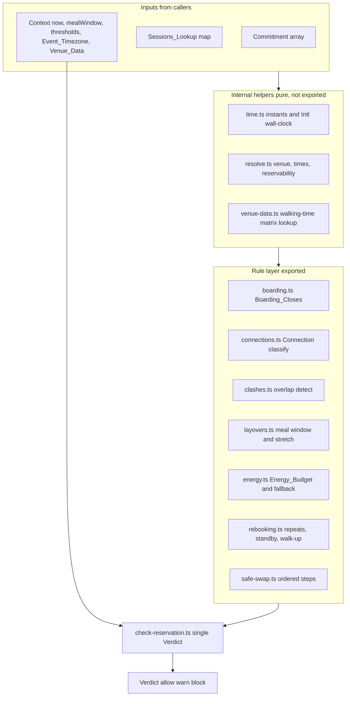

# Design Document

## Overview

The itinerary rules engine (stream S2) is a pure, browser-safe set of functions in `packages/core/src/rules`. It answers one question for a re:Invent attendee: can I get into this session on time and safely, given everything else on my week. It computes boarding times, walking connections between venues, clashes, layovers (personal time for meals and rest), a per-day energy budget, and rebooking options, and it packages all of these into one guardrail function, `checkReservation`, that returns a single `Verdict` of allow, warn or block with plain-English reasons.

The engine performs no input or output. It reads no files at runtime, imports nothing from Node built-in modules, and never reads the system clock. It is browser-safe because the showcase site (S7) runs it directly through the subpath export `@compass/core/rules`, the same code the MCP server (S3) and the Kiro hook call. The engine owns `packages/core/src/rules` and `data/venues.json` only.

It reuses the shared domain types `Verdict`, `Venue`, `NormalisedSession` and `Commitment` from `@compass/contracts` and never redefines them. Its own schedule shape is a `Commitment[]` plus a `Sessions_Lookup`, a map of `NormalisedSession` keyed by `sessionId`.

The engine follows the product voice: plain English, short sentences, and no em dash or en dash anywhere. It is honest about uncertainty: when a required field is missing it returns an "unknown" result with a reason and never invents a value. All times are interpreted in the event timezone supplied in `Context`, and all time arithmetic is DST-safe. The current instant always comes from `Context.now`, never from a system clock.

### Design goals

- **Purity and determinism.** Every exported function is a pure function of its inputs. Deeply equal inputs always produce deeply equal outputs (Req 10.5), and no input is ever mutated (Req 10.6).
- **Honesty about uncertainty.** Missing timezone, venue, start time, or end time yields an "unknown" result with a stated reason, never a substituted default (Req 1.5, 1.6, 1.8, 11.3, 11.4, 11.5).
- **One shared definition per concept.** "Tight", "clash", boarding, and venue resolution each have exactly one definition reused across all rules and the guardrail.
- **DST-safe time discipline.** Durations use absolute instants; day bucketing and meal windows use event-timezone local wall-clock time computed through `Intl` (Req 11.2).
- **One guardrail.** `checkReservation` combines every rule into a single `Verdict` with a stated precedence (block over warn over allow) (Req 8).

### Design decisions and rationale

- **Decision: a shared internal time toolkit (`time.ts`) splits instant arithmetic from wall-clock bucketing.** Rationale: Req 11.2 mandates two kinds of time work. Durations and elapsed minutes are computed on the absolute instants parsed from ISO 8601 strings with offset. Day bucketing and meal-window placement use `Intl.DateTimeFormat` with the `timeZone` option to read the local wall-clock fields. This keeps results stable across a DST transition inside the event window, because a duration between two offset-bearing instants does not change when the local offset changes.
- **Decision: the engine depends only on the `Intl` global and standard ECMAScript.** Rationale: Req 10.2 and 10.3 require zero Node built-in imports and no reference error for a missing runtime global in a browser. `Intl.DateTimeFormat` is a standard global available in Node 24 and every modern browser, so it is browser-safe. A test scans source and transitive imports for Node built-ins (Req 12.4).
- **Decision: every rule returns a typed result carrying either a value or an `unknown` status with reasons, rather than throwing.** Rationale: Req 11.5 and Req 8.7 require the engine to skip a rule it cannot judge and state why, not to fail. Throwing would break purity guarantees and the single-verdict contract.
- **Decision: `checkReservation` composes the lower-level rules and never re-implements them.** Rationale: the Glossary states "Tight" has one definition shared by the connection rules and the guardrail (Req 2.3, 8.4). Composition keeps that single source of truth.
- **Decision: the energy budget (Req 5, cut-list item 2) is built last and has a count-only fallback.** Rationale: Req 5.9 requires that if the full formula is cut, a count-only overload check still exists so the guardrail (Req 8.6) has a basis. The design keeps overload detection behind one interface so either implementation satisfies `checkReservation`.

## Architecture

The engine is a layered set of pure modules. The lower layers compute single facts (boarding time, a connection, a clash). The guardrail layer composes them into one `Verdict`. Nothing in any layer performs I/O or reads a clock.



### Module layout (owned files under packages/core/src/rules)

| File                   | Responsibility                                                                                                                                                                                                                                                                                                                                                                                                  | Exported |
| ---------------------- | --------------------------------------------------------------------------------------------------------------------------------------------------------------------------------------------------------------------------------------------------------------------------------------------------------------------------------------------------------------------------------------------------------------- | -------- |
| `index.ts`             | Subpath entry for `@compass/core/rules`; re-exports the public surface by name                                                                                                                                                                                                                                                                                                                                  | yes      |
| `context.ts`           | `Context` type, `ContextSchema`, and the documented defaults                                                                                                                                                                                                                                                                                                                                                    | yes      |
| `time.ts`              | Parse offset instants, compute duration minutes, bucket by event day, read wall-clock fields through `Intl.DateTimeFormat("en-US", { timeZone, hourCycle: "h23" })`, convert wall-clock to instant with a two-pass offset correction (earlier offset wins on a fall-back overlap), read offsets from the `longOffset` part, validate IANA timezone and reject any value starting with `+` or `-`; no `Temporal` | internal |
| `resolve.ts`           | `Venue_Resolution`, time resolution from `NormalisedSession` plus `missingFields`, reservability resolution                                                                                                                                                                                                                                                                                                     | internal |
| `venue-data.ts`        | Load and validate the in-memory `Venue_Data`, look up a walking time for an ordered venue pair                                                                                                                                                                                                                                                                                                                  | internal |
| `boarding.ts`          | `computeBoarding` returns `Boarding_Closes` or an unknown or not-applicable result                                                                                                                                                                                                                                                                                                                              | yes      |
| `connections.ts`       | `classifyConnection` returns comfortable, tight, impossible, or unknown with a reason                                                                                                                                                                                                                                                                                                                           | yes      |
| `clashes.ts`           | `findClashes` detects overlaps and reports unknown for missing end times                                                                                                                                                                                                                                                                                                                                        | yes      |
| `layovers.ts`          | `checkLayovers` evaluates the meal window and unbroken stretch and suggests blocks                                                                                                                                                                                                                                                                                                                              | yes      |
| `energy.ts`            | `scoreEnergy` computes the `Energy_Budget` and the count-only fallback                                                                                                                                                                                                                                                                                                                                          | yes      |
| `rebooking.ts`         | `findRebookingOptions` returns repeats, standby, and walk-up options                                                                                                                                                                                                                                                                                                                                            | yes      |
| `safe-swap.ts`         | `planSafeSwap` returns the ordered three-step swap plan and outcome                                                                                                                                                                                                                                                                                                                                             | yes      |
| `check-reservation.ts` | `checkReservation` composes all rules into one `Verdict`                                                                                                                                                                                                                                                                                                                                                        | yes      |
| `reasons.ts`           | Plain-English reason builders; central place that guarantees no em or en dash                                                                                                                                                                                                                                                                                                                                   | internal |

### Owned data file

`data/venues.json` holds the `Venue_Data` wrapper: the venues list, the walking-time matrix, and a source note on every value. The engine does not read this file at runtime (Req 10.1). Callers load and parse it and pass the result in through `Context.venueData`. A test validates the file against the wrapper schema (Req 9.6).

### Time discipline (Req 11.2)

Two kinds of time work, kept separate in `time.ts`:

- **Durations and elapsed time** use the absolute instants. The engine parses each ISO 8601 string with offset to an absolute epoch value and subtracts. A connection's spare minutes, a clash overlap, and the 10-minute boarding offset are all instant arithmetic. This is why a DST offset change inside the event window does not shift boarding, connection, or clash results by any minutes.
- **Day bucketing and meal-window placement** use event-timezone local wall-clock time. `time.ts` uses `Intl.DateTimeFormat("en-US", { timeZone, hourCycle: "h23" })` to read the local year, month, day, hour, and minute for an instant, and always passes a `Date` object to `formatToParts`. Day grouping compares the local calendar day. Meal-window checks compare local wall-clock minutes against `mealWindow`.

Further time rules in `time.ts`:

- Converting a wall-clock time to an instant uses a two-pass offset correction. When two offsets are possible, as in a daylight saving fall-back overlap, the earlier offset wins.
- Output offsets come from the `timeZoneName` `longOffset` part.
- The timezone validator rejects any `timeZone` value that starts with `+` or `-`.
- The engine does not use `Temporal`.

## Components and Interfaces

All interfaces below are described in TypeScript-flavoured shapes. The four shared types (`Verdict`, `Venue`, `NormalisedSession`, `Commitment`) are imported from `@compass/contracts` and never redefined (Req 10.4). Result types below are engine-local and do not redefine the shared four.

### Context

```ts
import type { Venue } from '@compass/contracts';

interface MealWindow {
  start: string; // local wall-clock HH:mm, default "11:30"
  end: string; // local wall-clock HH:mm, default "14:00"
  requiredFreeMinutes: number; // default 30
}

interface SourceNote {
  kind: 'official' | 'estimate';
  url?: string; // present and required when kind is "official"
}

interface WalkingEdge {
  from: string; // venue name
  to: string; // venue name, distinct from "from"
  minutes: number; // whole minutes 0..240
  source: SourceNote;
}

interface VenueEntry {
  venue: Venue; // reuses VenueSchema from contracts
  coordinatesSource?: SourceNote; // present when coordinates are present
}

interface VenueData {
  venues: VenueEntry[];
  walkingTimes: WalkingEdge[];
}

interface Context {
  now: string; // ISO 8601 with offset, required, no default
  eventTimezone?: string; // IANA name, e.g. "America/Los_Angeles"
  venueData: VenueData;
  mealWindow: MealWindow; // default 11:30 to 14:00 needing 30 free minutes
  maxStretchMinutes: number; // default 180
  overloadThreshold: number; // default 100
  overloadCountThreshold: number; // default 6, used by the count-only fallback
  tightMarginMinutes: number; // default 5
  bufferMinutes: number; // default 10
}
```

`context.ts` exports `ContextSchema` (a Zod schema whose name ends in `Schema`) and a `withContextDefaults` helper that fills every tuning value except `now` with its documented default, including `overloadCountThreshold` with a default of 6. `now` has no default; the caller always supplies it (Glossary, Context). `eventTimezone` is intentionally optional so the engine can return "unknown" when it is absent (Req 11.3) and "unknown" when it is present but not a recognised IANA name (Req 11.4).

### Sessions_Lookup and Schedule_Input

```ts
import type { Commitment, NormalisedSession } from '@compass/contracts';

type SessionsLookup = Readonly<Record<string, NormalisedSession>>;

interface ScheduleInput {
  commitments: readonly Commitment[];
  sessions: SessionsLookup;
}
```

### Resolved view (resolve.ts, internal)

`resolve.ts` turns one `Commitment` plus the `Sessions_Lookup` into a single resolved view used by every rule, so venue, time, and reservability resolution live in one place.

```ts
type Missing = 'venue' | 'startsAt' | 'endsAt' | 'reservability';

interface ResolvedCommitment {
  ref: string; // human label naming the commitment for reasons
  venue?: string; // Venue_Resolution result
  startsAt?: string; // ISO instant, absent when unusable
  endsAt?: string; // ISO instant, absent when unusable
  isAllDay: boolean;
  isReservable?: boolean; // absent when the flag is missing
  missing: Missing[]; // names every field left absent
}
```

`Venue_Resolution` order (Req 2.5, 9.x): `NormalisedSession.venue` when present, otherwise for a `reservedSession` `Commitment.venue`, otherwise for a `personalTime` `Commitment.location`. A time is "usable" only when the `NormalisedSession` field is present and the field name is not listed in `NormalisedSession.missingFields` (Req 1.5, 3.7, 5.7).

Time resolution by commitment kind:

- For a `personalTime`, the start and end times come from `Commitment.startsAt` and `Commitment.endsAt`.
- For a `reservedSession`, the times come from the `NormalisedSession` times when usable, otherwise the resolved time is absent (unknown).
- A `sessionId` that is missing from the `Sessions_Lookup` yields unknown for venue, start time, end time, and reservability.
- A time value is usable only when it matches ISO 8601 with a `Z` or a `+/-HH:MM` offset; any other string is treated as unknown.
- Reservability is treated as missing when `isReservable` appears in `missingFields`, or when the `sessionId` is absent from the lookup.

### Boarding (boarding.ts)

```ts
type BoardingResult =
  | { status: 'closes'; at: string; reason: string } // ISO instant, reservable
  | { status: 'notApplicable'; reason: string } // not reservable
  | { status: 'unknown'; reason: string }; // missing data

function computeBoarding(session: NormalisedSession, context: Context): BoardingResult;
```

Returns `closes` at start minus 10 minutes when reservable and all data is present (Req 1.1). Returns `notApplicable` when `isReservable` is false (Req 1.2). Returns `unknown` when the start time is missing (Req 1.5), the reservability flag is missing (Req 1.6), or the timezone is missing or unrecognised (Req 1.8, 11.3, 11.4). The 10-minute subtraction is instant arithmetic; the result is expressed in the event timezone for display (Req 1.1, 1.7).

### Connections (connections.ts)

```ts
type ConnectionClass = 'comfortable' | 'tight' | 'impossible' | 'unknown';

interface ConnectionResult {
  classification: ConnectionClass;
  walkingMinutes?: number; // matrix value plus buffer, absent when unknown
  reason: string; // names both venues and the walking minutes
}

function classifyConnection(
  from: ResolvedCommitment,
  to: ResolvedCommitment,
  toBoarding: BoardingResult,
  context: Context,
): ConnectionResult;
```

Walking minutes are the matrix value plus `bufferMinutes` (Req 2.1). When both commitments resolve to the same venue, the raw walk is 0 plus `bufferMinutes`, and the reason labels this walking time as an estimate. Venue names match after trimming and lowercasing, by exact name only, with no fuzzy matching. The next item's due time is its `Boarding_Closes` when reservable, otherwise its start time (Req 2.2, 2.8). Spare time of `tightMarginMinutes` or more is comfortable (Req 2.2); fewer is tight (Req 2.3); arrival after due time is impossible (Req 2.4). Returns unknown when either venue is missing (Req 2.5), a venue is absent from the matrix (Req 2.6, 9.8, 9.9), or a reservable next item has no boarding time (Req 2.7). Every reason names both venues and the walking minutes (Req 2.9), and states "estimate" when the walking-time source is an estimate.

### Clashes (clashes.ts)

```ts
interface ClashPair {
  a: string; // commitment ref
  b: string; // commitment ref
  overlap: string; // plain-English overlapping range in the event timezone
  reason: string;
}

type ClashReport = { status: 'ok'; clashes: ClashPair[] } | { status: 'unknown'; reason: string }; // missing end time or missing timezone

function findClashes(schedule: ScheduleInput, context: Context): ClashReport;
```

Two commitments clash when they overlap by one second or more (Req 3.1). An all-day item occupies 00:00:00 to 23:59:59 of its event day in the event timezone (Req 3.2). Cross-midnight commitments are evaluated on their instants (Req 3.3). Identical start and end instants clash (Req 3.4); touching at a single instant does not (Req 3.5). A missing end time yields `unknown` for any pair including that commitment (Req 3.7). A missing timezone yields `unknown` (Req 3.8). Every clash reason names both commitments and the overlapping range (Req 3.9).

### Layovers (layovers.ts)

```ts
interface SuggestedBlock {
  start: string; // ISO instant
  end: string; // ISO instant
  reason: string;
}

interface LayoverReport {
  mealLayoverMissing: boolean;
  longStretchMinutes?: number; // present when a stretch exceeds the max
  suggestions: SuggestedBlock[];
  noPlacementReason?: string; // present when no clash-free gap exists
}

function checkLayovers(schedule: ScheduleInput, context: Context): LayoverReport;
```

Reports a missing meal layover when free minutes inside the meal window fall below the required free minutes (Req 4.1, 4.2). Reports a long stretch over `maxStretchMinutes` (Req 4.3, 4.4). Produces suggested blocks in clash-free gaps (Req 4.5, 4.6), or states that none could be placed (Req 4.7). Meal windows and stretches use event-timezone wall-clock time (Req 4.8).

### Energy (energy.ts)

Energy is implemented last (Req 5 is cut-list item 2). `checkReservation` never branches on which implementation exists: it calls a single `isOverloaded(day, context)` interface, and either the full formula or the count-only fallback stands behind that one interface.

```ts
interface EnergyResult {
  score: number;
  commitmentCount: number;
  totalWalkingMinutes: number;
  venueChangeCount: number;
  overloaded: boolean;
  explanation: string; // names the three inputs and the formula
  missingDataNotes: string[]; // names commitments excluded from walk and venue totals
}

function scoreEnergy(dayCommitments: readonly ResolvedCommitment[], context: Context): EnergyResult;

// The one overload interface the guardrail calls. It never branches on which
// implementation exists: the full formula or the count-only fallback stands
// behind it.
function isOverloaded(
  dayCommitments: readonly ResolvedCommitment[],
  context: Context,
): { overloaded: boolean; explanation: string };
```

Score is `(commitmentCount * 10) + totalWalkingMinutes + (venueChangeCount * 15)` (Req 5.1). Days with fewer than two commitments have zero walking and zero venue changes (Req 5.2). The threshold comes from `Context.overloadThreshold` (Req 5.3). A score strictly greater than the threshold is overloaded (Req 5.4); equal or less is not (Req 5.5). A commitment missing a venue or usable time is counted but excluded from walking and venue totals, and named in the explanation (Req 5.7).

Owner decision on the fallback: if cut-list item 2 (the full formula) is cut, `isOverloaded` uses a count-only fallback that flags a day with more than `overloadCountThreshold` commitments, default 6, as overloaded. `overloadCountThreshold` is a separate `Context` value from `overloadThreshold`, so the fallback has its own tuning knob (Req 5.9).

### Rebooking (rebooking.ts)

```ts
interface RebookOption {
  kind: 'repeat' | 'standby' | 'walkUp';
  sessionId: string;
  startsAt: string;
  reason: string; // 1 to 200 characters, names why the option is offered
}

type RebookResult =
  | { status: 'ok'; options: RebookOption[]; message: string }
  | { status: 'unknown'; options: []; message: string }; // timezone missing

function findRebookingOptions(
  baseCode: string,
  candidates: readonly NormalisedSession[],
  favorites: readonly NormalisedSession[],
  context: Context,
): RebookResult;
```

Finds repeats by matching the base code with a `-R` suffix and by `NormalisedSession.repeatOf`, so a repeat is found whether it carries the `-R` code suffix or points back through `repeatOf`, including only sessions starting after `Context.now` in the event timezone (Req 6.1). Lists standby favorites sharing the base code and starting after now (Req 6.2). A walk-up option is a session for the base code starting after now whose `isReservable` is false or that is full (Req 6.3). Each option carries a 1 to 200 character reason (Req 6.4). Zero options returns a plain-English "no alternative found" message (Req 6.5). A missing timezone returns zero options with a timezone message and leaves the input unchanged (Req 6.7).

### Safe swap (safe-swap.ts)

```ts
interface SwapStep {
  order: 1 | 2 | 3;
  action: 'reserveRepeat' | 'confirmHeld' | 'cancelOriginal';
  blockedUntilConfirmed: boolean;
  reason: string;
}

interface SwapPlan {
  outcome: 'safe' | 'unsafe' | 'failed';
  steps: SwapStep[];
  clashesWith: string[]; // commitment refs when unsafe
  reason: string;
}

function planSafeSwap(
  original: Commitment,
  repeat: NormalisedSession,
  confirmationSchedule: ScheduleInput, // caller obtained this from GetSchedule
  context: Context,
): SwapPlan;
```

Produces three ordered steps: reserve the repeat, confirm by inspecting the confirmation schedule, then cancel the original (Req 7.1). The cancel step is blocked until the confirmation schedule shows the repeat held (Req 7.2). A clash with the original or any other commitment yields `unsafe`, names each clashing commitment, and leaves the original unchanged (Req 7.3). No clash yields `safe` (Req 7.4). A confirmation schedule that does not show the repeat held yields `failed` and leaves the original unchanged (Req 7.5). Every step and the outcome carry a plain-English reason (Req 7.6). All clash checks use the event timezone and `Context.now` (Req 7.7). The engine does no I/O; it only inspects the schedule it is given.

### Guardrail (check-reservation.ts)

```ts
import type { Verdict } from '@compass/contracts';

function checkReservation(
  candidate: NormalisedSession,
  schedule: ScheduleInput,
  context: Context,
): Verdict;
```

`checkReservation` composes the rules above and returns exactly one `Verdict` (Req 8.1). The candidate `NormalisedSession` is first turned into a `reservedSession` `Commitment` before any rule is evaluated, so every rule sees the candidate in the same shape as the rest of the schedule. The neighbours used for the connection checks are the nearest earlier commitment and the nearest later commitment on the same event day. A candidate that is already present in the schedule is ignored for the clash checks, so a session is never treated as clashing with itself.

It blocks on a clash (Req 8.2) or an impossible connection to or from an adjacent commitment (Req 8.3). It warns on a tight connection (Req 8.4), on removing the day's only meal layover (Req 8.5), or on raising the day's energy budget above the overload threshold (Req 8.6). The meal rule and the overload rule both compare the schedule without the candidate against the schedule with the candidate: the meal rule warns only when the meal layover goes from present to missing, and the overload rule warns only when overload goes from false to true. When a rule cannot be judged for missing data, it skips that rule, states which rule and that data was missing, and the overall decision is at least warn (Req 8.7, 8.9). Decision precedence is block if any block rule applies, otherwise warn if any warn rule or missing-data case applies, otherwise allow, with one reason per applied rule (Req 8.8). Every reason is plain English with no em or en dash (Req 8.10, 11.6). Tests parse every returned result with `VerdictSchema`.

### Reasons (reasons.ts, internal)

A single module builds every reason and warning string. It is the one place that guarantees no em dash and no en dash reach output, and that each sentence stays within 20 words (Req 11.6). Centralising reason text makes the no-dash test (Req 12.3) and the plain-English rule checkable in one place.

## Data Models

### Shared types from @compass/contracts (reused, never redefined)

- **`NormalisedSession`**: `sessionId`, `code`, `title`, optional `type`, `level`, `venue`, `room`, `startsAt`, `endsAt`, `isAllDay`, `isReservable`, `seatAvailability`, `repeatOf`, and `missingFields`. The engine treats a time as usable only when present and not named in `missingFields`.
- **`Commitment`**: a discriminated union on `kind`. `reservedSession` carries `sessionId`, `startsAt`, `endsAt`, optional `title` and `venue`. `personalTime` carries `title`, `startsAt`, `endsAt`, optional `personalTimeId` and `location`.
- **`Venue`**: required `name`, optional `coordinates` with numeric `lat` and `lon`.
- **`Verdict`**: a discriminated union on `decision` (`allow`, `warn`, `block`); `warn` and `block` carry at least one reason.

### Venue_Data (data/venues.json, owned by S2)

A wrapper object, not a bare `Venue` array (Req 9.1). Its schema reuses `VenueSchema` from `@compass/contracts` for each venue entry (Req 9.6).

```jsonc
{
  "venues": [
    {
      "venue": { "name": "Venetian", "coordinates": { "lat": 36.121, "lon": -115.169 } },
      "coordinatesSource": { "kind": "estimate" },
    },
  ],
  "walkingTimes": [
    {
      "from": "Venetian",
      "to": "Caesars Forum",
      "minutes": 15,
      "source": { "kind": "estimate" },
    },
  ],
}
```

Rules enforced by `VenueDataSchema` and the file-validation test:

- Every source note value defaults to `{ kind: "estimate" }`; a value is only `official` when a cited URL is supplied.
- The venues list holds only main re:Invent 2026 venues named on official AWS pages; each venue name is non-empty; coordinates are `lat` in -90 to 90 and `lon` in -180 to 180 (Req 9.2).
- The walking-time matrix covers all ordered pairs of the listed venues, giving for each ordered pair of distinct named venues whole minutes from 0 to 240 (Req 9.3).
- Every walking time and every coordinate carries a source note that is either `official` with a URL or `estimate` (Req 9.4). A value with no official source is marked `estimate` (Req 9.5).
- A source note of `official` requires a URL whose host is `reinvent.awsevents.com` or `aws.amazon.com`; any other host is rejected, so only official AWS re:Invent pages back an `official` note.
- A test validates the whole file against the wrapper schema (Req 9.6). An entry that fails `VenueSchema` is rejected with a statement of which entry failed and why (Req 9.7).
- A connection using a venue absent from the venues list, or an ordered pair with no matrix value, is treated as unknown with a stated reason (Req 9.8, 9.9).

### Result types

Each rule returns a small result type (`BoardingResult`, `ConnectionResult`, `ClashReport`, `LayoverReport`, `EnergyResult`, `RebookResult`, `SwapPlan`) carrying either a value or an `unknown`/`notApplicable` status with reasons. These are engine-local and do not redefine any of the four shared types.

## Correctness Properties

_A property is a characteristic or behavior that should hold true across all valid executions of a system, essentially a formal statement about what the system should do. Properties serve as the bridge between human-readable specifications and machine-verifiable correctness guarantees._

This engine is a pure set of functions over structured inputs: boarding math, connection classification, overlap detection, timezone discipline, and composition into one verdict. That is a strong fit for property-based testing, and Req 12.1 mandates property-style tests over generated inputs. The properties below were derived from the prework analysis, with redundant criteria consolidated so each property carries unique validation value. All sample data is self-made under `packages/core/test/rules` (Req 12.5).

### Property 1: Boarding closes at start minus ten minutes

_For any_ reservable session with a usable start time and a valid event timezone, `computeBoarding` returns status "closes" at an instant exactly ten minutes before the session start, computed on the absolute instants.

**Validates: Requirements 1.1, 1.7**

### Property 2: Reservability comes from the flag, not the type name

_For any_ session whose `isReservable` is false, `computeBoarding` returns status "notApplicable" with a reason stating no reservation is needed and never returns a boarding instant; and _for any_ session, changing only its `type` string while holding `isReservable` fixed does not change whether boarding is applicable or not applicable.

**Validates: Requirements 1.2, 1.3, 1.4**

### Property 3: Missing required field yields unknown with a reason and no value

_For any_ input missing a required field (venue, start time, end time, or reservability flag), the affected result has status "unknown", states the reason naming the missing field, and substitutes no default value.

**Validates: Requirements 1.5, 1.6, 2.5, 3.7, 11.5**

### Property 4: Missing or unrecognised timezone yields unknown for every time-dependent result

_For any_ time-dependent call, when the event timezone is absent or is not a recognised IANA name, the result has status "unknown", states that the timezone is missing or unrecognised, substitutes no default timezone, and leaves the input unchanged.

**Validates: Requirements 1.8, 3.8, 6.7, 11.3, 11.4**

### Property 5: Connection classification follows spare time against the due time, with walking minutes and a naming reason

_For any_ pair of consecutive commitments with resolvable venues and a known due time, `classifyConnection` computes walking minutes as the matrix value plus `Context.bufferMinutes`, returns comfortable when spare time is at least `tightMarginMinutes`, tight when spare time is below `tightMarginMinutes`, and impossible when arrival is after the due time, where the due time is the next item's boarding instant when reservable and its start instant otherwise; and the reason names both venues and the computed walking minutes.

**Validates: Requirements 2.1, 2.2, 2.3, 2.4, 2.8, 2.9**

### Property 6: Missing venue, matrix value, or missing boarding yields an unknown connection

_For any_ pair where a venue is unresolved, a named venue is absent from the venues list, the ordered pair has no matrix value, or a reservable next commitment has no available boarding instant, `classifyConnection` returns "unknown" and the reason names the offending venue or commitment or states that the next item's boarding time is missing.

**Validates: Requirements 2.6, 2.7, 9.8, 9.9**

### Property 7: Clash overlap semantics with all-day expansion and a naming reason

_For any_ two commitments with usable times, `findClashes` reports a clash exactly when their event-timezone intervals overlap by one second or more, reports a clash for identical intervals, reports no clash when one ends at the instant the next starts, treats an all-day item as spanning 00:00:00 to 23:59:59 of its event day, and names both commitments and their overlapping range in the event timezone in every clash reason.

**Validates: Requirements 3.1, 3.2, 3.3, 3.4, 3.5, 3.9**

### Property 8: Meal layover reported exactly when free minutes fall short

_For any_ day schedule and meal window, `checkLayovers` reports the meal layover as missing exactly when the free minutes inside the window are below the required free minutes.

**Validates: Requirements 4.1, 4.2**

### Property 9: Long stretch reported exactly when an unbroken run exceeds the max

_For any_ day schedule and maximum stretch, `checkLayovers` reports a long stretch exactly when an unbroken run of commitments exceeds `maxStretchMinutes`.

**Validates: Requirements 4.3, 4.4**

### Property 10: Suggested blocks are complete and clash-free, or none is reported

_For any_ report that triggers suggestions, every suggested block carries a start, an end, and a reason, and does not overlap any existing commitment; and when no clash-free gap exists, the report states that none could be placed and offers zero suggestions.

**Validates: Requirements 4.5, 4.6, 4.7**

### Property 11: Energy budget formula, overload threshold and count-only fallback, and explanation

_For any_ day schedule, `scoreEnergy` returns a score equal to `(commitmentCount * 10) + totalWalkingMinutes + (venueChangeCount * 15)`, with zero walking minutes and zero venue changes for a day of fewer than two commitments; `isOverloaded` flags the day overloaded exactly when the score is strictly greater than `Context.overloadThreshold`, and its count-only fallback flags overloaded exactly when the commitment count alone is strictly greater than `Context.overloadCountThreshold`; and the explanation names the commitment count, the total walking minutes, the venue change count, and the formula, while any commitment lacking a resolvable venue or usable time is counted, excluded from the walking and venue-change totals, and named in the explanation.

**Validates: Requirements 5.1, 5.2, 5.3, 5.4, 5.5, 5.6, 5.7, 5.9**

### Property 12: Every rebooking option matches the base code and starts after now

_For any_ base code, candidate set, and favorites, every option `findRebookingOptions` returns matches the base code for its kind (a repeat found by the `-R` suffix or by `repeatOf`, a standby favorite, or a walk-up whose `isReservable` is false or that is full), starts strictly after `Context.now` in the event timezone, and carries a reason of 1 to 200 characters; and when no candidate matches, the result has zero options and a plain-English no-alternative message.

**Validates: Requirements 6.1, 6.2, 6.3, 6.4, 6.5**

### Property 13: Safe swap produces the three gated steps and an outcome that matches clash and confirmation state

_For any_ swap request, `planSafeSwap` returns exactly three steps in the order reserve repeat, confirm held, cancel original, with the cancel-original step marked blocked until the confirmation schedule shows the repeat held; and the outcome is "unsafe" naming every clashing commitment when the repeat clashes with the original or any other commitment, "failed" when the confirmation schedule does not show the repeat held, and "safe" otherwise, leaving the original reservation and all inputs unchanged in every case.

**Validates: Requirements 7.1, 7.2, 7.3, 7.4, 7.5**

### Property 14: checkReservation returns one valid Verdict by severity precedence and never blocks on missing data

_For any_ candidate, schedule, and context, `checkReservation` returns exactly one valid `Verdict` whose decision is block if any block rule applies (a clash or an impossible connection), otherwise warn if any warn rule or missing-data case applies (a tight connection, a lost meal layover, an overload, or a rule skipped for missing data), otherwise allow; the verdict carries exactly one reason for every rule that applied; and for any candidate or schedule missing the data a rule needs, that rule is skipped rather than blocked on, the decision is at least warn, and the reasons state that the data was missing and name the rule that could not be judged.

**Validates: Requirements 8.1, 8.2, 8.3, 8.4, 8.5, 8.6, 8.7, 8.8, 8.9**

### Property 15: Invalid venue entries are rejected with a naming reason

_For any_ venue entry that violates `VenueSchema`, validating the `Venue_Data` rejects it and the error states which entry failed and why.

**Validates: Requirements 9.7**

### Property 16: Inputs are never mutated

_For any_ exported function, every input value is deeply equal to its pre-call snapshot after the call returns.

**Validates: Requirements 10.6, 6.7, 7.3, 7.5**

### Property 17: The same instants give identical results across an offset change

_For any_ schedule, the same absolute instants give identical boarding, connection, and clash results across a change in the event timezone offset (the results do not shift by any number of minutes), while day bucketing and meal-window placement use event-timezone local wall-clock time.

**Validates: Requirements 1.7, 2.10, 3.6, 4.8, 5.8, 6.6, 7.7, 11.1, 11.2**

### Property 18: Every produced string is plain English with no em dash or en dash

_For any_ reason or warning string the engine can produce, the string contains no em dash and no en dash, and every sentence in it is 20 words or fewer.

**Validates: Requirements 8.10, 11.6, 12.3**

## Error Handling

The engine never throws for an expected uncertainty. Expected uncertainty (missing timezone, missing venue, missing start or end time, a venue absent from the matrix, a reservable item with no boarding) is a first-class result, not an exception. This keeps purity guarantees intact and lets `checkReservation` always return one `Verdict`.

- **Missing or invalid timezone.** Every time-dependent function returns an "unknown" result stating the timezone is missing or unrecognised, substituting no default (Req 11.3, 11.4). `time.ts` validates the IANA name once by attempting an `Intl.DateTimeFormat` construction inside a guard and treating a thrown `RangeError` as "unrecognised"; this is the single place a platform error is caught and converted to a result.
- **Missing required field.** Boarding, connections, clashes, and energy each return "unknown" for the affected result with a reason naming the field, and never substitute a default (Req 1.5, 1.6, 2.5, 3.7, 5.7, 11.5).
- **Missing matrix value or unknown venue.** Connections return "unknown" naming the offending venue (Req 2.6, 9.8, 9.9). Energy excludes that commitment from walking and venue totals but still counts it, and names it (Req 5.7).
- **Invalid venue data.** `VenueDataSchema` (reusing `VenueSchema`) rejects an invalid entry with a `ZodError` whose message names the failing entry and reason; the file-validation test asserts this (Req 9.7). The engine does not parse the file at runtime; callers parse it and pass `VenueData` in through `Context`.
- **Guardrail composition.** `checkReservation` treats any lower-level "unknown" as a skipped rule: it never blocks on it, it raises the decision to at least warn, and it adds a reason naming the rule (Req 8.7). It throws nothing.
- **Reason text safety.** All reason text flows through `reasons.ts`, the single place that keeps output free of em and en dashes and within the 20-word sentence limit (Req 8.10, 11.6). A test asserts this across every producible string (Req 12.3).

## Testing Strategy

The engine is pure logic over structured inputs, so property-based testing is the primary strategy, complemented by targeted example tests for specific defaults and edge shapes, and smoke tests for the data file and the purity guarantees. Tests live in `packages/core/test/rules/**`, mirroring `src`, with files named `<module>.test.ts`. All sample data is self-made in those test files; tests never read `fixtures/synthetic` (Req 12.5, ADR-025).

### Property-based tests

- **Library.** Use `fast-check` with `vitest 4` (the project's test runner). The engine does not implement property-based testing from scratch. `fast-check` is already present at the repo root, so no install is requested. `zod` is now declared in `packages/core` (integrator commit b5c22cd), so `ContextSchema` and `VenueDataSchema` import it directly.
- **Iterations.** Each property test runs a minimum of 100 iterations.
- **Tagging.** Each property test carries a comment referencing its design property in the format: `// Feature: itinerary-rules, Property {number}: {property_text}`.
- **One test per property.** Each of the 18 correctness properties is implemented by a single property-based test.
- **Generators.** Self-made arbitraries build `NormalisedSession`, `Commitment`, `SessionsLookup`, `VenueData`, and `Context` values. Generators deliberately cover the Req 12.1 edge cases: a commitment that crosses midnight, an all-day item, a missing venue, a missing end time, identical start and end instants, and date arithmetic across a daylight saving time change. Each edge-case property asserts the exact verdict or result the engine returns.

### Example and edge-case tests

- The default meal window is 11:30 to 14:00 needing 30 free minutes (Req 4.2) and the default maximum stretch is 180 minutes (Req 4.3); concrete example tests assert these defaults, while the override behavior is covered by Properties 8 and 9 driving the values from `Context`.
- Concrete worked examples anchor boarding (Property 1), one comfortable, one tight, and one impossible connection (Property 5), and a clash across midnight and a touching-at-one-instant no-clash pair (Property 7), so a reader can see representative outputs.
- Determinism (Req 10.5) is asserted by an example test that calls each exported function twice on deeply equal inputs and checks the results are deeply equal. It is an example test, not a property test, because the behavior does not vary with input.

### Smoke and static tests

- **Venue data validation (Req 9.1 to 9.6).** A single test parses `data/venues.json` with `VenueDataSchema` and asserts it is a wrapper object (not a bare array), every venue name is non-empty, coordinates are within range, every matrix value is a whole number from 0 to 240, and every value carries a valid source note.
- **Node built-in import scan (Req 10.2, 12.4).** A single test scans the owned source files and their transitive imports and fails if any Node built-in import is found.
- **Impurity static scan (Req 10.1, 10.2).** A static scan fails if the engine source under `packages/core/src/rules` contains any of: `node:`, `fs`, `path`, `process`, `Buffer`, `Date.now(`, `new Date()`, or `Math.random`. This proves the engine performs no I/O, reads no clock, and imports nothing from Node built-ins.
- **Browser-safe execution (Req 10.1, 10.3).** A single test imports through `@compass/core/rules` and invokes every exported function, asserting no reference error for a missing runtime global and no I/O.
- **Shared-type usage (Req 10.4).** A structural test asserts the four shared types are imported from `@compass/contracts` and not redefined locally.
- **Test-data policy (Req 12.5).** A guard asserts no test under `test/rules` reads from `fixtures/synthetic`.

### Coverage

- `vitest` v8 coverage is configured to require 100 percent of lines, branches, functions, and statements over the files this spec owns, with the only permitted exclusions being the generated types named in the build plan. The run fails if any owned file falls below 100 percent on any of the four measures (Req 12.2).

## Requirements Mapping

| Requirement                            | Addressed by                                                                                                                                                         |
| -------------------------------------- | -------------------------------------------------------------------------------------------------------------------------------------------------------------------- |
| 1 Boarding time                        | `boarding.ts` (`computeBoarding`); Properties 1, 2, 3, 4, 17; boarding example test                                                                                  |
| 2 Connections                          | `connections.ts` (`classifyConnection`), `venue-data.ts`; Properties 3, 5, 6, 17; connection example tests                                                           |
| 3 Clashes                              | `clashes.ts` (`findClashes`); Properties 3, 4, 7, 17; midnight and touching example tests                                                                            |
| 4 Layovers and personal time           | `layovers.ts` (`checkLayovers`); Properties 8, 9, 10; default-window example tests                                                                                   |
| 5 Energy budget                        | `energy.ts` (`scoreEnergy`, `isOverloaded`); Property 11                                                                                                             |
| 6 Rebooking options                    | `rebooking.ts` (`findRebookingOptions`); Properties 4, 12, 16                                                                                                        |
| 7 Safe swap                            | `safe-swap.ts` (`planSafeSwap`); Properties 13, 16, 17                                                                                                               |
| 8 checkReservation guardrail           | `check-reservation.ts` (`checkReservation`), `reasons.ts`; Properties 14, 18                                                                                         |
| 9 Venue data file                      | `data/venues.json`, `venue-data.ts` (`VenueDataSchema`); Properties 6, 15; venue-data validation smoke test                                                          |
| 10 Purity and browser safety           | module structure, `context.ts`; Property 16; determinism example test (Req 10.5); Node-import scan, impurity static scan, browser-safe, shared-type structural tests |
| 11 Timezone and uncertainty discipline | `time.ts`, `resolve.ts`, `reasons.ts`; Properties 3, 4, 17, 18                                                                                                       |
| 12 Testing and coverage                | Testing Strategy; property tests at 100 iterations, coverage gate, no-dash test, Node-import scan, self-made-data guard                                              |

## Implementation deviations and clarifications

Recorded by the implementer (Claude, after the owner's Kiro credits ran out). Each item is a change from, or a clarification of, the design above.

1. `SourceNote` gains an optional `basis` string. An estimate may state its plain-English basis, so an estimate is traceable. It is ignored by every rule.
2. `ContextSchema` is first built on a structural venue data shape (`VenueDataShapeSchema` in `context.ts`). The strict `VenueDataSchema` arrives with `venue-data.ts` and then replaces it inside `ContextSchema`.
