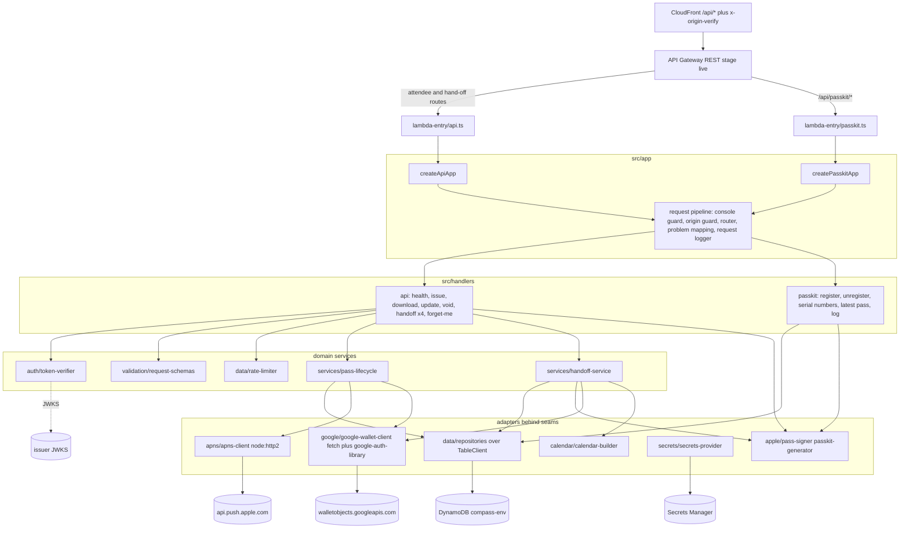

# Design Document

## Overview

This design covers S5, the `pass-service` stream: the Compass API Lambdas of re:Invent Compass. It owns `packages/pass-service/**` and produces two Lambda bundles:

- `api` (`dist/lambda/api.zip`): the ten attendee, hand-off and health operations of `contracts/compass-api.openapi.yaml`: getHealth, issuePasses, getApplePass, updatePass, voidPass, createHandoff, getHandoff, getHandoffAppleBundle, getHandoffCalendar and forgetMe.
- `passkit` (`dist/lambda/passkit.zip`): Apple's PassKit web service: registerDevice, unregisterDevice, getSerialNumbers, getLatestPass and logMessages.

Inside the bundles sit: an Origin_Guard, an ID token verifier on `aws-jwt-verify`, per-attendee rate limits in DynamoDB, a strict request validator built on the shared `createPassFieldsSchema`, an Apple pass builder and bundle builder on `passkit-generator` 3.7.0, an APNs HTTP/2 client, a Google Wallet client (insert, patch, save JWT), the hand-off service, a calendar builder, a single-table DynamoDB repository with expiry checked on every read, a Secrets Manager provider with an in-memory cache, and a redacting request logger that emits CloudWatch embedded metrics.

In the airline metaphor this stream is the gate agent's printer and the flight-status service: it prints a boarding pass only for a verified passenger, prints only from a fixed template, tells every phone when a flight changes or is cancelled, and runs a 15-minute pickup kiosk.

S6 owns every AWS resource. S5's hand-off to S6 is: the two bundle paths and handler names, the environment variables, the JSON keys of each secret, the DynamoDB key schema, the metric names and the permissions each Lambda needs (all in Data Models and the package README). The Compass API contract and `@compass/contracts` are frozen (S0); this stream never edits them.

### Design principles

1. **Contract first, contract exact.** Every route, status and body follows `contracts/compass-api.openapi.yaml`. Response schemas are typed against the generated `CompassApi` types so the compiler rejects drift, and a contract test reads the YAML itself.
2. **Fail closed.** Anything unauthenticated, unparseable, ambiguous or expired is refused with a fixed Problem_Response. Input is never reinterpreted and never echoed.
3. **Nothing identifying is logged or stored raw.** Logs carry an allowlist of fields. Storage keeps HMAC or SHA-256 forms of every identifier except the APNs push token, which Apple requires raw.
4. **Expiry is code, TTL is housekeeping.** Every read compares `expiresAtMs` with the injected clock. DynamoDB TTL only cleans up later.
5. **Every side effect is behind a seam.** Clock, randomness, DynamoDB, Secrets Manager, JWKS fetching, APNs, Google, the console and the filesystem are injected, so every test runs in memory with deterministic time and no network.
6. **Spike assumptions are configuration.** The SP2 issuer and verifier mode, the SP3 PassKit path and APNs settings, and the SP4 Google switches are environment variables with the build plan's expected values as defaults where a safe default exists.
7. **Pushes and Google calls are best effort.** A stored update or void always succeeds for the attendee; failed pushes and patches are counted as metrics and the pass still expires at session end (SP3 fallback).

### Research notes informing the design

- **Apple PassKit web service.** Endpoints and statuses, from Apple's reference pages:
  - Register: `POST <webServiceURL>/v1/devices/{deviceLibraryIdentifier}/registrations/{passTypeIdentifier}/{serialNumber}`, header `Authorization: ApplePass <authenticationToken>`, body `PushToken` `{pushToken}`; 201 registered, 200 already registered, 401 not authorized ([Register a pass for update notifications](https://developer.apple.com/documentation/walletpasses/register-a-pass-for-update-notifications), [PushToken](https://developer.apple.com/documentation/walletpasses/pushtoken)).
  - List updatable: `GET <webServiceURL>/v1/devices/{deviceLibraryIdentifier}/registrations/{passTypeIdentifier}?passesUpdatedSince=<tag>`; 200 with `SerialNumbers` `{serialNumbers: [string], lastUpdated: string}`, 204 no matching passes; no credential, the device library identifier is the shared secret ([Get the list of updatable passes](https://developer.apple.com/documentation/walletpasses/get-the-list-of-updatable-passes), [SerialNumbers](https://developer.apple.com/documentation/walletpasses/serialnumbers), [Adding a web service to update passes](https://developer.apple.com/documentation/walletpasses/adding-a-web-service-to-update-passes)). `lastUpdated` is "a developer-defined string"; Apple asks the server to return all passes when there is no tag.
  - Latest pass: `GET <webServiceURL>/v1/passes/{passTypeIdentifier}/{serialNumber}` with `ApplePass` authorization; 200 returns `application/vnd.apple.pkpass`, 401 not authorized ([Send an updated pass](https://developer.apple.com/documentation/walletpasses/send-an-updated-pass)). The current Apple page documents only 200 and 401; the `If-Modified-Since` request header, the `Last-Modified` response header and the 304 response come from the build plan (5.2) and the frozen contract, and their device behaviour is confirmed in SP3. HTTP dates follow [RFC 9110](https://www.rfc-editor.org/rfc/rfc9110) and have second precision.
  - Unregister: `DELETE` on the register path; 200 unregistered, 401 not authorized ([Unregister](https://developer.apple.com/documentation/walletpasses/unregister-a-pass-for-update-notifications)).
  - Log: `POST <webServiceURL>/v1/log`, body `LogEntries` `{logs: [string]}`, 200 ([Log a message](https://developer.apple.com/documentation/walletpasses/log-a-message), [LogEntries](https://developer.apple.com/documentation/walletpasses/logentries)).
  - Apple: "Your web service must use an HTTPS connection for production, but you can use an HTTP connection during testing." This is what lets SP3 run on the LAN.
- **Apple push.** "The notification uses the same certificate and private key that the creator of the pass used to sign the original, the push token registered by the device, and an empty JSON dictionary for the payload", "Delete a device if the Apple Push Notification service (APNs) returns an error that the push token is invalid", and "A push notification for a pass update works only in the production environment" ([Adding a web service to update passes](https://developer.apple.com/documentation/walletpasses/adding-a-web-service-to-update-passes)). APNs: production server `https://api.push.apple.com:443`, HTTP/2 and TLS 1.2 or later, `POST /3/device/<device_token>`, `apns-topic` header, `apns-push-type` "required for watchOS 6 and later; recommended for macOS, iOS, tvOS, and iPadOS", certificate-based trust presents the provider certificate during the TLS handshake ([Sending notification requests to APNs](https://developer.apple.com/documentation/usernotifications/sending-notification-requests-to-apns)). Status 410 means "The device token is no longer active for the topic" (reasons `Unregistered`, `ExpiredToken`); 400 `BadDeviceToken` means "The specified device token is invalid" ([Handling notification responses from APNs](https://developer.apple.com/documentation/usernotifications/handling-notification-responses-from-apns)). Apple's Wallet pages do not state the `apns-topic` value for pass pushes; the design sends the Pass Type ID and SP3 confirms it. The push type header is optional configuration for the same reason.
- **Apple pass keys.** `authenticationToken`, `webServiceURL`, `expirationDate` ("a complete date that includes hours and minutes"), `voided`, `relevantDates`, `sharingProhibited`, `serialNumber`, `passTypeIdentifier`, `teamIdentifier`, `formatVersion` (must be 1), `barcodes` ([Pass](https://developer.apple.com/documentation/walletpasses/pass)). `relevantDates` entries hold `startDate` and `endDate` ("Required when providing startDate") ([Pass.RelevantDates](https://developer.apple.com/documentation/walletpasses/pass/relevantdates-data.dictionary)). "All passes require an icon" ([Creating the source for a pass](https://developer.apple.com/documentation/walletpasses/creating-the-source-for-a-pass)). A `.pkpasses` bundle is a zip of `.pkpass` files with MIME type `application/vnd.apple.pkpasses`, "up to 10 passes or 150 MB" ([Distributing and updating a pass](https://developer.apple.com/documentation/walletpasses/distributing-and-updating-a-pass)). The current Pass reference states no minimum length for `authenticationToken`; the build plan records a minimum of 16 characters, and the 43-character token meets both.
- **passkit-generator 3.7.0** (read from its shipped type definitions). Certificates are PEM: `{wwdr, signerCert, signerKey, signerKeyPassphrase?}` (it does not take a `.p12`). `new PKPass(buffers, certificates, props)` takes in-memory file buffers (including `pass.json`) and overridable props (`serialNumber`, `webServiceURL`, `authenticationToken`, `voided`, `sharingProhibited` and others); `setExpirationDate`, `setRelevantDates`, `setBarcodes(null)`, `getAsBuffer()`; `PKPass.pack(...passes)` returns a bundle for `.pkpasses`. Source: [passkit-generator](https://github.com/alexandercerutti/passkit-generator). ADR-026 records that it pulls `node-forge` 1.4.0 and `joi` 17.13.4 with accepted advisories; this design keeps every value that reaches it validated by `createPassFieldsSchema` first, and S5's security review re-checks that decision (task 22).
- **Google Wallet REST.** `GenericObject` fields `id` (format `issuerID.identifier`, identifier characters "alphanumeric characters, `.`, `_`, or `-`"), `classId`, `state`, `cardTitle` and `header` (required), `subheader`, `textModulesData`, `hexBackgroundColor`, `validTimeInterval`, `barcode`; "an `inactive` object is moved to the "Expired passes" section" ([GenericObject](https://developers.google.com/wallet/generic/rest/v1/genericobject)). Insert is `POST https://walletobjects.googleapis.com/walletobjects/v1/genericObject` and patch is `PATCH https://walletobjects.googleapis.com/walletobjects/v1/genericObject/{resourceId}`, both with scope `https://www.googleapis.com/auth/wallet_object.issuer` ([insert](https://developers.google.com/wallet/generic/rest/v1/genericobject/insert), [patch](https://developers.google.com/wallet/generic/rest/v1/genericobject/patch)). `State` values include `ACTIVE`, `COMPLETED`, `EXPIRED` and `INACTIVE` ([State](https://developers.google.com/wallet/reference/rest/v1/State)). `TimeInterval` is `{start, end}` of `DateTime` `{date}`, an ISO 8601 extended date-time ([TimeInterval](https://developers.google.com/wallet/reference/rest/v1/TimeInterval), [DateTime](https://developers.google.com/wallet/reference/rest/v1/DateTime)). The insert page does not document duplicate handling, so treating a 409 as "exists, patch instead" is confirmed in SP4.
- **Save to Google Wallet JWT.** Claims `iss` (service account email), `aud` `google`, `typ` `savetowallet`, `iat`, `origins`, `payload` ([Jwt](https://developers.google.com/wallet/reference/rest/v1/Jwt)); the generic example uses `"origins": []` and `"genericObjects": [ ... ]`, and Google's Node sample signs with RS256 ([Generic pass JWT](https://developers.google.com/wallet/generic/use-cases/jwt)). The link is `https://pay.google.com/gp/v/save/<signed_jwt>` and "The safe length of an encoded JWT is 1800 characters" ([Generic web](https://developers.google.com/wallet/generic/web)). Referencing already-inserted objects by `{id, classId}` keeps the JWT short; this is confirmed in SP4.
- **aws-jwt-verify 5.2.1** (read from its shipped type definitions). `CognitoJwtVerifier.create({userPoolId, tokenUse, clientId}, {jwksCache})`, `JwtVerifier.create({issuer, audience, jwksUri}, {jwksCache})`, `SimpleJwksCache({fetcher, penaltyBox})` which refetches when a `kid` is missing, `decomposeUnverifiedJwt` from `aws-jwt-verify/jwt`, typed errors in `aws-jwt-verify/error` (`JwtExpiredError`, `JwtInvalidIssuerError`, `JwtInvalidAudienceError`, `KidNotFoundInJwksError`, `CognitoJwtInvalidTokenUseError` and others). Supported algorithms include RS256 to RS512, ES256 to ES512 and EdDSA, so the RS256-only rule is an explicit header check before verification. AWS recommends the library for Node ([Cognito JWT verification](https://docs.aws.amazon.com/cognito/latest/developerguide/amazon-cognito-user-pools-using-tokens-verifying-a-jwt.html), [aws-jwt-verify](https://github.com/awslabs/aws-jwt-verify)).
- **API Gateway REST proxy integration.** The event carries `resource` (the template), `httpMethod`, `headers`, `pathParameters`, `queryStringParameters`, `body`, `isBase64Encoded` and `requestContext.requestId`; the result is `{statusCode, headers, body, isBase64Encoded}` ([Lambda proxy integration](https://docs.aws.amazon.com/apigateway/latest/developerguide/set-up-lambda-proxy-integrations.html)). Binary responses depend on the binary media types and on the first media type of the request `Accept` header ([Content type conversions](https://docs.aws.amazon.com/apigateway/latest/developerguide/api-gateway-payload-encodings-workflow.html)); this is an open question for SP3 and S6 (see Open Questions).
- **Problem details.** `type: "about:blank"` with `title` equal to the status reason phrase is the RFC's own convention when no further semantics are defined ([RFC 9457](https://www.rfc-editor.org/rfc/rfc9457)); the Compass `code` carries the machine-readable kind.
- **Metrics.** CloudWatch embedded metric format: one JSON log line with `_aws.Timestamp` and `_aws.CloudWatchMetrics[{Namespace, Dimensions, Metrics}]`; the spec warns against high-cardinality dimensions such as a request id ([EMF specification](https://docs.aws.amazon.com/AmazonCloudWatch/latest/monitoring/CloudWatch_Embedded_Metric_Format_Specification.html)). The only dimension used is `Function` (`api` or `passkit`).
- **DynamoDB TTL** deletes expired items "within a few days", so correctness never depends on it ([TTL](https://docs.aws.amazon.com/amazondynamodb/latest/developerguide/TTL.html)). Atomic counters and optimistic version checks use condition expressions ([Condition expressions](https://docs.aws.amazon.com/amazondynamodb/latest/developerguide/Expressions.ConditionExpressions.html)).
- **Deterministic zip without a new dependency.** Node 24 has `zlib.deflateRawSync` and `zlib.crc32` ([zlib](https://nodejs.org/api/zlib.html)), enough for a small zip writer with fixed timestamps.
- **Dependencies.** `packages/pass-service/package.json` pins `@aws-sdk/client-dynamodb`, `@aws-sdk/lib-dynamodb` and `@aws-sdk/client-secrets-manager` 3.1152.0, `aws-jwt-verify` 5.2.1, `google-auth-library` 11.3.0 and `passkit-generator` 3.7.0; the root pins `esbuild` 0.28.2, `fast-check` 4.10.2, `vitest` 4.1.12 and `ical.js` 2.2.1. Three needs are not declared for this package and are requests for the integrator (tasks.md Notes): `zod` 4.6.7 as a dependency (S5 defines its own request, secret and response schemas), `ical-generator` 11.1.2 as a dependency (the hand-off calendar; already pinned in `packages/core`), and `node-forge` 1.4.0 as a devDependency (Throwaway_PKI: Node's `crypto` can make keys but not X.509 certificates; 1.4.0 is already in the lockfile through `passkit-generator`). No other new dependency is assumed: APNs uses `node:http2`, the save JWT uses `node:crypto`, the zip uses `node:zlib`, and the Lambda event types are written by hand.

## Architecture

### Component view



### Request pipeline

Each Lambda is `createXApp(deps)` returning `(event) => Promise<ProxyResult>`. The pipeline is identical for both:

1. Start the latency timer from the injected clock; install the console guard for the duration of the request (Requirement 22.5).
2. Origin_Guard: read the `app` secret, compare `x-origin-verify` in constant time; refuse with 403 before anything else (Requirement 3).
3. Router: look up `${httpMethod} ${resource}`; unknown gives 404 (Requirement 2.7).
4. Handler: attendee handlers verify the ID token first (401), then validate the body (400), then apply limits (429), then act. PassKit handlers check the `ApplePass` token where Apple requires it.
5. Problem mapping: a thrown `ProblemError` becomes its Problem_Response; any other thrown value becomes 500 `internal_error`, never rethrown, so the Lambda runtime logs nothing (Requirement 22.3).
6. Request_Logger writes exactly one line with the allowlisted fields and the request's metric counts.

Ordering is chosen so an unauthenticated caller learns nothing about body validity, and a caller with an invalid body consumes no rate budget.

### Seams

| Seam             | Production implementation                                                   | Test implementation                                                            |
| ---------------- | --------------------------------------------------------------------------- | ------------------------------------------------------------------------------ |
| `Clock`          | `Date.now`                                                                  | settable fake clock                                                            |
| `Random`         | `crypto.randomBytes`, `crypto.randomUUID`                                   | seeded byte source                                                             |
| `TableClient`    | `DynamoTableClient` over `DynamoDBDocumentClient` (`@aws-sdk/lib-dynamodb`) | `MemoryTable` in `src/harness/memory-table.ts` (shared with the local harness) |
| `SecretSource`   | `GetSecretValueCommand` on `SecretsManagerClient`                           | fake returning Throwaway_PKI JSON; the adapter test mocks `send`               |
| JWKS `Fetcher`   | `aws-jwt-verify` default fetcher                                            | fake fetcher serving a throwaway JWKS and counting calls                       |
| `Http2Connector` | `http2.connect` with client certificate                                     | local `http2.createSecureServer` on 127.0.0.1 with Throwaway_PKI               |
| `GoogleHttp`     | global `fetch` plus `google-auth-library` `JWT` token source                | fake fetch and fake token source                                               |
| `ConsoleSink`    | `globalThis.console`                                                        | capturing sink                                                                 |
| `LogSink`        | `process.stdout.write`                                                      | capturing array                                                                |

## Components and Interfaces

All signatures are illustrative TypeScript 6 strict. Shared types come from `@compass/contracts`. Files are kebab-case. Tests mirror `src/` under `packages/pass-service/test/` and import source through same-package relative paths.

### Component 1: Configuration (`src/config/config.ts`)

```ts
type VerifierMode = 'cognito' | 'oidc';
interface ApiConfig {
  tableName: string;
  appSecretId: string;
  appleSecretId: string;
  googleSecretId?: string; // required when google.enabled
  publicBaseUrl: string; // https origin, no path, no trailing slash
  passkitPath: string; // starts with '/', no trailing '/', default '/api/passkit'
  idToken: {
    mode: VerifierMode;
    issuer: string;
    clientId: string;
    jwksUri?: string;
    userPoolId?: string;
  };
  eventWindow: { start: string; end: string; timezone: string };
  apns: {
    enabled: boolean;
    host: string;
    pushType?: 'alert' | 'background';
    timeoutMs: number;
    budgetMs: number;
  };
  google: { enabled: boolean; classSuffix?: string };
  handoffCalendarEnabled: boolean;
  secretsCacheSeconds: number;
  serviceVersion: string;
}
type PasskitConfig = Pick<
  ApiConfig,
  | 'tableName'
  | 'appSecretId'
  | 'appleSecretId'
  | 'publicBaseUrl'
  | 'passkitPath'
  | 'secretsCacheSeconds'
> & {
  eventTimezone: string;
};
function parseApiConfig(
  env: Record<string, string | undefined>,
  opts?: { allowHttpBaseUrl?: boolean },
): ApiConfig; // throws ConfigError(variableName)
function parsePasskitConfig(
  env: Record<string, string | undefined>,
  opts?: { allowHttpBaseUrl?: boolean },
): PasskitConfig;
function webServiceUrl(cfg: { publicBaseUrl: string; passkitPath: string }): string; // publicBaseUrl + passkitPath
```

- In `cognito` mode the user pool id is parsed from the issuer with `^https://cognito-idp\.([a-z0-9-]+)\.amazonaws\.com/([a-z0-9-]+_[A-Za-z0-9]+)$`; any other issuer fails closed. In `oidc` mode `ID_TOKEN_JWKS_URI` is required and must be `https`.
- `allowHttpBaseUrl` is passed only by the owner-run local harness (SP3 and SP4 on the LAN, which Apple allows while testing). Lambda entries always parse with it off.
- `ConfigError` names the variable and never contains its value. Parsing happens once per execution environment; a failure throws at init, so the function fails closed and S6's Lambda error alarm fires.

### Component 2: HTTP primitives (`src/http/*`)

```ts
interface ProxyEvent {
  resource: string;
  httpMethod: string;
  headers: Record<string, string | undefined> | null;
  pathParameters: Record<string, string | undefined> | null;
  queryStringParameters: Record<string, string | undefined> | null;
  body: string | null;
  isBase64Encoded: boolean;
  requestContext: { requestId: string };
}
interface ProxyResult {
  statusCode: number;
  headers: Record<string, string>;
  body: string;
  isBase64Encoded: boolean;
}
type ProblemCode =
  | 'invalid_request'
  | 'unauthorized'
  | 'forbidden'
  | 'not_found'
  | 'not_enabled'
  | 'rate_limited'
  | 'active_pass_limit'
  | 'internal_error';
class ProblemError extends Error {
  constructor(status: number, code: ProblemCode, headers?: Record<string, string>);
}
function problem(
  status: number,
  code: ProblemCode,
  extraHeaders?: Record<string, string>,
): ProxyResult; // about:blank, reason phrase
function json(status: number, body: unknown): ProxyResult;
function binary(
  status: number,
  contentType: string,
  bytes: Uint8Array,
  headers?: Record<string, string>,
): ProxyResult; // base64, isBase64Encoded true
function empty(status: 200 | 201 | 204 | 304, headers?: Record<string, string>): ProxyResult;
function header(event: ProxyEvent, name: string): string | undefined; // case-insensitive
type RouteKey = `${'GET' | 'POST' | 'PUT' | 'DELETE'} ${string}`;
type Handler<D> = (req: RequestContext, deps: D) => Promise<ProxyResult>;
function createRouter<D>(
  routes: Record<RouteKey, Handler<D>>,
): (key: string) => Handler<D> | undefined;
```

`problem()` has no parameter that can carry request input; titles come from a fixed status table (400 Bad Request, 401 Unauthorized, 403 Forbidden, 404 Not Found, 429 Too Many Requests, 500 Internal Server Error). Every JSON body is serialised from a validated value, never from request text.

### Component 3: Request logger and metrics (`src/observability/*`)

```ts
type Outcome =
  | 'ok'
  | 'created'
  | 'accepted'
  | 'not_modified'
  | 'no_content'
  | 'invalid_request'
  | 'unauthorized'
  | 'forbidden'
  | 'not_found'
  | 'not_enabled'
  | 'rate_limited'
  | 'active_pass_limit'
  | 'internal_error'
  | 'dependency_error';
type MetricName =
  | 'ApnsFailure'
  | 'ApnsInvalidToken'
  | 'ApnsSkipped'
  | 'GoogleWalletFailure'
  | 'GoogleSaveJwtOversize'
  | 'PasskitLogMessages';
interface Metrics {
  add(name: MetricName, count: number): void;
}
interface RequestLogLine {
  requestId: string;
  route: string; // `${method} ${resource}` or 'UNMATCHED'
  status: number;
  latencyMs: number;
  outcome: Outcome;
  Function: 'api' | 'passkit'; // the single EMF dimension
  _aws: {
    Timestamp: number;
    CloudWatchMetrics: [
      {
        Namespace: 'Compass';
        Dimensions: [['Function']];
        Metrics: { Name: string; Unit: 'Count' | 'Milliseconds' }[];
      },
    ];
  };
  // plus one numeric member per metric recorded, and Latency
}
function writeRequestLog(sink: LogSink, line: RequestLogLine): void; // builds from an allowlist; any other key is a type error
function withConsoleGuard<T>(console: ConsoleSink, run: () => Promise<T>): Promise<T>; // replaces log, info, warn, error, debug with no-ops during run
```

`route` uses `event.resource`, never `event.path`. An unknown route logs `UNMATCHED` so the raw path never appears. `requestId` is API Gateway's request id, which identifies a request, not a person.

### Component 4: Secrets provider (`src/secrets/*`)

```ts
interface SecretSource {
  get(secretId: string): Promise<string>;
} // SecretString
interface AppSecret {
  pepper: string;
  originVerify: string;
}
interface AppleSecret {
  passTypeIdentifier: string;
  teamIdentifier: string;
  signerCertPem: string;
  signerKeyPem: string;
  signerKeyPassphrase: string;
  wwdrPem: string;
}
interface GoogleSecret {
  issuerId: string;
  serviceAccount: { client_email: string; private_key: string };
}
interface SecretsProvider {
  app(): Promise<AppSecret>;
  apple(): Promise<AppleSecret>;
  google(): Promise<GoogleSecret>;
}
function createSecretsProvider(
  source: SecretSource,
  ids: SecretIds,
  ttlSeconds: number,
  clock: Clock,
): SecretsProvider;
function awsSecretSource(client: SecretsManagerClient): SecretSource; // GetSecretValueCommand, SecretString only
```

- Each secret is parsed with a zod schema; a parse failure throws `DependencyError('secret')` with no value. JSON keys are fixed (Data Models) and are the S6 interface.
- Single flight: concurrent calls during a refresh await one in-flight promise; a failed refresh is not cached, so the next request tries again.
- No method returns or logs raw secret text; consumers receive parsed objects only.

### Component 5: Hashing and capability helpers (`src/security/*`)

```ts
function subHash(pepper: string, sub: string): string; // hex HMAC-SHA256
function deviceHash(pepper: string, deviceLibraryIdentifier: string): string; // hex HMAC-SHA256
function sha256Hex(value: string): string;
function constantTimeEqualHex(a: string, b: string): boolean; // timingSafeEqual on equal-length buffers; false on length mismatch after a dummy comparison
function deriveAuthToken(pepper: string, serialNumber: string): string; // base64url(HMAC-SHA256(pepper, 'compass-apple-auth-token-v1:' + serial)), 43 chars
function newHandoffId(random: Random): string; // base64url of 16 bytes, 22 chars
const HANDOFF_ID_PATTERN = /^[A-Za-z0-9_-]{22}$/;
const UUID_V4_PATTERN = /^[0-9a-f]{8}-[0-9a-f]{4}-4[0-9a-f]{3}-[89ab][0-9a-f]{3}-[0-9a-f]{12}$/;
```

**Why the Auth_Token is derived, not random.** The build plan asks for a 32-byte token with only its SHA-256 stored. But the token must sit inside every rebuilt pass (download, hand-off bundle and latest pass), and the download and hand-off routes do not receive it from the device. A stored hash cannot be reversed, so a purely random token could not be re-embedded. Deriving it as a keyed HMAC of the random Serial_Number gives 32 bytes that are unpredictable without the Pepper, keeps the store free of the token (only its SHA-256 is kept, as plan 4.1 says), and makes every rebuild carry the same token. The domain label separates it from SubHash and DeviceHash, which use the same Pepper. This is listed under Open Questions for the security review.

### Component 6: Origin guard (`src/security/origin-guard.ts`)

```ts
function checkOrigin(event: ProxyEvent, secret: AppSecret): boolean; // constant time; absent header is false
```

### Component 7: Token verifier (`src/auth/*`)

```ts
interface VerifiedCaller {
  subHash: string;
}
interface TokenVerifier {
  verify(authorizationHeader: string | undefined): Promise<VerifiedCaller>;
} // throws ProblemError(401)
function createTokenVerifier(
  cfg: ApiConfig['idToken'],
  deps: { jwksCache: JwksCache; secrets: SecretsProvider },
): TokenVerifier;
function parseBearer(value: string | undefined): string | undefined; // 'Bearer ' + three base64url segments, at most 8192 chars
```

Flow: `parseBearer`, then `decomposeUnverifiedJwt` and a check that `header.alg === 'RS256'` (rejects `none`, HS256 and every other algorithm before any key lookup), then `verifier.verify(token)` with the mode-specific verifier, then a `token_use === 'id'` check in `oidc` mode (Cognito mode checks it through `tokenUse: 'id'`), then `subHash(pepper, payload.sub)`. Every failure, including a typed `aws-jwt-verify` error, maps to the same 401. The verifier instance and its `SimpleJwksCache` live at module scope in production, so the JWKS is cached per `kid` for the life of the execution environment. Tests inject a `SimpleJwksCache` built with a fake `fetcher` and a short `SimplePenaltyBox`. The `email` claim is never read; only `sub` leaves the verifier, and only as a SubHash.

### Component 8: Table client and repositories (`src/data/*`, `src/harness/memory-table.ts`)

```ts
type Key = { pk: string; sk: string };
type Item = Record<string, unknown> & Key;
interface TableClient {
  get(key: Key): Promise<Item | undefined>;
  putIfAbsent(item: Item): Promise<'ok' | 'exists'>;
  put(item: Item): Promise<void>;
  updateIfVersion(
    key: Key,
    expectedVersion: number,
    set: Record<string, unknown>,
  ): Promise<'ok' | 'conflict'>;
  set(key: Key, set: Record<string, unknown>): Promise<void>;
  delete(key: Key): Promise<boolean>; // true when an item was deleted
  query(q: { index?: 'GSI1' | 'GSI2'; pk: string; skPrefix?: string }): Promise<Item[]>; // follows LastEvaluatedKey to the end
  addCounter(
    key: Key,
    units: number,
    max: number,
    attrs: Record<string, unknown>,
  ): Promise<{ allowed: boolean; count: number }>;
}
function createDynamoTableClient(doc: DynamoDBDocumentClient, tableName: string): TableClient;
function createMemoryTable(opts?: { interleave?: () => Promise<void> }): TableClient; // src/harness/memory-table.ts

interface PassRepository {
  create(rec: PassRecord): Promise<void>;
  get(serial: string, now: number): Promise<PassRecord | undefined>; // undefined when absent or expired
  listBySub(subHash: string, now: number): Promise<PassRecord[]>;
  save(rec: PassRecord, expectedVersion: number): Promise<'ok' | 'conflict'>;
  setGoogleState(serial: string, state: GoogleState): Promise<void>;
  delete(serial: string): Promise<boolean>;
}
interface RegistrationRepository {
  get(deviceHash: string, serial: string, now: number): Promise<DeviceRegistration | undefined>;
  upsert(reg: DeviceRegistration): Promise<'created' | 'updated'>;
  delete(deviceHash: string, serial: string): Promise<boolean>;
  listByDevice(
    deviceHash: string,
    passTypeIdentifier: string,
    now: number,
  ): Promise<DeviceRegistration[]>;
  listByPass(serial: string, now: number): Promise<DeviceRegistration[]>; // GSI1
  extendExpiry(serial: string, expiresAtMs: number): Promise<void>;
}
interface HandoffRepository {
  create(rec: HandoffRecord): Promise<void>;
  get(handoffHash: string, now: number): Promise<HandoffRecord | undefined>;
}
function nextLastUpdated(previousMs: number, nowMs: number): number; // max(floor(now/1000)*1000, previousMs + 1000)
```

- `DynamoTableClient` translates each method to one command: `GetCommand`, `PutCommand` with `attribute_not_exists(pk)`, `UpdateCommand` with `#version = :expected`, `DeleteCommand` with `ReturnValues: 'ALL_OLD'`, `QueryCommand` on the table or a GSI with `begins_with(sk...)`, and for counters `UpdateCommand` `ADD #count :units` with `attribute_not_exists(#count) OR #count <= :maxMinusUnits`. A `ConditionalCheckFailedException` maps to `'exists'`, `'conflict'` or `allowed: false`; any other error becomes `DependencyError('dynamodb')`.
- Every repository read applies `isLive(item, now) = now < item.expiresAtMs`; an expired item is returned as absent and is never acted on (Requirement 19.2).
- `createMemoryTable` lives in `src/harness/memory-table.ts` because the owner-run local harness uses it too; the tests use the same implementation, with the same conditional semantics and an `interleave` hook so properties can check atomicity. It is covered like any other source file.

### Component 9: Rate limiter (`src/data/rate-limiter.ts`)

```ts
type LimitKind = 'passWrites' | 'handoffs';
interface LimitDecision {
  allowed: boolean;
  retryAfterSeconds: number;
}
interface RateLimiter {
  consume(subHash: string, kind: LimitKind, units: number, now: number): Promise<LimitDecision>; // refuse when count + units > max
  record(subHash: string, kind: LimitKind, units: number, now: number): Promise<void>; // count without refusing (update, void)
}
const LIMITS = { passWrites: 60, handoffs: 10 } as const; // per one-hour window
const ACTIVE_PASS_LIMIT = 80;
```

Fixed one-hour windows aligned to the epoch hour. Key `RATE#<subHash>`, sort key `<kind>#<windowStartSeconds>`. `retryAfterSeconds` is the whole seconds until the window ends, at least 1. `record` uses an unconditional `ADD` so a void or update is never refused (Requirement 6.5). The active-pass cap is checked in the issue handler by counting live, non-voided Pass_Records from `listBySub`; that check is a soft limit under concurrency, which is acceptable because the hourly write limit bounds any overshoot (60 per hour).

### Component 10: Request validation (`src/validation/*`)

```ts
function parseJsonBody(event: ProxyEvent): unknown; // 400 when empty, base64-flagged non-JSON, over 64 KiB or invalid JSON
function assertKnownKeys(value: unknown, shape: KeyShape): void; // 400 on any property the contract does not define, at any depth
function parseIssueRequest(body: unknown, window: EventWindow): IssuePassesRequest; // platforms 1..2 distinct, passes 1..25, unique sessionCode
function parsePassFields(body: unknown, window: EventWindow): PassFields; // createPassFieldsSchema(window).safeParse
function parseHandoffRequest(body: unknown): CreateHandoffRequest; // serials 1..80 UUID v4, distinct, at least one include flag true
function parseRegistrationBody(body: unknown): { pushToken: string }; // ^[0-9A-Fa-f]{1,256}$, else 401 per Requirement 17.5
function parseLogBody(body: unknown): { count: number }; // returns only the count; texts are dropped unread
```

`assertKnownKeys` uses key shapes derived from the contract (PassFields with nested `walkFromPrevious` and `nextConnection`, IssuePassesRequest, CreateHandoffRequest, DeviceRegistration, LogEntries). It runs before zod because `createPassFieldsSchema` strips unknown keys, and stripping would silently reinterpret the input. A zod issue never reaches the response; every validation failure is the same `invalid_request`.

### Component 11: Apple pass builder and signer (`src/apple/*`)

```ts
interface PassTemplateInput {
  serialNumber: string;
  fields: PassFields;
  status: 'active' | 'voided';
  voidedAt?: string; // ISO
  authToken: string;
  webServiceUrl: string;
  timezone: string;
  apple: Pick<AppleSecret, 'passTypeIdentifier' | 'teamIdentifier'>;
}
function buildPassJson(input: PassTemplateInput): PassJson; // pure
function relevantInterval(fields: PassFields): { startDate: string; endDate: string }; // startsAt - 40 min .. endsAt
function boardingClosesAt(startsAt: string): string; // startsAt - 10 min
function formatEventTime(iso: string, timezone: string): string; // Intl, en-US, hour and minute; timezone named once on the back
interface PassSigner {
  signPass(input: PassTemplateInput): Promise<Uint8Array>; // .pkpass
  signBundle(inputs: PassTemplateInput[]): Promise<Uint8Array>; // .pkpasses, 1..10 inputs
}
function createPassSigner(secrets: SecretsProvider): PassSigner;
function chunkBundles<T>(items: T[], size?: 10): T[][];
```

Fixed template (`boardingPass`, `transitType: PKTransitTypeGeneric`):

| Area             | Content                                                                                                                                                                                                                                      |
| ---------------- | -------------------------------------------------------------------------------------------------------------------------------------------------------------------------------------------------------------------------------------------- |
| `logoText`       | "Compass"                                                                                                                                                                                                                                    |
| header field     | BOARDING CLOSES: boarding closes time                                                                                                                                                                                                        |
| primary fields   | SESSION: session code; GATE: venue, or "Venue not published" when empty                                                                                                                                                                      |
| secondary fields | session title                                                                                                                                                                                                                                |
| auxiliary fields | ROOM (omitted when empty), STARTS, ENDS, and the notice "Unofficial. Your badge is your ticket."                                                                                                                                             |
| back fields      | walk from previous and next connection (when present), attendee name (only when present), "All times are <timezone name> time.", the disclaimer again, and "re:Invent Compass is an independent community project, not affiliated with AWS." |
| keys             | `formatVersion: 1`, `organizationName: "re:Invent Compass (unofficial)"`, `description: "Unofficial boarding pass"`, `sharingProhibited: true`, original colours                                                                             |

`signPass` builds the file buffers in memory (`pass.json`, `icon.png`, `icon@2x.png`, `icon@3x.png`, `logo@2x.png`, `logo@3x.png` from `src/apple/artwork.ts`), constructs `new PKPass(buffers, {wwdr, signerCert, signerKey, signerKeyPassphrase}, props)`, calls `setBarcodes(null)`, `setExpirationDate(...)` and `setRelevantDates([...])`, and returns `getAsBuffer()`. `signBundle` signs each pass and returns `PKPass.pack(...passes).getAsBuffer()`. Every call runs inside the console guard.

**Artwork.** `scripts/make-artwork.ts` draws an original compass-rose glyph and wordmark in an original palette with a tiny PNG encoder (`src/artwork/png.ts` over `node:zlib`), and writes `src/apple/artwork.ts` holding the PNGs as base64 constants, so the images are inside the bundle and importable in tests with no loader. Image sizes follow Apple's Wallet design guidance, checked against Apple's current pages when the task runs. No AWS logo, colour or wording is used.

### Component 12: APNs client (`src/apns/*`)

```ts
interface PushTarget {
  deviceHash: string;
  serialNumber: string;
  pushToken: string;
}
interface PushOutcome {
  delivered: number;
  invalid: PushTarget[];
  failed: number;
  skipped: boolean;
}
interface Http2Connector {
  connect(
    authority: string,
    tls: { cert: string; key: string; passphrase: string; ca?: string },
  ): Http2SessionLike;
}
interface ApnsClient {
  push(targets: PushTarget[]): Promise<PushOutcome>;
}
function createApnsClient(
  cfg: ApiConfig['apns'],
  deps: { connector: Http2Connector; secrets: SecretsProvider; clock: Clock },
): ApnsClient;
```

One HTTP/2 session per call, all streams concurrent, each with `timeoutMs`, the whole call capped at `budgetMs`, session closed at the end. Headers: `:method POST`, `:path /3/device/<pushToken>`, `apns-topic: <passTypeIdentifier>`, `apns-push-type` only when configured, `content-type: application/json`; body `{}`. Status 200 is delivered; 410, or 400 with JSON `reason` `BadDeviceToken`, is invalid; anything else, a timeout or a connection error is failed. With `apns.enabled` false the client returns `skipped: true` without connecting. The pass-lifecycle service deletes invalid registrations and records `ApnsInvalidToken`, `ApnsFailure` or `ApnsSkipped`. The `ca` option exists only for the loopback test server.

### Component 13: Google Wallet client (`src/google/*`)

```ts
type GoogleState = 'none' | 'active' | 'inactive' | 'pending_inactive' | 'failed';
function buildGenericObject(
  input: {
    serialNumber: string;
    fields: PassFields;
    state: 'ACTIVE' | 'INACTIVE';
    timezone: string;
  },
  google: { issuerId: string; classSuffix: string },
): GenericObject; // pure
interface GoogleTokenSource {
  accessToken(): Promise<string>;
}
interface GoogleWalletClient {
  insert(obj: GenericObject): Promise<'ok' | 'failed'>; // 409 falls back to patch
  patch(objectId: string, obj: Partial<GenericObject>): Promise<'ok' | 'failed'>;
  saveUrl(
    objects: { id: string; classId: string }[],
    nowSeconds: number,
  ): Promise<{ url: string; oversize: boolean }>;
}
function createGoogleWalletClient(deps: {
  http: typeof fetch;
  tokens: GoogleTokenSource;
  secrets: SecretsProvider;
  cfg: ApiConfig['google'];
}): GoogleWalletClient;
function createGoogleTokenSource(secrets: SecretsProvider): GoogleTokenSource; // google-auth-library JWT {email, key, scopes: ['https://www.googleapis.com/auth/wallet_object.issuer']}
function signSaveJwt(claims: SaveJwtClaims, privateKeyPem: string): string; // RS256 with node:crypto createSign('RSA-SHA256')
```

Object content: `id`, `classId`, `state`, `cardTitle` (value "Compass boarding pass"), `header` (title), `subheader` (session code), `textModulesData` (Gate, Boarding closes, Starts, Notice: the disclaimer), `hexBackgroundColor` (the original palette), `validTimeInterval: {end: {date: endsAt}}`. No `barcode`, no `logo` (an image needs a public URL; Google then shows the first letter of `cardTitle`). Every call has a timeout; a non-2xx (other than an insert 409) or a network error is `'failed'` and the caller records `GoogleWalletFailure`. When Google is disabled by configuration, the lifecycle and hand-off services never call this client.

### Component 14: Pass lifecycle service (`src/services/pass-lifecycle.ts`)

```ts
interface PassLifecycle {
  issue(caller: VerifiedCaller, req: IssuePassesRequest, now: number): Promise<IssuePassesResponse>;
  update(
    caller: VerifiedCaller,
    serial: string,
    fields: PassFields,
    now: number,
  ): Promise<UpdatePassResponse>;
  void(caller: VerifiedCaller, serial: string, now: number): Promise<VoidPassResponse>;
  voidRecord(rec: PassRecord, now: number): Promise<'voided' | 'already'>; // shared by void and forgetMe
}
```

- **issue:** active-pass cap, then `consume('passWrites', n)`, then for each pass: `randomUUID`, `deriveAuthToken`, `sha256Hex`, `putIfAbsent`, then Google insert when requested and enabled. The response keeps request order and lists only the platforms that succeeded.
- **update:** owner match, active check, sessionCode equality, `record('passWrites', 1)`, `save` with version check (one retry on `'conflict'` after re-reading; a second conflict becomes 500), `extendExpiry` on registrations, push to `listByPass`, Google patch when the pass has an object.
- **void:** owner match; if already voided return 200 and retry the Google patch only when `googleState` is `pending_inactive` or `failed`; otherwise `record('passWrites', 1)`, set `status: 'voided'`, `voidedAt`, version plus 1, `nextLastUpdated`, save with version check, push, patch `state: INACTIVE` (store `inactive` on success, `pending_inactive` on failure).
- Owner mismatch, unknown serial, expired record and bad UUID all throw the same `ProblemError(404, 'not_found')`. SubHash comparison uses `constantTimeEqualHex`.

### Component 15: Hand-off service and calendar (`src/services/handoff-service.ts`, `src/calendar/calendar-builder.ts`)

```ts
interface HandoffService {
  create(
    caller: VerifiedCaller,
    req: CreateHandoffRequest,
    now: number,
  ): Promise<CreateHandoffResponse>;
  view(handoffId: string, now: number): Promise<HandoffView>;
  appleBundle(handoffId: string, index: number, now: number): Promise<Uint8Array>;
  calendar(handoffId: string, now: number): Promise<string>;
}
function buildCalendar(passes: { serialNumber: string; fields: PassFields }[]): string; // ical-generator, UTC, one VEVENT per pass
```

- `create`: validate, every serial must be live, active and owned (else one `invalid_request`), `consume('handoffs', 1)`, `newHandoffId`, store `HANDOFF#<sha256>` with `expiresAtMs = now + 900000`, return `boardUrl = publicBaseUrl + '/board#h=' + id`.
- `view` and the two downloads share `resolve(handoffId, now)`: pattern check, hash lookup, `now < expiresAtMs`, then re-read each pass and keep only live, active ones in stored order. Any failure is the single `ProblemError(404, 'not_found')`.
- Apple bundles: `chunkBundles(activeAppleSerials, 10)`; paths `/api/v1/handoffs/<id>/apple/<i>`; an index outside the list is 404.
- Google: when included, enabled, and at least one pass has `googleState` `active`, `saveUrl` over those objects; else `null`.
- Calendar: one VEVENT per pass with `UID` equal to the Serial_Number, `DTSTART` and `DTEND` in UTC, `SUMMARY` "<sessionCode> <title>", `LOCATION` gate and room or "Venue not published", a `DESCRIPTION` with boarding closes and the disclaimer, and a `VALARM` `DISPLAY` at boarding closes. With `handoffCalendarEnabled` false: `calendarPath: null` and the route returns 404 `not_enabled`.

### Component 16: PassKit handlers (`src/handlers/passkit/*`)

```ts
function authorizeApplePass(
  event: ProxyEvent,
  deps: PasskitDeps,
  now: number,
): Promise<{ rec: PassRecord; token: string }>; // throws 401
```

- `authorizeApplePass`: header matches `^ApplePass ([A-Za-z0-9_-]{16,128})$`; `passTypeIdentifier` equals the secret's; serial is UUID v4; record live; `constantTimeEqualHex(sha256Hex(token), rec.authTokenHash)`. An unknown serial still performs a comparison against a fixed dummy hash, so timing does not reveal existence.
- registerDevice: `authorizeApplePass`, `parseRegistrationBody`, `deviceHash(pepper, deviceLibraryIdentifier)` (identifier must be 1 to 128 of `[A-Za-z0-9._-]`, else 401), `upsert` with the pass's `subHash` and `expiresAtMs`: `'created'` gives 201, `'updated'` gives 200.
- unregisterDevice: `authorizeApplePass`, `delete`, 200 either way.
- getSerialNumbers: invalid identifier or wrong pass type gives 204; `listByDevice`, read each pass live, filter `lastUpdatedMs > since` (since absent or not `^\d{1,16}$` means 0), 200 `{serialNumbers, lastUpdated: String(max)}` or 204.
- getLatestPass: `authorizeApplePass`, parse `If-Modified-Since` as an HTTP date; when `floor(lastUpdatedMs / 1000) <= imsSeconds` return 304; else sign (using the header token, which equals the derived token) and return 200 with `Last-Modified: new Date(lastUpdatedMs).toUTCString()`.
- logMessages: `parseLogBody`, `metrics.add('PasskitLogMessages', count)`, 200 with no body.

### Component 17: forget_me and health (`src/handlers/api/forget-me.ts`, `health.ts`)

- forgetMe: verify; `query(GSI2, 'SUB#<subHash>')` returns passes, registrations, hand-offs and counters of that SubHash only; `voidRecord` each live active pass (pushes and patches within the push budget); then delete every returned item and every registration found through GSI1 for those passes; return 202 `{voided, deleted}`.
- getHealth: origin check only; 200 `{status: 'ok', version: cfg.serviceVersion}`.

### Component 18: Wiring, entries and local harness (`src/wiring/*`, `src/lambda-entry/*`, `src/harness/*`)

```ts
function productionApiDeps(env: NodeJS.ProcessEnv): ApiDeps; // parses config, builds SDK clients, connectors, caches at module scope
function productionPasskitDeps(env: NodeJS.ProcessEnv): PasskitDeps;
// src/lambda-entry/api.ts (named coverage exclusion):
//   export const handler = createApiApp(productionApiDeps(process.env));
function startLocalHarness(opts: {
  port: number;
  host: string;
  files: HarnessSecretFiles;
  env: Record<string, string>;
}): Promise<HarnessHandle>;
```

The local harness (owner-run, for SP3 and SP4) serves both apps on `node:http`, converts each request to a `ProxyEvent` (resource matched against the 15 contract templates), uses the in-memory table from `src/harness/memory-table.ts`, reads the owner's PEM and Google key files from paths given in environment variables, injects a fixed origin-verify value, prints only "listening" and request lines in the Request_Logger format, and exposes a small page to issue, update, void, hand off and repeat-insert passes for made-up sessions. It never prints file contents, tokens or identifiers. `scripts/local-harness.ts` is its thin launcher.

### Component 19: Build (`src/build/*`, `scripts/build.ts`)

```ts
function zipDeterministic(entries: { path: string; data: Uint8Array }[]): Uint8Array; // sorted, DOS time 1980-01-01 00:00, mode 0644, deflate
function bundleLambdas(opts: {
  outDir: string;
  esbuild: typeof import('esbuild');
}): Promise<{ name: 'api' | 'passkit'; bytes: number; sha256: string }[]>;
```

`esbuild.build({entryPoints: ['src/lambda-entry/<name>.ts'], bundle: true, platform: 'node', target: 'node24', format: 'esm', minify: true, sourcemap: false, legalComments: 'none', outfile: <tmp>/index.mjs, banner: <createRequire shim for CommonJS dependencies>})`, then `zipDeterministic([{path: 'index.mjs', ...}])`, then a size check under 5 MB. `scripts/build.ts` calls `bundleLambdas` and prints the names, sizes and SHA-256 values only.

## Data Models

### Imported from `@compass/contracts` (not redefined)

| Export                                 | Used by                                                    |
| -------------------------------------- | ---------------------------------------------------------- |
| `createPassFieldsSchema`, `PassFields` | request validation, pass template, Google object, calendar |
| `ProblemSchema`, `Problem`             | Problem_Response construction and its tests                |
| `CompassApi` (generated namespace)     | route table and response schema typing, contract tests     |

S5's response zod schemas live in `src/validation/response-schemas.ts`, each declared as `z.ZodType<CompassApi['components']['schemas']['<Name>']>` (Health, IssuePassesResponse, UpdatePassResponse, VoidPassResponse, CreateHandoffResponse, HandoffView, ForgetMeResponse, SerialNumbers), so a schema that drifts from the contract fails to compile. Every JSON success body is passed through its schema before it is sent.

### DynamoDB items (single table, S6 builds it)

Table keys: `pk` (S), `sk` (S). GSI1: `gsi1pk` (S), `gsi1sk` (S), projection ALL. GSI2: `gsi2pk` (S), `gsi2sk` (S), projection ALL. TTL attribute: `ttl` (number, epoch seconds).

| Item                | pk                 | sk                        | gsi1pk          | gsi1sk             | gsi2pk          | gsi2sk                         |
| ------------------- | ------------------ | ------------------------- | --------------- | ------------------ | --------------- | ------------------------------ |
| Pass_Record         | `PASS#<serial>`    | `PASS`                    |                 |                    | `SUB#<subHash>` | `PASS#<serial>`                |
| Device_Registration | `DEV#<deviceHash>` | `REG#<serial>`            | `PASS#<serial>` | `DEV#<deviceHash>` | `SUB#<subHash>` | `REG#<deviceHash>#<serial>`    |
| Handoff_Record      | `HANDOFF#<sha256>` | `HANDOFF`                 |                 |                    | `SUB#<subHash>` | `HANDOFF#<sha256>`             |
| Rate_Counter        | `RATE#<subHash>`   | `<kind>#<windowStartSec>` |                 |                    | `SUB#<subHash>` | `RATE#<kind>#<windowStartSec>` |

```ts
interface PassRecord {
  serialNumber: string;
  subHash: string;
  sessionCode: string;
  fields: PassFields; // P10, minimal printable fields; attendeeName only if sent
  platforms: ('apple' | 'google')[];
  authTokenHash: string; // SHA-256 hex of the derived Auth_Token
  status: 'active' | 'voided';
  version: number; // starts at 1
  lastUpdatedMs: number; // whole seconds, strictly increasing
  voidedAt?: string; // ISO 8601
  googleState: GoogleState;
  createdAtMs: number;
  expiresAtMs: number; // Date.parse(fields.endsAt) + 86400000
  ttl: number; // ceil(expiresAtMs / 1000)
}
interface DeviceRegistration {
  deviceHash: string;
  serialNumber: string;
  passTypeIdentifier: string;
  pushToken: string; // raw, P11, needed to push
  subHash: string; // copied from the pass so forget_me finds it through GSI2
  expiresAtMs: number; // same as the pass
  ttl: number;
}
interface HandoffRecord {
  handoffHash: string;
  subHash: string;
  serialNumbers: string[];
  include: { apple: boolean; google: boolean; calendar: boolean };
  expiresAtMs: number; // created + 900000
  ttl: number;
}
interface RateCounter {
  subHash: string;
  kind: 'passWrites' | 'handoffs';
  windowStartSec: number;
  count: number;
  expiresAtMs: number; // window end
  ttl: number; // window end + 120 s
}
```

### Secrets (S6 creates the containers; the owner loads the Apple and Google values)

| Secret id (configuration)                                 | JSON keys                                                                                                 | Read by      |
| --------------------------------------------------------- | --------------------------------------------------------------------------------------------------------- | ------------ |
| `compass/<env>/app` (`APP_SECRET_ID`)                     | `pepper`, `pepperId`                                                                                      | api, passkit |
| `compass/<env>/origin-verify` (`ORIGIN_VERIFY_SECRET_ID`) | `originVerify`, optional `originVerifyPrevious` while rotating                                            | api, passkit |
| `compass/<env>/apple-pass` (`APPLE_SECRET_ID`)            | `passTypeIdentifier`, `teamIdentifier`, `signerCertPem`, `signerKeyPem`, `signerKeyPassphrase`, `wwdrPem` | api, passkit |
| `compass/<env>/google-wallet` (`GOOGLE_SECRET_ID`)        | `issuerId`, `serviceAccount` (the downloaded key JSON; `client_email` and `private_key` are read)         | api          |

The Apple `.p12` is not stored as such: `passkit-generator` takes PEM, so the owner converts it once (for example `openssl pkcs12 -in <file>.p12 -clcerts -nokeys` for the certificate and `-nocerts` for the encrypted key, plus the WWDR G4 certificate converted from DER with `openssl x509 -inform der`), and `scripts/load-secrets.sh` (S6) puts the PEM values into the secret without echoing them. The same certificate and key authenticate the APNs connection (Apple's rule above), so there is no separate APNs key. Team ID and Pass Type ID are account-specific, so they live in the secret, not in the repository or Terraform variables.

### Environment variables (S6 sets them)

| Variable                                 | Lambda       | Required            | Default                      | Meaning                                                        |
| ---------------------------------------- | ------------ | ------------------- | ---------------------------- | -------------------------------------------------------------- |
| `TABLE_NAME`                             | api, passkit | yes                 |                              | DynamoDB table `compass-<env>`                                 |
| `APP_SECRET_ID`                          | api, passkit | yes                 |                              | id of the app secret (pepper, pepperId)                        |
| `ORIGIN_VERIFY_SECRET_ID`                | api, passkit | yes                 |                              | id of the origin-verify secret (its own secret, rotates alone) |
| `APPLE_SECRET_ID`                        | api, passkit | yes                 |                              | id of the apple-pass secret                                    |
| `GOOGLE_SECRET_ID`                       | api          | when Google enabled |                              | id of the google-wallet secret                                 |
| `PUBLIC_BASE_URL`                        | api, passkit | yes                 |                              | `https://<distribution>.cloudfront.net`                        |
| `PASSKIT_WEB_SERVICE_PATH`               | api, passkit | no                  | `/api/passkit`               | joined to the base URL as `webServiceURL` (SP3)                |
| `EVENT_TIMEZONE`                         | api, passkit | yes                 |                              | IANA zone from GetEvent                                        |
| `EVENT_WINDOW_START`, `EVENT_WINDOW_END` | api          | yes                 |                              | ISO 8601 with offset, from GetEvent                            |
| `ID_TOKEN_VERIFIER`                      | api          | no                  | `cognito`                    | `cognito` or `oidc` (SP2)                                      |
| `ID_TOKEN_ISSUER`                        | api          | yes                 |                              | exact `iss` (SP2)                                              |
| `ID_TOKEN_CLIENT_ID`                     | api          | no                  | `7vmom55m1qstvq8i71ph127bfq` | expected `aud`                                                 |
| `ID_TOKEN_JWKS_URI`                      | api          | in `oidc` mode      |                              | `jwks_uri` from discovery (SP2)                                |
| `APNS_ENABLED`                           | api          | no                  | `true`                       | SP3 fallback switch                                            |
| `APNS_HOST`                              | api          | no                  | `api.push.apple.com`         | APNs production host                                           |
| `APNS_PUSH_TYPE`                         | api          | no                  | unset                        | `alert` or `background`, sent only when set (SP3)              |
| `APNS_TIMEOUT_MS`, `APNS_BUDGET_MS`      | api          | no                  | `2000`, `4000`               | per push and per request                                       |
| `GOOGLE_WALLET_ENABLED`                  | api          | no                  | `true`                       | cut-list item 10 switch (SP4)                                  |
| `GOOGLE_WALLET_CLASS_SUFFIX`             | api          | when Google enabled |                              | class id suffix created by `scripts/google-wallet-class.mjs`   |
| `HANDOFF_CALENDAR_ENABLED`               | api          | no                  | `true`                       | cut-list item 5 switch                                         |
| `SECRETS_CACHE_TTL_SECONDS`              | api, passkit | no                  | `300`                        | secret cache period                                            |
| `SERVICE_VERSION`                        | api          | yes                 |                              | returned by getHealth                                          |

### Permissions each Lambda needs (for S6)

- api: `dynamodb:GetItem`, `PutItem`, `UpdateItem`, `DeleteItem`, `Query` on the table and both GSIs; `secretsmanager:GetSecretValue` on the four secrets (app, origin-verify, apple-pass, google-wallet); outbound HTTPS to the JWKS host, `api.push.apple.com`, `walletobjects.googleapis.com` and `oauth2.googleapis.com` (no VPC).
- passkit: `dynamodb:GetItem`, `PutItem`, `DeleteItem`, `Query` on the table; `secretsmanager:GetSecretValue` on `app`, `origin-verify` and `apple-pass` only.

## Correctness Properties

_A property is a characteristic or behavior that should hold true across all valid executions of a system, essentially a formal statement about what the system should do. Properties serve as the bridge between human-readable specifications and machine-verifiable correctness guarantees._

This stream suits property-based testing well: the validators, hashing and token helpers, the limiter, the template and object builders, the bundle chunker, the expiry and Last_Updated rules, the PassKit state machine and the logger are pure or driven only by injected seams. Real devices, real APNs, real Google and real JWKS endpoints are integration concerns covered by the owner-run spike checklist, not by properties.

### Property 1: Problem responses never echo input

_For any_ request to any operation, carrying arbitrary needle strings in path values, query values, headers and body, every error response is a Problem_Response that parses with `ProblemSchema`, has `type` `about:blank` and the reason-phrase title for its status, and no needle appears in its body or headers.

**Validates: Requirements 2.5, 2.6**

### Property 2: Every response conforms to the contract

_For any_ generated request (valid and invalid) to each of the 15 operations, the response status is one the contract lists for that operation (or 403, 429 where listed, or 500), every JSON success body validates against the contract-typed response schema, binary responses carry the contract content type with `isBase64Encoded` true, and an unknown method and Route_Template gives 404.

**Validates: Requirements 2.1, 2.2, 2.3, 2.4, 2.7, 2.8, 25.7**

### Property 3: The Origin_Guard admits exactly the matching header

_For any_ request to any operation and any header value, the request proceeds past the Origin_Guard if and only if `x-origin-verify` equals the secret value; otherwise the response is 403 `forbidden` and no token verification, body parse or table access happens.

**Validates: Requirements 3.1, 3.2, 3.3**

### Property 4: A token is accepted exactly when every rule holds

_For any_ token built from a throwaway key set with each of `alg`, `kid`, signature, `iss`, `aud`, `token_use` and `exp` either correct or mutated, the verifier accepts the token if and only if all are correct (`alg` RS256, known `kid`, valid signature, configured `iss` and `aud`, `token_use` `id`, `exp` in the future), and every rejection produces the identical 401 body, in both `cognito` and `oidc` modes.

**Validates: Requirements 4.1, 4.2, 4.3, 4.4, 4.5**

### Property 5: The JWKS is fetched at most once per kid, with one refetch for an unknown kid

_For any_ sequence of verifications with known and unknown `kid` values, the JWKS fetcher is called once for the first verification, never again for known `kid` values, and at most once more for each unknown `kid` before the 401.

**Validates: Requirements 4.6**

### Property 6: Identity reduces to a keyed hash

_For any_ `sub` and Pepper, `subHash` is a 64-character hex string, equal for equal inputs, different for different peppers, never equal to or containing the `sub`, and no stored item, response or log line produced by any operation contains the `sub` or the token; the same holds for `deviceHash` and the `deviceLibraryIdentifier`.

**Validates: Requirements 4.7, 4.8, 17.7, 19.4**

### Property 7: A non-owner is indistinguishable from an unknown serial

_For any_ pass owned by one SubHash and any caller with a different SubHash, getApplePass, updatePass and voidPass return a response byte-identical to the response for an unknown serial, an expired record or a non-UUID serial, and the table is unchanged.

**Validates: Requirements 5.1, 5.2, 5.3**

### Property 8: The fixed-window limiter allows exactly up to the limit, atomically

_For any_ interleaving of concurrent `consume` calls with arbitrary units against one SubHash and kind within one window, the sum of allowed units never exceeds the limit (60 pass writes, 10 hand-offs), a call is allowed if and only if its units fit in the remaining budget at its turn, a refused call reports `retryAfterSeconds` equal to the whole seconds to the window end (at least 1), a new window starts at zero, and every counter carries `expiresAtMs` at the window end and `ttl` 120 seconds later.

**Validates: Requirements 6.1, 6.2, 6.3, 6.6, 6.7**

### Property 9: The active-pass cap refuses issue only, and update and void are never refused

_For any_ number of live, non-voided passes for a SubHash and any issue request of n passes, the request is refused with 429 `active_pass_limit` and no `Retry-After` if and only if the live count plus n exceeds 80; and _for any_ state of the hourly counters, updatePass and voidPass never return 429.

**Validates: Requirements 6.4, 6.5**

### Property 10: PassFields acceptance equals the shared schema plus strictness

_For any_ candidate body (valid PassFields, hostile text with URLs, domains, bidirectional overrides, zero-width and control characters, out-of-window dates, inverted or over-long sessions, oversized fields, unknown keys at any depth, duplicate session codes, out-of-range list lengths), the validators accept it if and only if `createPassFieldsSchema(window)` accepts every PassFields, no unknown key is present, session codes are distinct and list lengths are inside the contract bounds; accepted values are returned exactly as sent, and every refusal is the one 400 `invalid_request`.

**Validates: Requirements 7.1, 7.2, 7.3, 7.4, 7.5, 7.6, 7.7**

### Property 11: Issue creates exactly the right records

_For any_ valid issue request of n passes within the limits, exactly n Pass_Records are created, each with a distinct UUID v4 serial, the caller's SubHash, version 1, status `active`, the stored fields equal to the request fields, `authTokenHash` equal to the SHA-256 of `deriveAuthToken(pepper, serial)`, `expiresAtMs` equal to `endsAt` plus 24 hours and `ttl` equal to its ceiling in seconds; and the 201 body lists the passes in request order.

**Validates: Requirements 8.1, 8.2, 8.5, 19.3**

### Property 12: A Google failure or a disabled Google degrades only the platform list

_For any_ issue request that includes `google` and any pattern of Google insert successes and failures, every Pass_Record is still created, each pass's response `platforms` contains `google` if and only if its insert succeeded, and one `GoogleWalletFailure` count is recorded per failed insert; and with Google disabled by configuration, no Google call is made and no pass lists `google`.

**Validates: Requirements 8.3, 8.4, 14.7**

### Property 13: Every Apple pass.json follows the fixed template

_For any_ valid PassFields, status and void instant, `buildPassJson` yields a `boardingPass` with `transitType` `PKTransitTypeGeneric`, the disclaimer on the front and the back, no barcode key, `sharingProhibited` true, `formatVersion` 1, the configured identifiers and serial, `expirationDate` equal to `endsAt` (or the void instant with `voided` true when voided), one relevant interval from `startsAt` minus 40 minutes to `endsAt`, boarding closes at `startsAt` minus 10 minutes formatted in the event timezone, "Venue not published" when the venue is empty, `webServiceURL` equal to the configured join, a 43-character base64url `authenticationToken`, and the attendee name present if and only if it was sent.

**Validates: Requirements 9.1, 9.2, 9.3, 9.4, 9.5, 9.6, 9.7, 9.8, 9.11**

### Property 14: Signed passes and bundles are intact

_For any_ valid template input signed with Throwaway_PKI, the `.pkpass` is a zip containing `pass.json`, the icon images, `manifest.json` and `signature`; every manifest entry equals the SHA-1 of its file; the detached PKCS #7 signature verifies over `manifest.json` with the throwaway signer certificate; and a bundle of k inputs (1 to 10) contains exactly k such passes.

**Validates: Requirements 9.1, 9.10, 10.1, 16.3**

### Property 15: The Auth_Token is derived, verifiable and never stored

_For any_ serial and Pepper, `deriveAuthToken` is deterministic, 43 base64url characters, different for different serials or peppers; the ApplePass check accepts a token if and only if it equals the derived token for that serial; and no stored item contains the token, only its SHA-256.

**Validates: Requirements 9.9, 17.1, 19.4**

### Property 16: Last_Updated strictly increases at second precision

_For any_ previous Last_Updated and current instant (including a clock that stands still or moves backwards), `nextLastUpdated` returns a whole-second value at least one second after the previous value and not earlier than the current second, so any `If-Modified-Since` equal to the old value sees the change.

**Validates: Requirements 11.5, 18.4, 18.5**

### Property 17: Update replaces content, bumps once and pushes once per device

_For any_ live active pass with any number of registrations, a valid update replaces the fields, increases the version by exactly 1, advances Last_Updated, moves `expiresAtMs` on the pass and every registration to the new `endsAt` plus 24 hours, sends exactly one push per registration and one Google patch when the pass has an object, and returns `{serialNumber, version}`; for a voided pass it returns 404 and changes nothing.

**Validates: Requirements 11.1, 11.2, 11.3, 11.4**

### Property 18: Void is idempotent

_For any_ live pass and any k of at least 1 void calls, the pass ends `voided` with the version increased by exactly 1 and Last_Updated advanced once, exactly one push per registration is sent across all calls, every call returns `{serialNumber, status: "voided"}`, and the Google `INACTIVE` patch is attempted again on a later call only while the stored Google state is `pending_inactive` or `failed`.

**Validates: Requirements 12.1, 12.2, 12.3, 12.4**

### Property 19: APNs requests and replies are handled exactly

_For any_ set of push targets and any mix of APNs replies (200, 410 with `Unregistered` or `ExpiredToken`, 400 with `BadDeviceToken` or another reason, 403, 429, 500, timeout, connection error), each request is `POST /3/device/<pushToken>` with `apns-topic` equal to the Pass Type ID, `apns-push-type` present if and only if configured, and body `{}`; exactly the 410 and `BadDeviceToken` targets are reported invalid (their registrations deleted and counted as `ApnsInvalidToken` by the lifecycle); every other non-200 is counted as `ApnsFailure` and kept; nothing is retried.

**Validates: Requirements 13.1, 13.2, 13.3, 13.4**

### Property 20: Pushes stay inside the time budget

_For any_ number of targets and any reply latencies, all pushes of one request start on one HTTP/2 session, each push that exceeds the per-push timeout counts as a failure, the whole call returns within the configured budget plus a small scheduling margin, and with APNs disabled no connection is opened and the call reports skipped (counted as `ApnsSkipped`).

**Validates: Requirements 13.5, 13.6**

### Property 21: Google objects follow the fixed mapping

_For any_ valid PassFields, serial, issuer id, class suffix and state, the generic object has `id` `<issuerId>.<serial>` made only of allowed characters, `classId` `<issuerId>.<suffix>`, the given `state`, `header` equal to the title, `subheader` equal to the session code, text modules with the gate, boarding closes, start and the disclaimer, `validTimeInterval.end.date` equal to `endsAt`, and no `barcode`.

**Validates: Requirements 14.1**

### Property 22: Google REST calls use the documented endpoints

_For any_ insert and patch, the client sends `POST .../walletobjects/v1/genericObject` or `PATCH .../walletobjects/v1/genericObject/<objectId>` with a bearer access token from the token source; an insert answered 409 is followed by exactly one patch of the same object; any other failure returns `'failed'` without a retry.

**Validates: Requirements 14.2, 14.3, 14.4**

### Property 23: Save links carry a verifiable RS256 JWT

_For any_ non-empty set of Google objects, the save URL is `https://pay.google.com/gp/v/save/` followed by a JWT whose header is `{alg: RS256, typ: JWT}`, whose claims are exactly `iss` (the service account email), `aud` `google`, `typ` `savetowallet`, `iat`, `origins` `[]` and `payload.genericObjects` listing each `{id, classId}` in order, whose signature verifies with the throwaway public key, and whose length above 1800 characters is reported as oversize (counted as `GoogleSaveJwtOversize`).

**Validates: Requirements 14.5, 14.6**

### Property 24: Hand-off creation stores only a hash and a 15-minute expiry

_For any_ valid hand-off request over owned live passes, the returned `handoffId` is 22 base64url characters, `boardUrl` equals the base URL plus `/board#h=` plus the id, `expiresAt` is exactly 15 minutes after creation, and the stored record holds the SHA-256 of the id (never the id), the chosen serials, the include flags and `ttl` at or after the expiry.

**Validates: Requirements 15.1, 15.2, 19.3, 19.4**

### Property 25: Hand-off creation refuses foreign serials uniformly

_For any_ hand-off request in which at least one serial is unknown, expired, voided or owned by another SubHash, or in which all include flags are false, the response is the same 400 `invalid_request`, no hand-off is stored and no hand-off unit is consumed.

**Validates: Requirements 15.3, 15.4**

### Property 26: The hand-off view lists exactly the active passes and their bundles

_For any_ live hand-off whose passes are in any mix of active, voided and expired states, the view lists exactly the active passes in stored order; `apple.bundlePaths` has `ceil(a / 10)` entries for a active Apple passes (or none when Apple was not included), each bundle holds at most 10 passes, their union equals the active Apple set; `google` is a save URL exactly when included, enabled and at least one active pass has a Google object, and `null` otherwise; and each bundle index inside the list downloads that chunk.

**Validates: Requirements 14.7, 16.1, 16.2, 16.3, 16.4**

### Property 27: Unknown and expired hand-offs look the same

_For any_ hand-off id (malformed, unknown, live, at expiry or past expiry, with or without the item still present in the table) and any bundle index, getHandoff, getHandoffAppleBundle and getHandoffCalendar either succeed (live id, index in range) or return one byte-identical 404 `not_found` response.

**Validates: Requirements 16.7, 19.2**

### Property 28: The hand-off calendar is valid RFC 5545

_For any_ set of active hand-off passes, the calendar parses with `ical.js`, holds one VEVENT per pass with `UID` equal to the serial, UTC `DTSTART` and `DTEND` equal to `startsAt` and `endsAt`, and one display alarm at boarding closes; with the calendar disabled, `calendarPath` is null and the route returns 404 `not_enabled`.

**Validates: Requirements 16.5, 16.6**

### Property 29: Registration follows Apple's state machine

_For any_ sequence of register and unregister calls with correct and incorrect ApplePass tokens, pass type identifiers, serials, device identifiers and push tokens, each call returns 201 for a first valid registration, 200 for a repeat valid registration (with the push token replaced), 200 for any valid unregister, and the identical 401 for every invalid call; the stored registrations equal a reference model applying only the valid calls, keyed by DeviceHash, never by the raw identifier.

**Validates: Requirements 17.1, 17.2, 17.3, 17.4, 17.5, 17.6, 17.7**

### Property 30: The updatable list is exact

_For any_ set of registrations and passes with arbitrary Last_Updated values and expiry, and any `passesUpdatedSince` (absent, malformed or numeric), getSerialNumbers returns 200 with exactly the registered live passes updated after the tag (all of them when the tag is absent or malformed) and `lastUpdated` equal to the maximum, or 204 when that set is empty, the device is unknown or the pass type differs.

**Validates: Requirements 18.1, 18.2, 18.3**

### Property 31: The latest pass honours If-Modified-Since

_For any_ authorised getLatestPass request and any `If-Modified-Since` (absent, unparseable, earlier, equal or later than Last_Updated at second precision), the response is 304 with no body exactly when the header parses and is at or after Last_Updated, and otherwise 200 with the signed pass and `Last-Modified` equal to Last_Updated as an HTTP date; an unauthorised request is 401 regardless of the header.

**Validates: Requirements 18.4, 18.5, 18.6**

### Property 32: Expiry is enforced on every read

_For any_ stored Pass_Record, Device_Registration, Handoff_Record or Rate_Counter and any clock at or after its `expiresAtMs`, every operation behaves exactly as if the item were absent, whether or not the item is still in the table; and every item written carries a `ttl` at or after its `expiresAtMs`.

**Validates: Requirements 19.1, 19.2, 19.3**

### Property 33: forget_me removes exactly the caller's items

_For any_ table holding items for several SubHashes, forgetMe for one caller voids each of that caller's live active passes once (with pushes and patches), deletes every item of that SubHash and every registration of its passes, leaves every other SubHash's items byte-identical, and returns 202 with `voided` and `deleted` equal to the true counts (both 0 for a caller with no items).

**Validates: Requirements 20.1, 20.2, 20.3, 20.4, 20.5**

### Property 34: Secrets are fetched once per period and never leak

_For any_ pattern of concurrent requests over time, Secrets Manager is called at most once per secret per cache period, a failed fetch is not cached, malformed secret JSON yields 500 `internal_error` with outcome `dependency_error`, and no secret value appears in any response, error or log line.

**Validates: Requirements 21.1, 21.2, 21.3**

### Property 35: Log lines hold only allowlisted fields

_For any_ request to any operation, including failing and throwing handlers and third-party console output, exactly one log line is written; it parses as JSON with only the keys `requestId`, `route`, `status`, `latencyMs`, `outcome`, `Function`, `_aws`, `Latency` and the listed metric names; `route` is the method plus Route_Template or `UNMATCHED`; and no identifier needle (token, `sub`, SubHash, DeviceHash, email, serial, Handoff_Id, push token, session code, title, issuer id, Auth_Token, body text) appears in it or in captured console output.

**Validates: Requirements 22.1, 22.2, 22.3, 22.4, 22.5, 25.6**

### Property 36: Configuration parses or fails closed without echo

_For any_ environment map, parsing succeeds exactly when every required variable is present and valid; a failure names the first invalid variable and never contains any value from the map; and `webServiceURL` always equals the base URL followed by the PassKit path with exactly one slash between them and none at the end.

**Validates: Requirements 9.8, 24.1, 24.2, 24.3, 24.4, 24.5**

### Property 37: The zip writer is deterministic

_For any_ set of entries given in any order, `zipDeterministic` returns byte-identical output, lists entries in sorted path order with the fixed timestamp and mode, and round-trips through a zip reader to the same paths and contents.

**Validates: Requirements 1.3, 1.4**

## Error Handling

### Error taxonomy

| Error or condition                            | Status | Problem code        | Outcome logged            | Notes                                                                  |
| --------------------------------------------- | ------ | ------------------- | ------------------------- | ---------------------------------------------------------------------- |
| Origin header missing or wrong                | 403    | `forbidden`         | `forbidden`               | before anything else; outside the contract on purpose (Open Questions) |
| Bad, missing or rejected ID token             | 401    | `unauthorized`      | `unauthorized`            | one body for every cause                                               |
| ApplePass check fails                         | 401    | `unauthorized`      | `unauthorized`            | one body for every cause, dummy comparison on unknown serial           |
| Invalid body or parameters                    | 400    | `invalid_request`   | `invalid_request`         | no field names or values in the body                                   |
| Unknown, expired or foreign pass              | 404    | `not_found`         | `not_found`               | owner mismatch is indistinguishable                                    |
| Unknown or expired hand-off                   | 404    | `not_found`         | `not_found`               | identical for every cause                                              |
| Hand-off calendar disabled                    | 404    | `not_enabled`       | `not_enabled`             | cut-list item 5                                                        |
| Hourly limit                                  | 429    | `rate_limited`      | `rate_limited`            | `Retry-After` in whole seconds; issue and hand-off only                |
| Active-pass cap                               | 429    | `active_pass_limit` | `active_pass_limit`       | no `Retry-After`                                                       |
| Secret, DynamoDB or signing failure           | 500    | `internal_error`    | `dependency_error`        | no detail                                                              |
| Any other thrown value                        | 500    | `internal_error`    | `internal_error`          | caught at the entry point                                              |
| APNs or Google failure on issue, update, void | n/a    | n/a                 | request outcome unchanged | counted as metrics, best effort                                        |
| Unknown route                                 | 404    | `not_found`         | `not_found`               | logged as `UNMATCHED`                                                  |

### Handling rules

- **One factory, no input.** `problem(status, code)` is the only way to build an error body; it has no parameter for request data.
- **Order of checks.** Origin, route, authentication, body, limits, action. A refused step never runs a later one, so a 401 consumes no budget and reveals nothing about the body.
- **Optimistic concurrency.** Update and void use a version condition. One conflict re-reads and retries once; a second conflict returns 500, never a silent overwrite.
- **Best effort side effects.** Push and Google failures never change the HTTP result of a stored change. Void records `pending_inactive` so a repeat void can finish the Google patch.
- **No thrown error leaves a handler.** The pipeline catches everything, so the Lambda runtime never logs an error object that could hold request data.
- **Fail closed at start.** Invalid configuration throws at init; the function errors rather than serving with a wrong issuer or window.

## Testing Strategy

### Tooling

- **vitest 4** with v8 coverage at 100% for `packages/pass-service/src/**`; the only named exclusion is `packages/pass-service/src/lambda-entry/*.ts`, already in the root `vitest.config.ts`.
- **fast-check 4.10.2** (root devDependency) for every property, at least 100 runs each (`fc.assert(..., { numRuns: 100 })` or more), tagged `// Feature: pass-service, Property {n}: {title}`.
- Tests live in `packages/pass-service/test/`, mirroring `src/`, named `<module>.test.ts`, importing source through same-package relative paths.
- No network: every external dependency is injected; the only sockets are loopback servers the tests start (the HTTP/2 APNs stand-in and the harness test).

### Test helpers (`packages/pass-service/test/helpers/`)

| Helper              | Purpose                                                                                                                                                                                                                                               |
| ------------------- | ----------------------------------------------------------------------------------------------------------------------------------------------------------------------------------------------------------------------------------------------------- |
| `throwaway-pki.ts`  | Generates at test time, in memory: a CA standing in for WWDR, a Pass Type ID signer certificate and encrypted key with a random passphrase (node-forge), and a Google service account key pair (`node:crypto`). Nothing is written to the repository. |
| `jwt-factory.ts`    | RSA key pairs and a JWKS for ID tokens (`node:crypto`); tokens with any header and claims, including `alg: none` and HS256 variants; a counting JWKS fetcher.                                                                                         |
| `apns-stand-in.ts`  | A loopback `http2.createSecureServer` that records pushes and answers with scripted statuses, reasons and delays.                                                                                                                                     |
| `proxy-event.ts`    | Builds API Gateway proxy events for every contract route, with a correct origin header by default.                                                                                                                                                    |
| `fake-clock.ts`     | Settable clock.                                                                                                                                                                                                                                       |
| `fake-secrets.ts`   | `SecretSource` returning JSON built from Throwaway_PKI and random pepper and origin values; counts calls.                                                                                                                                             |
| `capture.ts`        | Log sink and console sink that capture output; needle scanning.                                                                                                                                                                                       |
| `openapi-reader.ts` | A small indentation-based reader of `contracts/compass-api.openapi.yaml` that extracts each path, method, `operationId` and response status (no YAML dependency).                                                                                     |
| `zip-reader.ts`     | Minimal zip reader over `node:zlib` for pass, bundle and Lambda zip checks.                                                                                                                                                                           |

The in-memory `TableClient` is not a test helper: it is `src/harness/memory-table.ts`, shared by the tests and the local harness, and covered by its own tests.

### Property test mapping

| Property             | Generators (illustrative)                                                                                    |
| -------------------- | ------------------------------------------------------------------------------------------------------------ |
| 1 no echo            | needle strings placed in every request part, all 15 routes                                                   |
| 2 contract           | valid and invalid requests per operation, validated against contract-typed schemas and the YAML status lists |
| 3 origin             | header present, absent, prefix, suffix, case variants                                                        |
| 4 token rules        | one or more of seven token parts mutated, both modes                                                         |
| 5 JWKS cache         | sequences of known and unknown `kid` values with a counting fetcher                                          |
| 6 keyed hash         | arbitrary `sub`, identifier and pepper strings, including unicode, driven through every operation            |
| 7 owner match        | pairs of SubHashes, serial forms (valid, unknown, expired, non-UUID)                                         |
| 8 limiter            | interleaved concurrent consumes with random units, window boundaries                                         |
| 9 active cap         | live counts around 80, request sizes 1 to 25, saturated hourly counters for update and void                  |
| 10 validation        | the PassFields generator plus a hostile-text generator and structural mutations                              |
| 11 issue             | valid requests of 1 to 25 passes with seeded randomness                                                      |
| 12 Google degrade    | per-pass insert success masks, Google enabled and disabled                                                   |
| 13 template          | valid PassFields with empty and non-empty venue and room, opt-in name, both statuses                         |
| 14 signing           | template inputs and bundle sizes 1 to 10, verified with node-forge PKCS #7                                   |
| 15 auth token        | serials, peppers, near-miss tokens                                                                           |
| 16 last updated      | previous values and clocks that move forward, stand still or go back                                         |
| 17 update            | passes with 0 to 5 registrations, field changes, voided state                                                |
| 18 void              | k from 1 to 5 calls with Google patch outcomes                                                               |
| 19 APNs replies      | reply mixes from the loopback HTTP/2 server                                                                  |
| 20 push budget       | target counts and reply latencies around the timeouts, APNs disabled                                         |
| 21 Google object     | valid PassFields, issuer ids, suffixes, states                                                               |
| 22 Google REST       | reply codes including 409                                                                                    |
| 23 save JWT          | 1 to 80 objects, verified with `node:crypto`                                                                 |
| 24 hand-off create   | owned live serial sets, include flags                                                                        |
| 25 hand-off refuse   | sets with one bad serial of each kind, all-false flags                                                       |
| 26 hand-off view     | pass state mixes, include flags, Google states, Google enabled and disabled                                  |
| 27 hand-off expiry   | id forms and clocks around the 15-minute boundary, with and without the item present                         |
| 28 calendar          | active pass sets, enabled flag; parsed with `ical.js`                                                        |
| 29 registration      | random call sequences against a reference model                                                              |
| 30 updatable list    | registrations, Last_Updated values, tag forms                                                                |
| 31 If-Modified-Since | header forms around Last_Updated, authorised and not                                                         |
| 32 expiry            | every item kind, clocks around `expiresAtMs`, TTL deleted or not                                             |
| 33 forget_me         | multi-tenant tables with mixed item kinds                                                                    |
| 34 secrets           | concurrent request timelines, fetch failures, malformed JSON                                                 |
| 35 log allowlist     | every route with needles, throwing handlers, console noise from stubs                                        |
| 36 config            | environment maps with missing, malformed and valid values                                                    |
| 37 zip               | entry sets in shuffled order                                                                                 |

### Named example tests (required by the brief and plan 11.2)

- JWT negatives, one test each: wrong `aud`, wrong `iss`, `alg: none`, expired, unknown `kid` (also bad signature and wrong `token_use`).
- PassKit statuses, one test each: 200 (re-register, unregister, latest pass, log), 201 (first register), 204 (no updates), 304 (not modified), 401 (bad token).
- Hand-off expiry: a hand-off read at 14 minutes 59 seconds succeeds and at exactly 15 minutes returns the same 404 as an unknown id.
- 429: issuePasses past 60 units and createHandoff past 10 in one hour, each with a `Retry-After`; the 81st active pass refused with `active_pass_limit`.
- PassFields rejection: a URL, a bare domain, a bidirectional override (U+202E), a control character, an out-of-window date, an 81-character title.
- Void leads to an APNs push and a Google `INACTIVE` patch; TTL and expiry enforced on each item kind.
- The log-redaction test: drives all 15 operations with known identifier values and asserts no value appears in logs, console output or responses.
- A structural test that no test file uses `@aws-sdk/client-secrets-manager` except the adapter test, which mocks `send`, and that no file under `packages/pass-service` contains a PEM block.

### Contract tests

For each of the 15 operations, `openapi-reader.ts` supplies the method, path, `operationId` and response statuses from `contracts/compass-api.openapi.yaml`; the test asserts the router serves exactly that set, drives every listed status (except 500) through the app with the in-memory dependencies, and validates every JSON body against the contract-typed zod schema. A compile-time check maps the route table onto `CompassApi['paths']`, so a missing or extra path or method fails `tsc`.

### Integration and manual checks (owner)

Real device behaviour (registration, push, latest-pass fetch, Expired, bundles in Safari, Google save and `INACTIVE`) is covered by the owner-run spike checklist below and by the 25 October real-device conformance run, not by CI.

## Owner-run spike checklist (SP2, SP3, SP4)

Each spike confirms an assumption this design already codes for. Record each result (values that are not secret only) in an ADR through the integrator; S5 then runs the matching configuration task (tasks 26 to 28). Never paste a token, certificate, key, device identifier or push token into chat, an ADR or a file in the repository.

### SP2: ID token issuer and JWKS

1. Sign in once on your computer with the shared Builder ID client (the S1 sign-in once merged, or any PKCE sign-in against `https://oauth.awsevents.com/oauth2/authorize` with client id `7vmom55m1qstvq8i71ph127bfq`), and keep the ID token in a shell variable only.
2. In a private terminal, run `COMPASS_ID_TOKEN=<token> node spikes/sp2-id-token.ts` from the repository root. The script prints only `alg`, `kid`, `iss`, `aud`, `token_use`, `exp` and the claim names.
3. Open `<iss>/.well-known/openid-configuration` in a browser and note `jwks_uri`.
4. Record: `alg`, the full `iss`, whether `aud` equals the client id, `token_use`, whether `sub` is among the claim names, the `jwks_uri`, and whether the script printed `verified`.

What confirms the assumption: `alg` is `RS256`; `iss` matches `https://cognito-idp.us-east-1.amazonaws.com/<poolId>`; `aud` equals `7vmom55m1qstvq8i71ph127bfq`; `token_use` is `id`; `sub` is present; the script prints `verified`. Then: `ID_TOKEN_VERIFIER=cognito`, `ID_TOKEN_ISSUER=<iss>`.

Other outcomes: a different issuer with a public JWKS and `verified` means `ID_TOKEN_VERIFIER=oidc`, `ID_TOKEN_ISSUER=<iss>`, `ID_TOKEN_JWKS_URI=<jwks_uri>`. A token that cannot be verified offline means build plan 5.4 step 3, which needs an owner decision and an S0 contract change; S5 stops and raises it (Open Questions).

### SP3: PassKit on a real iPhone

Prerequisites: the Pass Type ID certificate (owner task O1) converted to PEM files outside the repository; the WWDR G4 certificate as PEM; an iPhone on the same LAN as the computer; and, if iOS asks for it, the iPhone developer setting that allows HTTP web services for passes (Apple allows HTTP while testing).

1. Start the harness: `node packages/pass-service/scripts/local-harness.ts` with `PUBLIC_BASE_URL=http://<lan-ip>:8443`, `PASSKIT_WEB_SERVICE_PATH=/api/passkit` and the four PEM file paths in the documented harness variables. It prints only "listening" and one log line per request.
2. Open the harness page on the iPhone in Safari, issue a pass for a made-up session, and tap Add.
3. Watch the harness log for `POST /api/passkit/v1/devices/{deviceLibraryIdentifier}/registrations/{passTypeIdentifier}/{serialNumber}` with status 201. This confirms Wallet joins the path as `<webServiceURL>/v1/...` with the configured value.
4. Use the harness page to update the pass (change the room). Within a minute the log should show `GET .../registrations/{passTypeIdentifier}` then `GET /api/passkit/v1/passes/...` with 200, and the phone should show the new room. This confirms production APNs with the Pass Type ID certificate, `apns-topic` equal to the Pass Type ID, and the empty payload. If no fetch arrives, repeat with `APNS_PUSH_TYPE=background`, then `alert`, and record which works.
5. Pull to refresh the pass back on the phone and note whether the harness log line for the latest pass reports 304 (the device sent `If-Modified-Since`).
6. Void the pass on the harness page and confirm the pass moves to Expired passes (Apple Support 102544 describes hiding expired passes).
7. Issue two passes and open the bundle link in Safari; confirm both are added from one `.pkpasses`.
8. After the first dev deploy (21 October), repeat step 2 through `https://<distribution>.cloudfront.net` and confirm the pass opens in Safari and Wallet rather than downloading as text (binary media type handling through API Gateway).
9. Record a short screen video of steps 2 to 6 for the article.

What confirms the assumptions: step 3 gives the path join; step 4 gives push delivery and the push type need; step 5 gives `If-Modified-Since`; step 6 gives void to Expired; step 7 gives bundles; step 8 gives binary handling through the real edge. Fallback if pushes never arrive: `APNS_ENABLED=false`; passes still expire at `expirationDate`, and S3 and S4 sync copy tells the attendee which pass to delete.

### SP4: Google Wallet demo mode

1. In the Google Pay and Wallet Console, confirm the issuer account and add your Android account as a test user (owner task O2).
2. Create the generic class with `scripts/google-wallet-class.mjs` (S6) and note the class id suffix.
3. Start the harness with the Google service account key file path, the issuer id and `GOOGLE_WALLET_CLASS_SUFFIX=<suffix>`; issue a pass with platform `google`. The harness log shows the issue outcome; a `GoogleWalletFailure` count of 0 means the insert worked.
4. Create a hand-off with Google included and open its save link on the Android phone; tap Save and confirm the pass appears in Google Wallet. This confirms that a JWT referencing inserted objects by `{id, classId}` with `origins: []` is accepted.
5. Void the pass and confirm it moves to Expired passes in Google Wallet. This confirms the `INACTIVE` patch.
6. Issue twelve Google passes and open one save link for all of them; record whether Save still works with a JWT longer than 1800 characters (the harness reports `GoogleSaveJwtOversize`).
7. Insert the same object twice through the harness's repeat-insert action and record the HTTP status Google returns.
8. Request publishing access the same day and record the decision date.

What confirms the assumptions: steps 3 to 5 give insert, save by reference and `INACTIVE`; step 6 gives the long-JWT behaviour; step 7 gives the duplicate status that triggers the patch fallback. Fallback if publishing access is not granted by 28 October: ship Google as "beta, test users" (copy in S3, S7 and the README; no S5 code change). If access is refused: `GOOGLE_WALLET_ENABLED=false` (cut-list item 10).

## Open Questions

Each is decided here with the option the build plan prefers; the owner or integrator may overturn it.

1. **Origin-verify refusal status.** The contract lists no 403. Decision: 403 `forbidden`, because such a request bypassed CloudFront and is outside the public contract. Alternative: an S0 change request adding 403 to every operation.
2. **Auth_Token derivation.** Plan 4.1 says "32 random bytes" with only the hash stored, which cannot be re-embedded in rebuilt passes. Decision: HMAC-derived from the random serial with the Pepper and a domain label (Component 5). Security review to confirm; the alternative is a KMS-encrypted stored token (more infrastructure).
3. **Rate counter retention.** Plan 4.2 P13 says "keyed by subHash and minute, 2 minutes (TTL)", but the limits are per hour. Decision: one-hour windows with TTL at window end plus 120 seconds. Plan 4.2 and ADR-012 need the P13 wording updated by the integrator.
4. **Update and void under the hourly limit.** ADR-009 says 60 pass writes per hour, but the contract lists 429 only for issuePasses and createHandoff. Decision: update and void count toward the budget but are never refused (a cancelled session must always be voidable); abuse of updates is bounded by API Gateway method throttling (S6). Alternative: an S0 change adding 429 to updatePass.
5. **Plan 5.4 step 3 (manage-token fallback).** It needs an owner decision and contract changes (a token on update, void and download, unauthenticated issue). Decision: not built; the verifier is a seam with `cognito` and `oidc` modes, and S5 stops and raises it if SP2 fails.
6. **Binary responses through API Gateway.** REST APIs convert a base64 Lambda body to binary based on the first `Accept` media type and the binary media types list, which holds only the three pass and calendar types. If Wallet or Safari send a different first `Accept` type, bytes may arrive as base64 text. Decision: S5 returns `isBase64Encoded: true` with the exact content type; SP3 step 8 checks it on dev; if it fails, an S0 change to the binary media types (for example adding `*/*`) and an S6 check of the JSON routes follow.
7. **Secret JSON layout and `.p12` handling.** Decision: the PEM keys in Data Models; the owner converts the `.p12` when loading. S6's `load-secrets.sh` and runbook must match these key names.
8. **DynamoDB key schema.** Decision: `pk`, `sk`, `gsi1pk`, `gsi1sk`, `gsi2pk`, `gsi2sk` (strings, projection ALL) and `ttl`. S6's data module must match.
9. **Google class suffix.** Decision: configuration `GOOGLE_WALLET_CLASS_SUFFIX`, set to whatever `scripts/google-wallet-class.mjs` creates.
10. **Large Google save links.** Decision: one JWT per hand-off, with an oversize metric; if SP4 step 6 fails, an S0 change to allow several save URLs is the follow-up.
11. **APNs topic and push type.** Decision: `apns-topic` is the Pass Type ID and `apns-push-type` is omitted by default; SP3 confirms.
12. **Insert duplicate status.** Decision: an insert 409 means the object exists and is patched; SP4 step 7 confirms.

## Security review amendments (SR)

The security review of this spec added the changes below. Where this section and the text above disagree, this section wins; each item names the task that implements it. Requirement 27 in requirements.md states them as acceptance criteria.

### High

- **SR-H1, no client date string reaches passkit-generator (tasks 12.3, 12.5).** Every date given to `passkit-generator` (the `pass.json` text, the props, `setExpirationDate`, `setRelevantDates`) is built as `new Date(Date.parse(x))` and passed as a Date or as its 24-character `toISOString()` form. Property 13 therefore states that `expirationDate` is the same instant as `endsAt` in canonical `toISOString()` form. Tests prove that a 60,000-digit fraction is refused by validation and that signing stays fast.
- **SR-H2, forget_me and the counters (tasks 9.1, 18.1).** forget_me never deletes Rate_Counters; they expire by themselves at window end plus 120 seconds, so deleting data cannot reset a limit. A new counter kind `forgetMe` allows 5 calls per one-hour window per SubHash. Over the limit the call still erases the data, but skips every APNs push and Google patch. The contract is unchanged (202). `deleted` counts every item except counters.
- **SR-H3, fan-out limits (tasks 8.3, 9.1, 16.7, 19.1).** At most 10 live Device_Registrations per pass: a registration past the cap answers 200 and is not stored, and `listByPass` returns at most 10. Updates are limited to 20 per hour per pass (counter kind `passUpdate`, scoped by serial) and 120 per hour per SubHash (kind `updates`). Over a limit the update is stored and Last_Updated advances, but APNs and Google fan-out is skipped; there is no 429 (the contract is frozen). Void is exempt and always fans out.

### Medium

- **SR-M1, key derivation (tasks 4.1, 8.3, 9.1).** The pepper is an HKDF-SHA256 input key. Sub-keys use the info strings `compass/sub/v1`, `compass/device/v1` and `compass/authtoken/v1`. `subHash` and `deviceHash` are HMAC-SHA256 under their sub-key. Each Pass_Record carries a random 16-byte `tokenSalt` (base64url), and Auth_Token = base64url(HMAC-SHA256(authKey, serial then tokenSalt)), 43 characters; the record stores only the SHA-256 of the token. The app secret gains `pepperId` (a short label, not secret) and every record stores it as `pepperId`. The pepper is never rotated during the event; the runbook for an emergency is "void all and flush" (void every pass, delete the table items, load a new pepper). `deriveAuthToken(pepper, serial, tokenSalt)` and the Pass_Record field `tokenSalt` replace the earlier two-argument form.
- **SR-M2, origin rotation (task 5.1).** The app secret may hold `originVerifyPrevious`. `checkOrigin` compares the SHA-256 of the header with the SHA-256 of each configured value using `timingSafeEqual`, accepting either.
- **SR-M3, forget_me order (task 18.1).** forget_me reads the caller's items (GSI2, looping until a query returns nothing twice, at most 3 rounds), deletes first (BatchWrite in chunks of 25), then runs best-effort pushes and Google `INACTIVE` patches from the in-memory copy within the push budget, and returns 202 even when the fan-out is partial. The client copy: Apple passes stay on the phone until they expire and the attendee is told to delete them; Google objects go INACTIVE; Google keeps its own copy of the object. This is recorded in the README.
- **SR-M4, response headers and hand-off reads (tasks 2.1, 17.4).** Every response except getHealth sets `Cache-Control: no-store`, `X-Content-Type-Options: nosniff` and `Referrer-Policy: no-referrer`; no CORS header is ever set. Reads of one hand-off (view, bundle, calendar) are capped at 30 with a conditional counter keyed by the hand-off hash; past the cap the same 404 is returned. A hand-off is not single-use within its 15 minutes; this is documented.
- **SR-M5, least privilege and PEM hygiene (task 25.1).** S6 should limit the passkit role's `PutItem` and `DeleteItem` with `dynamodb:LeadingKeys` to `DEV#*`. When converting the `.p12` the owner uses `-passin env:` and `-passout env:`, adds `-legacy` for Keychain exports, shreds the intermediate files, loads the secret from a file or stdin, and never reads the secret back.

### Low

- **SR-L1.** Production uses the `aws-jwt-verify` default JWKS penalty box (10 seconds) and fetch timeout (3 seconds), and rebuilds the verifier every hour.
- **SR-L2.** `graceSeconds` is 0, and the `exp` property test does not depend on the fake clock.
- **SR-L3.** In `oidc` mode `aud` must be a string, and the JWKS URI host must equal the issuer host (checked when the configuration is parsed; done in task 1.2).
- **SR-L5.** Every `http2` session and stream has an `error` listener, and a top-level handler records only the outcome.
- **Tests.** No test verifies a signature with node-forge; tests parse the ASN.1 and verify with `node:crypto.verify`.

## Implementation deviations (recorded while building)

Each entry names the task that introduced it. Where this section and the text above disagree, this section is the as-built record. - Task 8: `TableClient.addCounter` returns `{allowed}` only (the count is never used), and adds `batchDelete(keys)` (BatchWrite in chunks of 25, up to 4 attempts for unprocessed keys) for forget_me (review M3). `upsert` and `extendExpiry` of the registration repository take `now`, so an expired item counts as absent. `listByPass` returns at most 10 registrations (review H3). `createDynamoTableClient` takes `Pick<DynamoDBDocumentClient, 'send'>`. Records carry `pepperId` and the pass record carries `tokenSalt` (review M1). `ttl` is always recomputed from `expiresAtMs` by the repositories.

- Task 6: `createTokenVerifier` takes `{newJwksCache, secrets, clock}` instead of a ready `jwksCache`, so it can rebuild the verifier and cache every hour (review L1); `ApiConfig['idToken']` is a discriminated union (`cognito` with `userPoolId`, `oidc` with `jwksUri`).
- Task 2: `json()` accepts 200, 201 and 202; the hardening headers (review M4) are added by the pipeline through `withHardening`, not by each builder, and not for getHealth.
- Task 9: `RateLimiter` methods take an optional `scope` (per-pass update counters), `consume` and `record` cover the review counters `forgetMe`, `updates`, `passUpdate`, and `consumeHandoffRead` caps hand-off reads at 30 for the life of the hand-off (review H2, H3, M4).
- Task 10: `parseRegistrationBody` and `parseLogBody` take the event (they read the body themselves). Every registerDevice body failure is the 401 (the contract lists no 400 for it), and an unreadable logMessages body counts zero and answers 200 (the contract lists only 200), so neither can produce a status the contract omits. A title with leading or trailing spaces is valid text (spaces are in the allowlist) and is stored untrimmed.
- S6 alignment (integrator): origin-verify is its own secret. `ORIGIN_VERIFY_SECRET_ID` names `compass/<env>/origin-verify` (JSON key `originVerify`, optional `originVerifyPrevious` during rotation); `APP_SECRET_ID` names `compass/<env>/app` (`pepper`, `pepperId`). Both Lambdas read both, and each secret is cached with its own single-flight reader. The Origin_Guard reads the origin secret, the verifier and hashing read the app secret. This replaces the app-secret `originVerify` and `originVerifyPrevious` of the review amendments.
- Task 12: Apple's live Wallet pages are rendered by script and could not be fetched, so the image sizes (icon 29 by 29 points, logo up to 160 by 50 points, at 1x, 2x and 3x) come from the published Apple guidance and passkit-generator's own documentation, and are to be checked by the owner on a device in SP3. Artwork scripts run through `scripts/run.mjs` (an esbuild bundle-and-run wrapper) because the sources use `.js` import specifiers that Node's type stripping cannot resolve; `scripts/tsconfig.json` covers the TypeScript launchers. STARTS and ENDS show the weekday and time (`formatEventDayTime`), boarding closes shows the time only, and the back says 'All times are Pacific Time.' (generic zone name). An unencrypted signer key (empty passphrase) is supported by sending no passphrase to passkit-generator, which refuses an empty one. passkit-generator accepts a past `expirationDate` for a voided pass, so no workaround was needed. Signing failures are `DependencyError('signing')` with no cause, because passkit-generator's validation error object holds the certificate and key text and it also prints it to the console.
