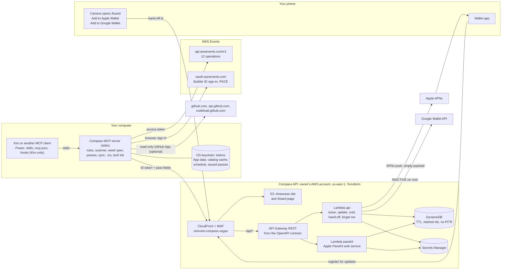

# re:Invent Compass

**From your code to your seat, on time.**

re:Invent Compass helps a first-time AWS re:Invent attendee plan their week from their own code, book it safely, and get into every reserved session on time.

It ships as a Kiro Power plus a local MCP server that any desktop MCP client can run. It reads your code (and, if you allow it, your GitHub repositories) to learn your tech, writes your week as a Kiro spec, reads your real re:Invent schedule without changing it unless you turn writes on, checks every booking against the guardrail, and issues unofficial Apple Wallet and Google Wallet boarding passes that void when a session is cancelled and expire when it ends.

Built for the re:Invent Catalog API Builder Challenge (September to November 2026).

> **Status: built, version 0.1.0, not yet released.** The code, tests and infrastructure are in this repository, and the code is set to version 0.1.0. These parts are **coming soon**: the production site and Compass API at `https://reinvent-compass.vegas`, the npm package `reinvent-compass` (published after the production deploy), the Kiro Power listing, the Builder Center article and the demo video. Links will be added here when they are live.

## Contents

- [Who it is for](#who-it-is-for)
- [re:Invent already works like an airline](#reinvent-already-works-like-an-airline)
- [Quick start](#quick-start)
- [The 24 tools](#the-24-tools)
- [Your tech list and GitHub](#your-tech-list-and-github)
- [How Compass uses the AWS Events API](#how-compass-uses-the-aws-events-api)
- [Guardrails](#guardrails)
- [Boarding passes and the phone hand-off](#boarding-passes-and-the-phone-hand-off)
- [Privacy](#privacy)
- [Architecture](#architecture)
- [How it was built](#how-it-was-built)
- [Repository layout](#repository-layout)
- [Development](#development)
- [Licence](#licence)

## Who it is for

**First-time re:Invent attendees.** There are more than 2,000 sessions across several hotels on the Las Vegas Strip. A first-timer does not know the session types, the campus or the rules.

The most expensive first-timer mistake is one no catalog shows. A reserved seat is only held until **10 minutes before the session starts**. After that it goes to the walk-up line (official re:Invent 2026 FAQ). So the time that matters is not "Starts 10:30". It is **"Boarding closes 10:20"**, plus the walk from wherever you are.

Compass is also useful to returning attendees who want a safer way to plan, and to anyone who wants to try the idea on a phone without signing up.

## re:Invent already works like an airline

Everyone at re:Invent has flown to get there, so the metaphor needs no explaining.

| Airline           | re:Invent                            | What Compass does                                |
| ----------------- | ------------------------------------ | ------------------------------------------------ |
| Itinerary         | Your week                            | Written as a Kiro spec you can read and edit     |
| Ticket            | Your physical badge                  | Compass never pretends to be a ticket            |
| Boarding pass     | One per reserved session             | An unofficial pass in Apple or Google Wallet     |
| Terminal and gate | Venue and room                       | TERMINAL and GATE on the front of every pass     |
| Boarding closes   | Start minus 10 minutes               | BOARDING CLOSES on the front of every pass       |
| Tight connection  | A walk longer than the gap           | Flagged before you reserve                       |
| Rebooking         | Taking the repeat (`-R` in the code) | Safe swap: reserve the repeat first, then cancel |
| Standby           | Favourites                           | Backups for full sessions                        |
| Layover           | Meals, water and rest                | Booked as personal time                          |
| Cancelled flight  | A cancelled reservation              | Its pass is voided                               |

The week runs in three acts:

1. **Plan** (on your computer, in Kiro or another MCP client). Compass scans your own code (a project, a dev folder of git repositories, or, after you confirm the list, your GitHub repositories through a read-only GitHub App) to see which AWS services you use and how deeply, and which other technology you use, such as .NET, Node.js or Python. It suggests sessions with a reason for each and writes the week to `.kiro/specs/my-reinvent-week/` as `requirements.md`, `design.md` and `tasks.md`. Each task is one action you approve.
2. **Board** (on your phone). A short-lived link or QR code moves your passes to your phone. Each pass shows the session code, the title as the flight name, the venue as the terminal, the room as the gate, the date and times, and **Boarding closes**. The back shows the full room, the walk from the previous session and the next connection.
3. **Fly** (during the week). Compass compares your real schedule with the passes it issued, and updates or voids passes to match.

## Quick start

### Requirements

- Node.js 24 or later (`npx` comes with it).
- Kiro (with "Kiro Agent: Configure MCP" enabled), or another desktop MCP client that runs stdio servers, such as Claude Desktop, VS Code or the Kiro CLI.
- For live mode: an AWS Builder ID registered for re:Invent 2026. Simulated mode and the demo need no account.
- For boarding passes on a phone: Apple Wallet on iPhone or Google Wallet on Android. iPad uses the calendar file.
- Optional: a GitHub account, to scan your GitHub repositories through the read-only Compass GitHub App.
- On Linux, the Secret Service (for example GNOME Keyring) keeps your sign-in between sessions. Without it, you sign in again each session.

### 1. Try the demo (simulated, no sign-in)

```sh
npx --yes reinvent-compass@0.1.0 demo
```

> **Coming soon:** this works once `reinvent-compass` 0.1.0 is published to npm, which happens after the production deploy.

The demo runs the whole flow in your terminal on made-up data, through the real tools, in ten steps:

1. Sign in and load the catalog
2. Scan the sample repo
3. Plan the week
4. A clash is blocked
5. A safe swap
6. Reserve the session that clashed
7. Issue boarding passes
8. Hand the passes to your phone
9. Cancel a session
10. Void the pass

No browser opens, no sign-in happens and nothing is sent anywhere. Every result starts with `SIMULATED MODE: no real data.` Use `demo --repo <folder>` to scan a folder of your own instead of the sample repo (Compass works on a copy, so your folder is not changed).

You can run the whole server on made-up data too: set `COMPASS_MODE=simulated`.

The showcase site will also run a click-through demo on any phone, with no install and no sign-in, at `https://reinvent-compass.vegas` (**coming soon**).

### 2. Install the Kiro Power

The Power is the `power/` folder: `plugin.json` and a matching `POWER.md`, `mcp.json`, three skills (`plan-my-week`, `first-timer-guide` and `install-hooks`) and a hook template.

1. In Kiro, open Settings and set "Kiro Agent: Configure MCP" to Enabled. Kiro starts no MCP server until you do.
2. Open the Powers panel and choose **Add Custom Power**.
3. Choose **Import power from GitHub** and give it the repository URL: `https://github.com/henniefrancis/aws-re_invent-compass`.
4. If Kiro does not find the Power at the root, use the folder URL: `https://github.com/henniefrancis/aws-re_invent-compass/tree/main/power`.

Both forms are listed because it is not yet recorded which one Kiro accepts. A listing in the Kiro Powers catalogue is **coming soon**.

Then open your own project in Kiro and say: "Plan my re:Invent."

**Other MCP clients.** Claude Desktop, VS Code and the Kiro CLI can run the same server with `npx --yes reinvent-compass@0.1.0`. The setup for each is in [packages/mcp-server/README.md](packages/mcp-server/README.md). Hooks are Kiro-only, but the guardrail runs inside the server in every client.

### 3. Live mode (AWS Builder ID)

Without `COMPASS_MODE=simulated`, Compass works on your real re:Invent schedule.

1. Ask your assistant to run `sign_in`. Your browser opens the AWS Builder ID sign-in page (OAuth 2.0 with PKCE).
2. Sign-in returns to a one-request server on `127.0.0.1`, on a port from 8484 to 8489, which then closes.
3. Your tokens go into your operating system keychain. On Linux with no Secret Service they are held in memory only, and you sign in again each session.
4. Run `refresh_catalog`, then plan and check. Compass is read-only by default: it reads your real schedule, and the booking tools tell you what they would do and that you make the change in the re:Invent app. See [Read-only by default](#read-only-by-default).

### Read-only by default

Signed in with your Builder ID, Compass reads the live catalog and your real reservations, standby list and layovers. It never changes them unless you turn writes on yourself. Until then the five schedule tools run the guardrail and reply with what they would have done, and every Events API write is refused before any request is sent, so nothing can change your schedule by accident. Boarding passes still work, because they live on the Compass pass service.

To let Compass make changes, each one still approved by you first, set `COMPASS_ALLOW_WRITES=1` in the `env` of the Compass MCP server in your client's MCP settings. While writes are on, every schedule reply starts with "Writes are on". Only you should change this setting: the Power tells the agent never to. Details are in [packages/mcp-server/README.md](packages/mcp-server/README.md#read-only-by-default).

Boarding passes in live mode need the production Compass API at `https://reinvent-compass.vegas`, which is **coming soon**.

## The 24 tools

| Tool                        | Kind         | What it does                                                                                                   |
| --------------------------- | ------------ | -------------------------------------------------------------------------------------------------------------- |
| `sign_in`                   | local action | Signs you in with your AWS Builder ID. Opens your browser.                                                     |
| `sign_out`                  | local action | Revokes your sign-in and clears the stored tokens.                                                             |
| `refresh_catalog`           | read         | Loads the session catalog into a private local cache.                                                          |
| `find_sessions`             | read         | Searches and filters the cached catalog.                                                                       |
| `scan_repo`                 | read         | Scans a folder (or a dev folder of repos) read-only for AWS services and tech.                                 |
| `show_my_tech`              | read         | Lists your tech list on this machine: AWS services first, then other technology.                               |
| `find_sessions_by_tech`     | read         | Finds catalog sessions on a technology, or on the tech you use the most.                                       |
| `connect_github`            | local action | Connects the read-only Compass GitHub App. Shows a code to enter on GitHub.                                    |
| `scan_github`               | read         | Reads your GitHub repositories, read-only, after you confirm the list.                                         |
| `disconnect_github`         | local action | Deletes the GitHub sign-in on this machine.                                                                    |
| `check_itinerary`           | read         | Runs the guardrail over proposed sessions. Writes nothing.                                                     |
| `show_schedule`             | read         | Lists your reservations, standby list and layovers with their ids. Writes nothing.                             |
| `plan_week`                 | local action | Plans a week and writes it as a Kiro spec in the workspace, after you confirm.                                 |
| `export_calendar`           | local action | Writes an `.ics` calendar file of your schedule.                                                               |
| `reserve_with_guardrails`   | write        | Reserves 1 to 10 sessions after the guardrail passes. Changes your real schedule when writes are on.           |
| `cancel_reservation`        | write        | Cancels a reservation, with the safe swap rule. Changes your real schedule when writes are on.                 |
| `add_standby`               | write        | Favourites sessions as backups. Changes your real schedule when writes are on.                                 |
| `remove_standby`            | write        | Removes a favourite. Changes your real schedule when writes are on.                                            |
| `add_layover`               | write        | Creates, changes or deletes personal time. Changes your real schedule when writes are on.                      |
| `issue_all_boarding_passes` | write        | Creates unofficial boarding passes for all your reserved sessions; approving the call is the one confirmation. |
| `issue_boarding_pass`       | write        | Creates one boarding pass for a session you hold; without a session it asks which.                             |
| `send_to_phone`             | write        | Makes a 15-minute link for your passes: shown as a link, a QR code in your browser, or both.                   |
| `sync_passes`               | write        | Makes the passes match your schedule. It can void passes.                                                      |
| `forget_me`                 | write        | Deletes your pass data on the server and on this machine.                                                      |

**Approvals.** Only three read tools may be auto-approved: `refresh_catalog`, `find_sessions` and `check_itinerary`, and the Power ships no auto-approve list. `scan_repo`, `show_schedule`, `show_my_tech`, `find_sessions_by_tech` and the three GitHub tools read your own data or your GitHub account, so approve each call. `scan_github` also asks you to confirm the repositories first. **Write tools must never be auto-approved.** In live mode the schedule tools change nothing until you set `COMPASS_ALLOW_WRITES=1`. Where your client supports it, Compass also asks you to confirm before it changes your schedule, listing the sessions and any warnings. Declining writes nothing. For the two pass tools, your client's approval is the one confirmation. There is no background booking, no seat polling and no retry loop on reservations.

## Your tech list and GitHub

Every scan adds to one tech list on your machine: the AWS services you use (with depth) and the other technology you use, such as .NET, C#, Node.js, TypeScript, Python, Java, Go, React, Angular, Docker, Kubernetes and Terraform. Ask "What tech do I work on?" (`show_my_tech`) or "Find me sessions on .NET" (`find_sessions_by_tech`). `plan_week` ranks sessions by the whole list.

- **A dev folder.** Point `scan_repo` at a folder of projects. Each git repository one or two levels down is scanned on its own, up to 50.
- **GitHub, read-only.** `connect_github` signs you in to the Compass GitHub App with a code you enter on github.com. The app has only Contents: read and Metadata: read, so it can never change your code. `scan_github` lists the repositories it is about to read and reads nothing until you confirm. Each repository is read in memory and dropped; nothing is written to disk.
- **Disconnect.** `disconnect_github` (or `forget_me`) deletes the GitHub sign-in on this machine. To remove the app on GitHub as well, uninstall it in your GitHub settings.

The tech list stays in your app-data folder and is never sent anywhere.

## How Compass uses the AWS Events API

The typed client in `packages/core/src/api` implements all 12 operations of the [AWS Events API](https://docs.aws.amazon.com/events/latest/devguide/what-is-events-api.html), with fixture tests for every operation and error path.

| Operation              | How Compass uses it                                                      |
| ---------------------- | ------------------------------------------------------------------------ |
| `ListEvents`           | Finds the event and is the fallback for its dates and timezone           |
| `GetEvent`             | The event window and timezone. Never hard-coded.                         |
| `ListSessions`         | Builds the local catalog cache, page by page until `nextToken` is absent |
| `GetSession`           | Refreshes a session before its boarding pass is issued                   |
| `GetSchedule`          | The source of truth. Read back after every write, and drives pass sync.  |
| `ReserveSessions`      | `reserve_with_guardrails`. Each session's result is read and reported.   |
| `CancelReservation`    | `cancel_reservation`, including the second half of a safe swap           |
| `AssociateFavorites`   | `add_standby`: backups for full sessions                                 |
| `DisassociateFavorite` | `remove_standby`                                                         |
| `CreatePersonalTime`   | `add_layover`: meals, water and rest                                     |
| `UpdatePersonalTime`   | `add_layover` with `action: update`: move a layover                      |
| `DeletePersonalTime`   | `add_layover` with `action: delete`: remove a layover                    |

How the client behaves:

- **A 200 does not mean success.** `ReserveSessions` returns a result per session, and a 200 can hold failures. Unknown failure codes are treated as refusals. Every write is confirmed by reading `GetSchedule` back, and a write is never re-sent blindly.
- **Quotas.** A client-side quota tracker follows the per-attendee limits. On a 429 it waits for `Retry-After`.
- **Defensive parsing.** Every response is parsed with zod. Any session field may be missing, and Compass never fills a gap with an invented value.
- **Locked to the right hosts.** The access token goes only to `api.awsevents.com`, the refresh token only to the token endpoint, and requests refuse redirects.
- **The official remote MCP server.** AWS publishes its own MCP server at `https://api.awsevents.com/mcp`. It is fine for reading, but its write tools skip both the Compass guardrail and the Compass read-only setting. The Kiro hook template blocks writes through it. The Power does not bundle it, because Kiro does not honour `disabledTools` inside a Power (ADR-024).

**Why the catalog is local.** The Events API has no server-side search. So `refresh_catalog` reads every page of `ListSessions` once into a private cache on your machine, and `find_sessions`, the planner and the guardrail all filter that cache locally. That keeps searches fast and well inside the read quotas.

## Guardrails

One function, `checkReservation` in `packages/core/src/rules`, answers "should this booking go ahead?" for every surface: the MCP server, the Kiro hook and the browser demo all call the same code. It returns allow, warn or block, with one plain-English reason for each rule that applied.

- **Seat release.** Boarding closes 10 minutes before the start, worked out by instant arithmetic and shown in the event's local time.
- **Clashes.** Two commitments that overlap by one second or more clash, including all-day items and sessions that cross midnight. A clash blocks.
- **Walking connections.** The walk between two venues plus a 10-minute buffer must fit in the gap. A connection with less than 5 minutes to spare is tight and warns.
- **Walking estimates from researched routes.** AWS publishes no walking times between venues, so `data/venues.json` holds researched estimates for all 30 ordered pairs of the six official 2026 venues. Each one is the OpenStreetMap foot-route distance (from the public OSRM router) at 66.7 metres a minute, plus 15 minutes to leave and enter buildings, rounded up to 5 minutes, with a 30-minute floor that matches the AWS advice to allow 30 to 45 minutes between venues. Every estimate states its basis and sources. Because they are estimates, an impossible walk warns ("likely impossible") and only blocks when you would be late even at half the estimate.
- **Meals.** Each day needs at least 30 free minutes between 11:30 and 14:00. If not, Compass warns and suggests a layover in a gap that clashes with nothing.
- **Rest.** A run of commitments longer than 3 hours with no gap is flagged.
- **Energy.** Each day gets a score you can read: 10 per commitment, plus the walking minutes, plus 15 per venue change. Over 100 warns that the day is overloaded.
- **Missing data.** A rule that cannot be judged is skipped, never blocked on, and the verdict says which rule could not be checked.

**The safe swap.** Moving to a repeat must never leave you with no seat. Compass reserves the repeat first, reads the schedule back to confirm it is held, and only then cancels the original. A repeat must be a true repeat of the same session (the base code with `-R`, `-R2` and so on). The swap is refused when the repeat clashes with anything, is not confirmed on your schedule, or leaves a neighbouring walk that is certainly impossible. Overriding a refused swap needs an explicit "cancel anyway", and a client that cannot ask never gets that override.

**Hooks (Kiro only).** The `install-hooks` skill writes a hook file to `.kiro/hooks/` after you say yes. Before a Compass booking, a PreToolUse hook runs the same check and blocks the call when the guardrail blocks it. A second hook blocks any write through the remote `awsevents` server. The Compass tool results say when to run `sync_passes`. Hooks are defence in depth: the server checks every booking again, and in read-only mode it changes nothing at all.

**Prompt injection.** Catalog text is returned to your assistant as labelled data, never as instructions, and a test proves that a session abstract containing instructions cannot trigger a write. The test covers all five schedule tools in read-only mode too.

## Boarding passes and the phone hand-off

**The badge is the ticket.** Every pass is marked unofficial, and its back says: "This is not a ticket. Your re:Invent badge is your official ticket. Bring it to every session." Passes carry no barcode and no AWS logos. All artwork is original.

- **What a pass shows:** the session code, the title as the flight name, the venue as the terminal, the room as the gate, the date and times, and **Boarding closes** (10 minutes before the start). The back shows the full room, the walk from the previous session and the next connection. The Google pass shows the same, except your name.
- **Void on cancel.** When you cancel a session, `sync_passes` voids its pass. For Apple Wallet the Compass API marks the pass voided and expired and pushes an update to each registered device over APNs, so Wallet moves it to expired passes. For Google Wallet the object is set to `INACTIVE`. No wallet lets anyone delete a pass remotely, so Compass never claims to.
- **Expire at session end.** Every pass expires when its session ends.
- **Changes.** A change of time or room updates the pass on the phone.
- **Calendar fallback.** `export_calendar` writes an `.ics` file with "Leave now" and "Boarding closes" alarms. When the walk from the previous session is unknown or does not fit, there is no "Leave now" alarm.

**The phone hand-off.** Planning happens on a computer, because Builder ID sign-in returns to your own machine. To board on your phone:

1. `send_to_phone` asks "Link or QR code?" first. A link appears in the chat; a QR code opens on a page in your browser, for your phone camera to scan.
2. The link opens the site's `/board` page. The hand-off id sits in the URL fragment, so it never reaches the CDN, and the page removes it from the address.
3. The page offers **Add to Apple Wallet** (in bundles of up to 10 passes), **Add to Google Wallet**, or the calendar file.
4. The link works for 15 minutes. When it expires, the QR page says so.

iPad has no Wallet app, so it uses the calendar file from the same page.

## Privacy

Compass is local first. The responsible party under South Africa's Protection of Personal Information Act (POPIA) is the project owner, Hennie Francis, acting personally. No human reads server data in normal operation.

**What stays on your machine**

- Your access, refresh and ID tokens, in the OS keychain (or memory only).
- The catalog cache, your schedule snapshot and your issued-pass record, in your app-data folder with owner-only file permissions.
- The repository scan. It runs in memory, and only service names and a depth per service leave the scanner: never a file name, path or content.
- Your week spec, in your workspace. A public repository would publish where you will be and when, so Compass offers to add it to `.gitignore`.
- Your tech list (AWS services and other technology), in your app-data folder. Each project is stored under a one-way hash, so no folder path or repository name is kept.
- Your GitHub tokens, if you connect GitHub, in the OS keychain (or memory only).

**What leaves it, and where it goes**

- The access token goes only to `api.awsevents.com`, and the refresh token only to the AWS Events token endpoint.
- When you issue passes, the printable pass fields (session code, title, times, room and an optional name you type yourself) and your ID token go to the Compass API. The ID token proves you signed in. It is checked and never stored. Only a keyed hash of your Builder ID subject is kept.
- Apple or Google receive the pass if you add it to a wallet. Google keeps its own copy of a saved object, set to `INACTIVE` after a void.
- If you connect GitHub, the GitHub tokens go only to `github.com` and `api.github.com`. Repository archives come from `codeload.github.com` without the token and are read in memory. Nothing about your repositories goes to Compass or to AWS.

**How long the server keeps it**

- Pass records: until the session ends plus 24 hours. Hand-offs: 15 minutes. Expiry is checked on every read, not left to the database clean-up.
- Device push tokens: deleted on unregister, on an "invalid token" reply from Apple, or with the pass.
- Rate-limit counters, keyed by the hashed id: they expire on their own shortly after their one-hour window.
- Logs hold the request id, route template, status, latency and outcome only. Never a token, email, path value, header or body. They are kept for 14 days.

**Forget me.** `forget_me` deletes your pass records, device registrations and hand-offs on the server, voids your passes, and deletes your local schedule snapshot, issued-pass record, tech list, GitHub sign-in and generated files. Apple passes already on a phone stay there until they expire (Compass tells you to delete them).

**No backups of erased data.** The DynamoDB table has point-in-time recovery switched off on purpose, so `forget_me` is a real erasure. The data is short-lived and you can always issue passes again.

The showcase site has no sign-in, no cookies, no storage and no analytics. Its only network call is the hand-off read on `/board`.

## Architecture



**Trust boundaries.** Your computer sends only the access token and Events API calls to AWS Events. If you connect GitHub, it sends the GitHub tokens only to GitHub. It sends only the ID token and printable pass fields to the Compass API, never the access token. The phone sends the hand-off id and Apple's per-pass token.

**Key choices** (each one is an ADR in [docs/decisions](docs/decisions/README.md)):

- **API Gateway REST behind CloudFront**, imported from the OpenAPI file with request validation. One WAF web ACL covers the site and the API. An origin-verify header shields the API Gateway URL.
- **Contract first.** `contracts/compass-api.openapi.yaml` (15 operations) is the single source. Byte-identical copies are checked by SHA-256, TypeScript types are generated from it, and every Compass API response is validated against it in tests.
- **No stored pass files.** Passes are signed on demand from the pass record, so there is no file store to clean up.
- **Expiry in code, TTL only for clean-up**, because DynamoDB TTL can take days.
- **Two Lambdas** (arm64, Node.js 24) so the attendee API and the Apple device service each get least privilege.
- **Terraform only**, in HCP Terraform with dynamic provider credentials. No AWS keys anywhere, and the owner runs every deploy.

## How it was built

Compass was built spec first, with [Kiro](https://kiro.dev).

- **Plan, then steering.** An approved build plan ([docs/architecture/build-plan.md](docs/architecture/build-plan.md)) and four steering files ([.kiro/steering](.kiro/steering)) load into every Kiro session, so every stream works from the same product rules, stack and voice.
- **Eight specs, parallel streams.** The work is split into eight Kiro specs, S0 to S7, each with its own `requirements.md`, `design.md` and `tasks.md` in [.kiro/specs](.kiro/specs). Each stream ran in its own git worktree and branch, with clear file ownership so no two streams edited the same file. The shared contracts were locked on day one ([ADR-025](docs/decisions/ADR-025-early-contract-lock.md)) so the other streams could start at once.
- **When the Kiro credits ran out.** Kiro wrote the S0, S1, S2, S4 and S6 specs and built S0 and S1 tasks 1 to 8. Then the owner's Kiro credits ran out on 17 October. From there, Claude's dev-team agents built the rest from the same Kiro specs, one agent per worktree, under the same steering and review gates. The S3, S5 and S7 specs were written in Kiro's format. The specs and their task checkboxes stayed the single record of what was done. The full story is in [KIRO-SPEC-PROMPTS.md](KIRO-SPEC-PROMPTS.md).
- **Reviews.** Every stream passed QA and security review before it was merged, and no branch merged with an open High or Critical finding. Accepted residual risks are recorded in [ADR-027](docs/decisions/ADR-027-accepted-residual-risks.md).
- **100% coverage.** Unit tests (vitest) cover 100% of lines, branches, functions and statements, with named exclusions only. The showcase site adds Playwright and axe tests across seven device profiles. Terraform has native tests with mock providers, plus tflint and Trivy.
- **Made-up data in public.** Tests and demos use a deterministic synthetic catalog of 120 sessions in the real API shape ([ADR-016](docs/decisions/ADR-016-synthetic-catalog.md)). The product itself always reads the live API.

## Repository layout

```text
.kiro/steering/        Product, tech, structure and workflow rules for every Kiro session
.kiro/specs/           The Kiro specs (requirements, design, tasks) for each stream
contracts/             The Compass API OpenAPI contract (the single source)
packages/contracts/    Shared zod schemas, the Events API OpenAPI document, generated types
packages/core/         Events API client, sign-in, catalog cache, rules engine, scanner,
                       week spec, passes, calendar file, simulated mode
packages/mcp-server/   The reinvent-compass MCP server and CLI (published to npm, coming soon)
packages/pass-service/ The Compass API Lambdas: passes, PassKit web service, hand-off, forget me
power/                 The Kiro Power: plugin.json, POWER.md, mcp.json, skills, hook template
site/                  The showcase site (Angular 22, static): story, demo, install, documentation, legal pages, board
infra/                 Terraform: bootstrap, dev and prod roots, six modules, tests
data/venues.json       Venues and researched walking times, each with its source
fixtures/              Synthetic catalog and API fixtures
scripts/               Owner-run release, bootstrap and secret-loading scripts
spikes/                Day-one spike scripts
docs/                  Build plan, ADRs, runbooks, hackathon rules, the story and the article draft
```

## Development

```sh
npm ci
npm run build            # TypeScript project build
npm test                 # vitest with coverage (100% required)
npm run lint
npm run format:check
npm run check:dash       # no em or en dashes anywhere
```

The site, the pass-service Lambdas and the infrastructure each have their own README: [site/README.md](site/README.md), [packages/pass-service/README.md](packages/pass-service/README.md) and [infra/README.md](infra/README.md). Live tests against the real Events API run only on the owner's machine with `COMPASS_LIVE_TESTS=1`. CI never calls the live API.

Contributions are welcome. Please keep to the voice in [.kiro/steering/product.md](.kiro/steering/product.md): plain English, short sentences, and no em or en dashes.

## Licence

Apache-2.0. See [LICENSE](LICENSE) and [NOTICE](NOTICE). The name "re:Invent Compass" identifies the original project; forks are welcome under a different name.

re:Invent Compass is an independent community project and is not affiliated with, endorsed by, or sponsored by Amazon Web Services.
