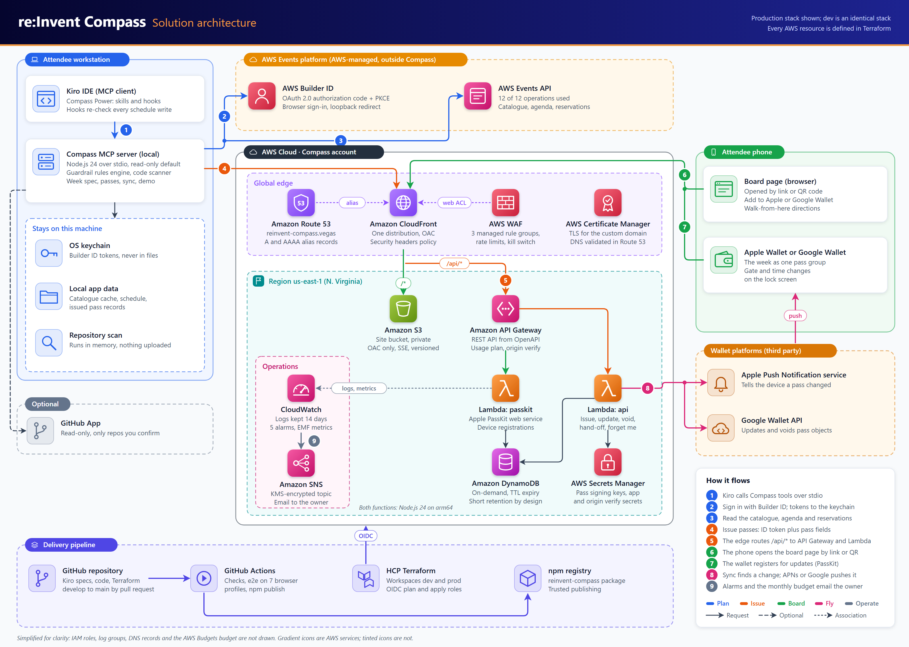
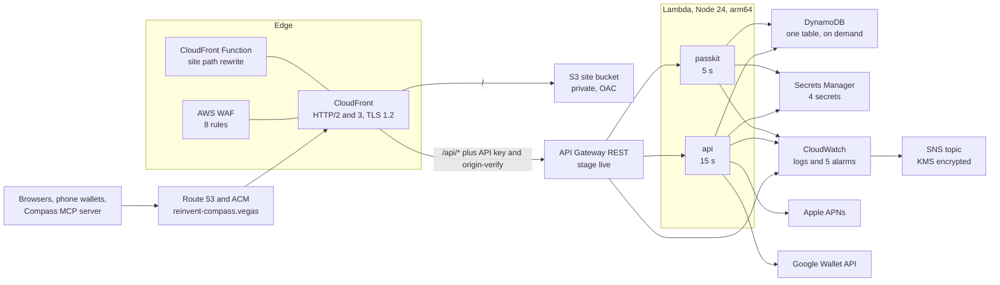

# AWS architecture

_For architects: every AWS service the Compass API and site use, with the real settings from the Terraform in the repository._

Everything runs in one AWS account in `us-east-1` and is defined in [Terraform](Glossary#terraform) under [infra/](https://github.com/henniefrancis/aws-re_invent-compass/tree/develop/infra). Nothing is created by hand. All values below come from the modules, not from documents.

## Diagram

## Region and layout

- **Region:** `us-east-1` for every provider. A CloudFront-scope WAF web ACL and a CloudFront certificate must live there anyway.
- **Modules:** six, in [infra/modules](https://github.com/henniefrancis/aws-re_invent-compass/tree/develop/infra/modules): `secrets`, `data`, `api`, `site`, `edge` and `observability`.
- **Environments:** [infra/envs/dev](https://github.com/henniefrancis/aws-re_invent-compass/tree/develop/infra/envs/dev) and [infra/envs/prod](https://github.com/henniefrancis/aws-re_invent-compass/tree/develop/infra/envs/prod) compose the same six modules in the same shape; only the environment name and its workspace values differ. Dev is deployed and checked before prod.
- **Bootstrap:** [infra/bootstrap](https://github.com/henniefrancis/aws-re_invent-compass/tree/develop/infra/bootstrap) runs once: the HCP Terraform OIDC provider, the plan and apply roles per environment, the permissions boundaries, the account-wide API Gateway logging role, the HCP workspaces, the domain registration and the account budget.
- **Tags:** every resource carries `project = reinvent-compass` and `environment = <env>` through provider default tags. Wherever a service supports tag conditions, the apply role of one environment can only create or change resources tagged for that environment.

## CloudFront

One distribution in [infra/modules/edge/main.tf](https://github.com/henniefrancis/aws-re_invent-compass/blob/develop/infra/modules/edge/main.tf) fronts both the site and the API.

| Setting                  | Value                                                                                                                                                                      |
| ------------------------ | -------------------------------------------------------------------------------------------------------------------------------------------------------------------------- |
| HTTP versions            | `http2and3`, IPv6 on                                                                                                                                                       |
| Viewer TLS               | ACM certificate, SNI only, minimum `TLSv1.2_2021`                                                                                                                          |
| Domain                   | `reinvent-compass.vegas`, ACM certificate validated by DNS, A and AAAA alias records in Route 53                                                                           |
| Default behaviour (site) | S3 origin through Origin Access Control, `GET` and `HEAD`, managed CachingOptimized policy, redirect to HTTPS, the site security headers policy                            |
| CloudFront Function      | `cloudfront-js-2.0`, viewer request on the site behaviour only: rewrites `/demo` and `/demo/` to `/demo/index.html`                                                        |
| `/api/*` behaviour       | API Gateway origin at the `/live` stage path, HTTPS only to the origin with TLS 1.2, managed CachingDisabled policy, all viewer headers except Host forwarded, no function |
| Origin headers           | `x-origin-verify` and `x-api-key`, both set by CloudFront, which overwrites any value a viewer sends                                                                       |
| Response headers         | Site: CSP, HSTS (two years, subdomains, preload), `nosniff`, `Referrer-Policy: no-referrer`, a Permissions-Policy. API: HSTS, `nosniff`, no referrer.                      |
| Access logging           | None                                                                                                                                                                       |

There is no distribution-level custom error response, so API error bodies (`application/problem+json`) reach the client unchanged. See [why the API sits behind CloudFront](Decisions-Architecture#api-gateway-rest-behind-cloudfront) and [the custom domain](Decisions-Infrastructure#a-custom-domain-for-the-site-and-the-api).

## WAF

One web ACL, scope `CLOUDFRONT`, default action allow. Request bodies are inspected up to 64 KB. No logging and no request sampling, so no source address is kept. Rate-based rules count per IP over the default five minute window.

| Priority | Rule                           | Action                           | What it does                                                                                                                                 |
| -------- | ------------------------------ | -------------------------------- | -------------------------------------------------------------------------------------------------------------------------------------------- |
| 1        | `per-ip-rate-limit`            | block                            | More than 600 requests per IP in five minutes on paths starting `/api/`.                                                                     |
| 2        | `aws-managed-common`           | managed                          | `AWSManagedRulesCommonRuleSet`, with its 8 KB body-size rule set to count, because pass bodies can be larger and the API bounds them itself. |
| 3        | `aws-managed-known-bad-inputs` | managed                          | `AWSManagedRulesKnownBadInputsRuleSet`.                                                                                                      |
| 4        | `aws-managed-ip-reputation`    | managed                          | `AWSManagedRulesAmazonIpReputationList`.                                                                                                     |
| 5        | `kill-switch`                  | count, or block when switched on | Matches every request. A Terraform variable flips it to block everything. See [Kill switch](Kill-Switch).                                    |
| 6        | `passkit-rate-limit`           | block                            | More than 300 requests per IP in five minutes on `/api/passkit/`.                                                                            |
| 7        | `api-body-size-limit`          | block                            | A body over 64 KB (65,536 bytes) on `/api/*`; an oversize body counts as a match.                                                            |
| 8        | `site-per-ip-rate-limit`       | block                            | More than 3,000 requests per IP in five minutes on every path outside `/api/`.                                                               |

## API Gateway

From [infra/modules/api/main.tf](https://github.com/henniefrancis/aws-re_invent-compass/blob/develop/infra/modules/api/main.tf):

- **REST API, regional endpoint, imported from the [OpenAPI](Glossary#openapi) contract.** The body is [infra/modules/api/openapi.yaml](https://github.com/henniefrancis/aws-re_invent-compass/blob/develop/infra/modules/api/openapi.yaml) through `templatefile`, with only the two Lambda invoke ARNs filled in. CI proves this file is byte-identical to [contracts/compass-api.openapi.yaml](https://github.com/henniefrancis/aws-re_invent-compass/blob/develop/contracts/compass-api.openapi.yaml). A change to the contract forces a new deployment, created before the old one is removed.
- **Request validation.** The contract declares two validators, `all` (body and parameters) and `params-only`, and every operation names one.
- **API key.** Every method requires the API key, read from the `x-api-key` header, which CloudFront injects. A direct call to the execute-api endpoint is refused before any Lambda runs. A usage plan ties the key to the stage. See [why an API key](Decisions-Security-and-Privacy#api-key-enforced-at-api-gateway).
- **Stage `live`.** Execution logging off, data trace off, metrics on, X-Ray off. The access log is JSON with the request id, the route template, the method, the status, the latencies and the error type: never the full path, a source address or an identifier.
- **Throttles** (environment defaults): 50 requests a second with a burst of 100 for the stage and the usage plan, and tighter per-route limits:

| Route                                                                                   | Rate, burst |
| --------------------------------------------------------------------------------------- | ----------- |
| `POST /api/v1/passes`, `POST /api/v1/handoffs`                                          | 5, 10       |
| `DELETE /api/v1/me`                                                                     | 2, 4        |
| `GET .../passes/{serialNumber}/apple`, `PUT .../passes/{serialNumber}`, `POST .../void` | 5, 10       |
| PassKit register, unregister and latest pass                                            | 10, 20      |

## Lambda

| Function                | Runtime      | Architecture | Memory | Timeout | Reserved concurrency (default) |
| ----------------------- | ------------ | ------------ | ------ | ------- | ------------------------------ |
| `compass-<env>-api`     | `nodejs24.x` | `arm64`      | 512 MB | 15 s    | 20                             |
| `compass-<env>-passkit` | `nodejs24.x` | `arm64`      | 512 MB | 5 s     | 10                             |

Each function has its own role, defined in [infra/modules/api/locals.tf](https://github.com/henniefrancis/aws-re_invent-compass/blob/develop/infra/modules/api/locals.tf), with an environment permissions boundary from the bootstrap:

- **api:** write its own logs; `GetItem` and `Query` on the table and its index; `PutItem`, `UpdateItem`, `DeleteItem` and `BatchWriteItem` only on items whose partition key starts with `PASS#`, `DEV#`, `HANDOFF#`, `RATE#`, `ACTIVE#` or `PASSREG#` (a `dynamodb:LeadingKeys` condition); `GetSecretValue` on the four secrets.
- **passkit:** write its own logs; the same reads; `PutItem` and `DeleteItem` only on `DEV#` and `PASSREG#` items; `GetSecretValue` on the app, origin-verify and Apple secrets, never the Google key.

API Gateway may invoke each function only from this REST API. The functions run outside a VPC and receive only names and ARNs in their environment, never a secret value.

## DynamoDB

From [infra/modules/data/main.tf](https://github.com/henniefrancis/aws-re_invent-compass/blob/develop/infra/modules/data/main.tf): one table `compass-<env>`, on-demand billing, keys `pk` and `sk`, one global secondary index `GSI2` (`gsi2pk`, `gsi2sk`, all attributes) that maps an attendee's hashed subject to their items. [TTL](Glossary#ttl) is on the `ttl` attribute. Encryption at rest uses the AWS managed key. Point-in-time recovery is off on purpose: forget_me must be a real erasure, and nothing lives longer than a session end plus 24 hours. Deletion protection is on. The items are described on [Data and privacy](Data-and-Privacy).

## Secrets Manager

Four secret containers from [infra/modules/secrets](https://github.com/henniefrancis/aws-re_invent-compass/tree/develop/infra/modules/secrets), with a 30 day recovery window:

| Name                          | Holds                                                          |
| ----------------------------- | -------------------------------------------------------------- |
| `compass/<env>/app`           | The pepper for keyed hashing and its label                     |
| `compass/<env>/origin-verify` | The origin-verify value, and the previous one while it rotates |
| `compass/<env>/apple-pass`    | The Apple Pass Type ID certificate and key                     |
| `compass/<env>/google-wallet` | The Google Wallet service account key                          |

Terraform creates the containers and never sets a value. The owner loads the values with [scripts/load-secrets.sh](https://github.com/henniefrancis/aws-re_invent-compass/blob/develop/scripts/load-secrets.sh), so a later apply never overwrites one. See [Secrets](Secrets).

## S3

From [infra/modules/site/main.tf](https://github.com/henniefrancis/aws-re_invent-compass/blob/develop/infra/modules/site/main.tf): one private, versioned bucket for the site, SSE-S3 encryption, all public access blocked. The bucket policy lets only this CloudFront distribution read objects, and denies reads from anything else and any plain HTTP request.

## CloudWatch, SNS and KMS

- **Logs:** three log groups per environment (the two Lambdas and the API Gateway access log), each kept for 14 days.
- **Alarms:** five, in [infra/modules/observability/main.tf](https://github.com/henniefrancis/aws-re_invent-compass/blob/develop/infra/modules/observability/main.tf). Each looks at one five minute period, treats missing data as not breaching and notifies an SNS topic.

| Alarm                                | Metric                                                        | Fires at    |
| ------------------------------------ | ------------------------------------------------------------- | ----------- |
| `compass-<env>-api-5xx`              | API Gateway `5XXError` for the `live` stage                   | 1 or more   |
| `compass-<env>-throttles`            | Lambda `Throttles`, both functions summed                     | 1 or more   |
| `compass-<env>-apns-push-failures`   | Custom `Compass` / `ApnsFailure`, emitted by the api function | 1 or more   |
| `compass-<env>-waf-blocked-requests` | WAF `BlockedRequests`, all rules                              | 100 or more |
| `compass-<env>-lambda-errors`        | Lambda `Errors`, both functions summed                        | 1 or more   |

- **SNS and KMS:** the alarm topic `compass-<env>-alarms` is encrypted with a customer managed KMS key with rotation on, and has one email subscription the owner confirms. See [Alarms](Alarms).

## Cost

One account-wide monthly cost budget in [infra/bootstrap/budget.tf](https://github.com/henniefrancis/aws-re_invent-compass/blob/develop/infra/bootstrap/budget.tf) emails the owner at 50, 80 and 100 percent of actual spend.

## HCP Terraform and OIDC

State and runs live in [HCP Terraform](Glossary#hcp-terraform). Plans and applies use dynamic provider credentials: HCP Terraform presents an [OIDC](Glossary#oidc) token from `app.terraform.io` with audience `aws.workload.identity`, and each role trusts only the exact subject of its organisation, project, workspace and run phase. A plan token can assume only the plan role, an apply token only the apply role, and there are no access keys anywhere. The plan and apply roles carry their own permissions boundary. The bootstrap itself runs once on the owner's machine with the owner's credentials, with its state in HCP Terraform. See [Decisions: Infrastructure](Decisions-Infrastructure#terraform-state-and-runs-in-hcp-terraform).

Terraform `>= 1.15, < 2.0` and the AWS provider `~> 6.0` are required.

## Retained resources

These carry `prevent_destroy`, so a mistaken plan cannot remove them: the DynamoDB table (also deletion protected), the CloudFront distribution (its domain is in every issued pass), the four Secrets Manager secrets, the S3 site bucket and the domain registration. Removing one is a deliberate edit, described in [Teardown](Teardown). See [Decisions: Infrastructure](Decisions-Infrastructure#retained-resources).

## Related pages

- [Architecture overview](Architecture-Overview)
- [Pass service](Pass-Service)
- [Security](Security)
- [Operations](Operations)
- [Release](Release)
