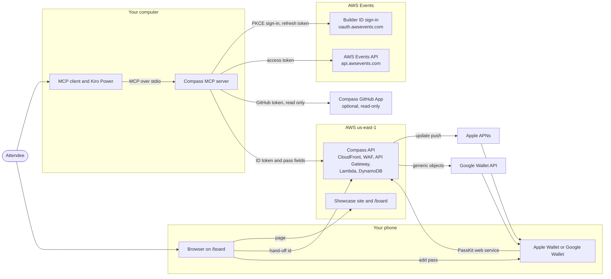

_For architects: what re:Invent Compass is made of, where each part runs, which token goes where, and where to read more._

re:Invent Compass is an independent community project. It is not affiliated with AWS, and its Boarding Passes are unofficial: the badge is the ticket.

## What the system is

Compass scans the code an [attendee](Glossary#attendee) of AWS re:Invent 2026 works on (local projects and, if they allow it, their GitHub repositories, read-only), learns their AWS services and the rest of their stack, and finds the sessions that match, with a reason for each. It then helps them book the week safely and carry it on their phone. It has four parts:

| Part          | What it is                                                                                                                                                                                                                                    | Page                           |
| ------------- | --------------------------------------------------------------------------------------------------------------------------------------------------------------------------------------------------------------------------------------------- | ------------------------------ |
| Kiro Power    | A [Kiro Power](Glossary#kiro-power): a manifest, three skills and an optional hook template that tell the agent how to use Compass.                                                                                                           | [Kiro Power](Kiro-Power)       |
| MCP server    | A local [MCP server](Glossary#mcp-server) (`reinvent-compass`, TypeScript on Node 24) with 24 tools. It talks to the [AWS Events API](Glossary#events-api), scans code, runs the [guardrail](Glossary#guardrail) and drives the pass service. | [MCP server](MCP-Server)       |
| Pass service  | The [Compass API](Glossary#compass-api): two Lambda functions behind CloudFront, WAF and API Gateway that issue, update and [void](Glossary#void) [Boarding Passes](Glossary#boarding-pass) for Apple Wallet and Google Wallet.               | [Pass service](Pass-Service)   |
| Showcase site | A static Angular site at [reinvent-compass.vegas](https://reinvent-compass.vegas) with a click-through demo and the `/board` page that hands passes to a phone.                                                                               | [Showcase site](Showcase-Site) |

The code lives in one repository: the Power in [power/](https://github.com/henniefrancis/aws-re_invent-compass/tree/develop/power), the server and its shared library in [packages/](https://github.com/henniefrancis/aws-re_invent-compass/tree/develop/packages), the site in [site/](https://github.com/henniefrancis/aws-re_invent-compass/tree/develop/site) and all infrastructure as [Terraform](Glossary#terraform) in [infra/](https://github.com/henniefrancis/aws-re_invent-compass/tree/develop/infra).

## Three places it runs

1. **Your computer.** The [MCP client](Glossary#mcp-client) (Kiro, or any client that speaks MCP) starts the Compass server on stdio with `npx --yes reinvent-compass@0.1.2`. Sign-in tokens, the catalog cache, your schedule snapshot, your [tech list](Glossary#tech-list) and your pass record stay here. Scans of your code run here, and only service and technology names, depth and counts leave the scanner.
2. **AWS.** The Compass API and the showcase site run in one AWS account in `us-east-1`, behind one [CloudFront](Glossary#cloudfront) distribution on the custom domain `reinvent-compass.vegas`. The API stores only what a pass needs, keyed by a hash of your Builder ID subject, and deletes it 24 hours after the session ends.
3. **Your phone.** The `/board` page opens in your phone's browser from a 15 minute [hand-off](Glossary#hand-off) link or QR code. From there you add passes to Apple Wallet or Google Wallet, and the [wallet](Glossary#wallet) keeps them up to date through Apple's [PassKit](Glossary#passkit) web service and Google's Wallet API.

## Context diagram

The [AWS architecture](AWS-Architecture) page shows the AWS side in detail.

## Trust boundaries

Each credential has one audience. The code enforces it in one place per credential, and every HTTP client refuses redirects so a token can never follow one to another host.

| Credential                      | Created by                                        | Goes only to                                                                  | Kept where                                                                            |
| ------------------------------- | ------------------------------------------------- | ----------------------------------------------------------------------------- | ------------------------------------------------------------------------------------- |
| Events API access token         | Builder ID sign-in ([PKCE](Glossary#pkce))        | `api.awsevents.com`                                                           | OS keychain on your computer, or memory only                                          |
| Refresh token                   | Builder ID sign-in                                | `oauth.awsevents.com` (token and revoke endpoints)                            | OS keychain, or memory only                                                           |
| ID token                        | Builder ID sign-in                                | The Compass API host built into the server (`https://reinvent-compass.vegas`) | OS keychain. The pass service verifies it and keeps only a keyed hash of its subject. |
| GitHub token                    | The [GitHub App](Glossary#github-app) device flow | `api.github.com` only, never the archive host                                 | OS keychain, or memory only                                                           |
| Hand-off id                     | The Compass API                                   | The `/board` page, in the URL fragment                                        | Only its SHA-256 is stored, for 15 minutes                                            |
| Apple authentication token      | Derived per pass from a server secret             | Inside the pass, back to the PassKit web service                              | Never stored, only its SHA-256                                                        |
| Origin-verify value and API key | The owner                                         | CloudFront to API Gateway only                                                | AWS Secrets Manager and sensitive HCP Terraform variables                             |

The access token check is in [credential-provider.ts](https://github.com/henniefrancis/aws-re_invent-compass/blob/develop/packages/core/src/auth/credential-provider.ts). The Compass API host is a build-time constant in [compass-api.ts](https://github.com/henniefrancis/aws-re_invent-compass/blob/develop/packages/mcp-server/src/config/compass-api.ts): `COMPASS_API_URL` can replace it only when `COMPASS_ALLOW_API_OVERRIDE=1` is also set, and only with an `https` URL. See [Security](Security) for the full threat model.

## A short tour

- [Kiro Power](Kiro-Power): the manifest, the skills that set the order of the tools, and the optional hooks.
- [MCP server](MCP-Server): the 24 tools, their classes, the command line, the settings and the shared `@compass/core` library.
- [Pass service](Pass-Service): the two Lambdas, the 16 routes, the limits, Apple signing, APNs and Google Wallet.
- [Showcase site](Showcase-Site): the 14 prerendered routes, the strict Content Security Policy, the board page and the demo.
- [Flows](Flows): plan, issue, board and fly, each as a sequence diagram.
- [AWS architecture](AWS-Architecture): every AWS service with its real settings from Terraform.
- [Security](Security): the threat model and how each threat is handled.
- [Data and privacy](Data-and-Privacy): every data item, where it lives, its key, its lifetime and how it is deleted.
- [Quality](Quality): the test strategy, the measured numbers and the CI gates.

The reasoning behind the shape is on the decision pages, for example [why the pass API sits behind CloudFront](Decisions-Architecture#api-gateway-rest-behind-cloudfront) and [why the contract came first](Decisions-Architecture#one-openapi-contract-copied-byte-for-byte).

## Related pages

- [Flows](Flows)
- [AWS architecture](AWS-Architecture)
- [Security](Security)
- [Repository layout](Repository-Layout)
- [Key decisions](Key-Decisions)
