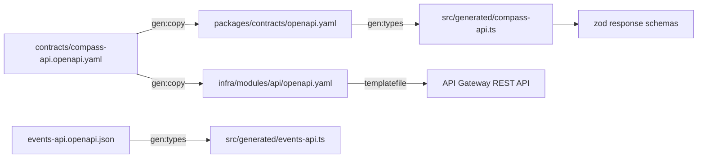

_For developers and architects: which contracts Compass is built against, where each one lives, how tests hold the code to them and how to change one safely._

Compass is contract first. Every boundary between parts has a written contract, and the code on both sides is generated from it or checked against it:

| Boundary                    | Contract                                                      | Where                                                                                                                                                        |
| --------------------------- | ------------------------------------------------------------- | ------------------------------------------------------------------------------------------------------------------------------------------------------------ |
| MCP server and Pass service | The [Compass API](Glossary#compass-api), OpenAPI 3.0.1        | [contracts/compass-api.openapi.yaml](https://github.com/henniefrancis/aws-re_invent-compass/blob/develop/contracts/compass-api.openapi.yaml)                 |
| Compass and AWS             | The official [Events API](Glossary#events-api), OpenAPI 3.1.0 | [packages/contracts/events-api.openapi.json](https://github.com/henniefrancis/aws-re_invent-compass/blob/develop/packages/contracts/events-api.openapi.json) |
| MCP client and MCP server   | The input and output schema of each of the 24 tools           | [packages/contracts/src/mcp-tools.ts](https://github.com/henniefrancis/aws-re_invent-compass/blob/develop/packages/contracts/src/mcp-tools.ts)               |
| Every package               | Shared zod schemas and types                                  | [packages/contracts](https://github.com/henniefrancis/aws-re_invent-compass/tree/develop/packages/contracts)                                                 |

## The Compass API contract

[contracts/compass-api.openapi.yaml](https://github.com/henniefrancis/aws-re_invent-compass/blob/develop/contracts/compass-api.openapi.yaml) is the single source for the pass API. It defines all 16 operations, their parameters, request bodies, responses and errors. [Pass API](Pass-API) lists them.

It is OpenAPI 3.0.1 on purpose: the [API Gateway](Glossary#api-gateway) REST import accepts Swagger 2.0 and OpenAPI 3.0, not 3.1. The same file also carries the API Gateway bindings, so the deployed API is built from the contract and cannot drift from it:

- every operation has an `x-amazon-apigateway-integration` of type `aws_proxy` to one of two [Lambda](Glossary#lambda) functions, written as one of exactly two Terraform placeholders, `${api_lambda_invoke_arn}` and `${passkit_lambda_invoke_arn}`;
- two request validators, `all` (body and parameters) and `params-only`, and each operation names one;
- the binary media types for Apple passes, pass bundles and calendar files;
- the API key read from the `x-api-key` header.

Errors use `application/problem+json` with one `Problem` schema of exactly four fields: `type`, `title`, `status` and `code`. No field carries request input, so a bad request is never echoed back.

### Two byte-identical copies

`npm run gen:copy` copies the source byte for byte to two places:

| Copy                                                                                                                                   | Used for                                                                                                                                                                                                                                    |
| -------------------------------------------------------------------------------------------------------------------------------------- | ------------------------------------------------------------------------------------------------------------------------------------------------------------------------------------------------------------------------------------------- |
| [packages/contracts/openapi.yaml](https://github.com/henniefrancis/aws-re_invent-compass/blob/develop/packages/contracts/openapi.yaml) | The input for the generated TypeScript types.                                                                                                                                                                                               |
| [infra/modules/api/openapi.yaml](https://github.com/henniefrancis/aws-re_invent-compass/blob/develop/infra/modules/api/openapi.yaml)   | The body of the API Gateway REST API. [infra/modules/api/main.tf](https://github.com/henniefrancis/aws-re_invent-compass/blob/develop/infra/modules/api/main.tf) reads it with `templatefile()`, passing only the two Lambda invoke values. |

Two checks guard the copies, both in CI:

- `npm run check:hash` proves the three files have the same SHA-256.
- `npm run check:placeholders` fails on anything account-specific in any of the three files: a twelve-digit run, `arn:aws`, a Terraform percent-brace marker, or a dollar-brace marker other than the two allowed placeholders. `templatefile()` evaluates every such marker, comments included, so a stray one would break the deploy.

A Terraform native test in [infra/modules/api/tests](https://github.com/henniefrancis/aws-re_invent-compass/tree/develop/infra/modules/api/tests) also checks that `main.tf` reads the copy with exactly those two variables.

## Generated types

`npm run gen:types` runs openapi-typescript on both OpenAPI documents:

| Input                                                                                                                                                        | Output                                                                                                                                              |
| ------------------------------------------------------------------------------------------------------------------------------------------------------------ | --------------------------------------------------------------------------------------------------------------------------------------------------- |
| [packages/contracts/openapi.yaml](https://github.com/henniefrancis/aws-re_invent-compass/blob/develop/packages/contracts/openapi.yaml)                       | [src/generated/compass-api.ts](https://github.com/henniefrancis/aws-re_invent-compass/blob/develop/packages/contracts/src/generated/compass-api.ts) |
| [packages/contracts/events-api.openapi.json](https://github.com/henniefrancis/aws-re_invent-compass/blob/develop/packages/contracts/events-api.openapi.json) | [src/generated/events-api.ts](https://github.com/henniefrancis/aws-re_invent-compass/blob/develop/packages/contracts/src/generated/events-api.ts)   |

Each file starts with a "Generated by openapi-typescript. Do not edit by hand." banner. Generated files are excluded from coverage and from type-aware lint. They are committed, so a clone builds without running the generator.

## packages/contracts

[packages/contracts](https://github.com/henniefrancis/aws-re_invent-compass/tree/develop/packages/contracts) (`@compass/contracts`) has one public entry, [src/index.ts](https://github.com/henniefrancis/aws-re_invent-compass/blob/develop/packages/contracts/src/index.ts), which re-exports every member by name:

| Part                                                                                                                                                                                                                                                     | What it holds                                                                                                                                                                                                                      |
| -------------------------------------------------------------------------------------------------------------------------------------------------------------------------------------------------------------------------------------------------------- | ---------------------------------------------------------------------------------------------------------------------------------------------------------------------------------------------------------------------------------- |
| [src/wire](https://github.com/henniefrancis/aws-re_invent-compass/tree/develop/packages/contracts/src/wire)                                                                                                                                              | zod schemas for the Events API wire shapes (session, schedule, event, personal time, bulk result), written to match the Events API document. Plain `z.object` strips unknown fields, so a new field from AWS never breaks parsing. |
| [src/domain](https://github.com/henniefrancis/aws-re_invent-compass/tree/develop/packages/contracts/src/domain)                                                                                                                                          | Compass shapes: `Commitment` (a reserved session or personal time), `NormalisedSession`, `Venue`, `Verdict`.                                                                                                                       |
| [src/mcp-tools.ts](https://github.com/henniefrancis/aws-re_invent-compass/blob/develop/packages/contracts/src/mcp-tools.ts)                                                                                                                              | `mcpTools`: the input and output zod schema for each of the 24 tools. The server registers exactly these keys and parses every call with them. See [MCP tools](MCP-Tools).                                                         |
| [src/compass-api-schemas.ts](https://github.com/henniefrancis/aws-re_invent-compass/blob/develop/packages/contracts/src/compass-api-schemas.ts)                                                                                                          | Strict zod schemas for the Compass API responses, each typed against the generated types, so a schema that drifts from the contract fails to compile. Both the pass service and the client import them.                            |
| [src/pass-fields.ts](https://github.com/henniefrancis/aws-re_invent-compass/blob/develop/packages/contracts/src/pass-fields.ts), [src/problem.ts](https://github.com/henniefrancis/aws-re_invent-compass/blob/develop/packages/contracts/src/problem.ts) | The pass content shape and the problem error shape.                                                                                                                                                                                |
| [events-api.openapi.json](https://github.com/henniefrancis/aws-re_invent-compass/blob/develop/packages/contracts/events-api.openapi.json)                                                                                                                | The official Events API document.                                                                                                                                                                                                  |

### Where the Events API document comes from

The Events API document is the one AWS publishes at `https://api.awsevents.com/v1/openapi.json`. The operator-run script [packages/contracts/scripts/fetch-events-api.mjs](https://github.com/henniefrancis/aws-re_invent-compass/blob/develop/packages/contracts/scripts/fetch-events-api.mjs) fetches it and writes the exact response bytes atomically; on any failure it writes nothing. No test or CI job runs the fetch. The committed copy was last refreshed on 31 October 2026. A test in [packages/contracts/test](https://github.com/henniefrancis/aws-re_invent-compass/tree/develop/packages/contracts/test) checks that the SHA-256 recorded for the document in the project's decision record (see [Key decisions](Key-Decisions)) matches the committed file, so a silent edit fails the build.

## How tests hold the code to the contracts

| Test                                                                                                                                                  | What it proves                                                                                                                                                                                                                                                                                                                                                                                                                                                                                  |
| ----------------------------------------------------------------------------------------------------------------------------------------------------- | ----------------------------------------------------------------------------------------------------------------------------------------------------------------------------------------------------------------------------------------------------------------------------------------------------------------------------------------------------------------------------------------------------------------------------------------------------------------------------------------------- |
| [openapi-conformance.test.ts](https://github.com/henniefrancis/aws-re_invent-compass/blob/develop/packages/core/test/api/openapi-conformance.test.ts) | For all 12 Events API operations, the method, the path template and the query parameter names the client sends match the official document exactly. Every expectation is read from the document, keyed by operation id.                                                                                                                                                                                                                                                                         |
| [contract.test.ts](https://github.com/henniefrancis/aws-re_invent-compass/blob/develop/packages/pass-service/test/contract/contract.test.ts)          | The two Lambda routers serve exactly the methods and paths in the Compass API contract, and every response to a generated request conforms to it. Bodies are checked with ajv against [contracts/compass-api.openapi.yaml](https://github.com/henniefrancis/aws-re_invent-compass/blob/develop/contracts/compass-api.openapi.yaml) through [openapi-validator.ts](https://github.com/henniefrancis/aws-re_invent-compass/blob/develop/packages/pass-service/test/helpers/openapi-validator.ts). |
| [bulk-failure-codes.ts](https://github.com/henniefrancis/aws-re_invent-compass/blob/develop/packages/core/src/api/bulk-failure-codes.ts)              | A compile-time check in both directions: the nine known bulk failure codes must equal the `BulkFailureCode` enum in the generated Events API types. If AWS adds or removes a code, the build fails.                                                                                                                                                                                                                                                                                             |
| The contracts package tests                                                                                                                           | Schemas accept and strip unknown fields, reject malformed input without coercion, keep unknown enum values, and enforce the tool bounds (for example 1 to 10 session ids).                                                                                                                                                                                                                                                                                                                      |

At run time the same contracts are enforced:

- Every 2xx Events API response is parsed with its zod schema before use. A failure throws a `ValidationError` that names the operation only, never the body ([validate.ts](https://github.com/henniefrancis/aws-re_invent-compass/blob/develop/packages/core/src/api/validate.ts)).
- Every MCP tool call is parsed with its contract input schema before the handler runs.
- API Gateway validates request bodies and parameters against the contract before a Lambda runs, and each Lambda validates again.

## How to change a contract

### The Compass API

1. Write the change in the [Kiro spec](Glossary#kiro-spec) that owns the behaviour first. See [Contributing](Contributing).
2. Edit [contracts/compass-api.openapi.yaml](https://github.com/henniefrancis/aws-re_invent-compass/blob/develop/contracts/compass-api.openapi.yaml) only. Never edit the two copies.
3. Run `npm run gen:copy`, then `npm run gen:types`.
4. Update the response schemas in [compass-api-schemas.ts](https://github.com/henniefrancis/aws-re_invent-compass/blob/develop/packages/contracts/src/compass-api-schemas.ts) until `npx tsc -b` compiles, then the handlers and the client.
5. Run `npm run check:hash`, `npm run check:placeholders` and `npm test`. The contract test fails until the pass service matches.
6. Commit the source, both copies and the generated file together.

The API Gateway body changes on the next deploy of the `api` module. See [Release](Release).

### The Events API document

1. Run `node packages/contracts/scripts/fetch-events-api.mjs`.
2. Run `npm run gen:types` and `npx tsc -b`. The bulk failure code check and the zod wire schemas show what changed.
3. Update the wire schemas, the recorded SHA-256 and the fixtures, then run `npm test`.

### An MCP tool schema

Edit [mcp-tools.ts](https://github.com/henniefrancis/aws-re_invent-compass/blob/develop/packages/contracts/src/mcp-tools.ts). The tool registry in the MCP server is typed against its keys, so a tool that is added or removed without a matching handler fails to compile.

## Related pages

- [Pass API](Pass-API)
- [Events API coverage](Events-API-Coverage)
- [MCP tools](MCP-Tools)
- [Build and test](Build-and-Test)
- [Quality gate](Quality-Gate)
