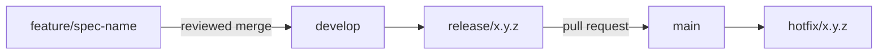

_For developers: how to propose and make a change to re:Invent Compass, from the spec to the merge, and the rules every change follows._

Thank you for your interest. re:Invent Compass is an unofficial community project that scans the code you work on to find the AWS re:Invent sessions that match your stack, then helps first-time attendees book the week safely and get to every session on time. It is not affiliated with AWS. This page is the wiki version of [CONTRIBUTING.md](https://github.com/henniefrancis/aws-re_invent-compass/blob/develop/CONTRIBUTING.md), with more detail on the workflow.

## Before you start

- Read the [README](https://github.com/henniefrancis/aws-re_invent-compass/blob/develop/README.md), then the four [steering](Glossary#steering) files in [.kiro/steering](https://github.com/henniefrancis/aws-re_invent-compass/tree/develop/.kiro/steering): [product.md](https://github.com/henniefrancis/aws-re_invent-compass/blob/develop/.kiro/steering/product.md), [tech.md](https://github.com/henniefrancis/aws-re_invent-compass/blob/develop/.kiro/steering/tech.md), [structure.md](https://github.com/henniefrancis/aws-re_invent-compass/blob/develop/.kiro/steering/structure.md) and [workflow.md](https://github.com/henniefrancis/aws-re_invent-compass/blob/develop/.kiro/steering/workflow.md). They describe what Compass is, the stack, who owns which folder and how work flows.
- Open an issue to discuss a larger change before you write code.
- Get the repository building and testing on your machine: [Build and test](Build-and-Test).

## Spec first

Compass is built spec first with Kiro. Each part has a [Kiro spec](Glossary#kiro-spec) in [.kiro/specs](https://github.com/henniefrancis/aws-re_invent-compass/tree/develop/.kiro/specs), with three files: `requirements.md`, `design.md` and `tasks.md`.

| Spec                                                                                                                         | Covers                                                             |
| ---------------------------------------------------------------------------------------------------------------------------- | ------------------------------------------------------------------ |
| [foundation-contracts](https://github.com/henniefrancis/aws-re_invent-compass/tree/develop/.kiro/specs/foundation-contracts) | The monorepo, the contracts, the CI scripts and workflows.         |
| [events-client](https://github.com/henniefrancis/aws-re_invent-compass/tree/develop/.kiro/specs/events-client)               | Sign-in, the Events API client, the catalog and simulated mode.    |
| [itinerary-rules](https://github.com/henniefrancis/aws-re_invent-compass/tree/develop/.kiro/specs/itinerary-rules)           | The [guardrail](Glossary#guardrail) rules engine.                  |
| [compass-power](https://github.com/henniefrancis/aws-re_invent-compass/tree/develop/.kiro/specs/compass-power)               | The MCP server, the CLI and the [Kiro Power](Glossary#kiro-power). |
| [boarding-passes](https://github.com/henniefrancis/aws-re_invent-compass/tree/develop/.kiro/specs/boarding-passes)           | The client side of passes: fields, sync, hand-off, calendar.       |
| [pass-service](https://github.com/henniefrancis/aws-re_invent-compass/tree/develop/.kiro/specs/pass-service)                 | The two Lambda functions behind the [Pass API](Pass-API).          |
| [infra](https://github.com/henniefrancis/aws-re_invent-compass/tree/develop/.kiro/specs/infra)                               | The Terraform.                                                     |
| [showcase-site](https://github.com/henniefrancis/aws-re_invent-compass/tree/develop/.kiro/specs/showcase-site)               | The Angular site.                                                  |

When you change behaviour, change the spec first: the requirement, then the design, then a task. Then write the code and tests that complete the task. A change to a shared contract follows [Contracts](Contracts#how-to-change-a-contract). See [Kiro specs](Kiro-Specs) for how the specs were written.

## Branches



| Branch                | Purpose                                                                           |
| --------------------- | --------------------------------------------------------------------------------- |
| `main`                | Production. Nobody commits to it directly.                                        |
| `develop`             | The integration branch.                                                           |
| `feature/<spec-name>` | One per piece of work, cut from `develop`, named after the spec it changes.       |
| `release/x.y.z`       | Cut from `develop` for a release, then merged into `main` through a pull request. |
| `hotfix/x.y.z`        | A fix after launch, cut from `main`.                                              |

A pull request into `main` and every push to `develop` run the required `check.yml` workflow. See [Quality gate](Quality-Gate).

## Commits

Use [Conventional Commits](https://www.conventionalcommits.org/), scoped by the spec name:

```text
feat(showcase-site): every sample pass draws FLIGHT NAME above TERMINAL and GATE
fix(infra): ...
docs(pass-service): ...
```

The types used in the history are `feat`, `fix`, `docs`, `test`, `ci`, `chore` and `style`. Commit in small steps, and only after the tests for the package you changed pass.

## Rules for every change

- **Coverage stays at 100%** for statements, branches, functions and lines. Only the named exclusions are allowed; see [Quality gate](Quality-Gate#coverage).
- **No secrets.** Never commit a secret, token, key, certificate, account identifier or real personal data. Use the `.example` files, such as [.env.example](https://github.com/henniefrancis/aws-re_invent-compass/blob/develop/.env.example).
- **No live calls in tests.** Tests run in [simulated mode](Glossary#simulated-mode) and never call the live Events API, Apple, Google or AWS. Only the owner runs the live smoke tests.
- **Terraform only.** All infrastructure is [Terraform](Glossary#terraform) in [infra](https://github.com/henniefrancis/aws-re_invent-compass/tree/develop/infra). No CloudFormation, CDK, SAM or console steps.
- **Exact versions.** Dependencies are pinned to exact versions. Propose a new dependency in the issue or pull request rather than adding it on your own.
- **Pass the gate.** Every check in [Quality gate](Quality-Gate) passes on your machine before you open a pull request.

## Voice

All copy, docs, comments, test names and commit messages follow the voice in [product.md](https://github.com/henniefrancis/aws-re_invent-compass/blob/develop/.kiro/steering/product.md):

- Plain English, short sentences, friendly and calm. Write for someone at their first conference of this size.
- Never use an em dash or an en dash. Use commas, colons, parentheses or a new sentence. `npm run check:dash` enforces this.
- Show times in the event's local time, with the time zone stated once per view.

Text that an attendee sees also says plainly that Compass is unofficial and that the badge, not the [boarding pass](Glossary#boarding-pass), is the ticket. The pass carries the line "Unofficial. Your badge is your ticket." ([pass-texts.ts](https://github.com/henniefrancis/aws-re_invent-compass/blob/develop/packages/pass-service/src/apple/pass-texts.ts)).

## Reporting a security problem

Do not open a public issue. Report it privately, as [SECURITY.md](https://github.com/henniefrancis/aws-re_invent-compass/blob/develop/SECURITY.md) describes: open the repository's **Security** tab and choose **Report a vulnerability**. Say what you found, how to reproduce it and the impact you expect, and give a reasonable time for a fix before you share details. Problems in the AWS Events API, AWS Builder ID, Apple Wallet or Google Wallet themselves go to their owners. See [Security](Security).

## Licence

By contributing you agree that your contribution is licensed under the Apache License 2.0 (see [LICENSE](https://github.com/henniefrancis/aws-re_invent-compass/blob/develop/LICENSE)).

## Related pages

- [Build and test](Build-and-Test)
- [Quality gate](Quality-Gate)
- [Kiro specs](Kiro-Specs)
- [Repository layout](Repository-Layout)
