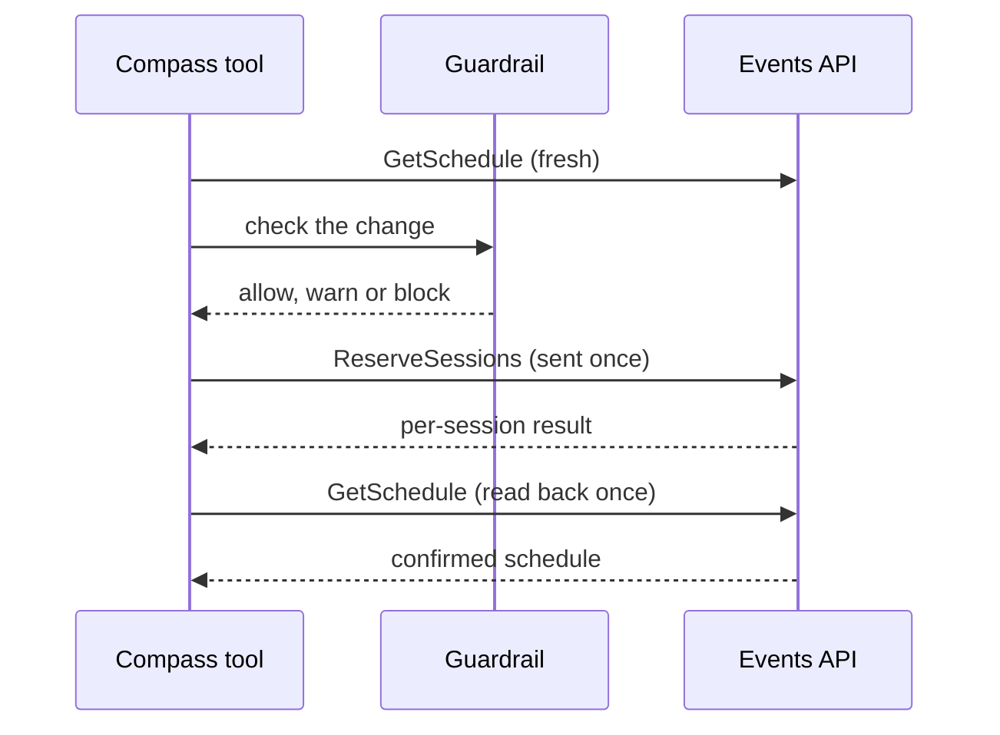

_For developers and architects: how Compass uses each of the 12 operations of the AWS re:Invent Event Catalog API, how the client behaves on the wire, and why the catalog is searched on your machine._

The [Events API](Glossary#events-api) is the AWS re:Invent 2026 Event Catalog API at `https://api.awsevents.com/v1`. Its OpenAPI document is committed as [packages/contracts/events-api.openapi.json](https://github.com/henniefrancis/aws-re_invent-compass/blob/develop/packages/contracts/events-api.openapi.json) (see [Contracts](Contracts)). Compass calls it from the attendee's own machine, through the local [MCP server](Glossary#mcp-server), with the attendee's own sign-in. Every call is scoped to the event id `reinvent2026`.

Compass uses all 12 operations. Each has one file in [packages/core/src/api](https://github.com/henniefrancis/aws-re_invent-compass/tree/develop/packages/core/src/api), and the tools reach them through the events adapter in [events-adapter.ts](https://github.com/henniefrancis/aws-re_invent-compass/blob/develop/packages/mcp-server/src/adapters/events-adapter.ts).

## The 12 operations

Paths are relative to `https://api.awsevents.com`. `{eventId}` is always `reinvent2026`.

| Operation                                                                                                                                  | Method and path                                              | Kind  | Compass tools                                                                                                                    | How Compass uses it                                                                                                                                                                                                                                                                    |
| ------------------------------------------------------------------------------------------------------------------------------------------ | ------------------------------------------------------------ | ----- | -------------------------------------------------------------------------------------------------------------------------------- | -------------------------------------------------------------------------------------------------------------------------------------------------------------------------------------------------------------------------------------------------------------------------------------- |
| [ListEvents](https://github.com/henniefrancis/aws-re_invent-compass/blob/develop/packages/core/src/api/list-events.ts)                     | `GET /v1/events`                                             | Read  | `refresh_catalog`, and every tool that needs event times                                                                         | With GetEvent, resolves the event window and time zone, read once per server run and kept in memory. No time is hard-coded.                                                                                                                                                            |
| [GetEvent](https://github.com/henniefrancis/aws-re_invent-compass/blob/develop/packages/core/src/api/get-event.ts)                         | `GET /v1/events/{eventId}`                                   | Read  | As ListEvents                                                                                                                    | The event's dates and time zone, so every time is shown in the event's local time.                                                                                                                                                                                                     |
| [ListSessions](https://github.com/henniefrancis/aws-re_invent-compass/blob/develop/packages/core/src/api/list-sessions.ts)                 | `GET /v1/events/{eventId}/sessions`                          | Read  | `refresh_catalog`                                                                                                                | Pages through the whole catalog (`nextToken` until none) into the local cache. A fetch of more than 200 pages or 20,000 sessions is treated as incomplete.                                                                                                                             |
| [GetSession](https://github.com/henniefrancis/aws-re_invent-compass/blob/develop/packages/core/src/api/get-session.ts)                     | `GET /v1/events/{eventId}/sessions/{sessionId}`              | Read  | `issue_all_boarding_passes`, `issue_boarding_pass`                                                                               | Refreshes each reserved session just before its [boarding pass](Glossary#boarding-pass) is issued, so the pass carries current times, [venue](Glossary#venue) and room.                                                                                                                |
| [GetSchedule](https://github.com/henniefrancis/aws-re_invent-compass/blob/develop/packages/core/src/api/get-schedule.ts)                   | `GET /v1/events/{eventId}/schedule`                          | Read  | `show_schedule`, `check_itinerary`, `plan_week`, `export_calendar`, `sync_passes`, both issue tools and all five schedule writes | The source of truth. Read fresh before any decision, and read back once after every write to confirm it.                                                                                                                                                                               |
| [ReserveSessions](https://github.com/henniefrancis/aws-re_invent-compass/blob/develop/packages/core/src/api/reserve-sessions.ts)           | `POST /v1/events/{eventId}/reservations`                     | Write | `reserve_with_guardrails`                                                                                                        | Reserves 1 to 10 sessions, only after the [guardrail](Glossary#guardrail) allows them. When a clash blocks a booking and a [repeat](Glossary#repeat) of the clashing session fits, it proposes a [safe swap](Glossary#safe-swap): reserve the repeat first, cancel the original after. |
| [CancelReservation](https://github.com/henniefrancis/aws-re_invent-compass/blob/develop/packages/core/src/api/cancel-reservation.ts)       | `DELETE /v1/events/{eventId}/reservations/{sessionId}`       | Write | `cancel_reservation`                                                                                                             | Cancels one reservation. In a safe swap it cancels the original only once the schedule shows the repeat held.                                                                                                                                                                          |
| [AssociateFavorites](https://github.com/henniefrancis/aws-re_invent-compass/blob/develop/packages/core/src/api/associate-favorites.ts)     | `POST /v1/events/{eventId}/favorites`                        | Write | `add_standby`                                                                                                                    | Adds 1 to 10 sessions to the [standby](Glossary#standby) list. Favourites are standby: backups if a seat frees up.                                                                                                                                                                     |
| [DisassociateFavorite](https://github.com/henniefrancis/aws-re_invent-compass/blob/develop/packages/core/src/api/disassociate-favorite.ts) | `DELETE /v1/events/{eventId}/favorites/{sessionId}`          | Write | `remove_standby`                                                                                                                 | Removes one session from the standby list.                                                                                                                                                                                                                                             |
| [CreatePersonalTime](https://github.com/henniefrancis/aws-re_invent-compass/blob/develop/packages/core/src/api/create-personal-time.ts)    | `POST /v1/events/{eventId}/personal-time`                    | Write | `add_layover` (`action: create`)                                                                                                 | Adds a [layover](Glossary#layover): personal time for a meal, water or rest. Times are written in the event time zone.                                                                                                                                                                 |
| [UpdatePersonalTime](https://github.com/henniefrancis/aws-re_invent-compass/blob/develop/packages/core/src/api/update-personal-time.ts)    | `PUT /v1/events/{eventId}/personal-time/{personalTimeId}`    | Write | `add_layover` (`action: update`)                                                                                                 | Moves or renames a layover, by the id `show_schedule` lists.                                                                                                                                                                                                                           |
| [DeletePersonalTime](https://github.com/henniefrancis/aws-re_invent-compass/blob/develop/packages/core/src/api/delete-personal-time.ts)    | `DELETE /v1/events/{eventId}/personal-time/{personalTimeId}` | Write | `add_layover` (`action: delete`)                                                                                                 | Removes a layover.                                                                                                                                                                                                                                                                     |

Five operations read and seven write. In live mode the seven writes are off by default: the read-only wrapper in [read-only-events.ts](https://github.com/henniefrancis/aws-re_invent-compass/blob/develop/packages/mcp-server/src/adapters/read-only-events.ts) refuses them before any request is made, until the attendee sets `COMPASS_ALLOW_WRITES=1`. See [Read-only by default](Read-Only-By-Default). Every write tool needs the attendee's approval; see [MCP tools](MCP-Tools#approval-rules).

## Client behaviour

The client in [packages/core/src/api](https://github.com/henniefrancis/aws-re_invent-compass/tree/develop/packages/core/src/api) behaves the same in live and [simulated mode](Glossary#simulated-mode): quotas, retries, validation and error mapping all sit above the transport.

### Per-session results

ReserveSessions and AssociateFavorites take 1 to 10 distinct session ids; a list out of range or with a duplicate is refused before it is sent. The answer is a result per session: `successful` ids and `failed` entries, each with a `code` and, for a clash, the sessions it `conflictsWith`. Compass knows the nine documented codes (`sessionNotReservable`, `scheduleConflict`, `alreadyScheduled`, `sessionFull`, `insufficientAccess`, `timePassed`, `alreadyFavorited`, `notFavorited`, `other`). A code it does not know is reported as a refusal, never as a success. A compile-time check in [bulk-failure-codes.ts](https://github.com/henniefrancis/aws-re_invent-compass/blob/develop/packages/core/src/api/bulk-failure-codes.ts) fails the build if this list and the official document drift apart.

### GetSchedule read-back

A 200 from a write does not prove the write took effect, so Compass trusts GetSchedule, not the write response. [confirmed-write.ts](https://github.com/henniefrancis/aws-re_invent-compass/blob/develop/packages/core/src/api/confirmed-write.ts) sends the write once and, only if it succeeds, reads the schedule back exactly once. If the write fails, the schedule is not read. If the write succeeds but the read-back fails, the change is reported as unconfirmed and the write is never re-sent, because a second ReserveSessions could double-book.

### Quotas

The Events API limits each attendee per minute. [quota-tracker.ts](https://github.com/henniefrancis/aws-re_invent-compass/blob/develop/packages/core/src/api/quota-tracker.ts) mirrors those limits on the client, so a call that would go over is refused before it is sent. The window is a rolling minute from the first counted call of each operation.

| Operation                                                                                           | Client limit per minute                |
| --------------------------------------------------------------------------------------------------- | -------------------------------------- |
| GetSession                                                                                          | 120                                    |
| ListSessions                                                                                        | 120                                    |
| GetSchedule                                                                                         | 60                                     |
| ReserveSessions                                                                                     | 30 sessions (each id in a call counts) |
| AssociateFavorites                                                                                  | 30 sessions (each id in a call counts) |
| CancelReservation, DisassociateFavorite, CreatePersonalTime, UpdatePersonalTime, DeletePersonalTime | 30 each                                |
| ListEvents, GetEvent                                                                                | Not counted                            |

### Retries and Retry-After

From [retry.ts](https://github.com/henniefrancis/aws-re_invent-compass/blob/develop/packages/core/src/api/retry.ts):

- **401:** refresh the access token once, then retry once.
- **429:** if `Retry-After` is a whole number of seconds from 0 to 120, wait that long and retry once. Without a usable `Retry-After`, fail. After any 429, the next call of that operation is blocked until the wait has passed, for every operation including ListEvents and GetEvent.
- **ReserveSessions is never re-sent automatically,** for any status. On a 401 it refreshes the token so your next attempt works, then fails; on a 429 or a 5xx it fails.

### Validation

Every 2xx body is parsed with its zod schema from [packages/contracts](https://github.com/henniefrancis/aws-re_invent-compass/tree/develop/packages/contracts) before use ([validate.ts](https://github.com/henniefrancis/aws-re_invent-compass/blob/develop/packages/core/src/api/validate.ts)). Unknown fields are dropped, so a new field from AWS breaks nothing. A body that does not match throws an error that names the operation only, never any of the body, which could hold personal data. The five operations that return 204 must return no body. Response bodies are read only up to 5 MB.

### Host lock and no redirects

[http-transport.ts](https://github.com/henniefrancis/aws-re_invent-compass/blob/develop/packages/core/src/api/http-transport.ts) checks every request URL before it is sent:

- https only, on the Events API host only, with no custom port and no credentials in the URL;
- the path must stay inside `/events`, exactly as built, so no `..` or encoded trick can move it;
- the access token goes only to `api.awsevents.com`, through an audience guard. The ID token is never sent to the Events API;
- redirects are an error, never followed, because a redirect could carry the bearer token to another host;
- every request times out after 30 seconds.

## Why the catalog is local

The Events API has no search. ListSessions only pages through the whole catalog, with `locale`, `includeAbstracts` and `nextToken` as its parameters. So `refresh_catalog` downloads the catalog once into a private cache file on the attendee's machine, and `find_sessions`, `find_sessions_by_tech`, `plan_week` and the guardrail search and filter it locally. This:

- answers every search in milliseconds, with no call and no quota used;
- lets the [Kiro hook](Glossary#kiro-hook) check a booking with no network at all;
- keeps the attendee's searches on their own machine.

The cache is one file per event, readable only by the user (folder mode 0700, file mode 0600), written atomically, and refused if it is a symbolic link or larger than 50 MB. It is stale after 24 hours. If a refresh fails, the stale copy is served and marked as stale. See [Data and privacy](Data-and-Privacy).

## The official remote MCP server

AWS also publishes its own remote MCP server for the Events API at `https://api.awsevents.com/mcp`, with one tool per operation ([Using the MCP server](https://docs.aws.amazon.com/events/latest/devguide/mcp-server.html)). It is fine for reading events and sessions. Its seven write tools, though, go straight to the API: they skip the Compass guardrail and the read-only setting.

The [Kiro Power](Glossary#kiro-power) does not bundle it. The project's Kiro hook spike found that Kiro does not honour `disabledTools` for a server inside a Power, so the write tools could not be turned off there. Two layers protect attendees instead:

- [power/POWER.md](https://github.com/henniefrancis/aws-re_invent-compass/blob/develop/power/POWER.md) tells an attendee who adds the server to their workspace `.kiro/settings/mcp.json` to list the seven write tools in `disabledTools` by their full names, such as `AWSEventsPublicApi-Mcp-prod___ReserveSessions`. A bare name hides nothing.
- The hook template in [power/hook-templates/reinvent-compass.json](https://github.com/henniefrancis/aws-re_invent-compass/blob/develop/power/hook-templates/reinvent-compass.json) blocks any call to those seven tools and points the agent to the Compass tool instead.

The decision is recorded in [Decisions: architecture](Decisions-Architecture).

## Related pages

- [MCP tools](MCP-Tools)
- [Contracts](Contracts)
- [MCP server](MCP-Server)
- [Guardrail rules](Guardrail-Rules)
- [Read-only by default](Read-Only-By-Default)
