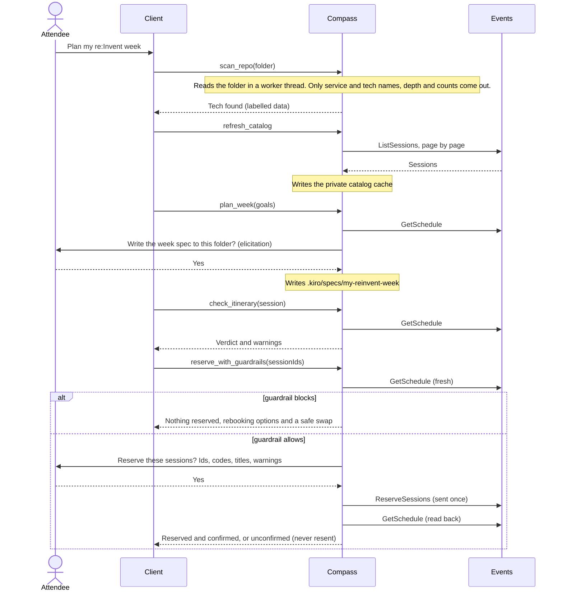
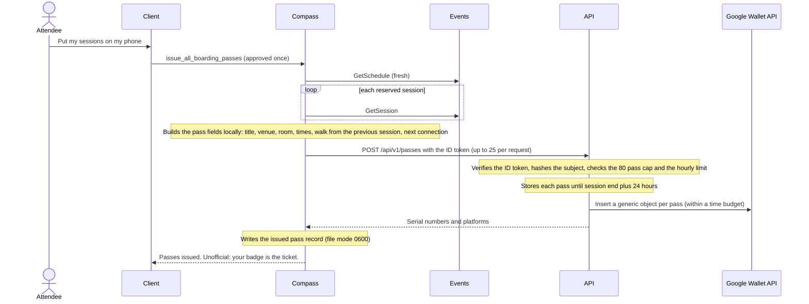
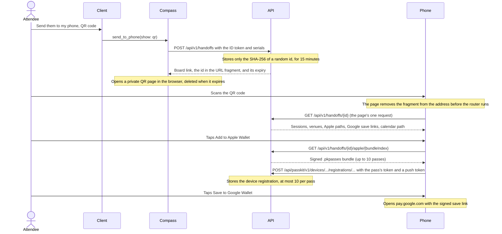
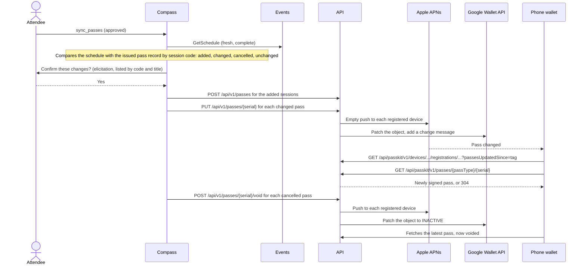

_For architects: the four end-to-end flows of Compass (plan, issue, board and fly), each as a sequence diagram checked against the code._

Every flow starts in the attendee's [MCP client](Glossary#mcp-client) and runs through the Compass [MCP server](Glossary#mcp-server) on their computer. The server is the only part that holds Events API tokens. The [Compass API](Glossary#compass-api) sees only the ID token and the pass fields. The participants below are the same in every diagram.

| Participant | What it is                                                            |
| ----------- | --------------------------------------------------------------------- |
| Attendee    | The person at the keyboard or holding the phone.                      |
| Client      | Kiro or another MCP client, with the [Kiro Power](Kiro-Power) skills. |
| Compass     | The Compass MCP server on the attendee's computer.                    |
| Events      | The [AWS Events API](Glossary#events-api) at `api.awsevents.com`.     |
| API         | The Compass API behind CloudFront at `reinvent-compass.vegas`.        |
| Phone       | The phone's browser on `/board`, and its wallet.                      |

## Plan

The attendee scans their code, loads the catalog, plans a week and books it. Every booking passes the [guardrail](Glossary#guardrail) against a fresh schedule, is confirmed by the human, is sent once, and counts only when the schedule read back lists it.

**Safe swap.** When a clash is blocked and a [repeat](Glossary#repeat) of the held session fits, Compass records a pending [safe swap](Glossary#safe-swap) in memory. The attendee first reserves the repeat with `reserve_with_guardrails`. Then `cancel_reservation` on the original reads a fresh schedule, re-checks the swap with the rules engine, and cancels only when the repeat is confirmed, so the attendee never ends up with neither seat. The cancel is sent once and confirmed by a `GetSchedule` read-back like every other write.

In [read-only mode](Glossary#read-only-mode) the steps are the same up to the human confirmation; the tool then answers what it would have done and sends nothing. The code: [reserve-with-guardrails.ts](https://github.com/henniefrancis/aws-re_invent-compass/blob/develop/packages/mcp-server/src/tools/reserve-with-guardrails.ts), [cancel-reservation.ts](https://github.com/henniefrancis/aws-re_invent-compass/blob/develop/packages/mcp-server/src/tools/cancel-reservation.ts) and the read-back in [confirmed-write.ts](https://github.com/henniefrancis/aws-re_invent-compass/blob/develop/packages/core/src/api/confirmed-write.ts).

## Issue

The attendee asks for [Boarding Passes](Glossary#boarding-pass). The client's approval of `issue_all_boarding_passes` is the one confirmation for every reserved session.

Nothing is signed at this point. Apple passes are signed when the phone downloads them (see Board). Google save links are signed into the hand-off view, from objects inserted here; an insert that failed or ran past its budget is tried once more when the board page is opened. The code: [issue-boarding-passes.ts](https://github.com/henniefrancis/aws-re_invent-compass/blob/develop/packages/mcp-server/src/tools/issue-boarding-passes.ts) and [pass-lifecycle.ts](https://github.com/henniefrancis/aws-re_invent-compass/blob/develop/packages/pass-service/src/services/pass-lifecycle.ts).

## Board

The attendee sends the passes to their phone with a 15 minute [hand-off](Glossary#hand-off), opens `/board` and adds the passes to a [wallet](Glossary#wallet). Apple Wallet then registers with the [PassKit](Glossary#passkit) web service so it can receive updates.

Every unusable hand-off is the same 404, and reads of one hand-off are capped at 30 plus 2 per pass. The code: [send-to-phone.ts](https://github.com/henniefrancis/aws-re_invent-compass/blob/develop/packages/mcp-server/src/tools/send-to-phone.ts), [handoff-service.ts](https://github.com/henniefrancis/aws-re_invent-compass/blob/develop/packages/pass-service/src/services/handoff-service.ts), [register-device.ts](https://github.com/henniefrancis/aws-re_invent-compass/blob/develop/packages/pass-service/src/handlers/passkit/register-device.ts) and the board client in [handoff-client.ts](https://github.com/henniefrancis/aws-re_invent-compass/blob/develop/site/src/lib/board/handoff-client.ts).

## Fly

During the week the schedule changes. `sync_passes` makes the passes match it: it updates changed passes, voids cancelled ones and issues new ones, and the wallets follow.

The order in [pass-sync.ts](https://github.com/henniefrancis/aws-re_invent-compass/blob/develop/packages/core/src/passes/pass-sync.ts) is: issue the added passes in chunks of 25, update the changed ones, then void the cancelled ones. The record on disk is written after every completed call, so a failure part way keeps the progress made.

**Safety rules.** The sync runs only on a fresh, complete `GetSchedule`. Voiding every pass, or more than five in one run, needs an explicit elicited confirmation, and is refused where the client cannot ask. A reserved session the catalog does not know stops the sync and asks for `refresh_catalog`. Every pass that could be needed is built before the first API call, so a pass that cannot be built stops the run with no call made.

**Expiry.** A pass record lives until the session end plus 24 hours, then [DynamoDB](Glossary#dynamodb) [TTL](Glossary#ttl) removes it; every read already treats an item at or past its expiry as absent. The Apple pass itself expires at the session end, or at the void time once voided. The Google object's valid interval ends at the session end. A voided pass stays in the wallet until the attendee removes it. The code: [sync-passes.ts](https://github.com/henniefrancis/aws-re_invent-compass/blob/develop/packages/mcp-server/src/tools/sync-passes.ts), [pass-sync.ts](https://github.com/henniefrancis/aws-re_invent-compass/blob/develop/packages/core/src/passes/pass-sync.ts) and [keys.ts](https://github.com/henniefrancis/aws-re_invent-compass/blob/develop/packages/pass-service/src/data/keys.ts).

## Related pages

- [Architecture overview](Architecture-Overview)
- [User guide: plan](User-Guide-Plan)
- [User guide: board](User-Guide-Board)
- [User guide: fly](User-Guide-Fly)
- [Pass API](Pass-API)
