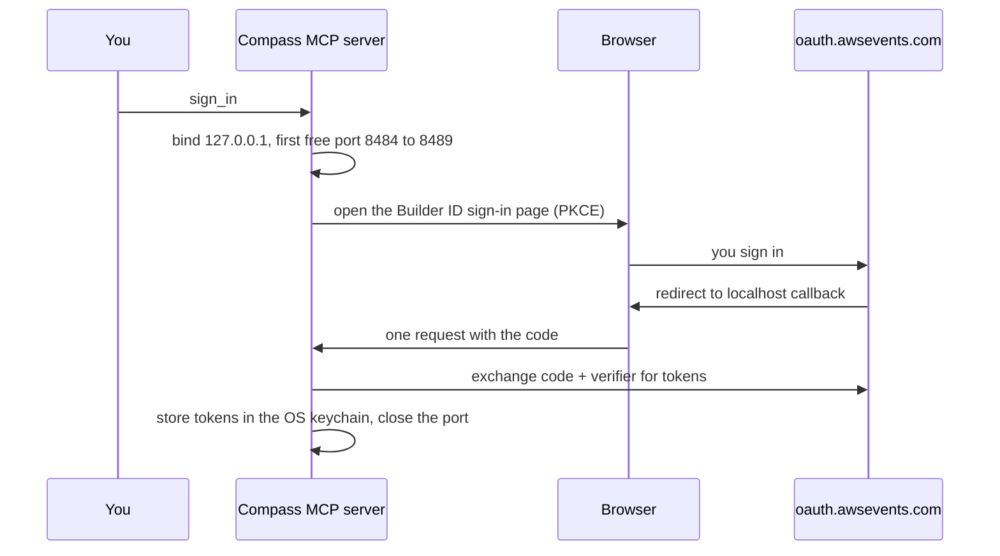

_For attendees: three ways to try re:Invent Compass, what you need, and how live sign-in works._

re:Invent Compass plans your AWS re:Invent week from your own code, checks every booking against a [guardrail](Glossary#guardrail), and puts unofficial [boarding passes](Glossary#boarding-pass) on your phone. It is an independent community project and is not affiliated with AWS (see the [Disclaimer](Disclaimer)).

There are three ways in, from no install at all to the full setup:

| Way in                   | Requires                                   | Touches your real schedule                      |
| ------------------------ | ------------------------------------------ | ----------------------------------------------- |
| Demo: Phone              | A browser                                  | No                                              |
| Demo: Terminal           | Node.js 24                                 | No                                              |
| Kiro Power or MCP server | Node.js 24, and Kiro or another MCP client | Reads it; changes it only if you turn writes on |

## Demo: Phone

Open [reinvent-compass.vegas/demo](https://reinvent-compass.vegas/demo) on any phone or computer. There is nothing to install and no sign-in.

The demo runs entirely in your browser ([site/src/lib/demo](https://github.com/henniefrancis/aws-re_invent-compass/tree/develop/site/src/lib/demo), page in [site/src/app/pages/demo](https://github.com/henniefrancis/aws-re_invent-compass/tree/develop/site/src/app/pages/demo)):

- It uses a small snapshot of 17 real re:Invent 2026 sessions, read once from the [AWS Events API](Glossary#events-api) and copied into the site. The snapshot holds only the [session code](Glossary#session-code), title, start, end, [venue](Glossary#venue) and room. Your week, seats and reservations are simulated, and nothing touches a real schedule.
- Choose **Start with a sample week**, or add sessions one by one. Each addition runs the same guardrail code as the MCP server, so you see real verdicts: a clash that blocks, a [tight connection](Glossary#tight-connection), a lost meal break. Your week also shows each connection and suggests [layovers](Glossary#layover) for meals and rest.
- When a session clashes with one that has a [repeat](Glossary#repeat), the demo offers a step-by-step [safe swap](Glossary#safe-swap).
- **Show sample pass** draws a pass for a reserved session, with FLIGHT NAME above TERMINAL and GATE.
- **Download sample calendar** gives you an `.ics` file of your demo week with "Boarding closes" and "Leave now" alarms.

## Demo: Terminal

```sh
npx --yes reinvent-compass@0.1.2 demo
```

This runs the whole Compass flow on made-up data, through the real tools and the real server, in ten steps ([packages/mcp-server/src/demo/run-demo.ts](https://github.com/henniefrancis/aws-re_invent-compass/blob/develop/packages/mcp-server/src/demo/run-demo.ts)):

1. Sign in and load the catalog
2. Scan the sample repo
3. Plan the week
4. A clash is blocked
5. A safe swap
6. Reserve the session that clashed
7. Issue Boarding Passes
8. Hand the passes to your phone (the QR code prints in the terminal)
9. Cancel a session
10. Void the pass

The demo forces [simulated mode](Glossary#simulated-mode): a [synthetic catalog](Glossary#synthetic-catalog) of 120 made-up sessions, a signed-in attendee, a pinned clock and an in-process pass service. No browser opens, no sign-in happens and nothing is sent anywhere. The phone link it makes never resolves. If a step fails, the demo says which one and exits with code 1.

Useful options:

- `demo --repo <folder>` scans a folder of yours instead of the [sample repo](https://github.com/henniefrancis/aws-re_invent-compass/tree/develop/fixtures/sample-repo). Compass copies the folder to a temporary workspace first (skipping `.git`, `node_modules`, links and files over 1 MB, up to 2,000 files), so your folder is never changed.
- To run the whole server on made-up data in your own client, set `COMPASS_MODE=simulated` in its environment. Every result then starts with `SIMULATED MODE: no real data.`

## Kiro Power or MCP server

### Kiro Power

The [Kiro Power](Glossary#kiro-power) is the [power](https://github.com/henniefrancis/aws-re_invent-compass/tree/develop/power) folder: `plugin.json` and a matching `POWER.md`, `mcp.json`, three skills (`plan-my-week`, `first-timer-guide` and `install-hooks`) and a hook template. Its `mcp.json` starts one server, `compass`, with `npx --yes reinvent-compass@0.1.2`.

1. In Kiro, open Settings and set **Kiro Agent: Configure MCP** to Enabled. Kiro starts no [MCP server](Glossary#mcp-server) until you do.
2. Open the Powers panel and choose **Add Custom Power**.
3. Choose **Import power from GitHub** and give it the folder URL of the Power: `https://github.com/henniefrancis/aws-re_invent-compass/tree/main/power`.

Use the folder URL, not the repository URL: the Power lives in `power/`, and Kiro reports "Nothing to install from the repository root" for the repository URL. If you import the folder from a local clone instead, Kiro names the server `power-power-compass`.

Then open your own project in Kiro and say: **"Plan my re:Invent."** The `plan-my-week` skill tells the agent the order of the tools and that every write needs your approval. To add the optional [Kiro hooks](Glossary#kiro-hook), ask for them: the `install-hooks` skill shows the template and writes `.kiro/hooks/reinvent-compass.json` only after you say yes.

### Other MCP clients

Any desktop [MCP client](Glossary#mcp-client) that runs stdio servers can start Compass with `npx --yes reinvent-compass@0.1.2`. Hooks are Kiro-only, but the guardrail runs inside the server in every client.

**Kiro without the Power.** Add the server to `.kiro/settings/mcp.json` (this workspace) or `~/.kiro/settings/mcp.json` (all workspaces):

```json
{
  "mcpServers": {
    "compass": {
      "command": "npx",
      "args": ["--yes", "reinvent-compass@0.1.2"],
      "autoApprove": ["refresh_catalog", "find_sessions", "check_itinerary"]
    }
  }
}
```

Only those three read tools may be auto-approved. Never auto-approve a write tool (see [MCP tools](MCP-Tools)).

**Claude Desktop.** Open Settings, then Developer, then Edit Config (`~/Library/Application Support/Claude/claude_desktop_config.json` on macOS, `%APPDATA%\Claude\claude_desktop_config.json` on Windows), add the block below, then quit and restart Claude Desktop:

```json
{
  "mcpServers": {
    "compass": {
      "command": "npx",
      "args": ["--yes", "reinvent-compass@0.1.2"]
    }
  }
}
```

**VS Code.** Create `.vscode/mcp.json` in the workspace, or run **MCP: Open User Configuration**. VS Code uses a `servers` object:

```json
{
  "servers": {
    "compass": {
      "type": "stdio",
      "command": "npx",
      "args": ["--yes", "reinvent-compass@0.1.2"]
    }
  }
}
```

**Kiro CLI.** The Kiro CLI reads the same `mcpServers` JSON as the IDE, so use the Kiro snippet above. It also has `kiro-cli mcp` subcommands; run `kiro-cli mcp --help` for the options of your version.

Every snippet names the exact package version. Keep the pin: `npx` can otherwise pick up a different copy of the package.

The command line itself is small:

```text
reinvent-compass                      start the Compass server on stdio
reinvent-compass demo [--repo <dir>]  run the simulated demo (no network)
reinvent-compass hook <name>          run a Kiro hook: pre-write-guardrail or post-write-sync
reinvent-compass --version            print the version
reinvent-compass --help               print the usage
```

## Requirements

- **Node.js 24 or later.** `npx` comes with it. The package declares `"node": ">=24"`.
- **For live mode:** an [AWS Builder ID](Glossary#aws-builder-id) registered for re:Invent 2026. Simulated mode and both demos need no account.
- **For passes on a phone:** Apple Wallet on iPhone, or Google Wallet on Android. iPad has no Wallet app, so it uses the calendar file (see [Board](User-Guide-Board)).
- **Optional:** a GitHub account, to scan your repositories through the read-only Compass [GitHub App](Glossary#github-app).
- **On Linux:** the Secret Service (for example GNOME Keyring) to keep your sign-in between sessions. Without it, Compass holds your tokens in memory only and you sign in again each session.

## Live sign-in

Without `COMPASS_MODE=simulated`, Compass works on your real re:Invent schedule. Ask your assistant to run `sign_in`:



- It is OAuth 2.0 with [PKCE](Glossary#pkce): a fresh verifier, challenge and state for every attempt.
- The redirect comes back to a one-request server on `127.0.0.1` (and `::1` where the machine has IPv6), on the first free port from 8484 to 8489. It accepts only `GET /callback` with the right Host header and a matching state, answers once, and closes. It gives up after five minutes ([packages/core/src/auth/loopback-server.ts](https://github.com/henniefrancis/aws-re_invent-compass/blob/develop/packages/core/src/auth/loopback-server.ts)).
- Your access, refresh and ID tokens go into your operating system keychain. If the keychain is missing or fails, Compass holds them in memory only.
- If no browser opens, Compass prints the sign-in address on stderr; open it by hand. Make sure one of the ports 8484 to 8489 is free.

Then run `refresh_catalog`, and plan. Compass is [read-only by default](Read-Only-By-Default): it reads your real schedule, and the booking tools say what they would do. `sign_out` revokes your sign-in and clears the stored tokens.

## Related pages

- [Plan: from your code to a week](User-Guide-Plan)
- [Board: passes on your phone](User-Guide-Board)
- [Read-only by default](Read-Only-By-Default)
- [MCP tools](MCP-Tools)
- [FAQ](FAQ)
