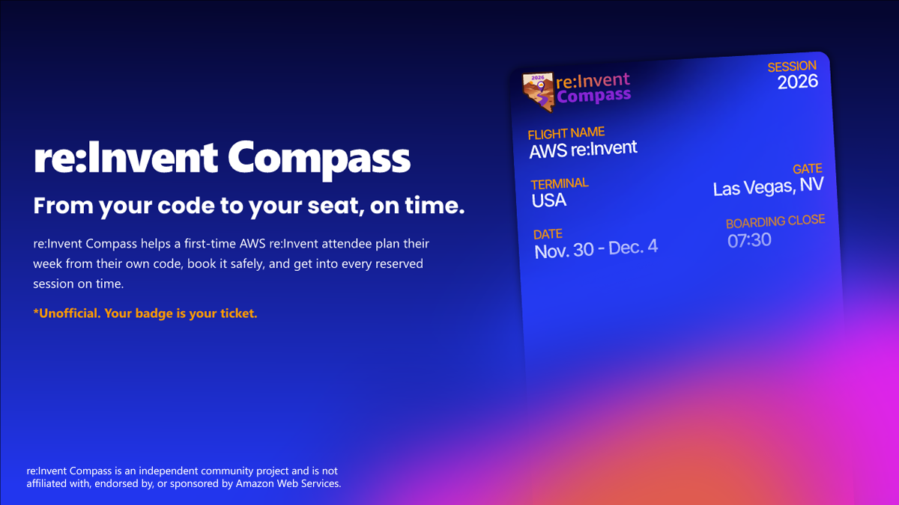

# re:Invent Compass

**From your code to your seat, on time.**

_For everyone: what re:Invent Compass is, who it is for, and where to start reading._

re:Invent Compass scans the code you work on (one project, a dev folder of git repositories or, if you allow it, your GitHub repositories through a read-only GitHub App), learns which AWS services you use and how deeply, plus the rest of your stack such as .NET, Node.js or Python, and finds the re:Invent sessions that match, with a reason for each. It then helps a first-time attendee book the week safely and get into every reserved session on time. It is an independent community project, built for the re:Invent Catalog API Builder Challenge (September to November 2026), and it is not affiliated with AWS (see the [Disclaimer](Disclaimer)).

## What it is

Compass ships as a [Kiro Power](Glossary#kiro-power) plus a local [MCP server](Glossary#mcp-server) that any desktop [MCP client](Glossary#mcp-client) can run. It:

- scans your code on your machine, read-only, and, if you allow it, your GitHub repositories through the read-only [GitHub App](Glossary#github-app), to learn which AWS services you use and how deeply, plus your other technology;
- matches that tech list to the official session catalog and gives a reason for each session it suggests;
- plans your week from those sessions and writes it as a [Kiro spec](Glossary#kiro-spec) you can read and edit;
- reads your real re:Invent schedule, and changes it only if you turn writes on and approve each change;
- checks every booking against the [guardrail](Glossary#guardrail): clashes, walking time between venues, meal breaks and the 10-minute seat rule;
- issues unofficial Apple Wallet and Google Wallet [boarding passes](Glossary#boarding-pass) that update when a session changes, [void](Glossary#void) when you cancel it and expire when it ends.

The time that matters at re:Invent is not "Starts 10:30". A reserved seat is held only until 10 minutes before the start, so it is **"Boarding closes 10:20"**, plus the walk from wherever you are. Compass is built around that one fact.

## Who it is for

- **Attendees**, first-timers above all: start with [Getting started](Getting-Started), then the user guide ([Plan](User-Guide-Plan), [Board](User-Guide-Board), [Fly](User-Guide-Fly)).
- **Architects**: start with the [Architecture overview](Architecture-Overview) and the [Key decisions](Key-Decisions).
- **Developers**: start with the [Repository layout](Repository-Layout) and [Build and test](Build-and-Test).
- **Operators**: start with [Operations](Operations), then the [Runbooks](Runbooks).

## Quick links

| I want to                               | Go to                                                                       |
| --------------------------------------- | --------------------------------------------------------------------------- |
| Try it on my phone, with no install     | [reinvent-compass.vegas/demo](https://reinvent-compass.vegas/demo)          |
| Run the demo in a terminal              | [Getting started](Getting-Started)                                          |
| Install the Power in Kiro               | [Getting started](Getting-Started)                                          |
| Know what each tool does                | [MCP tools](MCP-Tools)                                                      |
| Understand the guardrail                | [Guardrail rules](Guardrail-Rules)                                          |
| Know what data leaves my machine        | [Privacy](Privacy)                                                          |
| See how the system fits together        | [Architecture overview](Architecture-Overview)                              |
| See how Compass uses the AWS Events API | [Events API coverage](Events-API-Coverage)                                  |
| Read the code                           | [GitHub repository](https://github.com/henniefrancis/aws-re_invent-compass) |
| Get answers to common questions         | [FAQ](FAQ)                                                                  |

## The submission

The owner submitted re:Invent Compass to the re:Invent Catalog API Builder Challenge on 5 November 2026 (see [Hackathon](Hackathon)):

- the [hackathon project](https://builder.aws.com/project/3LE6YlbFWwf3mrjiuOyMl9wBBo2/reinvent-compass-from-your-code-to-your-seat-on-time);
- the article [re:Invent Compass: From your code to your seat, on time](https://builder.aws.com/content/3LVhghIjFObX3utBCV2t31xJjqR/reinvent-compass-from-your-code-to-your-seat-on-time);
- the article [re:Invent Compass: Project Stats and Costs](https://builder.aws.com/content/3LWRjwavL1lcilvpa3XAgpceMLc/reinvent-compass-project-stats-and-costs);
- the videos: [Promotional Video](https://www.youtube.com/watch?v=YKumzOFCAog), [Plan with Kiro IDE](https://www.youtube.com/watch?v=Xm6ZobZ8smY), [Plan with Terminal](https://www.youtube.com/watch?v=XXz5B5a0nRM), [Boarding with Passes](https://www.youtube.com/watch?v=T9ycY93RnHU) and [Fly with Updates](https://www.youtube.com/watch?v=x_l_M3ByYEA), all in the [Video Library](https://reinvent-compass.vegas/videos).

## The build, in public

Every task from kickoff on 15 October 2026 to submission is a card on the [project board](https://github.com/users/henniefrancis/projects/3), with its workstream and real date. [How it was built](How-It-Was-Built) tells the story.

## Related pages

- [Getting started](Getting-Started)
- [Architecture overview](Architecture-Overview)
- [How it was built](How-It-Was-Built)
- [Hackathon](Hackathon)
- [Glossary](Glossary)
