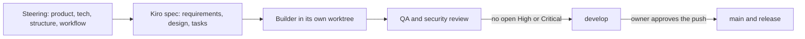

# How it was built

_For developers and architects: how re:Invent Compass went from an idea on 15 October 2026 to a live service on 31 October 2026, who built what, and how the work was kept safe._

re:Invent Compass was built spec first, with [Kiro](Glossary#kiro). Every piece of the product started as a [Kiro spec](Glossary#kiro-spec): a requirements file, a design file and a task list. Four [steering](Glossary#steering) files gave every session the same product rules, stack and voice. The work ran as eight parallel streams, one spec each, and every stream passed a QA and security review before it was merged.

AI did most of the typing. Kiro wrote five of the eight specs and built the first tasks. When the owner's Kiro credits ran out on 17 October, Claude's dev-team agents built the rest from the same Kiro specs, under the same steering and the same review gates. The owner made every decision, approved every push and is the author of every commit.

The whole build is public on the [project board](https://github.com/users/henniefrancis/projects/3): every task is a card with its workstream and its real date. The [workstream view](https://github.com/users/henniefrancis/projects/3/views/3) groups the cards by phase, and the [roadmap view](https://github.com/users/henniefrancis/projects/3/views/4) shows them on a timeline.

## Spec-driven development with Kiro

A Kiro spec is a folder under [.kiro/specs](https://github.com/henniefrancis/aws-re_invent-compass/tree/develop/.kiro/specs) with three files:

| File              | What it holds                                                                                      |
| ----------------- | -------------------------------------------------------------------------------------------------- |
| `requirements.md` | What the stream must do, as numbered acceptance criteria in EARS form ("WHEN ..., THE ... SHALL"). |
| `design.md`       | How it is built: components, data, error handling, test strategy, and every later change of plan.  |
| `tasks.md`        | An ordered checklist of tasks, each ticked when it is done and committed.                          |

The specs and their task checkboxes are the single record of what was done. When the plan changed, the change went into `design.md` in the same commit, and work that ran ahead of its task was written back into the spec as a ticked task the same day. [Kiro specs](Kiro-Specs) describes all eight.

The four steering files in [.kiro/steering](https://github.com/henniefrancis/aws-re_invent-compass/tree/develop/.kiro/steering) load into every Kiro session. They hold the product rules, the stack, the folder ownership and the working rules (branches, commits, the definition of done). [Steering and hooks](Steering-and-Hooks) explains each one.

## The build in phases

Each phase below links its workstream on the project board.

### Kickoff (15 October 2026)

[Kickoff cards](https://github.com/users/henniefrancis/projects/3/views/1?filterQuery=workstream%3A%22Kickoff%22)

The owner answered a solutions architect's first questions on 15 October: plan on a computer and board on any device, real live data in the product and made-up data in public, an attendee-only pass service, and a cloud [hand-off](Glossary#hand-off) to the phone. The same day the owner set the branching model (`main` for production, `develop` for integration, one `feature/<spec>` branch per stream) and the submission target. The first two commits in the repository are from 15 October.

### Plan (15 October 2026)

[Plan cards](https://github.com/users/henniefrancis/projects/3/views/1?filterQuery=workstream%3A%22Plan%22)

The owner approved a build plan the same day. It split the work into eight specs with strict file ownership, so that up to six builders could work at once without editing each other's files. The [concept](https://github.com/henniefrancis/aws-re_invent-compass/blob/develop/CONCEPT.md), the product, tech and structure steering files, and one prompt per spec ([KIRO-SPEC-PROMPTS.md](https://github.com/henniefrancis/aws-re_invent-compass/blob/develop/KIRO-SPEC-PROMPTS.md)) were committed on 15 October. Each prompt names the folders a stream owns, its requirements and its tests.

### Day-one spikes

[Spikes cards](https://github.com/users/henniefrancis/projects/3/views/1?filterQuery=workstream%3A%22Spikes%22)

Six short experiments tested the riskiest assumptions on the real platforms before the designs that depend on them were settled:

| Spike                    | Question                                                                                                        | When it ran              |
| ------------------------ | --------------------------------------------------------------------------------------------------------------- | ------------------------ |
| Kiro hook spike          | How a hook receives a tool call, what blocks it, and whether a [Kiro Power](Glossary#kiro-power) can ship hooks | 18 October, in Kiro IDE  |
| ID token spike           | Can the pass service verify the attendee's sign-in token offline?                                               | 18 October               |
| Real data shape          | Does the live catalog match the official OpenAPI document and the synthetic catalog?                            | 18 October               |
| PassKit on a real iPhone | Issue, register, push, update and void a pass on a real phone                                                   | 19 October, against dev  |
| Google Wallet            | Save and void a pass on a real Android phone                                                                    | 25 to 31 October, on dev |
| Account and cost checks  | Lambda concurrency, account plan and the CloudFront pricing plan                                                | Owner checks             |

The two owner-run spike scripts, which print only claim names and field differences and never values, are in [spikes/](https://github.com/henniefrancis/aws-re_invent-compass/tree/develop/spikes). The Kiro hook spike changed the hook design most: see [Steering and hooks](Steering-and-Hooks#why-there-is-no-posttooluse-hook).

### Shared contracts locked on day one (16 October 2026)

The other streams needed the shared contracts, not the whole foundation. On 16 October the owner decided to lock the contracts early: the wire and domain schemas, the boarding pass fields, the MCP tool schemas and the [Compass API](Glossary#compass-api) [OpenAPI](Glossary#openapi) contract were merged first, so every other stream could start against them at once. From then on the contracts were frozen. A stream that needed a contract change stopped and asked the integrator, and every stream rebased onto the change. The contracts live in [contracts/](https://github.com/henniefrancis/aws-re_invent-compass/tree/develop/contracts) and [packages/contracts](https://github.com/henniefrancis/aws-re_invent-compass/tree/develop/packages/contracts). See [Contracts](Contracts).

### Build: parallel streams, each in its own worktree

[Build cards](https://github.com/users/henniefrancis/projects/3/views/1?filterQuery=workstream%3A%22Build%22)

Each spec was built on its own `feature/<spec>` branch, cut from `develop`, in its own git worktree (a separate folder on disk). Never two builders in one worktree. The rules came from the workflow steering file:

- **Strict file ownership.** Each folder has one owning stream. A builder edits only its own folders and writes any other need up as a request to the integrator.
- **One lockfile owner.** Only the integrator changes [package.json](https://github.com/henniefrancis/aws-re_invent-compass/blob/develop/package.json) and [package-lock.json](https://github.com/henniefrancis/aws-re_invent-compass/blob/develop/package-lock.json) after day one. A builder that needs a dependency asks.
- **Contracts and mocks.** Code that depends on an unmerged stream is written against the contract with a mock, never against the other stream's unfinished code.
- **Commit locally, never push.** Builders commit in small steps after their package tests pass. They never push, merge, open a pull request or tag. The integrator merges reviewed branches into `develop` locally, and the owner approves every push.
- **No live calls in tests, no deploys.** Tests run in [simulated mode](Glossary#simulated-mode) on the [synthetic catalog](Glossary#synthetic-catalog). Only the owner runs a deploy.

On 17 October the dev team built and reviewed the events client, the itinerary rules, the boarding passes and the infrastructure streams in parallel. The first deploy to the dev environment happened on 18 October, and `develop` was merged into `main` for the first time on 19 October (pull request #1), which is when the [Power](https://github.com/henniefrancis/aws-re_invent-compass/tree/develop/power), the [site](https://github.com/henniefrancis/aws-re_invent-compass/tree/develop/site), the [infrastructure](https://github.com/henniefrancis/aws-re_invent-compass/tree/develop/infra) and the [pass service](https://github.com/henniefrancis/aws-re_invent-compass/tree/develop/packages/pass-service) first reached `main`. The owner then reviewed the product in Kiro and on real phones, and each review became new tasks in the specs: read-only by default, the GitHub scan, six rounds of pass design, the Google Wallet layout, the board page and "Walk from here".

The public git history is condensed: the code arrives in one commit on 18 October, so the per-stream merge dates are not in it. Dates before 18 October come from the owner's records in the specs and decisions.

### Review gates: QA and security, no open High or Critical

[Review cards](https://github.com/users/henniefrancis/projects/3/views/1?filterQuery=workstream%3A%22Review%22)

A stream was done only when it met the definition of done in the workflow steering file:

1. Every task in its `tasks.md` is ticked and the spec files are committed.
2. 100% unit coverage of the code it owns (named exclusions only), with lint, format and type checks clean.
3. A test proves no token, email or other personal data can reach a log or an error message, where that applies.
4. A short README for what it built, plus any runbook the owner needs.
5. Then the review gate: QA and security review the branch, and the builder fixes findings until no High or Critical finding is open.

No branch merged with an open High or Critical finding. A few residual risks that were not worth closing in code for a hackathon project were accepted by the owner in writing, so the release gate could check each one (see [Decisions: security and privacy](Decisions-Security-and-Privacy)). Before release, a technical account manager review gave the Go/No-Go [board: G01] and a CTO review signed the work off. The final reviews ran on 29 October.

### Release to prod (31 October 2026)

[Release cards](https://github.com/users/henniefrancis/projects/3/views/1?filterQuery=workstream%3A%22Release%22)

On 31 October the owner merged `develop` into `main` (pull requests #2, #3 and #4), ran the release script against prod from `main`, and tagged `v0.1.0` after prod answered its health check. The prod preconditions (the prod Google key and class, the Apple certificate check and the workspace secrets) were their own gate [board: G03]. The first prod apply surfaced two small fixes, both written back into the infrastructure spec as tasks: the apply role may tag CloudFront functions, and the release script builds the TypeScript workspace first.

The showcase site and the Compass API have been live at https://reinvent-compass.vegas since 31 October 2026. See [Release](Release) for the release steps.

### Deliverables

[Deliverables cards](https://github.com/users/henniefrancis/projects/3/views/1?filterQuery=workstream%3A%22Deliverables%22)

- The [MCP server](Glossary#mcp-server) and CLI as the npm package `reinvent-compass`, installed with `npx --yes reinvent-compass@0.1.0`.
- The Kiro Power in [power/](https://github.com/henniefrancis/aws-re_invent-compass/tree/develop/power).
- The pass service on AWS and the showcase site at https://reinvent-compass.vegas.
- The README with setup, requirements and how to run it.
- The Builder Center article [board: D02] and the demo video [board: D03].
- This wiki.

### Owner tasks

[Owner cards](https://github.com/users/henniefrancis/projects/3/views/1?filterQuery=workstream%3A%22Owner%22)

Some work only the owner could do: register the Apple Pass Type ID and the Google Wallet issuer, run the spikes on real devices, load secrets, run every deploy, set up the npm trusted publisher, protect the `main` branch, and check passes on real iPhone and Android phones. On 29 October the owner ran every write tool against the live Events API from Kiro; that run found two layover bugs, which became tasks and were fixed the same day.

### Close-out

[Close-out cards](https://github.com/users/henniefrancis/projects/3/views/1?filterQuery=workstream%3A%22Close-out%22)

After the release: the public docs were cleaned of anything private and their content is moving into this wiki, and a final rules check runs on submission day [board: S01]. The submission target is 4 November 2026.

## The honest AI story

| Who                      | What they did                                                                                                                                                                                                                          |
| ------------------------ | -------------------------------------------------------------------------------------------------------------------------------------------------------------------------------------------------------------------------------------- |
| The owner                | The idea, every product and architecture decision, every review sign-off, every push, every deploy, and every real-device check. The owner is the author of every commit.                                                              |
| Kiro                     | Wrote five of the eight specs (foundation and contracts, events client, itinerary rules, boarding passes, infrastructure) and built the first tasks of the foundation and events client specs, up to 17 October.                       |
| Claude's dev-team agents | From 17 October: built the rest from the same Kiro specs, one agent per worktree, in developer, QA, security, technical account manager and CTO roles. Wrote the compass power, pass service and showcase site specs in Kiro's format. |

What happened:

1. **Kiro first.** Kiro wrote the specs and started building. On 16 October one foundation task alone took over two hours in Kiro, which is why the contracts were locked early.
2. **The credits ran out on 17 October.** By then Kiro had written five specs and built the first tasks.
3. **The specs carried the project.** From 17 October Claude's dev-team agents built from the same Kiro specs, under the same steering, file ownership and review gates. The three specs Kiro had not written yet were written in Kiro's format, and reviewed by the CTO and security roles before any code. The specs, the task checkboxes and the design files stayed the single record, so Kiro could pick up any stream when credits renewed.
4. **Kiro first stays the rule.** On 19 October the owner made it explicit (an owner requirement, not a contest rule): every change starts as a Kiro spec or a task in an existing spec, and the agents build from it. The owner uses Kiro for the demo and the Power.
5. **The owner approves every push.** Builders commit locally and never push. Every one of the repository's commits names the owner as its author.

## Quality, measured

Measured on 2 November 2026 on `develop`:

| Suite               | Result                                                                                                                                                                          |
| ------------------- | ------------------------------------------------------------------------------------------------------------------------------------------------------------------------------- |
| `npm test`          | 245 test files, 3,025 tests, all passing. 100% of statements, branches, functions and lines over the packages, spikes and CI scripts.                                           |
| `npm run test:site` | 40 test files, 453 tests, all passing. 100% coverage of the site's logic and scripts.                                                                                           |
| Playwright          | The browser suite runs on 7 device profiles ([site/e2e/support/profiles.ts](https://github.com/henniefrancis/aws-re_invent-compass/blob/develop/site/e2e/support/profiles.ts)). |

The coverage exclusions are named: the MCP server's start-up file, the pass service's Lambda entry adapters and generated files. Terraform has native tests with mock providers. See [Quality](Quality) and [Quality gate](Quality-Gate).

## Related pages

- [Kiro specs](Kiro-Specs)
- [Steering and hooks](Steering-and-Hooks)
- [Decisions: delivery and tooling](Decisions-Delivery-and-Tooling)
- [Quality](Quality)
- [Release](Release)
