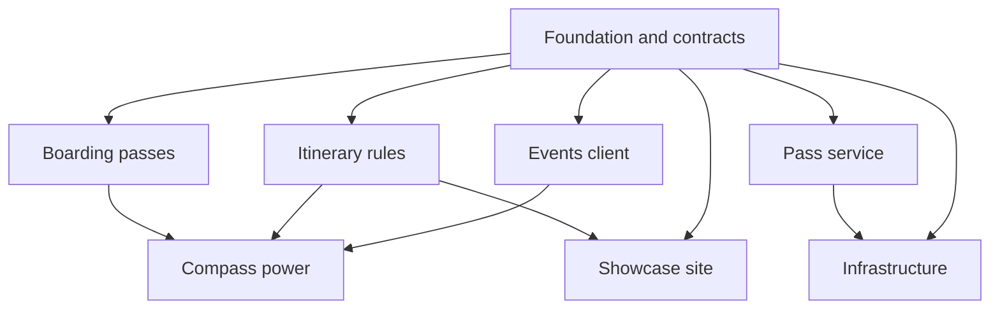

_For developers and architects: the eight Kiro specs that re:Invent Compass was built from, what each one owns and built, and how to read a spec._

re:Invent Compass was built from eight [Kiro specs](Glossary#kiro-spec), one per build stream. Each spec owns a fixed set of folders, and no other stream edits them. Together the specs are the record of what was built and why: every task is ticked when it is done, and every change of plan is written into the design. [How it was built](How-It-Was-Built) tells the story of the build; this page describes the specs themselves.

All eight live in [.kiro/specs](https://github.com/henniefrancis/aws-re_invent-compass/tree/develop/.kiro/specs).

## The three files of a Kiro spec

| File              | What it holds                                                                                                                                                                                                      |
| ----------------- | ------------------------------------------------------------------------------------------------------------------------------------------------------------------------------------------------------------------ |
| `requirements.md` | An introduction with the scope and the owned folders, a glossary of the names the spec uses, then numbered requirements. Each requirement has a user story and acceptance criteria in EARS form.                   |
| `design.md`       | How the stream is built: architecture, components and interfaces, data models, error handling, testing strategy, and correctness properties. Later sections record every change of plan, with its date and reason. |
| `tasks.md`        | An ordered checklist of tasks and sub-tasks. Tasks name the requirements they meet, and checkpoint tasks stop until the whole suite passes.                                                                        |

[Kiro](Glossary#kiro) writes the three files in that order, and a human reviews each one before any task runs.

### EARS requirements

EARS (Easy Approach to Requirements Syntax) is a small set of sentence patterns that make each acceptance criterion testable. The ones used here:

- **Event-driven:** "WHEN a trigger happens, THE system SHALL respond."
- **Unwanted behaviour:** "IF a bad condition holds, THEN THE system SHALL respond."
- **Always true:** "THE system SHALL ..."

A real example from the itinerary rules spec:

> WHEN computing Boarding_Closes, THE Rules_Engine SHALL interpret the session start time in the Event_Timezone supplied in Context.

Each design also lists correctness properties, rules that must hold for any input. Many are tested as property-based tests with `fast-check`, which generates many random inputs for each rule.

## Who wrote which spec

Kiro wrote five specs: foundation and contracts, events client, itinerary rules, boarding passes and infrastructure. The owner's Kiro credits ran out on 17 October 2026, and the other three (compass power, pass service and showcase site) were written by Claude's dev-team agents in Kiro's format, then reviewed by the CTO and security roles before any code. Every spec was built under the same steering and review gates. See [How it was built](How-It-Was-Built#the-honest-ai-story).

| Spec                     | Folder                 | Written by | About how many top-level tasks |
| ------------------------ | ---------------------- | ---------- | ------------------------------ |
| Foundation and contracts | `foundation-contracts` | Kiro       | 25                             |
| Events client            | `events-client`        | Kiro       | 21                             |
| Itinerary rules          | `itinerary-rules`      | Kiro       | 18                             |
| Compass power            | `compass-power`        | Claude     | 62                             |
| Boarding passes          | `boarding-passes`      | Kiro       | 13                             |
| Pass service             | `pass-service`         | Claude     | 57                             |
| Infrastructure           | `infra`                | Kiro       | 29                             |
| Showcase site            | `showcase-site`        | Claude     | 46                             |

The counts are top-level tasks on 2 November 2026, done and open. The specs grew after the first build: owner reviews, real-device checks, code scanning alerts and the final reviews each added tasks.

Arrows point from a spec to the specs that build on it. Until a spec was merged, the specs after it built against the shared contracts with mocks.

## Foundation and contracts

**Spec:** [.kiro/specs/foundation-contracts](https://github.com/henniefrancis/aws-re_invent-compass/tree/develop/.kiro/specs/foundation-contracts)

**Owns:** the root configuration and npm workspaces, [packages/contracts](https://github.com/henniefrancis/aws-re_invent-compass/tree/develop/packages/contracts), [contracts/](https://github.com/henniefrancis/aws-re_invent-compass/tree/develop/contracts), [.github/](https://github.com/henniefrancis/aws-re_invent-compass/tree/develop/.github), [fixtures/synthetic](https://github.com/henniefrancis/aws-re_invent-compass/tree/develop/fixtures/synthetic), [spikes/](https://github.com/henniefrancis/aws-re_invent-compass/tree/develop/spikes), [.kiro/hooks](https://github.com/henniefrancis/aws-re_invent-compass/tree/develop/.kiro/hooks), the steering files, and the copy of the API contract in [infra/modules/api/openapi.yaml](https://github.com/henniefrancis/aws-re_invent-compass/blob/develop/infra/modules/api/openapi.yaml).

**Built:** the ground every other stream stands on, locked in one day so six streams could start in parallel.

- The monorepo: npm workspaces, strict TypeScript, ESLint, Prettier and vitest with 100% coverage thresholds, with every planned dependency pinned up front.
- The official [Events API](Glossary#events-api) OpenAPI document, recorded with its source and SHA-256, and TypeScript types generated from it.
- The shared zod schemas: sessions, schedules, commitments, venues, guardrail verdicts, boarding pass fields, the error type and every MCP tool's input and output.
- The [Compass API](Glossary#compass-api) contract (OpenAPI 3.0.1), its two byte-identical copies and the script that checks their hashes.
- The [synthetic catalog](Glossary#synthetic-catalog): 120 made-up sessions in the real data shape.
- The CI workflows, the owner-run spike scripts and the repository's own save hook.

Later tasks added tool contracts as the product grew (the schedule view, the tech and GitHub tools, the two pass issuing tools) and refreshed the Events API document on 31 October. One task is open: this wiki.

## Events client

**Spec:** [.kiro/specs/events-client](https://github.com/henniefrancis/aws-re_invent-compass/tree/develop/.kiro/specs/events-client)

**Owns:** [packages/core/src/auth](https://github.com/henniefrancis/aws-re_invent-compass/tree/develop/packages/core/src/auth), [packages/core/src/api](https://github.com/henniefrancis/aws-re_invent-compass/tree/develop/packages/core/src/api), [packages/core/src/catalog](https://github.com/henniefrancis/aws-re_invent-compass/tree/develop/packages/core/src/catalog), [packages/core/src/simulated](https://github.com/henniefrancis/aws-re_invent-compass/tree/develop/packages/core/src/simulated) and [fixtures/api](https://github.com/henniefrancis/aws-re_invent-compass/tree/develop/fixtures/api).

**Built:** everything that talks to the Events API from the attendee's computer.

- Sign-in with an [AWS Builder ID](Glossary#aws-builder-id): OAuth 2.0 with [PKCE](Glossary#pkce) through a loopback page on the attendee's machine, tokens in the OS keychain (or in memory only when there is none), refresh and sign-out.
- A typed client for all 12 Events API operations, one file each, with every response validated, typed errors, one retry after a refresh or a rate limit, and never an automatic retry of a reservation.
- A client-side quota tracker per operation, and a confirmed-write helper that reads the schedule back after every write.
- The catalog: every page fetched, cached locally, normalised (event time zone, [repeats](Glossary#repeat), venue recovery from room text) and filtered locally.
- [Simulated mode](Glossary#simulated-mode): the same flows on the synthetic catalog with a fake attendee, including full sessions, clashes, rate limits and expired tokens.
- A security test proving no token, email or authorization header reaches a log or an error message.

## Itinerary rules

**Spec:** [.kiro/specs/itinerary-rules](https://github.com/henniefrancis/aws-re_invent-compass/tree/develop/.kiro/specs/itinerary-rules)

**Owns:** [packages/core/src/rules](https://github.com/henniefrancis/aws-re_invent-compass/tree/develop/packages/core/src/rules) and [data/venues.json](https://github.com/henniefrancis/aws-re_invent-compass/blob/develop/data/venues.json).

**Built:** the rules engine behind the [guardrail](Glossary#guardrail). It is pure (no I/O, no clock, no Node imports), so the MCP server, the Kiro hook and the showcase site demo all run the same code.

- [Boarding closes](Glossary#boarding-closes): session start minus 10 minutes for reservable session types.
- [Connections](Glossary#connection) between consecutive commitments, from the venue walking times plus a buffer: comfortable, tight, impossible or unknown.
- Clashes, including all-day items and anything crossing midnight in the event time zone.
- [Layovers](Glossary#layover) for meals and rest, and the daily [energy budget](Glossary#energy-budget).
- Rebooking options ([repeats](Glossary#repeat), [standby](Glossary#standby), [walk-ups](Glossary#walk-up)) and the [safe swap](Glossary#safe-swap): reserve the repeat first, confirm, then cancel.
- `checkReservation`, one function that returns allow, warn or block with plain-English reasons.
- The venue data: six venues and their walking times, each with a source note.

## Compass power (MCP server and Power)

**Spec:** [.kiro/specs/compass-power](https://github.com/henniefrancis/aws-re_invent-compass/tree/develop/.kiro/specs/compass-power)

**Owns:** [packages/mcp-server](https://github.com/henniefrancis/aws-re_invent-compass/tree/develop/packages/mcp-server), [packages/core/src/scanner](https://github.com/henniefrancis/aws-re_invent-compass/tree/develop/packages/core/src/scanner), [packages/core/src/spec](https://github.com/henniefrancis/aws-re_invent-compass/tree/develop/packages/core/src/spec), [packages/core/src/github](https://github.com/henniefrancis/aws-re_invent-compass/tree/develop/packages/core/src/github), [power/](https://github.com/henniefrancis/aws-re_invent-compass/tree/develop/power) and [fixtures/sample-repo](https://github.com/henniefrancis/aws-re_invent-compass/tree/develop/fixtures/sample-repo).

**Built:** everything the attendee touches on their computer. This is the largest spec.

- The repo scanner: a local, read-only scan for AWS services (Terraform, AWS CDK in TypeScript, AWS SDK for JavaScript v3, boto3, AWS SDK for .NET and package manifests) and other technology, reporting only names, depth and counts, never file contents.
- The week spec generator, which writes the attendee's week as their own Kiro spec.
- The local [MCP server](Glossary#mcp-server) with 24 tools, where every booking runs the guardrail inside the server and is confirmed by reading the schedule back.
- [Read-only mode](Glossary#read-only-mode) by default, an owner decision of 20 October.
- The read-only [GitHub App](Glossary#github-app) scan of the attendee's repositories, with consent.
- The CLI: the server, a ten-step terminal demo and the hook command.
- The [Kiro Power](Glossary#kiro-power): `plugin.json`, `mcp.json`, three skills and the hook template.
- A prompt-injection test: a session abstract that contains instructions never triggers a write.

See [Kiro Power](Kiro-Power), [MCP server](MCP-Server) and [MCP tools](MCP-Tools).

## Boarding passes

**Spec:** [.kiro/specs/boarding-passes](https://github.com/henniefrancis/aws-re_invent-compass/tree/develop/.kiro/specs/boarding-passes)

**Owns:** [packages/core/src/passes](https://github.com/henniefrancis/aws-re_invent-compass/tree/develop/packages/core/src/passes).

**Built:** the local pass side, which runs on the attendee's computer.

- The pass builder: [boarding pass](Glossary#boarding-pass) fields from a confirmed session and the schedule, validated against the shared schema, with long titles and rooms shortened rather than dropped.
- The Compass API client: issue, update, void, [hand-off](Glossary#hand-off) and forget me, using the attendee's ID token.
- A local record of issued passes, and sync: compare the schedule with the issued passes and issue, update or [void](Glossary#void). Running it twice changes nothing.
- The hand-off QR code, for the terminal, for chat and as SVG for a browser page.
- The calendar file, with two alarms per reserved session (leave now, and boarding closes), and an offline itinerary page writer (no MCP tool in 0.1.2 calls it).

## Pass service

**Spec:** [.kiro/specs/pass-service](https://github.com/henniefrancis/aws-re_invent-compass/tree/develop/.kiro/specs/pass-service)

**Owns:** [packages/pass-service](https://github.com/henniefrancis/aws-re_invent-compass/tree/develop/packages/pass-service).

**Built:** the two [Lambda](Glossary#lambda) functions behind the Compass API: one for the attendee routes and one for Apple's [PassKit](Glossary#passkit) web service.

- ID token verification for every attendee route, ownership checks and rate limits per attendee.
- Apple Wallet passes signed from a fixed template, with no barcode and the line "Unofficial. Your badge is your ticket."
- Updates and voids pushed to every registered iPhone over [APNs](Glossary#apns), and Google Wallet objects patched to match.
- Google Wallet passes and save links.
- The 15-minute hand-off, the calendar download and forget me.
- [DynamoDB](Glossary#dynamodb) access with an expiry checked on every read, and logs that carry no identifiers.

Many later tasks came from the owner's reviews of the pass on real phones: six rounds of Apple pass design, the Google layout, buttons for each session, one wallet group for the week and change alerts on the phone. One task is still open: the prod Google key, the prod Google class and the Apple certificate check.

See [Pass service](Pass-Service) and [Pass API](Pass-API).

## Infrastructure

**Spec:** [.kiro/specs/infra](https://github.com/henniefrancis/aws-re_invent-compass/tree/develop/.kiro/specs/infra)

**Owns:** [infra/](https://github.com/henniefrancis/aws-re_invent-compass/tree/develop/infra) (except the contract copy), [scripts/](https://github.com/henniefrancis/aws-re_invent-compass/tree/develop/scripts) and the operations runbooks, now in the [Operations](Operations) pages of this wiki.

**Built:** all of the AWS side in [Terraform](Glossary#terraform), run through [HCP Terraform](Glossary#hcp-terraform) with no AWS keys anywhere.

- The bootstrap: the [OIDC](Glossary#oidc) trust for HCP Terraform, separate plan and apply roles, the budget and the domain.
- Six modules: site, edge ([CloudFront](Glossary#cloudfront) and [WAF](Glossary#waf)), api ([API Gateway](Glossary#api-gateway) and both Lambdas), data, secrets and observability.
- The dev and prod environments.
- Retained resources that a release can never destroy, native Terraform tests with mock providers, tflint and Trivy.
- The owner-run scripts: bootstrap, release, secret loading and the Google Wallet class set-up.

Later tasks came from the first dev deploy on 18 October and the first prod apply on 31 October.

See [AWS architecture](AWS-Architecture) and [Release](Release).

## Showcase site

**Spec:** [.kiro/specs/showcase-site](https://github.com/henniefrancis/aws-re_invent-compass/tree/develop/.kiro/specs/showcase-site)

**Owns:** [site/](https://github.com/henniefrancis/aws-re_invent-compass/tree/develop/site).

**Built:** the public website at https://reinvent-compass.vegas, a static Angular 22 site with no sign-in, cookies, analytics or third-party requests.

- The story, the install page, the privacy page, documentation and the legal pages.
- The click-through demo, which runs the real rules engine in the browser on a snapshot of 17 real catalog sessions (since 30 October; made-up sessions before that): build a small week, try to book a clash and watch it blocked, take the safe swap, see a sample pass and download a sample calendar file.
- The `/board` page that a phone opens from the hand-off QR code, with Apple Wallet, Google Wallet and calendar buttons, and "Walk from here", the walking time to the next session.
- Built to WCAG 2.2 AA, with Playwright tests on seven device profiles.

See [Showcase site](Showcase-Site).

## Related pages

- [How it was built](How-It-Was-Built)
- [Steering and hooks](Steering-and-Hooks)
- [Repository layout](Repository-Layout)
- [Contracts](Contracts)
- [Architecture overview](Architecture-Overview)
