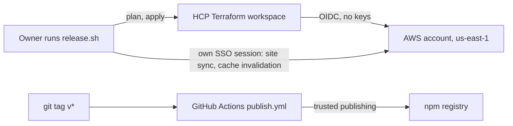

_For operators: how the Compass backend is run, who does what, and which runbook to open when._

The [Compass API](Glossary#compass-api) and the showcase site run in one AWS account, in two environments, all defined in [Terraform](Glossary#terraform) under [infra/](https://github.com/henniefrancis/aws-re_invent-compass/tree/develop/infra). This page is the operator's overview; the six step-by-step procedures are in the [Runbooks](Runbooks) section. Every command on these pages is taken from the scripts and Terraform in the repository.

## Environments

| Environment | Address                                                          | Purpose                                                                                               |
| ----------- | ---------------------------------------------------------------- | ----------------------------------------------------------------------------------------------------- |
| `dev`       | [dev.reinvent-compass.vegas](https://dev.reinvent-compass.vegas) | Rehearsal. Every release goes to dev first.                                                           |
| `prod`      | [reinvent-compass.vegas](https://reinvent-compass.vegas)         | Live since 31 October 2026: the showcase site, the board page and the API that the npm package calls. |

Both environments are built from the same composition of six modules (secrets, data, api, site, edge, observability). The two roots, [infra/envs/dev](https://github.com/henniefrancis/aws-re_invent-compass/tree/develop/infra/envs/dev) and [infra/envs/prod](https://github.com/henniefrancis/aws-re_invent-compass/tree/develop/infra/envs/prod), differ only in the default value of `env`. Everything runs in `us-east-1`, and resource names start with `compass-<env>`.

Each environment holds:

- one [CloudFront](Glossary#cloudfront) distribution in front of the site (`/`) and the API (`/api/*`), with a [WAF](Glossary#waf) web ACL;
- one [API Gateway](Glossary#api-gateway) REST API with the stage `live`;
- two [Lambda](Glossary#lambda) functions, `compass-<env>-api` and `compass-<env>-passkit` (Node.js 24, arm64, 512 MB);
- one [DynamoDB](Glossary#dynamodb) table, `compass-<env>` by default, on demand, with [TTL](Glossary#ttl);
- four Secrets Manager secrets under `compass/<env>/` (see [Secrets](Secrets));
- a private, versioned S3 bucket for the site;
- three log groups with 14 days of retention, five CloudWatch alarms, and an SNS alarm topic encrypted with its own KMS key (see [Alarms](Alarms)).

The account-level parts live in [infra/bootstrap](https://github.com/henniefrancis/aws-re_invent-compass/tree/develop/infra/bootstrap) and are applied once: the OIDC trust for HCP Terraform, a plan role and an apply role per environment, the permission boundaries, the API Gateway logging role, the account budget, the domain registration and the two HCP workspaces.

## Who runs what

The owner runs every deploy. No CI job and no coding agent deploys, applies, loads a secret, tags or publishes: each script in [scripts/](https://github.com/henniefrancis/aws-re_invent-compass/tree/develop/scripts) is marked owner-run only.

| Task                                      | Who                          | How                                                                                                                                                |
| ----------------------------------------- | ---------------------------- | -------------------------------------------------------------------------------------------------------------------------------------------------- |
| Set up the account (once)                 | Owner                        | [scripts/bootstrap.sh](https://github.com/henniefrancis/aws-re_invent-compass/blob/develop/scripts/bootstrap.sh), with the owner's own credentials |
| Deploy dev, then prod                     | Owner                        | [scripts/release.sh](https://github.com/henniefrancis/aws-re_invent-compass/blob/develop/scripts/release.sh) (see [Release](Release))              |
| Plan and apply                            | HCP Terraform, remote runs   | Dynamic credentials, started by `release.sh`                                                                                                       |
| Load, rotate and check secrets            | Owner                        | `load-secrets.sh`, `set-workspace-secrets.sh`, `check-secrets.sh` (see [Secrets](Secrets))                                                         |
| Create the Google Wallet class            | Owner                        | `scripts/google-wallet-class.mjs` (see [Secrets](Secrets#google-wallet-class))                                                                     |
| Checks on every change                    | GitHub Actions `check.yml`   | Pull requests into `main` and pushes to `develop`                                                                                                  |
| Browser tests                             | GitHub Actions `e2e.yml`     | Started by hand from the Actions tab                                                                                                               |
| Publish the npm package                   | GitHub Actions `publish.yml` | A `v*` tag the owner pushes, then the owner's approval (see [Release](Release#the-npm-package))                                                    |
| React to an alarm or a budget alert       | Owner                        | Email from SNS and AWS Budgets (see [Alarms](Alarms))                                                                                              |
| Stop all traffic, roll forward, tear down | Owner                        | [Kill switch](Kill-Switch), [Rollback](Rollback), [Teardown](Teardown)                                                                             |

## HCP Terraform and dynamic credentials

Terraform state and runs live in [HCP Terraform](Glossary#hcp-terraform). No AWS access key exists anywhere in the project.

- **One workspace per environment.** The bootstrap creates both with the `tfe` provider ([workspaces.tf](https://github.com/henniefrancis/aws-re_invent-compass/blob/develop/infra/bootstrap/workspaces.tf)): CLI-driven with no VCS connection, auto-apply off, speculative plans off, no global remote state, working directory `envs/<env>`, Terraform `~> 1.15.0`.
- **Dynamic credentials.** Each run gets a short-lived [OIDC](Glossary#oidc) token from HCP Terraform, and AWS trusts the `app.terraform.io` provider for the audience `aws.workload.identity`. The role trust names the exact workspace and the run phase, so a plan run can assume only the plan role and an apply run only the apply role. The workspace variables `TFC_AWS_PROVIDER_AUTH`, `TFC_AWS_PLAN_ROLE_ARN` and `TFC_AWS_APPLY_ROLE_ARN` wire this up; the bootstrap sets them.
- **Bounded roles.** Both roles sit under a permission boundary that allows only the services the project uses and denies `secretsmanager:GetSecretValue`. Terraform creates the secret containers but can never read a secret value.
- **Your own session for the rest.** The site sync and the CloudFront invalidation in `release.sh` run on your machine under your own AWS SSO session.
- **Backend settings stay local.** Each root reads a git-ignored `infra/envs/<env>/cloud.auto.tfbackend`, copied from the committed [example](https://github.com/henniefrancis/aws-re_invent-compass/blob/develop/infra/envs/prod/cloud.auto.tfbackend.example), with three lines: `TF_CLOUD_ORGANIZATION=<organisation>`, `TF_CLOUD_PROJECT=<project>` and `TF_WORKSPACE=<workspace>`.
- **What is uploaded.** The CLI runs in `infra/envs/<env>` and uploads `infra/`, so the modules travel with it. [infra/.terraformignore](https://github.com/henniefrancis/aws-re_invent-compass/blob/develop/infra/.terraformignore) keeps real tfvars, backend files, `.env*`, `*.pem`, `*.p12`, state and plan files out of the upload. `infra/build/` is uploaded on purpose: the remote run needs the Lambda zips.

## Setting up the account once

1. Create the bootstrap workspace by hand in HCP Terraform and set it to Local execution. It is the one thing that must exist before Terraform can manage anything.
2. Copy [infra/bootstrap/terraform.tfvars.example](https://github.com/henniefrancis/aws-re_invent-compass/blob/develop/infra/bootstrap/terraform.tfvars.example) to `terraform.tfvars` (git-ignored) and fill it in.
3. Export `TFE_TOKEN`, `TF_CLOUD_ORGANIZATION` and `TF_WORKSPACE`, then run `scripts/bootstrap.sh` in CloudShell or a shell with your own credentials. Read the plan before you confirm.
4. Run it a second time. Terraform must report no changes.

AWS allows one `app.terraform.io` OIDC provider per account. If another configuration already manages it, set `create_oidc_provider = false` and the bootstrap reads it and checks that it lists the `aws.workload.identity` audience. With `register_domain = true` the bootstrap buys and renews the domain through Route 53 Domains; the registration is protected against destroy like the [retained resources](Rollback#retained-resources).

## Runbooks

The step-by-step procedures (release, alarms, kill switch, rollback, secrets and teardown) are on the [Runbooks](Runbooks) page, with when to open each one.

## Ground rules

- Every change goes through Terraform and `release.sh`. Nothing is created, changed or deleted in the AWS console.
- Never print, paste, log or commit a secret value. The scripts never echo one.
- A rollback is always a roll forward. Never run `terraform destroy` or `terraform state rm` against an environment, apart from the dev teardown.
- Deploy dev first and prod second.

The release work is tracked on the project board under the [Release workstream](https://github.com/users/henniefrancis/projects/3/views/1?filterQuery=workstream%3A%22Release%22).

## Related pages

- [AWS architecture](AWS-Architecture)
- [Security](Security)
- [Pass service](Pass-Service)
- [Infrastructure decisions](Decisions-Infrastructure)
- [Runbooks](Runbooks)
- [Release](Release)
