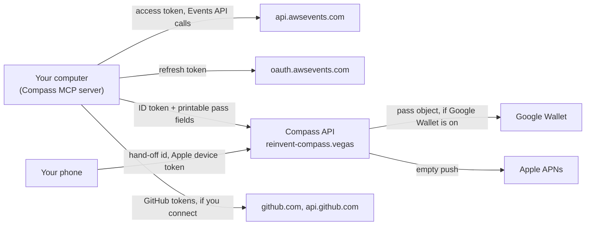

_For attendees: what Compass keeps on your computer, what leaves it and where it goes, how long the server keeps it, and how to erase it._

Compass is local first. It keeps your data on your computer and sends as little as it can. This page is the attendee view; the full data inventory for architects is on [Data and privacy](Data-and-Privacy).

## Who is responsible

In the project owner's words (from the [README](https://github.com/henniefrancis/aws-re_invent-compass/blob/develop/README.md#privacy)):

> The responsible party under South Africa's Protection of Personal Information Act (POPIA) is the project owner, Hennie Francis, acting personally. No human reads server data in normal operation.

The Compass server runs in the AWS us-east-1 Region (N. Virginia, United States), outside South Africa, in the owner's AWS account.

Apple processes data (the push token) when you add a pass to Apple Wallet. Google holds the pass object from the moment the pass is issued, so that the Add to Google Wallet link works. Google acts as a processor.

## What stays on your machine

Compass keeps its files in a `reinvent-compass` folder under your app-data folder: `%APPDATA%` on Windows, `~/Library/Application Support` on macOS, and `$XDG_DATA_HOME` or `~/.local/share` on Linux. On macOS and Linux the folder is readable only by you (folders mode 0700, personal files mode 0600).

| What                                    | Where                                           | Removed by                                                     |
| --------------------------------------- | ----------------------------------------------- | -------------------------------------------------------------- |
| Your access, refresh and ID tokens      | OS keychain (or memory only)                    | `sign_out`                                                     |
| Your GitHub tokens, if you connect      | OS keychain (or memory only)                    | `disconnect_github` or `forget_me`                             |
| The session catalog cache (public data) | App-data folder                                 | You                                                            |
| Your schedule snapshot                  | App-data folder                                 | Replaced on every schedule read; deleted by `forget_me`        |
| The record of passes you issued         | App-data folder                                 | `forget_me`                                                    |
| Your [tech list](Glossary#tech-list)    | App-data folder                                 | `forget_me`                                                    |
| Generated files (`reinvent.ics`)        | `output` folder in the app-data folder          | `forget_me`                                                    |
| The result of a code scan               | Memory only                                     | When the server stops, or `forget_me`                          |
| The QR page for your phone              | A private folder in your temp folder            | At the link's expiry, a newer page, `forget_me` or server stop |
| Your week spec                          | Your workspace, `.kiro/specs/my-reinvent-week/` | You                                                            |

Notes:

- **The schedule snapshot** is the last schedule Compass read from the Events API. It is overwritten on every read and deleted by `forget_me`; there is no time-based purge.
- **The code scan** runs in memory. Only service and technology names, a depth per service and counts leave the scanner: never a file name, path or content. What it learns is saved as your tech list in the app-data folder, with no file paths. The week spec gets service names and depth only.
- **The tech list** stores each project under a one-way hash, so no folder path or repository name is kept. It is never sent anywhere.
- **The week spec** would show where you will be and when if your repository is public, so Compass offers to add it to `.gitignore` (see [Plan](User-Guide-Plan#the-week-spec)).
- **Logs.** The MCP server logs to stderr only, through a redacting logger. Nothing logged holds a token, an email address, a link or a file path.

## What leaves your machine, and where it goes

| What                  | Goes to                                                                          | Why                                                                                                                                                                                                |
| --------------------- | -------------------------------------------------------------------------------- | -------------------------------------------------------------------------------------------------------------------------------------------------------------------------------------------------- |
| Access token          | `api.awsevents.com` only                                                         | To read the catalog and your schedule (and write, if you turn writes on)                                                                                                                           |
| Refresh token         | The AWS Events token endpoint only                                               | To renew your sign-in                                                                                                                                                                              |
| ID token              | The [Compass API](Glossary#compass-api) only                                     | To prove you signed in. It is checked and never stored. The server keeps only a keyed one-way hash of your Builder ID subject.                                                                     |
| Printable pass fields | The Compass API                                                                  | To build your passes: session code, title, venue, room, start and end, the walk from the previous commitment and the next session                                                                  |
| Pass object           | Google Wallet, when the Compass API issues a pass with Google Wallet switched on | So you can save it to Google Wallet. Google keeps its own copy, set to `INACTIVE` after a void. It has no name in it: Compass does not send your name, and never takes it from your sign-in token. |
| Pass file             | Your phone, from the Compass API                                                 | When you tap Add to Apple Wallet. Your phone then registers its push token with the Compass API so the pass can be updated.                                                                        |
| GitHub tokens         | `github.com` and `api.github.com` only                                           | To list and read your repositories. Archives come from `codeload.github.com` without the token and are read in memory.                                                                             |

Nothing about your code or your repositories goes to Compass or to AWS. Catalog text is shown to your assistant as labelled data, and session abstracts are never passed on.

## How long the server keeps it

The Compass API stores records in one DynamoDB table ([packages/pass-service/src/data](https://github.com/henniefrancis/aws-re_invent-compass/tree/develop/packages/pass-service/src/data)). Expiry is checked in code on every read; the database's own [TTL](Glossary#ttl) clean-up only removes items later.

| Record               | Kept for                                                                                                                                                                                                               |
| -------------------- | ---------------------------------------------------------------------------------------------------------------------------------------------------------------------------------------------------------------------- |
| Pass records         | Until the session ends plus 24 hours                                                                                                                                                                                   |
| Device registrations | Until your device unregisters the pass, Apple says the push token is invalid, or the pass record expires. The device id is stored only as a keyed hash; the push token is kept as it is, because it is needed to push. |
| Hand-offs            | 15 minutes. Only a SHA-256 hash of the hand-off id is stored.                                                                                                                                                          |
| Rate-limit counters  | Their one-hour window plus 2 minutes. They are keyed by the hashed id, and `forget_me` does not delete them, so erasing cannot reset a limit.                                                                          |
| Logs                 | 14 days. They hold the request id, route template, method, status, latency and outcome only: never a token, email, path value, header or body.                                                                         |

There are no other copies:

- **No backups of erased data.** Point-in-time recovery is switched off on the table on purpose ([infra/modules/data/main.tf](https://github.com/henniefrancis/aws-re_invent-compass/blob/develop/infra/modules/data/main.tf)), so `forget_me` is a real erasure. The data is short-lived and you can always issue passes again.
- **No edge logs.** The CloudFront distribution has no access logging, and the WAF has no logging and no request sampling ([infra/modules/edge/main.tf](https://github.com/henniefrancis/aws-re_invent-compass/blob/develop/infra/modules/edge/main.tf)).
- **No request detail in API logs.** The API Gateway access log records the route template, never the full path or a source address ([infra/modules/api/locals.tf](https://github.com/henniefrancis/aws-re_invent-compass/blob/develop/infra/modules/api/locals.tf)), and X-Ray tracing is off.

## Forget me

`forget_me` erases what Compass holds about you ([packages/mcp-server/src/tools/forget-me.ts](https://github.com/henniefrancis/aws-re_invent-compass/blob/develop/packages/mcp-server/src/tools/forget-me.ts)). It takes `confirm: true`, and where your client can ask, it asks: "Delete everything Compass holds about you? This voids your Boarding Passes and removes your local Compass data."

**On the server** (`DELETE /api/v1/me`): it deletes your pass records, device registrations and hand-offs, then voids your passes (an empty push to Apple devices, `INACTIVE` for Google).

**On your computer**, only after the server accepted: it deletes the record of issued passes, the generated files, your schedule snapshot, your tech list, your GitHub sign-in and any QR page, and clears the scan result held in memory.

What it does not touch:

- **Passes already on your phone.** No wallet lets anyone delete a pass remotely. They are voided and will expire, but they stay until you remove them yourself.
- **Your Builder ID sign-in.** Use `sign_out`.
- **The public catalog cache, and your week spec** in your workspace. Delete them yourself if you want.

If the server step fails, nothing on your computer is touched and the reply says so.

## The website

The showcase site at [reinvent-compass.vegas](https://reinvent-compass.vegas) has no sign-in, no cookies, no browser storage and no analytics. Its Content Security Policy allows network calls only to its own origin. Its only network call is the hand-off read on `/board`.

- **The demo** runs in your browser on a snapshot of 17 public sessions (code, title, times, venue and room only). It never connects to the Events API.
- **The board page** keeps your hand-off link in the page's memory only. It removes the link from the address bar as soon as it has read it, and never stores, logs or shares it. The link's secret is in the part after `#`, which a browser never sends to a server.

## Walk from here

On the board page, **Walk from here** asks your phone for its location only when you tap it, once. The walking time is worked out on your phone ([site/src/lib/board/walk-estimate.ts](https://github.com/henniefrancis/aws-re_invent-compass/blob/develop/site/src/lib/board/walk-estimate.ts)). Compass does not send your location anywhere, save it or log it. Your phone may use its own location service to find it. The **Directions** link opens Apple Maps or Google Maps, and that app gets your location only when you open the link.

## Your rights

- `forget_me` is how you erase the data Compass keeps on the server.
- To ask about your data, use private vulnerability reporting on the [GitHub repository](https://github.com/henniefrancis/aws-re_invent-compass) (the Security tab, then Report a vulnerability). See [SECURITY.md](https://github.com/henniefrancis/aws-re_invent-compass/blob/develop/SECURITY.md).
- You may also complain to the Information Regulator (South Africa).

The site's own privacy text is in [site/src/lib/content/privacy.ts](https://github.com/henniefrancis/aws-re_invent-compass/blob/develop/site/src/lib/content/privacy.ts).

## Related pages

- [Data and privacy](Data-and-Privacy)
- [Security](Security)
- [Read-only by default](Read-Only-By-Default)
- [Board: passes on your phone](User-Guide-Board)
- [FAQ](FAQ)
