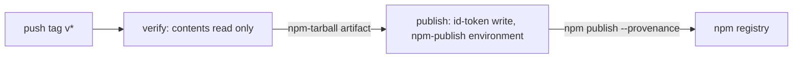

_For operators: how to deploy an environment with the release script, set up a new environment, ship a new version and publish the npm package._

Every deploy is run by the owner with one script, [scripts/release.sh](https://github.com/henniefrancis/aws-re_invent-compass/blob/develop/scripts/release.sh). It builds everything, saves a [Terraform](Glossary#terraform) plan in [HCP Terraform](Glossary#hcp-terraform), refuses dangerous plans, asks for a typed word, applies, syncs the site, clears the [CloudFront](Glossary#cloudfront) cache and checks the health route. The npm package is published separately, by a GitHub Actions workflow started by a version tag. See [Operations](Operations) for the environments and who runs what.

## The command

```
scripts/release.sh dev
scripts/release.sh prod
```

Deploy `dev` first and `prod` second. The script takes exactly one argument; anything other than `dev` or `prod` prints the usage and exits with status 2 before any Terraform runs.

The typed confirmation differs per environment: dev asks you to type `yes`, prod asks you to type `prod`. A `yes` meant for dev can therefore never apply production.

## What the script does

1. **Reads the backend settings.** It reads `infra/envs/<env>/cloud.auto.tfbackend` as `KEY=VALUE` lines (it never sources the file) and exports `TF_CLOUD_ORGANIZATION`, `TF_CLOUD_PROJECT` and `TF_WORKSPACE`. A missing key stops the script and is named.
2. **Checks the tools and your AWS session.** `terraform`, `jq`, `npm`, `aws` and `curl` must be installed, and `aws sts get-caller-identity` must succeed. Otherwise it stops with `no AWS session; run aws sso login first`.
3. **Builds.** It builds the TypeScript workspace (`npx tsc -b`), the two Lambda bundles (`npm run build:lambda --workspace @compass/pass-service`, copied to `infra/build/api-lambda.zip` and `infra/build/passkit-lambda.zip`) and the site (`npm run build --workspace site`). It then copies the three Google Wallet images (`logo-v1.png`, `wide-logo-v1.png`, `hero-v1.png`) from [packages/pass-service/artwork/google](https://github.com/henniefrancis/aws-re_invent-compass/tree/develop/packages/pass-service/artwork/google) into the built site under `wallet/`, because Google fetches them from `<public base URL>/wallet/`.
4. **Checks it can reach the right account.** After `terraform init` it reads the `site_bucket_name` output of the last apply and runs `aws s3api head-bucket` on it. A session in another account stops here, before anything is planned, with a message that names `AWS_PROFILE`. A first deploy has no bucket yet and skips this.
5. **Plans.** It runs `terraform plan -out=tfplan` with `service_version` set from `git describe --tags --always --dirty`. The plan JSON is held in memory and piped through `jq`; it is never written to disk. The saved plan file `tfplan` is git-ignored, excluded from the HCP upload, and deleted when the script ends, whatever the outcome.
6. **Refuses dangerous plans.** It exits non-zero and prints the addresses or types (never values) if the plan would delete or replace a resource of a retained type (`aws_cloudfront_distribution`, `aws_dynamodb_table`, `aws_secretsmanager_secret`, `aws_s3_bucket`), or touches any resource type outside its allow list of 32 types.
7. **Asks for the typed word.** It prints `plan for <env>: N to add or replace, N to change, N to destroy`, then `Type yes to apply this plan to dev:` or `Type prod to apply this plan to prod:`. Anything else prints `aborted: nothing was applied`.
8. **Applies, syncs and invalidates.** It applies the saved plan. An empty plan skips the apply (HCP Terraform refuses to apply a saved plan with no changes) but still syncs, invalidates and checks health. It then syncs the site to the site bucket with `aws s3 sync --delete`, uploads `.webp` files again with their content type stated, and creates a CloudFront invalidation for `/*`.
9. **Checks health.** It calls `GET https://<cloudfront domain>/api/v1/health` up to six times, ten seconds apart. Only HTTP 200 counts.

The health check goes to the CloudFront default domain of the environment, not the custom domain. Because every request passes the origin guard first, a 200 proves the whole path: CloudFront, the API key that CloudFront adds, API Gateway, the Lambda, and the origin-verify secret. The route answers `{"status":"ok","version":"<service version>"}`.

You can override the build steps with `COMPASS_WORKSPACE_BUILD_CMD`, `COMPASS_LAMBDA_BUILD_CMD` and `COMPASS_SITE_BUILD_CMD`, and the site output folder with `COMPASS_SITE_DIR`.

## Expected outcome

The script ends with `health check passed (HTTP 200)` and exit status 0. Run it again with no commit in between and the plan shows no changes. After a new commit the api Lambda shows one in-place update, because `service_version` comes from `git describe`.

## Preconditions

1. The bootstrap has been applied and a second apply shows no changes (see [Operations](Operations#setting-up-the-account-once)).
2. `infra/envs/<env>/cloud.auto.tfbackend` exists, copied from the `.example` next to it, with your organisation, project and workspace names. It is git-ignored.
3. You are signed in with your own SSO session (`aws sso login`) in the Compass account. If your default identity belongs to another account, prefix the command: `AWS_PROFILE=<profile> scripts/release.sh dev`.
4. `terraform`, `jq`, `npm`, `aws` and `curl` are installed and `npm ci` has run.
5. The provider lock files of the three roots (`infra/bootstrap`, `infra/envs/dev`, `infra/envs/prod`) are committed. To regenerate one, run `terraform providers lock -platform=linux_amd64 -platform=windows_amd64 -platform=darwin_arm64` in that root and commit it. A lock made by a plain `terraform init` on one machine can fail on the HCP runners.
6. The workspace variables are set. The bootstrap writes the non-sensitive ones from `workspace_variables` in its tfvars: `event_timezone`, `event_window_start`, `event_window_end`, `id_token_issuer` and `domain_name`, plus any optional ones you add. The three sensitive ones (`alarm_email`, `origin_verify_value`, `api_key_value`) are written by `set-workspace-secrets.sh` (see [Secrets](Secrets)).

Reserved concurrency is a deliberate cap: 20 for the api Lambda and 10 for the passkit Lambda. A new AWS account can have a Lambda concurrency quota too low to reserve any. If the first apply fails on reserved concurrency, request a quota increase in Service Quotas and keep the defaults. Do not set `api_reserved_concurrency` or `passkit_reserved_concurrency` to `-1`: that removes the cap.

## First-time setup of an environment

Run these once per environment, in this order.

1. **Domain.** The hosted zone for `reinvent-compass.vegas` exists (the bootstrap registers the domain, or reads an existing zone). Set `domain_name` per environment: `dev.reinvent-compass.vegas` for dev, `reinvent-compass.vegas` for prod. `hosted_zone_name` keeps its default. The ACM certificate validates itself through DNS records the first apply creates, usually within a few minutes.
2. **Edge values.** Generate the origin-verify value and the API key, and set the sensitive HCP variables from them ([Secrets](Secrets#first-load-of-an-environment), steps 1 and 2).
3. **First release.** Run `scripts/release.sh <env>`. It creates the infrastructure with empty secret containers. The health check fails and the script exits non-zero: by design the API refuses every request until the origin-verify secret is loaded. That is not a failed deploy.
4. **Secrets.** Load `origin-verify`, `app`, `apple` and `google`, then run `scripts/check-secrets.sh <env>`. All seven values must report present.
5. **Google Wallet class.** Create it with `scripts/google-wallet-class.mjs` ([Secrets](Secrets#google-wallet-class)).
6. **Second release.** Run `scripts/release.sh <env>` again. The health check must pass, and the plan must show no changes apart from the api Lambda update a new commit causes.
7. **Alarm email.** Click the confirmation link AWS emails to the alarm address. Until then the alarms notify nobody.

With `domain_name` set, the Lambdas know their public address (`https://<domain_name>`) from the first apply. Without it, set the variable `public_base_url` to `https://` plus the `cloudfront_domain_name` output and release once more: the distribution depends on the Lambdas, so they cannot learn its address any earlier.

## Shipping a new version

The release is cut from `main`. There is no release branch.

1. Open a pull request from `develop` into `main`, wait for the checks to go green, and merge it.
2. Check out `main` in a clean working tree (`git switch main`, `git pull`, `git status` shows nothing) and run `npm ci`.
3. Rehearse on dev: `scripts/release.sh dev`. It must end with `health check passed (HTTP 200)`.
4. Release prod: `scripts/release.sh prod`, and type `prod`.
5. Check the custom domain yourself, since the script checks the CloudFront domain: `curl https://reinvent-compass.vegas/api/v1/health` must return HTTP 200.
6. Smoke test on a real iPhone and a real Android phone: open the board page, issue a pass and add it to the [wallet](Glossary#wallet).
7. Run the `e2e` workflow ([.github/workflows/e2e.yml](https://github.com/henniefrancis/aws-re_invent-compass/blob/develop/.github/workflows/e2e.yml)) by hand on the `main` commit. It runs Playwright with axe on seven device profiles and must be green.
8. If the npm package changed, publish it ([below](#the-npm-package)).
9. Merge `main` back into `develop` so the branches match.
10. Watch the five [alarms](Alarms) and the health route for 30 to 60 minutes. If something breaks, [roll forward](Rollback) or use the [kill switch](Kill-Switch).

## The npm package

The [MCP server](Glossary#mcp-server) is published to npm as `reinvent-compass` from [packages/mcp-server](https://github.com/henniefrancis/aws-re_invent-compass/tree/develop/packages/mcp-server). The workflow is [.github/workflows/publish.yml](https://github.com/henniefrancis/aws-re_invent-compass/blob/develop/.github/workflows/publish.yml). It runs only on a pushed tag that matches `v*`, never on a branch push, a pull request or a schedule. It publishes through npm trusted publishing with provenance, so no npm token is stored anywhere. Every action in it is pinned by commit SHA.

### One-time setup

1. **Claim the name.** A trusted publisher can only be added to a package that already exists, so a placeholder `0.0.1` was published once by hand. That version is spent: npm never lets a version be reused, so a real release is `0.1.0` or later.
2. **Add the trusted publisher** on npmjs.com (package settings, Trusted Publisher, GitHub Actions): the repository owner and name, the workflow file `publish.yml`, the environment `npm-publish`, and only the "npm publish" action. The CLI equivalent is:

   ```
   npm trust github reinvent-compass --file publish.yml --repo henniefrancis/aws-re_invent-compass --env npm-publish --allow-publish
   npm trust list reinvent-compass
   ```

3. **Revoke** any npm token used for the manual publish.

### Prepare a release

Do these in one commit:

1. Set the same version in [packages/mcp-server/package.json](https://github.com/henniefrancis/aws-re_invent-compass/blob/develop/packages/mcp-server/package.json), [power/plugin.json](https://github.com/henniefrancis/aws-re_invent-compass/blob/develop/power/plugin.json), [power/mcp.json](https://github.com/henniefrancis/aws-re_invent-compass/blob/develop/power/mcp.json), [power/POWER.md](https://github.com/henniefrancis/aws-re_invent-compass/blob/develop/power/POWER.md), the [hook template](https://github.com/henniefrancis/aws-re_invent-compass/blob/develop/power/hook-templates/reinvent-compass.json) and every `npx --yes reinvent-compass@X.Y.Z` example in the package README and under `power/`. The tests in [packages/mcp-server/test/power](https://github.com/henniefrancis/aws-re_invent-compass/tree/develop/packages/mcp-server/test/power) fail if any one differs.
2. Check that `COMPASS_API_BASE_URL` in [compass-api.ts](https://github.com/henniefrancis/aws-re_invent-compass/blob/develop/packages/mcp-server/src/config/compass-api.ts) is the prod domain, `https://reinvent-compass.vegas`, with no trailing slash. A published version cannot be changed, so a wrong address there makes the version useless.
3. Run `npx tsc -b`, `npm run lint`, `npm run format:check` and `npm test`.
4. Check the file list once by hand: `npm pack --dry-run --workspace packages/mcp-server`. It may hold only the entries of the `files` list in the package.json (the three bundles in `dist/`, the `dist/data`, `dist/sample-repo` and `dist/fixtures` folders, `README.md`, `LICENSE`, `NOTICE`, `THIRD-PARTY-NOTICES.txt`) and `package.json`.

### Tag order

1. Deploy prod first, so `https://reinvent-compass.vegas` answers `GET /api/v1/health`.
2. Merge the release commit to `main`.
3. Check the trusted publisher (`npm trust list reinvent-compass`, or the package settings page). If it is missing or has expired, delete it and add it again.
4. Create the tag `vX.Y.Z` on that commit, where `X.Y.Z` is the package version, and push it.
5. Approve the publish job when it waits in the `npm-publish` environment.

### What the workflow does



It has two jobs, so the job that holds the OIDC token runs none of the repository's code.

1. **`verify`** has `contents: read` only: no `id-token` and no environment. It runs `npm ci`, `npx tsc -b`, `npm run lint` and `npm test`; checks that the tag equals `v` plus the package version; builds the workspace and the package; checks the packed file list with [check-pack.mjs](https://github.com/henniefrancis/aws-re_invent-compass/blob/develop/packages/mcp-server/scripts/check-pack.mjs) (any missing or unexpected file stops the run); packs the tarball with `npm pack`; and uploads it as the `npm-tarball` artifact, kept for seven days.
2. **`publish`** needs `verify` and runs only when the ref starts with `refs/tags/v`. It holds `id-token: write` and the `npm-publish` environment, so it waits for approval. It does no checkout, no `npm ci` and runs no package script. It sets up Node 24 with the npm registry, fails if npm is older than 11.5.1 (trusted publishing needs it), downloads the tarball, checks there is exactly one named `reinvent-compass-<version>.tgz`, and runs `npm publish <tarball> --provenance --access public`. What is published is exactly the file `verify` built and checked.

### After the package is published

1. On a clean machine, run `npx reinvent-compass@X.Y.Z demo` and check that it starts.
2. In [Kiro](Glossary#kiro), use "Import power from GitHub" on the repository and check that the [Kiro Power](Glossary#kiro-power) loads.
3. Set `packageVersion` in [site/src/lib/content/links.ts](https://github.com/henniefrancis/aws-re_invent-compass/blob/develop/site/src/lib/content/links.ts) to the published version and release the site with `scripts/release.sh prod`.
4. After the first real release, deprecate the placeholder once: `npm deprecate reinvent-compass@0.0.1 "Placeholder. Use 0.1.0 or later."`

### Hardening

These are account and repository settings, not code:

- Keep two-factor authentication on for the npm account, including for publishing.
- In GitHub, under Settings, Environments, `npm-publish`, require the owner as reviewer and allow deployments only from tags matching `v*`.

### If a publish fails

- **File list check failed.** The message names each `missing:` or `unexpected:` path. Fix the `files` list or the build script; never edit the checker to make it pass.
- **Tag and version differ.** Delete the tag locally and on the remote, fix the version, and tag again.
- **`npm publish` reports E404 on `PUT https://registry.npmjs.org/reinvent-compass` right after the provenance statement.** npm refused the OIDC token exchange, so nothing was published. Check the trusted publisher (missing, expired, or a field that differs), fix it, then use "Re-run failed jobs" on the same run. The tag and the checked tarball stay as they are.
- **A published version is wrong.** It cannot be overwritten. Publish a new patch version and run `npm deprecate` on the bad one.

## If a release goes wrong

- **A plan refusal** names the resource or type. Fix the cause. Never edit the script to get past it.
- **`AccessDenied` during the apply** means a statement in the apply role policy in [infra/bootstrap](https://github.com/henniefrancis/aws-re_invent-compass/tree/develop/infra/bootstrap) is too narrow. Extend only that statement, apply the bootstrap again, and review the diff before you release again. Never widen a statement to a wildcard.
- **`your AWS session cannot reach the <env> site bucket`** means your shell is signed in to another account. Set `AWS_PROFILE`, run `aws sso login`, and try again. Nothing was applied.
- **The health check fails after a release** that should be healthy: run `scripts/check-secrets.sh <env>`. If every value is present, the HCP origin-verify value and the stored secret may differ; set both again from the same file (see [Secrets](Secrets)).
- **`terraform init` fails with "unauthorized"**: a `TF_TOKEN_app_terraform_io` left over from another project is in your shell. Load the Compass token in the same shell first (for example with `read -rs`).
- **A plan or apply role was recreated**: the bootstrap writes the role ARNs into the workspaces as write-only values, so a changed ARN is pushed only when you raise `value_wo_version` on both role variables in [workspaces.tf](https://github.com/henniefrancis/aws-re_invent-compass/blob/develop/infra/bootstrap/workspaces.tf) and apply the bootstrap again.

## Good to know

- The scripts run under Git Bash on Windows as well as on Linux and macOS: they strip the carriage returns that the Windows AWS CLI and `jq.exe` add. Run them from Git Bash, not from a WSL shell that lacks the tools.
- The `hash_key` and `range_key` deprecation warnings on the DynamoDB table are expected and harmless; the module keeps those arguments on purpose.
- The alarm topic uses a customer managed KMS key, which costs about USD 1 a month and counts against the [budget](Alarms#the-budget).

## Related pages

- [Operations](Operations)
- [Secrets](Secrets)
- [Rollback](Rollback)
- [Alarms](Alarms)
- [Delivery and tooling decisions](Decisions-Delivery-and-Tooling)
