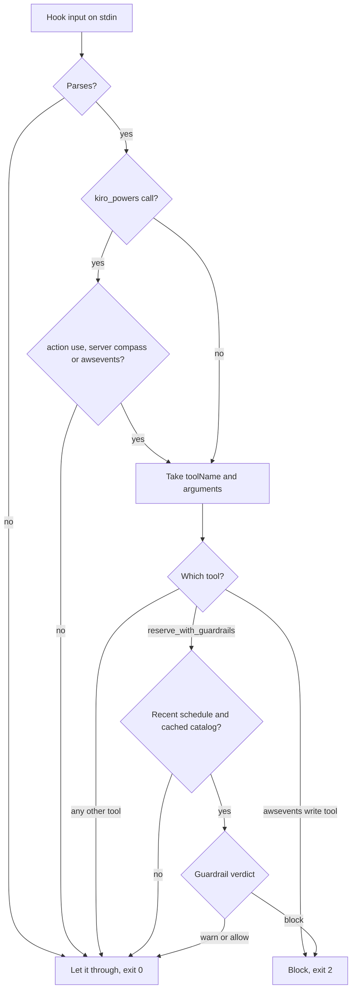

_For developers: the four Kiro steering files that every build session read, the hook used while building this repository, and the two hooks the Compass Power can install for attendees, including why they work the way they do._

[Kiro](Glossary#kiro) has two ways to shape what its agent does without repeating it in every prompt. [Steering](Glossary#steering) files are standing instructions that load into a session. [Kiro hooks](Glossary#kiro-hook) run an action when something happens in the IDE, such as a file save or a tool call. re:Invent Compass uses both: steering and one hook to build the repository, and two hooks that attendees can install to add an early check before a booking.

## Steering: the rules every session reads

The steering files live in [.kiro/steering](https://github.com/henniefrancis/aws-re_invent-compass/tree/develop/.kiro/steering). Each one starts with this front matter:

```yaml
---
inclusion: always
---
```

`inclusion: always` tells Kiro to load the file into every session in the workspace, so every spec, task and chat starts from the same product rules, stack, layout and working rules. The spec prompts did not need to repeat any of it. product.md and tech.md also pull in the approved build plan with Kiro's `#[[file:...]]` file reference (product.md pulls in the concept too), and say that the build plan wins when anything conflicts.

| File                                                                                                            | What it says                                                                                                                                                                                                                                                                                                                                                                                                                                                                                                                                                                      |
| --------------------------------------------------------------------------------------------------------------- | --------------------------------------------------------------------------------------------------------------------------------------------------------------------------------------------------------------------------------------------------------------------------------------------------------------------------------------------------------------------------------------------------------------------------------------------------------------------------------------------------------------------------------------------------------------------------------- |
| [product.md](https://github.com/henniefrancis/aws-re_invent-compass/blob/develop/.kiro/steering/product.md)     | Who Compass is for (first-time attendees first), the problem ([boarding closes](Glossary#boarding-closes) 10 minutes before the start), plan on a computer and board on any device, the airline metaphor for copy and code names, the core features, the product principles that must never break (the badge is the ticket, no impersonation of AWS, a human approves every write, local first, minimal expiring server data, trust the schedule read-back), the non-goals, and the voice rules, including no em dash or en dash anywhere.                                        |
| [tech.md](https://github.com/henniefrancis/aws-re_invent-compass/blob/develop/.kiro/steering/tech.md)           | The stack with pinned choices (TypeScript 6, Node.js 24, npm workspaces, ESLint and Prettier, vitest at 100% coverage, Playwright, Angular 22, the MCP SDK, zod, Terraform only), the [Events API](Glossary#events-api) facts and behaviour rules (paging, quotas, never re-send a reservation, confirm every write), the sign-in details, how to add the official `awsevents` server safely, the re:Invent rules Compass enforces, the [Compass API](Glossary#compass-api) design, Terraform and deploy rules, CI, what is public and what stays private, and the testing rules. |
| [structure.md](https://github.com/henniefrancis/aws-re_invent-compass/blob/develop/.kiro/steering/structure.md) | The folder tree with the one stream that owns each folder, and the naming conventions: kebab-case files, one Events API operation per file, zod schemas ending in `Schema`, airline names for domain types, snake_case MCP tools, imports only through declared package exports, tests mirroring the source, and Conventional Commits with the spec as scope.                                                                                                                                                                                                                     |
| [workflow.md](https://github.com/henniefrancis/aws-re_invent-compass/blob/develop/.kiro/steering/workflow.md)   | How parallel builders avoid collisions: one git worktree and one `feature/<spec>` branch per session, strict file ownership, only the integrator changes the lockfile, frozen contracts, mocks for unmerged streams, commit locally and never push (the owner approves every push), the definition of done with the QA and security review gate, and the safety rules (no live API calls in tests, no secrets, no deploys).                                                                                                                                                       |

The rule that a decision which changes steering also updates the steering file in the same change kept these files current through the build. For example, the Kiro hook spike of 18 October changed both tech.md and structure.md. [How it was built](How-It-Was-Built) shows how the steering, the specs and the review gates fit together.

## The repository's own build hook

One hook helped while building Compass:
[.kiro/hooks/save-typescript-check.kiro.hook](https://github.com/henniefrancis/aws-re_invent-compass/blob/develop/.kiro/hooks/save-typescript-check.kiro.hook).

| Part   | Value                                                                                                                                                                                                                                                                                               |
| ------ | --------------------------------------------------------------------------------------------------------------------------------------------------------------------------------------------------------------------------------------------------------------------------------------------------- |
| When   | A file matching `**/*.ts` or `**/*.tsx` is saved (`fileEdited`).                                                                                                                                                                                                                                    |
| Then   | Ask the agent (`askAgent`) to run three checks and report failures briefly.                                                                                                                                                                                                                         |
| Checks | ESLint on the saved file; the vitest tests of the workspace package that owns the file (or the full suite when the path matches no package); the dash check ([.github/scripts/dash-check.mjs](https://github.com/henniefrancis/aws-re_invent-compass/blob/develop/.github/scripts/dash-check.mjs)). |
| Limits | The agent edits no files; it only runs the checks and summarises.                                                                                                                                                                                                                                   |

It is a convenience for builders. The CI check on every pull request is the real gate (see [Quality gate](Quality-Gate)).

## The attendee hooks the Power installs

The [Kiro Power](Glossary#kiro-power) ships a hook template, [power/hook-templates/reinvent-compass.json](https://github.com/henniefrancis/aws-re_invent-compass/blob/develop/power/hook-templates/reinvent-compass.json), with two `PreToolUse` hooks. A `PreToolUse` hook runs before the agent calls a tool and can stop the call. Both hooks run the same command, with a 30 second limit:

```sh
npx --yes reinvent-compass@0.1.3 hook pre-write-guardrail
```

| Hook                                      | Matcher                                                                                                                                         | What it does                                                                                                                  |
| ----------------------------------------- | ----------------------------------------------------------------------------------------------------------------------------------------------- | ----------------------------------------------------------------------------------------------------------------------------- |
| `reinvent-compass-pre-write-guardrail`    | `kiro_powers`                                                                                                                                   | Checks a Compass booking with the [guardrail](Glossary#guardrail) before it runs, and blocks it when the guardrail blocks it. |
| `reinvent-compass-block-awsevents-writes` | `.*(reservesessions\|cancelreservation\|associatefavorites\|disassociatefavorite\|createpersonaltime\|updatepersonaltime\|deletepersonaltime)$` | Blocks the seven write tools of the official `awsevents` MCP server, so every booking goes through Compass.                   |

### Why the matchers look like this

The Kiro hook spike of 18 October (Kiro IDE 1.3.11) showed how Kiro really names tools in a hook:

- **A Power's tools all arrive as one built-in tool, `kiro_powers`.** The real tool is inside the input: `tool_input.action` is `use`, `tool_input.serverName` is the server, `tool_input.toolName` is the tool and `tool_input.arguments` are its arguments. A matcher on the Compass tool name never fires, so the first hook matches `kiro_powers` and the hook command unwraps the call itself.
- **Tools of a server configured in the workspace arrive lower-cased,** with every character that is not a letter or digit turned into an underscore, for example `mcp_awsevents_awseventspublicapi_mcp_prod___reservesessions`. Kiro matches a regular expression case-sensitively against that lower-cased id, so the second hook's pattern is lower case. It matches on the end of the id, so it works whatever name the attendee gave the server.
- **Only exit code 2 blocks.** Exit 2 stops the call and the agent receives the hook's error output. Exit 1 does not block.

### How the guardrail hook decides

The hook code is in [packages/mcp-server/src/hooks](https://github.com/henniefrancis/aws-re_invent-compass/tree/develop/packages/mcp-server/src/hooks).



1. It reads at most 1 MiB from stdin for at most 5 seconds ([read-stdin.ts](https://github.com/henniefrancis/aws-re_invent-compass/blob/develop/packages/mcp-server/src/hooks/read-stdin.ts)).
2. For a `kiro_powers` call it acts only when the action is `use` and the server is Compass or `awsevents`, including the name Kiro gives a folder import, such as `power-power-compass`. Activation calls and other Powers pass. It never reads `powerName`, because that is the import folder's name ([hook-input.ts](https://github.com/henniefrancis/aws-re_invent-compass/blob/develop/packages/mcp-server/src/hooks/hook-input.ts)).
3. It identifies the tool by its name, ignoring case and any server prefix ([tool-names.ts](https://github.com/henniefrancis/aws-re_invent-compass/blob/develop/packages/mcp-server/src/hooks/tool-names.ts)).
4. An `awsevents` write tool is blocked with exit 2 and the reason "Compass blocks this call. Use reserve_with_guardrails (or the matching Compass tool) so your booking is checked first."
5. For `reserve_with_guardrails` it takes the 1 to 10 session ids or codes, the schedule Compass last read (only if it is under 15 minutes old) and the cached catalog, and runs the same guardrail the server runs. A block exits 2 with the reasons. A warning or an allow exits 0 ([pre-write-guardrail.ts](https://github.com/henniefrancis/aws-re_invent-compass/blob/develop/packages/mcp-server/src/hooks/pre-write-guardrail.ts)).
6. Every other Compass tool passes.
7. If it cannot judge a call (bad input, an unknown tool, no recent schedule, no catalog, unknown sessions, any error), it lets the call through, because the server checks it again. This is called failing open.

The `hook` command exits only with 0 or 2 ([exit-policy.ts](https://github.com/henniefrancis/aws-re_invent-compass/blob/develop/packages/mcp-server/src/hooks/exit-policy.ts)), reads its input only from stdin, puts no input value on a command line, and starts no shell or other program ([run-cli.ts](https://github.com/henniefrancis/aws-re_invent-compass/blob/develop/packages/mcp-server/src/cli/run-cli.ts)). The hook code itself makes no network call and writes nothing: it reads the schedule snapshot and the cached catalog from the same local folders the server uses.

## Why there is no PostToolUse hook

The first design had a third hook: a `PostToolUse` hook that ran after a booking and reminded the agent to run `sync_passes`. The Kiro hook spike removed it, for two reasons:

- **Text from a hook that exits 0 never reaches the agent.** Neither its standard output nor its error output. A reminder or a warning from a hook is therefore lost.
- **A `PostToolUse` hook cannot block.** The call has already run and its result has reached the agent.

So the template has no `PostToolUse` hook, and no hook carries warnings or reminders. The reminder now comes from the Compass tool results themselves: for example, cancelling a session that has a [boarding pass](Glossary#boarding-pass) tells the agent to run `sync_passes` to [void](Glossary#void) it. The CLI still accepts `hook post-write-sync`, but the template never calls it.

## How the hooks get installed

**A Power cannot ship hooks.** In the spike, a hook file inside a Power never ran, even after Kiro copied it into the installed Power. So the Power carries the hooks as a template, and its `install-hooks` skill ([power/skills/install-hooks/SKILL.md](https://github.com/henniefrancis/aws-re_invent-compass/blob/develop/power/skills/install-hooks/SKILL.md)) copies them into the attendee's workspace after asking:

1. The agent tells the attendee what the two hooks do.
2. It shows the template.
3. It asks whether it may write `.kiro/hooks/reinvent-compass.json` in the current workspace, and writes nothing until the attendee says yes.
4. After a yes it writes that one file. It never edits another hook file, and never overwrites an existing `reinvent-compass.json` without showing the difference first.
5. It tells the attendee to reload the window, and that deleting the file removes the hooks.

The template pins the same version as the server in the Power's [power/mcp.json](https://github.com/henniefrancis/aws-re_invent-compass/blob/develop/power/mcp.json).

## Hooks are defence in depth

The hooks are an extra, early check. They are not the control:

- **The server checks every booking again.** `reserve_with_guardrails` runs the guardrail inside the Compass [MCP server](Glossary#mcp-server) before anything is sent, in every [MCP client](Glossary#mcp-client), with or without hooks. Hooks run only in Kiro.
- **A human approves every write.** Write tools are never auto-approved.
- **Read-only by default.** In live mode Compass sends no write to the Events API unless the attendee sets `COMPASS_ALLOW_WRITES=1` (see [Read-only by default](Read-Only-By-Default)).
- **The official server stays read-only.** An attendee who also wants the official `awsevents` server adds it to the workspace `.kiro/settings/mcp.json`, not to the Power, because Kiro does not honour `disabledTools` inside a Power. The seven write tools go in `disabledTools` by their full names, each starting `AWSEventsPublicApi-Mcp-prod___` (ReserveSessions, CancelReservation, AssociateFavorites, DisassociateFavorite, CreatePersonalTime, UpdatePersonalTime, DeletePersonalTime). A bare name hides nothing. The second hook is the backup if that list is wrong.

Kiro starts no MCP server, and so no Compass tool, until Settings, "Kiro Agent: Configure MCP", is set to Enabled.

## Related pages

- [Kiro Power](Kiro-Power)
- [Guardrail rules](Guardrail-Rules)
- [How it was built](How-It-Was-Built)
- [Decisions: delivery and tooling](Decisions-Delivery-and-Tooling)
- [Security](Security)
