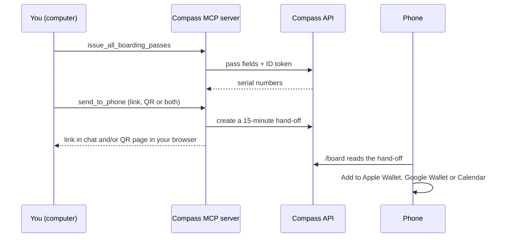

_For attendees: how to issue your unofficial boarding passes, what each pass shows, and how to move them to your phone._

Board is the second of the three acts ([Plan](User-Guide-Plan), Board, [Fly](User-Guide-Fly)). You issue passes on your computer, then a short-lived link or QR code moves them to your phone.

**The badge is the ticket.** Every pass is unofficial. It carries no barcode and cannot get you into a session. Your re:Invent badge is your ticket. See the [Disclaimer](Disclaimer).



## Issue your passes

You can issue passes only for sessions your schedule lists as reserved. Compass reads your schedule fresh, then refreshes each session from the [Events API](Glossary#events-api) so the pass carries the current times and room.

- **All of them.** `issue_all_boarding_passes` takes no input and issues a pass for every reserved session. Approving that one call in your client is the only confirmation.
- **One of them.** `issue_boarding_pass` takes a session id or code. Without one, it asks which reserved session (a client that cannot ask gets a reply asking you to name one).
- **Nothing reserved.** The reply says so and nothing is issued.

Each pass is issued for both Apple Wallet and Google Wallet. Passes work in read-only mode too, because they live on the [Compass API](Glossary#compass-api), not in your re:Invent schedule (see [Read-only by default](Read-Only-By-Default)).

The Compass API caps each attendee at 80 live passes, 60 pass writes an hour and 10 hand-offs an hour ([packages/pass-service/src/data/rate-limiter.ts](https://github.com/henniefrancis/aws-re_invent-compass/blob/develop/packages/pass-service/src/data/rate-limiter.ts)).

## What a pass shows

The layout is the same on every pass. Labels below are the exact labels on the Apple pass ([packages/pass-service/src/apple/pass-template.ts](https://github.com/henniefrancis/aws-re_invent-compass/blob/develop/packages/pass-service/src/apple/pass-template.ts)).

### The front

| Row    | Label             | Value                                                                                         | Example                                                       |
| ------ | ----------------- | --------------------------------------------------------------------------------------------- | ------------------------------------------------------------- |
| Top    | `SESSION`         | The [session code](Glossary#session-code), next to the logo                                   | `INV530-R1`                                                   |
| Main   | `FLIGHT NAME`     | The session title (the [flight name](Glossary#flight-name))                                   | `EC2 at 20: Rebuilding the control plane while it is running` |
| Middle | `TERMINAL`        | The [venue](Glossary#venue) (the [terminal](Glossary#terminal)), or "Venue not published"     | `MGM Grand`                                                   |
|        | (arrow)           | A right arrow between terminal and gate                                                       | `→`                                                           |
|        | `GATE`            | The room (the [gate](Glossary#gate)): the part after the first comma, or "Room not published" | `Academy 409` from "Level 1, Academy 409"                     |
| Bottom | `DATE`            | Date, then start and end on a 24-hour clock, in the event time zone                           | `30 Nov 2026 \| 11:30-12:30`                                  |
|        | `BOARDING CLOSES` | 10 minutes before the start ([boarding closes](Glossary#boarding-closes))                     | `11:20`                                                       |

FLIGHT NAME sits above TERMINAL and GATE. The pass is black with white values and orange labels, and the issuer shown in Wallet is "re:Invent Compass". All your session passes stack as one group in Wallet.

### The back

In this order, with a row left out when there is no data for it:

| Label                  | Text                                                                                                                                                                                                                                            |
| ---------------------- | ----------------------------------------------------------------------------------------------------------------------------------------------------------------------------------------------------------------------------------------------- |
| `ABOUT`                | "re:Invent Compass is an independent community project, not affiliated with AWS or AWS re:Invent. It is an entry in the re:Invent Catalog API Builder Challenge."                                                                               |
| `UNOFFICIAL PASS`      | "This is not a ticket. Your re:Invent badge is your official ticket. Bring it to every session."                                                                                                                                                |
| `BOARDING CLOSES`      | "Your reserved seat is held until 10 minutes before the session starts. After that, it can go to the walk-up line."                                                                                                                             |
| `ROOM`                 | The full room text, for example "Level 1, Academy 409".                                                                                                                                                                                         |
| `WALK FROM PREVIOUS`   | For example "30 min from Caesars Forum", when there is a session or layover before it within 12 hours.                                                                                                                                          |
| `NEXT SESSION`         | For example "DAT302 at Thu 13:05, The Venetian, 30 min walk", when there is a next reserved session within 12 hours.                                                                                                                            |
| `NAME`                 | Only when a name is supplied. The Compass tools in version 0.1.3 do not supply one.                                                                                                                                                             |
| `TIMES`                | For example "All times are Pacific Time."                                                                                                                                                                                                       |
| `IF YOUR PLANS CHANGE` | "By default, Compass never changes your schedule: make changes in the official re:Invent app. If you turn on write mode, Compass changes it only after you approve each change. If you cancel a session, this pass is voided at the next sync." |
| `PRIVACY`              | "This pass holds only session details. Remove it from Wallet at any time. To delete everything Compass keeps, ask Compass to forget you."                                                                                                       |

The fixed texts are in [packages/pass-service/src/apple/pass-texts.ts](https://github.com/henniefrancis/aws-re_invent-compass/blob/develop/packages/pass-service/src/apple/pass-texts.ts).

Wallet shows the pass on your lock screen from 40 minutes before the start (30 minutes before boarding closes) until the end. Sharing the pass from Wallet is switched off.

### Google Wallet

The Google pass has the same content ([packages/pass-service/src/google/google-object.ts](https://github.com/henniefrancis/aws-re_invent-compass/blob/develop/packages/pass-service/src/google/google-object.ts)). The card title is "Compass boarding pass", the header is the session title and the subheader the session code. The front rows are TERMINAL and GATE, then DATE and BOARDING CLOSES. The details follow: ROOM first, then the same back texts, except NAME, because Google keeps the pass on its own servers.

## Send the passes to your phone

`send_to_phone` makes a 15-minute [hand-off](Glossary#hand-off) for your issued passes (all of them, or the sessions you name). It first needs to know how to show it:

| `show` | What you get                                                                                                          |
| ------ | --------------------------------------------------------------------------------------------------------------------- |
| `link` | A link in the chat. Open it on your phone.                                                                            |
| `qr`   | A QR code on a page that opens in your browser on this computer. Scan it with your phone camera. No link in the chat. |
| `both` | The link in the chat and the QR page.                                                                                 |

Without `show`, Compass creates nothing and asks ("Link or QR code?"). Where your client can ask, you then confirm: "Create a 15-minute link that puts N Boarding Passes (codes) on your phone ... ? This creates a real link."

- **The QR page** is a static file in a new private folder in your temp folder, with no script and nothing loaded from outside. It shows "This link has expired. Ask Compass for a new link or QR code." once the 15 minutes are up. Compass deletes it at the expiry, when it shows a newer one, on `forget_me` and when the server stops.
- **If the browser cannot open,** the QR code comes back in the chat instead, as text and as an image.
- **Do not share the link or QR code.** Anyone who has it can see these passes until it expires.

## The /board page

The link opens `https://reinvent-compass.vegas/board#h=<id>` on your phone.

- **The id sits in the URL fragment** (after `#`). A browser never sends the fragment to the server, so it never reaches the CDN. The page takes it before anything else runs, removes it from the address bar, and keeps it in the page's memory only. A reload shows "This link is not complete" by design ([site/src/lib/board](https://github.com/henniefrancis/aws-re_invent-compass/tree/develop/site/src/lib/board)).
- **It works for 15 minutes.** The page says "This link works for about N more minutes". After that it shows "This link has expired" and asks you to create a new one on your computer.
- **Your sessions** are listed with code, title, day and start time.

### The buttons

| Your hand-off has | At the top                                                                                     | On each session                           |
| ----------------- | ---------------------------------------------------------------------------------------------- | ----------------------------------------- |
| 1 to 8 passes     | **Add to Apple Wallet** (one bundle), **Add to Google Wallet** (one link), **Add to Calendar** | nothing                                   |
| 9 to 80 passes    | **Add to Calendar**                                                                            | Add to Apple Wallet, Add to Google Wallet |

Apple accepts up to 10 passes in one bundle, and the Compass API splits Apple bundles at 10. One Google save link holds at most 8 passes, so the top buttons are shown only up to 8 ([packages/pass-service/src/services/handoff-service.ts](https://github.com/henniefrancis/aws-re_invent-compass/blob/develop/packages/pass-service/src/services/handoff-service.ts)).

The page shows only the wallet your phone uses: Apple Wallet on an iPhone, Google Wallet on an Android phone. A computer, an iPad, an Android tablet or anything else shows both, so a wallet is never hidden on a guess. The check runs on the phone and sends nothing ([site/src/lib/board/device.ts](https://github.com/henniefrancis/aws-re_invent-compass/blob/develop/site/src/lib/board/device.ts)).

### iPad and the calendar file

iPad has no Wallet app, so use **Add to Calendar**. It downloads an `.ics` file with one event per pass: the title is the code and session title, the location is the venue and room, and each event has one alarm at boarding closes, 10 minutes before the start ([packages/pass-service/src/calendar/calendar-builder.ts](https://github.com/henniefrancis/aws-re_invent-compass/blob/develop/packages/pass-service/src/calendar/calendar-builder.ts)). Times are in UTC, so the file is correct on every device.

For a calendar with walking alarms too, run `export_calendar` on your computer (see [Fly](User-Guide-Fly#the-calendar-file)).

### Walk from here

The next session on the list (the one that starts soonest) has a **Walk from here** button. Tap it and the page:

1. checks the session has a venue with a known map point (from [data/venues.json](https://github.com/henniefrancis/aws-re_invent-compass/blob/develop/data/venues.json));
2. asks your phone once for a rough location (no high accuracy, a 10 second limit);
3. works out the walk on the phone ([site/src/lib/board/walk-estimate.ts](https://github.com/henniefrancis/aws-re_invent-compass/blob/develop/site/src/lib/board/walk-estimate.ts)):

```text
walk minutes  = round up ( straight-line distance x 1.6 / 66.7 metres a minute ), at least 1
total minutes = walk minutes + 15 (to get into the venue and to the room)
```

It then shows "About N min walk." and "Leave by HH:MM." (the start time minus the total minutes), or "Leave now." when that time has passed. The factor 1.6 is Compass's own assumption: for the 15 venue pairs in the venue data, the walking route is 1.33 to 2.99 times the straight line, with a median of 1.66. The pace of 66.7 metres a minute is the same as the venue walking times. More than 20 km from the venue, it gives no estimate.

A **Directions** link opens Apple Maps on an iPhone, or Google Maps elsewhere. That app gets your location only when you open the link.

**Your location stays on your phone.** Compass does not send it anywhere, save it or log it. Your phone may use its own location service to find it. See [Privacy](Privacy#walk-from-here).

## Related pages

- [Plan: from your code to a week](User-Guide-Plan)
- [Fly: keeping passes in step](User-Guide-Fly)
- [Guardrail rules](Guardrail-Rules)
- [Privacy](Privacy)
- [Pass API](Pass-API)
