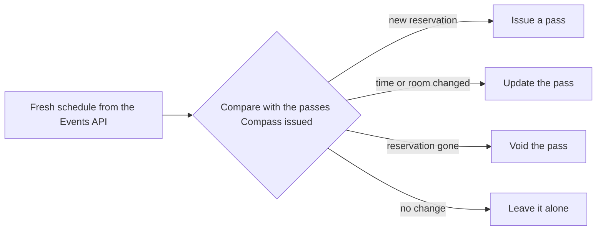

# User guide: Fly

_For attendees: how Compass keeps your passes in step with your real schedule during the week, and how to see your week at a glance._

Fly is the third of the three acts ([Plan](User-Guide-Plan), [Board](User-Guide-Board), Fly). Your real re:Invent schedule is the source of truth. Compass compares it with the passes it issued and makes the passes match: it issues new ones, updates changed ones and [voids](Glossary#void) cancelled ones.

## Sync your passes

`sync_passes` makes your passes match your schedule. It is a write tool, because it can void passes, so approve each call yourself.

How it works ([packages/mcp-server/src/tools/sync-passes.ts](https://github.com/henniefrancis/aws-re_invent-compass/blob/develop/packages/mcp-server/src/tools/sync-passes.ts) and [packages/core/src/passes/pass-sync.ts](https://github.com/henniefrancis/aws-re_invent-compass/blob/develop/packages/core/src/passes/pass-sync.ts)):

- It reads your schedule fresh and compares it, by [session code](Glossary#session-code), with the record of passes on your machine. Each session falls into one of four cases: added, changed, cancelled or unchanged.
- Where your client can ask, it lists every issue, update and void by code and title and asks you first.
- Voiding every pass, or more than five in one run, needs that explicit confirmation. A client that cannot ask is refused.
- Every pass the run needs is built before the first call to the [Compass API](Glossary#compass-api). If one cannot be built, the sync stops with nothing changed, rather than void a pass for a session you still hold.
- If your schedule holds a session the cached catalog does not know, the sync refuses and asks you to run `refresh_catalog`.
- `sessionIds` narrows a sync to some sessions; the others are not touched.

**When to run it.** After any change to your schedule. When you cancel through Compass, the reply says "You have a Boarding Pass for this session. Run sync_passes to void it." If you change your schedule in the re:Invent app, run `sync_passes` afterwards.

## Void on cancel

When a reservation is gone from your schedule, `sync_passes` voids its pass:

- **Apple Wallet.** The Compass API marks the pass voided, sets its expiry to the moment of the void, and sends an empty push through [APNs](Glossary#apns) to each phone that holds the pass. The phone fetches the new version, and Wallet moves it to your expired passes.
- **Google Wallet.** The Compass API sets the pass object to `INACTIVE`.

No wallet lets anyone delete a pass from your phone remotely, so Compass never claims to. The reply says: "A voided pass moves to your wallet's expired passes. Compass cannot delete it from your phone." Remove it from Wallet yourself whenever you like.

## Expire at session end

Every pass expires when its session ends: the Apple pass's expiry date and the Google pass's valid time both end at the session's end time. The Compass API keeps the pass record until the session ends plus 24 hours, then treats it as gone (see [Privacy](Privacy)).

## Updates when a session changes

If a session moves to another time or room, `sync_passes` updates its pass and your phone shows the change:

| Wallet | What you see                                                                                                                                              |
| ------ | --------------------------------------------------------------------------------------------------------------------------------------------------------- |
| Apple  | A Wallet notification for the field that changed: "Terminal changed to ...", "Gate changed to ...", "Time changed to ..." or "Boarding now closes at ..." |
| Google | A message such as "INV530-R1 changed", with "Now at MGM Grand, Room 350." for a new place and "Now 30 Nov 2026 \| 11:30-12:30." for a new time            |

The Compass API pushes at most 20 updates per pass and 120 per attendee in an hour. Past that, the update is still stored, and the Compass API serves the new version the next time your phone asks for the pass, but no push is sent. A void is always pushed.

## See your schedule

`show_schedule` reads your live schedule and lists, in start order:

- your reserved sessions, with id, code, title, venue, room and times;
- your [standby](Glossary#standby) list (favourites that are not also reserved);
- your [layovers](Glossary#layover), with the `personalTimeId` you need to change or delete one.

It starts with a count, for example "Your schedule has 6 reserved sessions, 2 on your standby list and 3 layovers." The Events API keeps a reserved session in your favourites too; Compass lists it once, under reserved. Sessions your cached catalog does not know are listed by id, with a hint to run `refresh_catalog`. It writes nothing ([packages/mcp-server/src/tools/show-schedule.ts](https://github.com/henniefrancis/aws-re_invent-compass/blob/develop/packages/mcp-server/src/tools/show-schedule.ts)).

## Your week at a glance

There are three views of the same week:

| Where                           | What it shows                                                                                                                                                                                                                                       |
| ------------------------------- | --------------------------------------------------------------------------------------------------------------------------------------------------------------------------------------------------------------------------------------------------- |
| `design.md` in your week spec   | One section per day: each session with its gate, times, boarding closes, the connection from the session before, layovers and the day's [energy](Glossary#energy-budget) score. Written by `plan_week` (see [Plan](User-Guide-Plan#the-week-spec)). |
| The `/board` page on your phone | Your passes, with the next session marked and a **Walk from here** estimate (see [Board](User-Guide-Board#walk-from-here)).                                                                                                                         |
| Your calendar                   | The `.ics` file from `export_calendar`, below, or **Add to Calendar** on the board page.                                                                                                                                                            |

The week spec is a plan: it is written once and is not updated when your schedule changes. `show_schedule` is always the live view.

## The calendar file

`export_calendar` writes an `.ics` file of your schedule (or of the commitments you give it) and returns its text. Nothing is booked or changed ([packages/core/src/passes/ics-exporter.ts](https://github.com/henniefrancis/aws-re_invent-compass/blob/develop/packages/core/src/passes/ics-exporter.ts)).

- One event per reserved session and per layover. Times are in UTC, so the file is correct on every device; the calendar description names the event time zone.
- Each reserved session has a **Boarding closes** alarm 10 minutes before the start.
- When Compass knows the walk from the commitment before it (within 12 hours), there is also a **Leave now** alarm, 10 minutes plus the walk before the start. Without a known walk, there is no Leave now alarm.
- Each event keeps a stable id, so importing a newer file updates your events instead of duplicating them.
- A copy is saved as `reinvent.ics` in the `output` folder of your Compass app-data folder, readable only by you.

The calendar file from the board page is simpler: one alarm per session, at boarding closes.

## Leaving

- `forget_me` voids every pass, deletes your pass data on the server and deletes your local Compass data. See [Privacy](Privacy#forget-me).
- `sign_out` revokes your sign-in and clears the stored tokens.

## Related pages

- [Board: passes on your phone](User-Guide-Board)
- [Plan: from your code to a week](User-Guide-Plan)
- [Privacy](Privacy)
- [MCP tools](MCP-Tools)
- [FAQ](FAQ)
