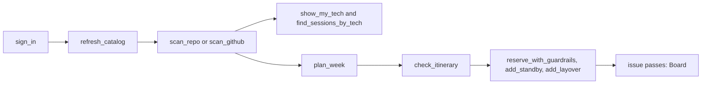

# User guide: Plan

_For attendees: how Compass learns your tech, plans your week as a Kiro spec, and books it safely on your computer._

Plan is the first of the three acts (Plan, [Board](User-Guide-Board), [Fly](User-Guide-Fly)). It happens on your computer, in Kiro or another [MCP client](Glossary#mcp-client), because the [AWS Builder ID](Glossary#aws-builder-id) sign-in returns to your own machine. You talk to your assistant; it calls the Compass tools. Every tool is listed on [MCP tools](MCP-Tools).

The `plan-my-week` skill in the [Kiro Power](Glossary#kiro-power) ([power/skills/plan-my-week/SKILL.md](https://github.com/henniefrancis/aws-re_invent-compass/blob/develop/power/skills/plan-my-week/SKILL.md)) tells the agent to follow this order and to ask you before every write.

## Load the catalog

After `sign_in` (see [Getting started](Getting-Started#live-sign-in)), run `refresh_catalog`. It reads every page of the session list from the [Events API](Glossary#events-api) into a private cache on your machine. The Events API has no search parameter, so `find_sessions`, the planner and the [guardrail](Glossary#guardrail) all filter this local copy. `find_sessions` takes a text query and filters for services, level, type and day.

## Scan your code

Compass learns what you work on from your own code. Nothing it reads leaves your machine: only service and technology names, a depth per service and counts come out of the scanner, never a file name, path or file content.

### A folder or a dev folder

`scan_repo` reads a folder, read-only.

- **The workspace.** A folder inside the one Compass was started in is scanned freely. For any other folder, Compass asks you to confirm first, and a client that cannot ask cannot scan it.
- **A dev folder.** If the folder is not itself a git repository but holds git repositories one or two levels down, each repository is scanned on its own, in name order, up to 50 ([packages/mcp-server/src/tools/scan-projects.ts](https://github.com/henniefrancis/aws-re_invent-compass/blob/develop/packages/mcp-server/src/tools/scan-projects.ts)). No new repository is started after two minutes. The reply says how many were scanned and skipped.
- **What it detects.** AWS services from Terraform, CDK (TypeScript), the AWS SDK for JavaScript v3, boto3 (Python), the AWS SDK for .NET (`AWSSDK.*` packages and `new Amazon<Name>Client(` in C#) and package manifests. It also detects other technology, such as .NET, C#, Node.js, TypeScript, Python, Java, Go, React, Angular, Docker, Kubernetes and Terraform.

Each AWS service gets a depth, and a depth suggests a session level:

| Depth        | Means                                                                                               | Suggested level              |
| ------------ | --------------------------------------------------------------------------------------------------- | ---------------------------- |
| `exploring`  | Only imports or declared dependencies                                                               | 100 (200 with more evidence) |
| `building`   | Any real resource, construct, client or command                                                     | 300                          |
| `production` | Building, with both infrastructure and code usage, and a score of 12 or more or a production marker | 400                          |

The score is 2 for each resource, construct or client, plus 1 for each command, import or dependency.

### GitHub, read-only

If you want your GitHub repositories in the picture too:

1. `connect_github` shows a code and opens the GitHub page where you enter it. If you have not installed the Compass [GitHub App](Glossary#github-app), you install it there and choose which accounts, organisations and repositories it may read. An organisation's owner must approve it. The app has only **Contents: read** and **Metadata: read**, so it can never change your code.
2. `scan_github` lists the repositories it is about to read (50 by default, up to 200; forks are left out unless you ask) and **reads nothing until you confirm the list**. A client that cannot ask cannot run it. Each repository is downloaded as an archive into memory, scanned under a time and size limit, and dropped. Nothing is written to disk.
3. `disconnect_github` deletes the GitHub sign-in on this machine. To remove the app from GitHub too, uninstall it at `https://github.com/settings/installations` and revoke it at `https://github.com/settings/apps/authorizations`.

GitHub is not used in simulated mode.

## Your tech list

Every scan adds to one [tech list](Glossary#tech-list) on your machine: the AWS services you use, with depth, and the other technology you use.

- **"What tech do I work on?"** `show_my_tech` lists AWS services first, then other technology, ranked by the number of projects that use it and then by score. Ask "What do I use the most?" and it narrows the list with `top`.
- **"Find me sessions on .NET."** `find_sessions_by_tech` searches the cached catalog for one technology (20 sessions by default; it knows spellings such as "dotnet" and "C#"). With no technology, it searches your top five technologies and top five AWS services, five sessions each.

The list lives in your app-data folder with owner-only permissions. Each project is stored under a one-way hash, so no folder path or repository name is kept. It is never sent anywhere, and `forget_me` deletes it. See [Privacy](Privacy).

## Plan the week

`plan_week` suggests a week from your tech list, your goals and the sessions you already hold. It never books anything.

| Input       | Default | Limits                |
| ----------- | ------- | --------------------- |
| `goals`     | none    | up to 20 goals        |
| `level`     | none    | 100, 200, 300 or 400  |
| `maxPerDay` | 4       | 1 to 8 sessions a day |

**How sessions are ranked** ([packages/core/src/spec/planner.ts](https://github.com/henniefrancis/aws-re_invent-compass/blob/develop/packages/core/src/spec/planner.ts)):

- 3 x (depth + 1) for every AWS service of yours that the session covers;
- 2 when the session level matches your level (or the level your depth suggests);
- 2 x the number of your projects that use a technology the session matches, counting at most 3 projects;
- 1 for every word of three or more letters from your goals that appears in the title.

Only sessions that score above zero are suggested. Each one is checked against the guardrail: sessions it allows are picked first, in rank order. A session it only warns about is a last resort, and never when its walk would be impossible or unknown, its venue is missing, or it is full. A full session is never picked. The planner also adds a [standby](Glossary#standby) backup where it finds one, and a [layover](Glossary#layover) where a day needs a meal or rest break.

### The week spec

The plan is written as a [Kiro spec](Glossary#kiro-spec) in `.kiro/specs/my-reinvent-week/`, always under the folder Compass was started in:

| File              | What it holds                                                                                                                                                                                                                                                            |
| ----------------- | ------------------------------------------------------------------------------------------------------------------------------------------------------------------------------------------------------------------------------------------------------------------------ |
| `requirements.md` | The rules your week must meet: be at the gate before [boarding closes](Glossary#boarding-closes), keep a 30 minute meal layover between 11:30 and 14:00, prefer sessions on what your code uses, favour your goals.                                                      |
| `design.md`       | One section per day. Each pick has its title, type, level, gate, times, boarding closes, why it was picked, the connection from the session before, and whether to reserve or [walk up](Glossary#walk-up). Then layovers and the day's [energy](Glossary#energy-budget). |
| `tasks.md`        | One checkbox per action you approve: reserve each session, add each standby, add each layover, then issue boarding passes.                                                                                                                                               |

Before writing, Compass names the folder and, where your client can ask, asks you to confirm it. It never overwrites a file. If a plan already exists, it writes `week-<date>.md` next to it and shows you what changed; if nothing changed, it writes nothing ([packages/core/src/spec/write.ts](https://github.com/henniefrancis/aws-re_invent-compass/blob/develop/packages/core/src/spec/write.ts)).

**Keep it out of a public repository.** A public week spec would publish where you will be and when. So Compass offers to add `.kiro/specs/my-reinvent-week/` to your `.gitignore`. It changes `.gitignore` only when you accept; otherwise it gives you the exact line to add yourself.

## Book it, behind the guardrail

The tasks in `tasks.md` are done one at a time, each with your approval. In live mode, Compass is [read-only by default](Read-Only-By-Default): until you turn writes on, these tools run every check and then tell you what they would have done, and you make the change in the re:Invent app.

### Check, then reserve

- `check_itinerary` runs the guardrail over sessions you propose and writes nothing.
- `reserve_with_guardrails` takes 1 to 10 session ids (codes such as `SVS339` work too). It reads your schedule fresh, then checks each session against your confirmed schedule plus the sessions before it in the same request.

The guardrail answers **allow**, **warn** or **block**, with one plain-English reason for each rule that applied. All the rules and numbers are on [Guardrail rules](Guardrail-Rules).

- **Block.** Nothing is sent. The reply gives the reasons, other showings of the session you could take, and, where one exists, a safe swap.
- **Warn or allow.** Where your client can ask, Compass shows a confirmation that lists each session code, title and id, then every warning, then "Go ahead?". Declining writes nothing.
- **After the write.** `ReserveSessions` is sent once and never resent. A session counts as reserved only when your schedule, read back, lists it. If the schedule cannot be read back, the reply says the booking is unconfirmed and asks you to check before trying again.
- **No reservation needed.** If a session is not reservable, nothing is sent: walk up early, or keep it as a favourite.

There is no background booking, no seat polling and no retry loop.

### The safe swap

When a session you want clashes with one you hold, and the one you hold has a [repeat](Glossary#repeat) (the same code with `-R`, `-R1`, `-R2` and so on), Compass can move you to the repeat without ever leaving you with neither seat. This is the [safe swap](Glossary#safe-swap):

1. Reserve the repeat first.
2. Read the schedule back and check that the repeat is held.
3. Only then cancel the original.
4. Reserve the session that clashed.

`cancel_reservation` on the original follows this rule. If the swap is not safe (the repeat clashes with something, is not confirmed on your schedule, or leaves a walk next to it that is certainly impossible), nothing is cancelled. Asking again gets a "Cancel anyway?" confirmation; a client that cannot ask never gets that override. The exact conditions are on [Guardrail rules](Guardrail-Rules#the-safe-swap).

### Standby

`add_standby` favourites 1 to 10 sessions as backups for full sessions. Standby is a backup, not a reservation: it does not hold a seat. `remove_standby` removes one. `show_schedule` lists your standby list with the ids these tools take.

### Layovers

A layover is personal time for a meal, water or rest. `add_layover` creates, updates or deletes one (`action` is `create`, `update` or `delete`; update and delete take the `personalTimeId` that `show_schedule` lists). Before anything is sent, Compass checks that both times carry an offset, the end is after the start, both fall inside the event window (from the start of the badge pickup day, the day before the event), and the layover ends on the day it starts. An overlap with a session is a warning, not a block. Each action asks you to confirm.

## Related pages

- [Guardrail rules](Guardrail-Rules)
- [Read-only by default](Read-Only-By-Default)
- [Board: passes on your phone](User-Guide-Board)
- [MCP tools](MCP-Tools)
- [Privacy](Privacy)
